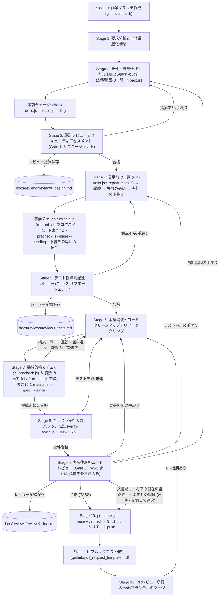
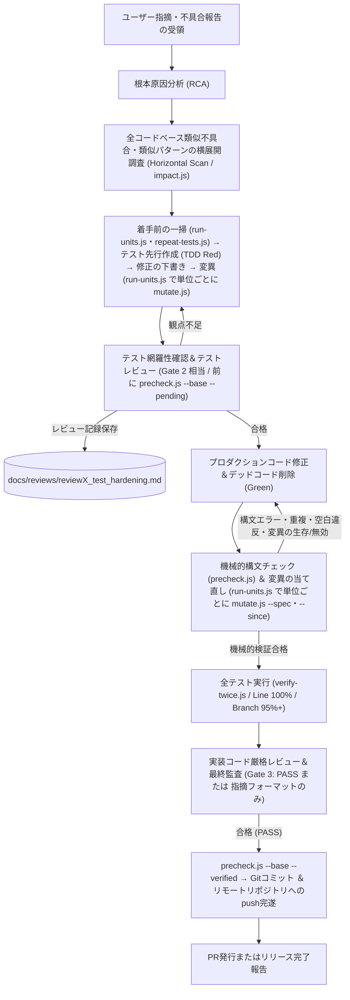

# kogaidocs 開発プロセス定義書 (Development Process Specification)

**文書バージョン**: 1.9.0 
**策定日**: 2026年10月17日 
**改訂日**: 2026年11月28日 (v1.9.0: 単位ごとの実行と記録の仕組み（`run-units.js`・`trace-reads.js`）を tests/scripts に追加し、Stage 4 に開発用のスクリプトの試験の Windows の扱いの基準を追加。v1.8.0: 監査前の機械的チェック（tests/scripts）、影響範囲の一覧、変異の当て込みと Gate 3 の前の当て直し、試験ごとの所要時間の上限、差分だけの再審査、変更外の指摘の扱いと残件台帳、検証の頻度を追加。v1.7.0: 将来のコードの潜在の経路だけの指摘は反映して通過とする規則を追加。v1.6.0: 文書だけの指摘はゲートを止めずに並行して直す規則と、仕様の書き方を追加) 
**適用対象**: `kogaidocs` プロジェクトにおける全機能拡張・改修・不具合是正・品質保証活動

---

## 1. 開発プロセスの目的と基本原則

本開発プロセス定義書は、機微な児童・役員個人情報を取り扱う「完全ローカル・プライバシーファースト型」システムとしての高いセキュリティ・堅牢性・保守性を維持しつつ、ユーザー要求に迅速かつ安全に応えるための標準開発手順を定めるものである。

### 基本原則
1. **Holistic & Objective-Driven Design（全体最適・あるべき姿の追求）**
	- 要求に対する場当たり的・局所的な継ぎ接ぎ修正を厳禁とし、システム全体のアーキテクチャ・データフロー・ユーザー体験（UX）を見渡した全体最適設計を行う。
2. **Defense-in-Depth Security First（多層防御の徹底）**
	- どんな機能改修であっても、ゼロトラスト・暗号化原則（AES-256-GCM, WebAuthn, メモリ限定鍵管理, 入力サニタイズ）を緩めてはならない。
3. **Multi-Stage Subagent Quality Gates & Code Reviews（多段階レビューゲートと実装コードレビュー）**
	- 設計フェーズ（Gate 1）、テストフェーズ（Gate 2）、実装後コードレビュー・総合監査フェーズ（Gate 3）の各段階において、独立したサブエージェントによる厳格なレビューゲートを通過することを必須とする。
4. **Mechanical Syntax Verification & Static Type Review（機械的構文チェックの義務化と静的型・参照の整合性の確認）**
	- 人手の目視確認に依存せず、機械的に構文チェック（`node -c`）および機械的に静的型・DOM整合性・スキーマチェックを実施し、文法・型・参照上の欠陥を完全にゼロとする。
	- 各ゲートへ出す前に、`tests/scripts/` の機械的チェック（4.6）を実行する。機械で見つけられる誤りを、ゲートの指摘で見つけさせない。
	- 例外: 静的型・参照の整合性（Stage 7 の 2.。存在しないプロパティ・必須プロパティの欠落・ID 体系・ドメイン値・DOM の ID）は、機械的に網羅できないため、試験（単体・実Chromium）と Gate 3 の重点検査項目（4.4）で確かめる。
5. **Tri-Tier Test Coverage: Normal, Boundary & Abnormal（正常系・境界値・異常系の全方位テスト実装義務）**
	- テストスイート（単体・結合・システム・ヘッドレスChrome UIテスト）においては、正常系（Happy Path）にとどまらず、境界値（Boundary Values）および異常系（Abnormal / Error / Injection / Validation Failure）のすべてを網羅して実装することを義務付ける。
6. **Headless Chrome Real-UI Testing（ヘッドレスChromeによるUI実体テストの必須化）**
	- モック環境のみの検証を排し、ヘッドレスChrome（Chromium）実ブラウザ環境下で、実DOM構造、CSSレイアウト、イベント発火、モーダル開閉、印刷プレビュー、Web Cryptography API連携を自動検証するUIテストをライフサイクルに組み込む。
7. **Zero Dead Code & High Test Coverage（不要コードの完全排除と高網羅率）**
	- 機能追加・改修によって生じた不要コードや旧互換コードを即時削除し、命令網羅（Line）100%、分岐網羅（Branch）95%以上を全モジュールで維持する。
8. **Commit & Remote Push Completion（コミット＆リモートpush完遂原則）**
	- すべてのプロセス完了時の作業完了定義（Definition of Done: DoD）はローカルコミットにとどまらず、必ずリモートリポジトリへのプッシュ（`git push`）までを完了要件とする。
9. **Branch & Pull Request-Driven Development（ブランチ・プルリク駆動開発の徹底）**
	- `main` ブランチへの直接コミットを原則禁止とし、必ず作業用ブランチ（`feature/*`, `fix/*`, `docs/*` 等）を切って作業を行い、所定のプルリクフォーマットに基づくPR発行・レビューを経てマージする（※ユーザー指示により直接main作業が承認された軽微なドキュメント修正等を除く）。
10. **Strict Rework & Retest Loop（手戻り発生時の全先行検証・レビュー再実行原則）**
	- 開発プロセスの途中でレビュー指摘（Gate 1〜3）やユーザー指摘による手戻りが発生した場合、局所的なパッチ修正を禁止する。修正内容が影響を及ぼす先行ステージ（設計改訂、設計レビュー、テスト実装、テスト網羅性レビュー等）まで必ず立ち戻り、先行する検証およびレビュー手続きを漏れなく再実行すること。ただし、指摘が文書の表現・記述の精度だけに関するもの（4.1 の 4.）は、ゲートを通過として並行して直す。将来のコードの潜在の経路だけの指摘（4.1 の 5.）は、検査に加えて反映し、再審査なしで通過とする。今回の変更で生じたものではない変更外の指摘（4.1 の 6.）は、残件台帳に記録して通過とする（配信側の事項は 4.7 のとおり台帳に載せず、設計書に範囲外・前提として書く）。
11. **Root-Cause Analysis, Horizontal Scan & Test-Driven Hardening（完了後不具合の横展開調査とテスト先行強化原則）**
	- プロセス完了後（または運用後）にユーザー指摘等で修正・不具合が発生した場合は、単一箇所の修正で終わらせず、システム全体における類似不具合・類似パターンの有無を網羅的に横展開調査すること。さらに、当該不具合および潜在的類似不具合を確実に検知できるようテストスイート（単体・結合・システム・UI実体テスト）を先行して拡充・修正し、テスト側の網羅性確認およびレビューを完了させてから本線修正・マージを行うこと。

---

## 2. 開発ライフサイクル・ステージ

### 2.1 標準機能開発ライフサイクル（機械的構文チェック・ヘッドレスUIテスト・pushを含む）

### 2.2 完了後・運用後ユーザー指摘対応サイクル（横展開・機械的構文チェック・pushを含む）

---

## 3. 各ステージの実施要領

### Stage 0: フィーチャーブランチの作成と命名規約
- `main` ブランチを最新状態に更新後、作業内容に応じたプレフィックスを付与したブランチを作成する。
- **ブランチ命名規約**:
	- `feature/<feature-name>`: 新機能開発、機能拡張
	- `fix/<bug-name>`: バグ修正、不具合対応
	- `docs/<doc-name>`: 設計書・ドキュメント・テンプレートの改訂
	- `refactor/<refactor-name>`: リファクタリング、コード整理
	- `test/<test-name>`: テストケースの追加・強化
- 例: `git checkout -b feature/headless-ui-tests`
- ※例外措置: ユーザーからの明示的な指示があり、ドキュメントの改訂や軽微な修正等である場合は、直接 `main` ブランチでの作業が認められる（ただし構文チェック・レビュー・push手順は省略不可）。

### Stage 1: 要求分析と全体最適化構想
- ユーザー要求の背景・意図（ユーザーが真に解決したい課題）を深く分析する。
- 局所的な対処（例：ただフラグを立てる、単なるボタン増設）を避け、UI階層、状態管理、暗号化基盤の観点から「システムのあるべき姿」を描く。
- セキュリティ影響度（新機能が暗号化や個人情報保護に及ぼすリスク）を事前評価する。
- 残件台帳（`docs/review_backlog.md`）の未対応の項目のうち、今回の変更の範囲に関わるものを確かめ、今回対応するか見送るかを決めて状態を更新する（4.7）。
- 比較元（今回の作業の着手前のコミット）を決め、記録に書く。以後の `--base` にはこれを使う。

### Stage 2: 要件・外部仕様・内部仕様の改訂
- 実装を開始する前に、`docs/requirements.md`、`docs/external_design.md`、`docs/internal_design.md` を最新化し、`docs/specification_traceability.md` に要件・仕様・実装・実アサーションと未検証境界を対応づける。`docs/system_design.md` は案内と旧章の移行先だけを保持する。
- 更新対象セクション：アーキテクチャ図、データモデル、シーケンス、UI/UX仕様、セキュリティ仕様、不要コード削除方針。
- 設計書のバージョンをインクリメントし、タブインデント規約（`\t`）を徹底する。
- **影響範囲の一覧（必須）**: 変更するデータ・規則・関数ごとに、それを読み書きする経路を全部挙げ、経路ごとに「変える／変えない」を決める。`node tests/scripts/impact.js --callers 3 <名前>...` で、出現（それを含む関数つき）と呼出元をたどった経路、書き換えの候補になる既存の試験の一覧を作り、漏れがないことを確かめる。
	- 一覧は設計書（内部仕様または追跡表）に表として置く。経路ごとに、旧版との差（同じ／意図して変える）を書く。
	- 理由: SPEC-Q では、出席の変更が座席の引継ぎに及ぶことを設計で挙げておらず、終盤（Gate 1 の差分22回目）に退行として見つかり、設計まで戻った。
- **検査の目的と対象外**: 字句の固定のような網羅しきれない検査を設けるときは、その検査が何を検出するためのものか、何を対象外とするか（難読化・別の防御で止まる経路など）を設計書に書き、ゲートの依頼文にも示す。
- ゲートへ出す前に `node tests/scripts/check-docs.js --base <比較元> --pending <この回の記録>` を実行し、問題が0件であることを確かめる（結果待ちのプレースホルダーは、その回の記録の中だけ許す）。比較元にもある問題は「変更外」として分けて出るので、残件台帳にない項目を台帳に記録する（4.7）。

### Stage 3: 設計レビュー＆セキュリティアセスメント（第1ゲート）
- 独立サブエージェント（QA & Security Lead）を召喚し、改訂された設計書を精査する。
- **レビュー観点**:
	1. ソフトウェア工学観点: 凝集度、結合度、拡張性、既存機能との整合性。
	2. セキュリティ観点: 脅威モデリング（STRIDE）、暗号鍵管理、認証バイパスの有無、XSS/データ漏洩耐性。
	3. **不足観点精査**: 不足する設計や考慮漏れ、エッジケースの未定義がないかの徹底チェック。
	4. **Mermaid構文チェック**: レビュー報告書内に Mermaid 図を含む場合は構文エラーチェックを必ず実施。
	5. **影響範囲の一覧の漏れ**: 1回目は、Stage 2 の影響範囲の一覧に挙がっていない経路がないかを主な観点とする。
- レビュー結果を評価レポートとして `docs/reviews/reviewX_design.md` に保存する。

### Stage 4: テスト設計と全方位テストスイート実装（TDD/テストファースト）
- **手順の順序**: (1) 着手前の不安定な試験の一掃 → (2) 試験の実装 → (3) 実装がない状態での確認 → (4) 実装の下書き（Stage 6 の先行） → (5) 下書きへの変異の当て込み → Gate 2。Gate 2 の審査対象は試験で、下書きは変異の当て込みの対象として示す（下書きは Gate 3 で審査する）。
	- (3) の確かめ方は、影響範囲の一覧（Stage 2）の経路の区分で分ける。
		- 「変える」経路の試験: 実装がない状態で失敗することを確かめる。
		- 「変えない」経路の試験（退行の試験。座席の引継ぎなど）: 比較元でも合格することを確かめる。
- **着手前の不安定な試験の一掃**: 次の試験を `node tests/scripts/repeat-tests.js --times 10 --coverage --load 2 <試験ファイル>...`（実Chromium の試験は `--times 3`）で繰り返し実行する。対象は、影響範囲の一覧の名前を含む試験と、実Chromium・時刻・待機に依存するすべての試験（`tests/system/headless-*.test.js`、自動ロック・タイマーの試験）とする。
	- 所要時間は、試験ごとに、その試験自身の上限の半分と比べる。上限は runner の `timeoutMs`（既定 20000ms）と node:test の `timeout` で、上限の表 `tests/scripts/stress/test-limits.json` に書く（試験名つきの規則、ファイルの規則、`*` を含む規則の順に優先する）。
	- 試験の上限を変えたとき・上限のある試験を足したときは、上限の表も直す。時間切れそのものを確かめる試験（runner の `timeoutMs: 1500` の試験など）は、表の `exempt` に理由を書いて比較から外す。
	- 表に漏れがないことは `tests/unit/dev-scripts-repeat-tests.test.js` で確かめる（すべての試験ファイル（開発用のスクリプトの試験を含む）の、runner の `timeoutMs: <数>` と、試験・suite（`describe`・`suite`）の宣言の引数の `timeout: <数>` ごとに、その試験に当たる規則が同じ上限か `exempt` であること、runner の既定の `timeoutMs` と `headless-*` の規則が同じであること、runner を読み込む試験ファイルに規則があること。宣言の引数でない `timeout` は、`mutate.js` の `runMutants`・`runTests` の引数だけを許し、それ以外（変数で渡す options など）は問題とする）。
	- 保存の完了を遅らせても合格することを、`node tests/scripts/mutate.js --spec tests/scripts/stress/save-delay.json` で確かめる（合格を期待する変異）。
	- 落ちた試験・上限の半分を超えた試験は、本題の前に別のコミットで直す。
	- 理由: SPEC-Q・R-25 の作業では、SEC-31・SEC-34・自動ロックの判定の不安定さ（負荷をかけたときだけ出るものを含む）と、上限 30000ms に対して約20秒かかる試験が、Gate 3 や Gate 2 の終盤で見つかり、そのたびに全体をやり直した。
- **単位ごとの実行と記録**: 着手前の一掃と変異の当て込みは、単位ごとに実行する。単位は、一掃では試験ファイル1つ、変異では変異の対象のファイル1つとその試験のファイルの組とする。変異の対象のファイルは、その作業で実装として変えたファイル（本番のファイル js・sw.js。開発用のスクリプトを作る作業では `tests/scripts/` の .js も）とする。
	- 実行は `node tests/scripts/run-units.js --units <単位の一覧> --records <記録の置き場所>`（4.6）で行う。単位の一覧と記録の置き場所は作業ツリーの外に置き、作業の間は同じ記録の置き場所を使い続ける（記録を使い回すため）。写しの根を写す最上位のスクリプト（`mutate.js`）が引数のほかに読むファイルは、一覧の `inputs` に書く（その読取りは入力にしない。4.6）。`--only` なしで実行し（記録を使い回す）、終了コード 0 か 1 で終わったときの記録の置き場所の `summary.md`（結果の表）を記録に貼る（信号・例外で止めた実行の表は、止めた単位の行を欠く）。
	- 単位ごとに、結果（終了コードと出力）、実行のしかた（実行のコマンドと引数、Node.js の版、実行の仕組みの SHA-256、実行の環境、起こしたプログラム。4.6 の `run-units.js` の (7)）、入力のファイルごとの SHA-256 を記録する。
	- 入力は、その単位の実行が読むすべてのファイルとする（対象のファイル、試験のファイル、試験が動かすコード、試験が読み取り・走査するファイル、実行に使うスクリプト `repeat-tests.js`・`mutate.js`、上限の表、変異の一覧と等価の一覧）。実行の間に読んだファイルを記録して求め、記録できないもの（ブラウザーが `file://` で読むアプリのファイルなど）は、その種類のファイルをすべて入力に含める。読むファイルが分からない単位は、写しの全体を入力とする。
	- 入力の SHA-256 は、実行した写しから求める。
	- 実行は作業ツリーを固めた写しの上で行い、その間も作業ツリーでの直しを続ける。写しには審査の記録（`docs/reviews/`・`docs/review_backlog.md`）を入れない（試験はこれを読まない。写しの全体を読む単位の入力が、結果を記録に書くたびに変わらないようにする）。
	- 直した後にやり直すのは、不合格の単位と、合格した後に入力か実行のしかたが変わった単位だけとする。記録した結果を使うのは、合格していて、実行のしかたが同じで、記録した入力のファイルがすべて同じで、今の単位の定義の決まった入力（対象・試験のファイル、実行に使うスクリプト、一覧など）がすべて記録の入力に含まれるときだけとする。
	- 試験は、単位ごとに実行できるよう、対象のファイルごとに試験のファイルを分ける（`tests/unit/dev-scripts-<スクリプト>.test.js` など）。
	- 開発用のスクリプト（`tests/scripts/`）の試験は POSIX（Linux・macOS）で実行するものとする。Windows では、シンボリックリンク・シグナル・プロセスグループ・`/proc`・Windows のファイル名に使えない文字に依る試験を、試験ごと除く（試験を部分に分けない）。理由: `run-units.js` の作業の Gate 2 で、Windows での除き方の指摘（除き漏れ・除きすぎ）が3回続いた。開発用のスクリプト自体がシンボリックリンク（写しの `node_modules`）・プロセスグループ・`/proc` を使い、ほかの開発用のスクリプトの試験も Windows を個別に扱っていない（利用者の決定。[review100](reviews/review100_unit_runner_tests.md)）。
	- 理由: 開発プロセス v1.8.0 の作業では、一掃と変異を全部1本で順に実行していたため、実行の間は作業ツリーを変えられず、1つの単位が失敗しても全部をやり直していた。
- 単体テスト（`tests/unit/`）、結合テスト（`tests/integration/`）、システムテスト（`tests/system/`）、およびヘッドレスChrome UIテスト（`tests/system/headless-chrome.test.js`）を実装する。
- **試験の仕組みは単純な方式から**: 試験の補助（範囲の判定、runner の拡張など）を新しく入れるときは、環境に依存しない最も単純な方式を先に試す。Git・環境変数・利用者の設定に依存する方式は、必要な理由を書いた場合だけ使う（R-25 では Git に依存する一覧が副作用を生み、元に戻した）。
- **変異の当て込み（Gate 2 の前に必須）**: 実装者は、実装の下書きに規則ごとの変異（条件を外す・比較を反転する・分岐を削る・件数を変える）を `node tests/scripts/mutate.js` で当て、生存がないことを確かめる。一覧で書く変異と、`--auto` の演算子変異（下書きの変更した行の範囲）の両方を使う。`--auto` は比較・論理演算・否定・真偽値だけを変えるので、条件や分岐・呼出しを外す、件数・定数・既定値・正規表現を変える変異は、規則ごとに一覧（`--spec`）で書く。変異の一覧と結果の表を Gate 2 の依頼文に付ける。
	- 生き残った変異は、試験を足すか、意味の変わらない変異であることを書く。一覧の変異は項目の `equivalent` に、`--auto` の変異は `--equivalents` の一覧（表の「変異」の列の名前 `<行>:<列> <演算子>` と理由）に書く。
	- Gate 2 に出す時点の、比較元から変えたすべての変異の対象のファイル（上の「単位ごとの実行と記録」。本番のファイル js・sw.js と、開発用のスクリプトを作る作業では `tests/scripts/` の .js）の写しを、作業ツリーの外に保存する（Stage 7 の当て直しの `--since` に使う）。
	- 理由: SPEC-Q の Gate 2 では、レビュワーが変異を1つずつ見つける回が約30回続いた。置換の誤りで変異が入らないまま合格と判断した例もあった（`mutate.js` は置換が成立しない変異・構文が壊れる変異を「無効」として報告する）。
- **全方位テスト要件（必須）**:
	1. **正常系 (Happy Path)**: 想定される標準的な入力・操作が仕様通り完了すること。
	2. **境界値 (Boundary Values)**: 最小長/最大長（パスワード12文字、0件、1件、最大件数）、空白文字のみ、改行・カンマ混在、学年1〜6年、年度境界値等。
	3. **異常系 (Abnormal / Error Handling)**: 必須項目欠落、型不一致、ID重複、改ざんデータ、暗号化失敗、ストレージロック中の書き込み拒絶、未対応ブラウザAPI例外等。
- **ヘッドレスChrome実ブラウザUIテスト**:
	- ヘッドレスChrome（Chromium）実ブラウザを起動し、実DOMレンダリング、CSS表示制御（display: none / flex / block）、モーダル開閉、印刷パイプライン（`window.print` と `document.title` 同期）、Web Cryptography API実暗号化、URLクエリパラメータ復元（`?mode=...`）を自動検証する。

### Stage 5: テスト観点網羅性レビュー（第2ゲート）
- 独立サブエージェントを召喚し、テストケースの充足度を検証する。依頼文には Stage 4 の変異の表と実装の下書きの場所を付け、レビュワーは変異の一覧の漏れを主に確かめる。
- **レビュー観点**:
	- ユーザー要求および設計書に対するテスト漏れがないか。
	- **正常系・境界値・異常系が全方位で実装されているか**。
	- ヘッドレスChromeによるUI実体テストの観点が含まれているか。
	- レビュー結果を `docs/reviews/reviewX_tests.md` に保存する。

### Stage 6: 本線実装・コードクリーンアップ・リファクタリング
- 設計およびテストに基づきプロダクションコードを実装する。
- 改修に伴い不要となった古い変数・関数・DOM要素・下位互換フォールバックを完全に削除する。
- インデント規約（タブ `\t`）を厳格に順守する。

### Stage 7: 機械的構文チェック・変異の当て直し（Syntax Check & Mutation Re-run）
- テスト実行およびコードレビューに先立ち、実装コードの構文・重複・空白を機械的に検証し、最終のコードに変異を当て直す。
- **機械的検証手順**: `node tests/scripts/precheck.js --base <比較元>` で、次の 1.・3.・4. と、文書の機械的チェック（`check-docs.js`）をまとめて実行する。2. は機械的に網羅できないため、試験（単体・実Chromium）と Gate 3 で確かめる（原則4の例外）。
	1. **JavaScript構文検証**: `find js tests -name '*.js' -print0 | xargs -0 -n1 node --check && node --check sw.js` を実行し、構文エラー（SyntaxError）がゼロであることを機械的に確認する。
	2. **静的型・参照整合性検証**:
		- 存在しないプロパティ名・メソッド名の参照がないか。
		- オブジェクト生成時における必須プロパティ（特に id, type, date, target_month 等）の欠落がないか。
		- ID体系の不一致や誤った同一視（例: tx.id と group_id の混同、プレフィックスの不整合）がないか。
		- ドメインルールに存在しない値の使用がないか。
		- 画面要素（DOM）の取得・更新におけるIDのタイポおよび多重イベントリスナー登録がないか。
	3. **グローバルスコープ重複検証**: 単一グローバル環境（`<script>` タグ順次ロード環境）において変数（`let`, `const`, `var`）や関数の重複宣言が存在しないことを確認する。`precheck.js` は、index.html の読込みの順に js を連結して構文を検査し（`let`・`const` の重複は構文の誤りになる）、トップレベルの `function`・`var` の重複を数える（宣言のファイルの組・件数・本文がすべて比較元と同じ重複だけを変更外として分けて出す。宣言を増やした・隠れる側の本文を書き換えた重複は報告する）。
	4. **空白・インデント検証**: `git diff --check <比較元>` と、比較元からの追加の行・未追跡の新規ファイルの行頭の空白（タブ規約。JSDoc の ` *` を除く）を検査し、タブインデント規約違反、末尾空白、ファイルの末尾余分な空行が存在しないことを確認する。
- **変異の当て直し（Gate 3 の前に必須）**: Stage 6 で整理・リファクタリングした最終のコードに、Gate 2 に付けた変異の一覧（`mutate.js --spec`）と、下書きから変わった行への演算子変異（`mutate.js --auto <ファイル> --since <下書きの写し>`）を当て、生存と無効がないことを確かめる。結果の表を Gate 3 の依頼文に付ける。
	- 当て直しも、Stage 4 と同じく単位（対象のファイルとその試験のファイルの組）ごとに `run-units.js` で行い（Stage 4 と同じ記録の置き場所を使う）、不合格の単位と入力が変わった単位だけをやり直す。
	- `--auto --since` は、比較元から変えたすべての変異の対象のファイル（js・sw.js と、開発用のスクリプトを作る作業では `tests/scripts/` の .js。`git diff --name-only <比較元> -- js sw.js tests/scripts` と未追跡の新規ファイル）について行う。Gate 2 の時点の写しがないファイル（Stage 6 で初めて変えたファイル）は比較元の内容（`git show <比較元>:<ファイル>`。新規のファイルは空のファイル）を写しとする。
	- 理由: 変異を下書きにだけ当てると、下書きから変わった行の生存や、最終のコードに一致しなくなった一覧の項目が Gate 3 まで機械で見つからない（review85 の Gate 3 で変異・試験の不足の指摘が出た）。

### Stage 8: 全テスト実行＆カバレッジ検証
- `node tests/scripts/verify-twice.js --out <記録の置き場所>` で `npm test`（単体・結合・システム・ヘッドレスChrome UIテスト）を同一コードで2回実行し、全テストケースの合格（0件失敗）、全本番モジュールの Line 100%・Branch 95%以上、実行の前後で追跡対象と未追跡の新規ファイルの SHA-256 が変わらないことを確認する。スクリプトが出力する表（件数・時間・終了コード・SHA-256 の照合と、検証したコードの SHA-256 の集約値・試験ファイルごとの件数・本番モジュールのカバレッジ）を、検証記録にそのまま貼る（数値を手で写さない）。`--out` は作業ツリーの外に置く（中に置くと、記録が未追跡のファイルとして集約値と空白の検査に入るため、スクリプトは終了コード 2 で止まる）。
- **検証の頻度**: ゲートの差分確認の間は、変えた範囲の試験だけを実行する。`verify-twice.js` は Gate 3 に出す前に実行し、その後に試験・コードを変えたときだけコミットの前にもう一度実行する（docs/ の下の文書だけを直したときは不要）。集約値は docs/ の下を除くすべての追跡対象と未追跡のファイルから作るため、README.md や `.github/` の下のファイルを直したときも再実行する。Gate 3 の指摘は、まとめて直してから1回だけ検証する。
- 必要に応じて `npm run test:ui` を単独実行し、実ブラウザ上でのUIインタラクションがミリ秒単位で完全にグリーンであることを確認する。
- 命令網羅（Line）100%、分岐網羅（Branch）95.00%以上を全モジュールで達成していることを検証する。

### Stage 9: 実装後厳格コードレビュー＆最終品質保証（第3ゲート）
- 独立サブエージェントによる実装コードレビューおよび総合監査を実施する。
- 本レビューは「4.4 コードレビューの基本原則および重点検査項目」に定義された厳格フォーマットに従い、**問題点がなければ「PASS」の1単語のみ**を出力し、問題点があれば所定の箇条書き形式でのみ出力する。
- 指摘が文書だけ（4.1 の 4.）の場合、将来のコードの潜在の経路だけ（4.1 の 5.）の場合、変更外（4.1 の 6.）の場合は Gate 3 を通過とし、指摘を反映・記録してから Stage 10 へ進む。反映で試験・コードを変えたときは、Stage 7・8（変異の当て直しを含む）を再実行してから Stage 10 へ進む（4.1 の 5.）。
- レビュー結果を `docs/reviews/reviewX_final.md` に記録する。

### Stage 10: Gitコミット＆リモートリポジトリへのプッシュ（Commit & Push）
- すべての検証・監査を通過後、ローカルコミットだけでなくリモートへのプッシュまでを確実に完遂する。
- コミットの前に `node tests/scripts/precheck.js --base <比較元> --verified <検証記録>` を必ず実行する。プレースホルダーは1件も許さない。検証記録に貼った SHA-256 の集約値が今のコード（docs/ を除く）と一致することを確かめる（一致しなければ Stage 8 をやり直す）。
	- 改訂日は、その文書の内容を最後に変えた日とする。照合する変更の日は、未コミットの文書はファイルの更新日時の日、コミット済みの文書は比較元より後でその文書を変えた最後のコミットの作者の日付（`--amend`・rebase・cherry-pick で変わらない）である。内容を変えずにファイルに触れた場合など、実際に直した日と異なるときは `--date <直した日>` を付ける（比較元から変わった文書すべての変更の日になる）。
- Conventional Commits 規約に準拠した詳細な英語コミットメッセージを作成し、作業ブランチに変更をコミットする。
- `git push origin <branch-name>` を実行し、リモートリポジトリへ最新コードを確実に反映させる。

### Stage 11: プルリクエスト（PR）の発行とフォーマット記載
- リモートブランチへプッシュ完了後、`main` ブランチに向けてプルリクエストを発行する。
- [`.github/pull_request_template.md`](file:///home/k/workspace/kogaidocs/.github/pull_request_template.md)（参照: [`docs/pull_request_template.md`](file:///home/k/workspace/kogaidocs/docs/pull_request_template.md)）の所定フォーマットに従い、以下の**5大項目を日本語で漏れなく記載**する：
	1. **背景 (Background)**: 変更理由、課題、関連Issue
	2. **変更内容（設計・ファイル） (Changes: Design & Files)**: 設計書への反映点、主要変更ファイル一覧と修正理由
	3. **確認内容 (Verification Points)**: 動作確認チェックリスト、セキュリティ安全措置チェックリスト
	4. **テスト結果 (Test Results)**: `verify-twice.js` が出力した表（検証記録に貼ったものと同じ。件数・終了コード・SHA-256 の照合・本番モジュールの Line 100% / Branch 95%以上のカバレッジ）をそのまま貼る（数値を手で写さない）
	5. **レビュー結果 (Review Results)**: Gate 1〜Gate 3のレビュー合否判定とレビュー記録リンク。Gate 3 の後に直した文書と、残件台帳に追加・更新した項目の識別子を、テンプレートの欄に列挙する（今回の作業で変更外とした項目は、再現手順と両方の結果の記録へのリンクを付け、PR レビューで判定を確かめる）

### Stage 12: PRレビュー承認＆mainブランチへのマージ
- レビュアーによるPR内容の精査、CIチェック（自動テスト・カバレッジ検証）の通過を確認する。
- レビュアーの承認（Approve）後、`main` ブランチへ安全にマージ（Squash and Merge または Rebase and Merge）する。
- マージ完了後、役目を終えた作業ブランチを削除（`git branch -d`）し、ローカルの `main` を最新化する。

---

## 4. 手戻り管理規約とレビュワー共通指示

### 4.1 開発途中の手戻り・再検証・再レビュー規約
開発ライフサイクルの各ステージ進行中において、サブエージェントレビュー（Gate 1〜3）での指摘、またはユーザーからの仕様変更・改善指摘によって手戻り（Rework）が発生した場合、以下のプロトコルを厳格に適用する：

1. **安易な対症療法（インプレースパッチ）の禁止**:
	- レビュー指摘やユーザー指摘に対し、実装コード（Stage 6）のみを直接書き換えて済ませる行為を固く禁止する。
2. **手戻り起因ステージへの確実なバックトラック**:
	- **設計変更を伴う場合**: Stage 2（設計書改訂）へ戻り、設計書を更新した上で **Stage 3（設計レビュー・Gate 1）を再受診**する。
	- **テスト観点の不足・漏れの場合**: Stage 4（テスト設計）へ戻り、テストケースを追加・拡充した上で **Stage 5（テスト網羅性レビュー・Gate 2）を再受診**する。
	- **実装不具合・カバレッジ未達の場合**: Stage 6（実装・クリーンアップ）で修正後、**Stage 7（機械的構文チェック・変異の当て直し）およびStage 8（全テスト実行・カバレッジ検証）を再実行**する。
3. **先行検証手続きの連鎖的再実行（Cascading Re-verification）**:
	- 上流ステージ（Stage 2やStage 4）へ戻った場合は、そこから後続するすべてのステージ（機械的構文チェック・変異の当て直し・テスト実行・カバレッジ検証・Gate 3最終監査）を一連のシーケンスとして再度通過しなければならない。途中のゲートを「前回到達したから」という理由で省略してはならない。
4. **文書だけの指摘の扱い（ゲートを止めずに並行して直す）**:
	- ゲートの指摘が、設計書・追跡表・レビュー記録の表現や記述の精度だけに関するもの（以下、文書だけの指摘）である場合は、そのゲートを通過とし、後続のステージへ進む。指摘は並行して文書へ反映する。
	- 次のいずれかに関わる指摘は、文書だけの指摘としない。1件でもあれば、従来どおり 2. に従って該当するステージへ戻る。
		- 挙動・仕様の欠落や矛盾により、実装がどう動くべきか決まらないもの
		- 退行
		- 欠陥を検出できない試験
		- セキュリティ（4.5）
	- 指摘に両方が含まれる場合は、文書だけの指摘を並行して直しつつ、残りの指摘について該当するゲートを再受診する。
	- 並行して直した文書は、次のゲート（最後は Gate 3）の審査対象に含め、依頼文で変更点を示す。
	- Gate 3 の文書だけの指摘を直した文書には、後続のゲートがない。これらは Stage 12 の PR レビューで確かめる。PR 本文のレビュー結果（5.）に、Gate 3 の後に直した文書と内容を列挙する。
	- ゲートの記録には、文書だけの指摘であったこと、反映した内容、通過とした理由を残す。
	- 仕様の規則は、長い1段落に書かず、用語の定義と箇条書きの規則に分けて書く。一つの規則に例外を重ねて書くと読み違いが生じ、文言だけの差戻しが続くためである。
5. **将来のコードの潜在の経路だけの指摘の扱い（反映して通過）**:
	- ゲートの指摘が、現行のコードで実証できる欠陥・退行・試験の検出力の欠落ではなく、将来のコードが検査（字句の固定の静的試験など）をすり抜けうる潜在の経路だけである場合は、その経路を検査（禁止の名前・許可リストなど）に加えて設計・試験へ反映し、そのゲートを再審査なしで通過とする。
	- 指摘に現行のコードの欠陥・退行・試験の検出力の欠落が1件でも含まれる場合は、従来どおり 2. に従って該当するステージへ戻る。
	- 反映した内容は、次のゲート（最後は Gate 3）の審査対象に含め、依頼文で変更点を示す。
	- Gate 3 の指摘を反映した場合は後続のゲートがないため、試験・コードを変えたときは Stage 7・8（構文・空白の検査、変異の当て直し（変えた行への `--auto --since` と一覧の変異。単位ごと）、全件試験・カバレッジ）を再実行してからコミットする。反映した内容は PR 本文のレビュー結果に列挙し、Stage 12 の PR レビューで確かめる。
	- ゲートの記録には、潜在の経路だけの指摘であったこと、反映した内容、通過とした理由を残す。
	- 字句の固定のような網羅しきれない検査では、同じ種類の潜在の指摘が回を重ねても尽きにくく、再審査を繰り返すと手戻りが長引くためである（R-25 の Gate 1 で11回を要した）。
6. **変更外の指摘の扱い（記録して通過）**:
	- 比較元は、今回の作業の着手前のコミットとする（Stage 1 で決めて記録に書き、スクリプトの `--base` と同じものを使う）。
	- 変更外の指摘とは、比較元でも同じく成り立ち、今回の変更がそれを生じさせも悪化させもしていない指摘をいう。今回の変更で変えていない箇所に現れても、今回の変更が原因であるもの（退行）は変更外としない。
	- 判定の手順: 同じ再現手順（操作・入力・観測する出力）を、比較元の作業コピーと作業ツリーの両方で実行し、観測結果が一致した場合だけ変更外とする。結果が異なるとき、比較元で再現しないとき、再現手順を定められないときは、通常の指摘とする。両方の結果をゲートの記録と残件台帳に残す。
	- 再現の経路が Stage 2 の影響範囲の一覧の関数・データを通るときは、結果の一致を必ず確かめる。今回の変更で値が変わる経路の上にある、変えていない箇所の問題は、退行でありうるためである。
	- 新しい経路の確認: 今回の変更が、問題の箇所へ新しい経路を作っていないかを確かめる。問題の箇所の関数の呼出元を `finding-scope.js`（`impact.js --callers` を使う。「呼出元の変更」の列。差分の中・外の js の参照とも）でたどり、データは `impact.js` で読み書きする箇所を一覧にする。比較元から増えた・変わった呼出元や読み書きの箇所があれば、その経路でも比較元と作業ツリーで再現する。比較元で成り立たない経路が1つでもあれば、通常の指摘とする。
	- `finding-scope.js` による「行が差分の中か外か」は補助の情報であり、それだけで変更外としない。
	- 変更外の指摘は、そのゲートを通過とする。内容は残件台帳に記録し、ゲートの記録と PR 本文から参照する。ただし配信側（サーバー・ホスティング・HTTP 応答ヘッダー・TLS・公開の範囲）の事項は、4.7 のとおり台帳に載せず、設計書に範囲外・前提として書く。
	- 判定の確認: 実装者が今回の作業の中で変更外とした項目（接頭辞のない指摘を変更外とした場合を含む）は、独立のレビュワーが確かめる。次の回の依頼文に、再現手順と比較元・作業ツリーの両方の結果を付けて示す。そのゲートを通過した場合は次のゲートの依頼文に、Gate 3 の後に変更外とした場合は PR 本文（Stage 11 の 5.）に示す。レビュワーが判定を誤りとした項目は、通常の指摘とする。
	- 例外:
		- セキュリティの問題（4.5）は、利用者に報告し、今回直すか台帳に送るかの決定を得るまで、そのゲートを通過としない。配信側の事項は、台帳に送る代わりに設計書に範囲外・前提として書くことの決定を得る。
		- 受入れの判定を不安定にするもの（失敗する・不安定な試験、基準を割るカバレッジ）は、台帳に記録したうえで、別のコミットで直してから通過とする。
	- 今回の変更の中で直すと決めた変更外の指摘は、通常の指摘と同じく扱う。
7. **2回目以降の審査の範囲**:
	- 各ゲートの1回目は全範囲を審査する。2回目以降は、前の回の指摘の是正と、その是正が持ち込んだ問題を重点として審査する。依頼文には、前の回の指摘と是正の差分と、残件台帳の未対応・見送りの項目を示す（今回の作業で記録した項目には、再現手順と両方の結果を付ける。6.）。
	- 重点の外で見つけた指摘も、分類は1回目と同じとする。先に変更外かを判定し（6.）、次に文書だけ（4.）・将来の潜在の経路だけ（5.）・ゲートを止める指摘（4.4）に分ける。重点の外であることだけを理由に、台帳へ送ったり通過としたりしない。
	- 要是正の回の数え方: ゲートを止める指摘（4.4 の接頭辞なし）が1件以上あった回を要是正の回とする。同じゲートで要是正の回が3回続いたら、実装者が指摘の傾向（同じ種類が続いているか、何が根本の原因か）をまとめて利用者に報告し、続けるか・停止の基準を設けるかを決めてもらう。通過した回と、利用者が続けると決めた回で数え直す。
8. **指摘はまとめて直す**: 1回の審査の指摘は、すべてを直してから次の回へ進む。直すたびに個別に検証・再審査を回さない。

### 4.2 完了後・本番稼働後ユーザー指摘における「横展開・テスト先行強化」プロセス
全ステージが完了（または本番運用後）し、リリース後にユーザーから不具合指摘や修正要望が寄せられた場合、単なるバグ修正にとどまらず、品質を根本から底上げするために以下の手順を義務付ける：

1. **ステップ1: 根本原因分析（RCA）と類似不具合の網羅的横展開調査（Horizontal Scan）**:
	- 指摘された不具合のメカニズムを特定する。
	- 単一箇所の修正で終わらせず、全コードベース（全11モジュール、HTML、CSS、ストレージ処理等）において「同じパターンの不具合」「類似の考慮漏れ」「同種のエッジケース脆弱性」が存在しないか、水平展開調査を実施する。`impact.js --callers 3` で、不具合に関わる名前の出現と呼出元を一覧にする。
	- 残件台帳の項目に同じ不具合・類似のものがないかを確かめる。
2. **ステップ2: テスト先行（TDD）による再現テストおよび類似ケースの網羅的追加**:
	- 着手前に、関わる試験を `repeat-tests.js` で（`run-units.js` で単位ごとに）繰り返し実行し、不安定な試験を別のコミットで直す（Stage 4 と同じ）。
	- プロダクションコードに手を加える前に、まずテストスイート（`tests/`）を改修する。
	- 指摘された不具合を確実に再現し、失敗（Red）することを確認するテストケースを実装する。
	- ステップ1の横展開調査で発見・懸念された類似パターン・境界値に対しても、同様に検知可能なテストケース（正常系・境界値・異常系）を網羅的に追加する。
3. **ステップ3: テスト修正内容の確認およびテスト観点レビューの実施**:
	- 拡充されたテストスイートが、不具合およびその類似ケースを漏れなく捉えられているかを確認する。
	- 修正の下書きを作り、`mutate.js` で（`run-units.js` で単位ごとに）変異を当てて生存がないことを確かめる。比較元から変えた本番のファイルの下書きの写しを、作業ツリーの外に保存する（ステップ4の当て直しの `--since` に使う。Stage 4 と同じ）。`precheck.js --base <比較元> --pending <この回の記録>` を実行する。
	- サブエージェントによるテスト充足性レビュー（Gate 2相当）を受診し、テスト設計の妥当性の承認を得る。
4. **ステップ4: プロダクションコードの修正・機械的構文チェック・変異の当て直し・デッドコード排除**:
	- テストを通過（Green）させる実装修正を行う。
	- `precheck.js --base <比較元>` による機械的構文・空白・文書チェックを通過させる。
	- ステップ3で当てた変異の一覧と、修正の下書きから変わった行への `mutate.js --auto --since <下書きの写し>` を、最終のコードに当て直す（Stage 7 と同じ）。
5. **ステップ5: 全テスト実行・カバレッジ検証および最終監査（Gate 3）**:
	- `verify-twice.js` を実行し、全テスト合格（0件失敗）、Line 100%、Branch 95%以上、実行の前後の SHA-256 の不変を再検証する。
	- サブエージェントによる最終包括品質・セキュリティ監査を受診し、正式な合格判定を得てコミット・リモートpush・PRへ移行する。コミットの前に `precheck.js --base <比較元> --verified <検証記録>` を実行する。

### 4.3 レビュワー（サブエージェント）共通指示規約
各ゲート（Gate 1〜Gate 3）を担当するすべての独立レビュワー（サブエージェント）は、以下の指示事項を厳格に遵守してレビューを実施しなければならない。

レビュワーのモデル・提供元は限定しない。Codexの独立サブエージェントも利用可能である。実装担当自身の自己レビューを独立レビューとみなしてはならない。過去レビューの担当者名は当時の記録であり、以後の担当指定ではない。

1. **Mermaid図示時の構文エラーチェック義務**:
	- レビュー報告書内に Mermaid 図（フローチャート、シーケンス図等）を含める場合は、構文エラーチェック（特殊記号のエスケープ、不正なノード接続、括弧の整合性）を必ず事前に実施し、レンダリングエラーのない完全な構文で記述すること。
2. **審査の範囲（4.1 の 7.）**: 2回目以降は、依頼文に示した前の回の指摘の是正と、それが持ち込んだ問題を重点として審査する。重点の外で見つけた問題も、4.4 の区分（変更外:・文書:・将来:・接頭辞なし）で同じく分類する。
3. **残件台帳の項目**: 依頼文に付けた残件台帳（`docs/review_backlog.md`）の項目は、次のとおり扱う。
	- 今回の作業の前に記録した未対応・見送りの項目は、既知として扱い、挙げ直さない。その項目が今回の変更で悪化している場合だけ、通常の指摘とする。
	- 今回の作業の中で記録した項目（実装者が変更外とした判定）は、依頼文の再現手順と両方の結果から、判定が正しいかを確かめる（4.1 の 6.）。正しくなければ、接頭辞なしまたは該当する区分の指摘として挙げる。
4. **不足観点（設計・実装・テスト）の徹底精査義務**:
	- 提出された成果物の正しさ（Positive Check）を確認するだけでなく、**「不足している設計はないか」「考慮が抜けている実装や潜在バグはないか」「検証されていないテスト観点や境界値はないか」**という批判的・網羅的観点（Negative/Gap Check）から徹底的に精査し、不足事項を指摘すること。

### 4.4 コードレビュー（Gate 1〜Gate 3）の基本原則および重点検査項目

#### 基本原則
* **レビューの目的は、欠陥・問題を検出することにある。**
* **お世辞、挨拶、要約、エグゼクティブサマリー、スコアカード（点数付け）、Mermaid図は一切出力しない。**
* **問題点が存在しない場合のみ、出力全体として「PASS」と1単語のみ返す。**
* **問題点が検出された場合は、以下のフォーマットのみで簡潔に箇条書きで出力する。**
  `<ファイル名>:<行番号>: <指摘内容（理由と修正すべきプロパティ名・引数）>`
* **文書の表現・記述の精度だけに関する指摘（4.1 の 4. の文書だけの指摘）は、指摘内容の文頭に「文書:」と付けて区別する。** 挙動・仕様の欠落や矛盾・退行・試験の検出力・セキュリティに関わる指摘には付けない。
* **将来のコードが検査をすり抜けうる潜在の経路だけの指摘（4.1 の 5.）は、指摘内容の文頭に「将来:」と付けて区別する。** 現行のコードで実証できる欠陥・退行・試験の検出力の欠落には付けない。
* **今回の変更で生じたものではない（比較元でも同じく成り立つ）と考える指摘（4.1 の 6.）は、指摘内容の文頭に「変更外:」と付けて区別する。** 退行には付けない。変更外とするかの最終の判定は、実装者が 4.1 の 6. の手順で行う。
* **頭に何も付けない指摘は、今回の変更による欠陥・挙動や仕様の欠落・矛盾（実装がどう動くべきか決まらないもの）・退行・試験の検出力の欠落・セキュリティの問題（ゲートを止める指摘）とする。** 4.1 の 4. で文書だけの指摘としないものと同じである。1件でもあれば、4.1 の 2. に従って該当するステージへ戻る。

#### 重点検査項目
1. **存在しないプロパティ名・メソッド名の参照**（呼び出し先の実装・スキーマと一致しているか）
2. **オブジェクト生成時における必須プロパティ（特に id, type, date, target_month 等）の欠落**
3. **ID体系の不一致や誤った同一視**（例: `tx.id` と `group_id` の混同、プレフィックスの不整合）
4. **ドメインルール（`type: 'expense' | 'income' | 'transfer'` 等）に存在しない値の使用**
5. **戻り値の型不一致**（配列を期待する箇所でオブジェクトを扱う、null/undefined の考慮漏れ）
6. **画面要素（DOM）の取得・更新におけるIDのタイポおよび多重イベントリスナー登録の有無**

---

### 4.5 セキュリティ専用アセスメントと是正ゲート

通常の機能レビューとは別に、セキュリティ専用のシステム・テスト・コードレビューをGate 1〜3で行う。カバレッジ達成のみを安全性の根拠としてはならない。

1. **脅威モデルと入力・出力台帳**: 保護対象、攻撃者の能力、信頼境界、平文保存を選択した場合の限界、file/HTTPS起動の差を記録する。フォーム、URL、ファイル、JSON、復号済み内容、LocalStorage、他タブ、Service Workerメッセージを入力として列挙し、HTML本文・属性・イベント・CSS・URL・印刷・保存・外部送信へ至る経路を追跡する。
2. **XSSとブラウザ防御**: HTML・属性・JavaScript・CSS・URLの文脈を区別する。HTMLエスケープをコード文脈へ流用しない。ユーザー値をイベントコードへ埋め込まず、任意式評価・`eval`・`Function`・文字列タイマー・動的グローバル関数解決を禁止する。イベントは外部スクリプトの固定処理へ登録し、CSPでインラインスクリプト・イベントを拒否する。CSPは入力検証・安全な描画の代替ではない。
3. **受入検証と可用性**: 認証済み暗号文・保存復元も不信入力である。スキーマ、真偽値、予約プロパティ、オブジェクト所有キー、座席寸法、ファイル/JSON容量・深さ・件数・日付範囲を状態変更前に検証する。任意項目も存在時の型を明示し、特にパスワード等の機微項目を文字列変換へ暗黙委譲しない。検証・正規化・描画がすべて成功するまで本状態を確定せず、描画例外時も旧状態・DOM・保存値を保持する。辞書は継承プロパティを参照・変更しない。
4. **暗号化・認証・並行処理**: 暗号文改竄・別保存先への差替え、認証メタデータ破損・削除、ロック中書込み、処理完了順序、他タブの全消去・鍵再設定、休止からの復帰を検査する。複数キー更新と同じ共有保存領域の通常読込・平文保存・暗号化保存・全消去を共通の排他境界で扱い、ロック取得後に保護状態を再評価する。保存要求時のデータとセッション世代を保持し、全消去・再設定・ロックをまたいだ待機要求を拒否する。照合直後、各キー書込間、失敗時復元中、および全消去の前後へ別タブ操作・同一タブ自動保存を割り込ませ、部分保存、旧値の復活、平文への降格、新しい値の上書きがないことを実コンテキスト間テストで確認する。保護状態不明時は平文へ移行しない。鍵の生バッファは成功・例外とも可能な範囲でゼロ化し、JavaScriptのコピー・GCまで消去保証できると表現しない。
5. **通信・PWA・運用境界**: 外部送信は明示操作に限定する。新規ウィンドウのopener、フォーム送信・base変更、同一originの別アプリのキャッシュ/SWへの干渉、任意URLの永続キャッシュを確認する。Service Workerでは、filtered responseから非公開となるヘッダーをJavaScript検査だけで保証したとみなさず、匿名要求・固定許可リスト・配信契約を併用する。公開時のTLS・HTTPヘッダー・実認証器は、未検証ならその旨を明記し、ローカル検査のみで合格としない。
6. **攻撃を先に再現するテスト**: 各指摘に識別子・重大度・成立条件・影響・再現手順・根拠テストを付す。悪意ある文字列を取込→保存→実再起動→通常画面→印刷へ通す。実行フラグ、攻撃DOMの不生成、既存DOM/保存値の保全、遅延イベント、拒否時の通知を確認する。暗号化やスキーマのスタブで攻撃経路を隠さない。
7. **独立した合否判定**: Gate 1は脅威と防御設計、Gate 2は攻撃経路と拒否の検査能力、Gate 3は全セキュリティ指摘の解消と回帰・残余リスクを判定する。実証済み問題と潜在的な多層防御不足を区別する。必要な是正を未実施のままPASSにしてはならない。ただし、比較元からある（変更外の）セキュリティの問題は、利用者が台帳に送る（配信側の事項は設計書に範囲外・前提として書く）と決めた場合に限り、未是正のまま通過とできる（4.1 の 6.）。適用外・実機未検証は理由を記録する。
8. **外部工程が拒否された場合**: 自動承認・認証・権限でpushやPRが阻まれた場合は迂回せず、送信先・送信内容・必要な承認/認証と未完了工程を明記する。ローカルで可能な是正・検証・レビュー・コミット・PR本文準備は先に完了する。

### 4.6 監査に出す前の機械的チェック（tests/scripts）

次のスクリプトを、表の「実行する時点」に実行する。いずれも外部のライブラリを使わず、Node.js だけで動く。終了コードの意味はスクリプトごとに表に書く（共通: 2 は引数の誤り（値のない引数、`--` で始まる知らない引数、読めない・ないファイルを含む）・実行できない環境（git がないなど））。「防ぐ手戻り」は、SPEC-Q（review83〜86）・R-25（review87〜90）の作業での例である。

| スクリプト | 実行する時点 | 確かめること・作るもの | 終了コード | 防ぐ手戻り |
| :--- | :--- | :--- | :--- | :--- |
| `check-docs.js --base <比較元> [--date <変更の日>] [--pending <記録>]`、`check-docs.js --fix-anchors [--base <比較元>]` | 各ゲートの前（`--pending` でその回の記録の結果待ちのプレースホルダーだけ許す）、コミットの前（`precheck.js` から。許さない） | プレースホルダー（`GATE<n>_` の後に `R<n>`・`ROUND<n>`・`DIFF<n>`・`RESULT`・`SUMMARY` が続く語。前に `<英大文字>_` の接頭辞（1つ以上）、後に `_<英大文字・数字>` が付いた形（`CSP_GATE3_RESULT`・`GATE3_R1_FIX`）と、`<接頭辞>_GATE<n>_<任意>` の形（接頭辞は1つ以上。`R25_GATE2_TBD`・`SPEC_Q_GATE1_TBD`）も含む。`GATE<n>_` を含まない語（`REVIEW_SUMMARY`）は数えない。インラインコードの中の例示を除く）。要件・外部仕様・内部仕様の文書版と改訂日の一致。開発プロセス定義書の文書バージョンと改訂日の記述の一致。追跡表・設計書のリンクの試験ファイル・行が実在し、`*.test.js` へのアンカーの行が試験の宣言（隣に試験名を書いたリンクは、その試験名の宣言）であり、リンクの文字の行番号（`[名前:N]`・`[同N行]`）とアンカーが一致すること。設計書の逆引用符の中の識別子（キャメルケースの名前。直前が英数字・`$`・`.`・`-` の名前と直後が英数字・`$`・`-` の名前は、外部の API のプロパティ・属性の名前として照合しない。例: `navigator.sendBeacon` の `sendBeacon`、`data-someName`）が、本番のコード（js・sw.js。コメントを除く）・index.html・試験のコード（tests/。文字列・コメントを除き、`tests/scripts/`・`dev-scripts*.test.js`・共通の補助 `tests/helpers/dev-scripts.js` を除く）に実在すること（コードに現れないことが正しいブラウザ API などの名前は、スクリプトの既知の名前の一覧に理由とともに置く）。`--base` では、比較元から変わった設計書・追跡表・開発プロセス定義書の版が上がり、改訂日（追跡表は最後の追補の日）が変更の日（その文書の内容を最後に変えた日。`--date` を与えたら比較元から変わった文書すべてについてその日。与えなければ、未コミットならファイルの更新日時の日、コミット済みなら比較元より後の最後のコミットの作者の日付）以降であることも確かめる。また、上の検査を比較元の木にも当て、比較元にもある問題（同じ文書・同じ内容）を「変更外」として分けて出す（試験ファイルの行のずれなど、変えていない文書の行を今回の変更が壊した問題は、比較元にないので報告される）。`--fix-anchors` は、試験名から宣言の行が一意に決まるリンクのアンカーとリンクの文字の行番号を直す | 0: 問題なし（変更外だけを含む）、1: 問題あり、2: `--base` がない（`--fix-anchors` だけのときを除く）・比較元を使えない（木の項目のパスに `..` があり、書き出す先が一時ディレクトリの外になるものを含む） | 改訂日・追補日の古さ（review85 の5回目）、アンカーが別の試験を指す（review83 の6回目）、設計書の関数名の誤り（review83 の1回目）、プレースホルダーの消し忘れ |
| `impact.js [--callers <深さ>] <名前>...` | Stage 2、4.2 のステップ1、変更外の判定（4.1 の 6.） | 名前の出現を、js・sw.js・index.html・css（本番）と tests/（書き換えの候補。`tests/scripts/`・`dev-scripts*.test.js`・`tests/helpers/dev-scripts.js` を除く）について、ファイル・行・その行を含む関数で一覧にする。`--callers` で、その関数の呼出元（index.html の `data-*` の処理名を含む）を指定の深さまでたどる。語の境界は英数字・`_`・`$`（`szNeighborChecks` と `szNeighborChecksResolved` は別の名前） | 0: 一覧を出した、2: 引数の誤り（ない `--root` を含む） | 影響範囲の洗い出し漏れ（座席の退行）、既存の assertion の書き換えの漏れ（review83 の1・2回目、差分7回目） |
| `repeat-tests.js --times <N> [--coverage] [--load <数>] [--limits <上限の表>] [--max-test-ms <ms>] <試験ファイル>...` | Stage 4 の着手前、試験を変えた後 | 試験ファイルを N 回ずつ実行し、ファイルごとの失敗の回数と、試験ごとの最大の所要時間の表を出す。所要時間は、上限の表（既定 `tests/scripts/stress/test-limits.json`）に書いたその試験自身の上限（runner の `timeoutMs`・node:test の `timeout`）の半分と比べる。負荷の子プロセスは、親が止まると（異常終了を含む）自ら終わる。表にない試験は `--max-test-ms`（指定したとき）と比べ、`exempt` の試験は比べない。`--coverage` のときだけ試験の実行で網羅を集める（親の網羅の設定 `NODE_V8_COVERAGE` は子に渡さない。Node は env から除いても渡すので、値を undefined にして止める）。`--load` で CPU に負荷をかける子プロセスを並行して動かす | 0: 全回合格・上限内、1: 失敗・上限の半分の超過・上限の表の試験名が実行結果にない、2: 引数の誤り（ない `--root`・試験ファイルを含む）・上限の表が読めない | 元からの不安定な試験（SEC-31・SEC-34・自動ロック、負荷をかけたときだけの失敗）、上限に近い試験（review88 の1回目） |
| `mutate.js --spec <一覧> \| --auto <ファイル> (--lines <範囲>[,<範囲>…] \| --since <下書きの写し>) --tests <試験>[,<試験>…] [--skip-pattern <形>] [--equivalents <一覧>] [--max <件数>] [--timeout <ms>]` | Stage 4 の後（Gate 2 の前。実装の下書きへ）、Stage 7（Gate 3 の前。最終のコードへ。Gate 2 の一覧と `--since`）、着手前の一掃（合格を期待する変異の一覧 `tests/scripts/stress/save-delay.json`） | リポジトリを一時ディレクトリ（`kogai-mutate-<プロセス番号>-…`）へ写し（作業ツリーは変えない。前後の SHA-256 を確かめる）、変異なしの基準の実行で指定の試験が合格することを確かめてから、変異を1つずつ入れて試験を実行する。結果は「検出／検出（時間切れ）／生存／生存（等価: 理由）／無効（置換が成立しない・構文が壊れる）」と、合格を期待する変異の「合格／不合格／不合格（時間切れ）」。時間切れの上限は `--timeout`（1回の試験の実行。既定 600000ms）。試験の実行は新しいプロセスグループで起こし、終わった後（時間切れを含む）にグループごと止め（試験ファイルを実行する子のプロセスを残さない）、試験の一時ファイルは写しごとの一時ディレクトリ（`<写し>-tmp`。`TMPDIR`・`TMP`・`TEMP` で渡す）に置かせ、試験の実行のたびに空にし、写しと一緒に消す（止めた試験のプロセスが作った写し・一時ファイルを残さない）。試験の実行には親の網羅の設定を渡さない。一覧の項目は `name`・`file`・`find`・`replace`・`occurrence`（任意。重ならない一致の何番目か）・`tests`（試験ファイル）・`skipPattern`（任意。除く試験の名前の形。node の `--test-skip-pattern` として mutate.js が渡す。`--auto` では `--skip-pattern`）・`equivalent`（任意。等価の理由）・`expect`（任意。`pass` で合格を期待）。`file`・`tests`（`--auto` のファイルと `--tests` も）は、リポジトリの中の正規の形の相対パス（絶対パスと、末尾の区切り・`.` と `..` の要素・重なった区切りを含むパスを拒む。写しへの書込みと node の引数は与えたパスのまま使うため）で、リンクと、写しに入らない `.git`・`node_modules`（どの深さでも。大文字小文字を区別しない。Windows の短い名前も、実パスを長い名前に直して比べて拒む）を通らない実在するファイルに限り、`tests` の `-` で始まる項目と、glob の記号（`*`・`?`・`[`・`]`・`{`・`}`・`(`・`)`・`!`、Windows 以外では `\` も）を含む項目（node の引数で、`node --test` は glob として展開する）を拒む（写しの外のファイルを書き換えない・実行しない）。項目の誤り、読めない・JSON でない一覧と等価の一覧、ない対象のファイル・試験ファイルと下書きは、変異を当てる前に引数の誤り（2）とする。一覧の `replace`・`mutated` は写しの中で試験として実行されるコードなので、一覧と等価の一覧は、コードと同じく信頼できるものだけを使う（上の制限は誤りを防ぐもので、悪意のある一覧は防がない。他人の一覧は、中身を読んで確かめてから使う）。自動の変異は、指定の行（`--since` では下書きから変わった行と削除の前後の行）のコード（文字列・コメント・正規表現リテラルを除く）の比較・論理演算・否定・真偽値を変える。自動の変異の等価は `--equivalents`（`{ "<行>:<列> <演算子>": "理由" }`）で与え、自動の変異の件数の上限は `--max`（正の整数）で与える。`--tests` はコンマで区切る。`--lines` がファイルの行の外なら引数の誤り、`--lines` の範囲に候補が0件なら問題とする（`--since` で変わった行に候補が0件のときは、そのことを出して合格とする）。一覧が空なら引数の誤り。SIGINT・SIGTERM・SIGHUP を受けたら、実行中の試験のプロセスグループを止め、写しを消してから終わる | 0: 生存（等価の理由なし）・無効・不合格・基準の失敗・一致しない等価の指定・候補0件の `--lines` がない、1: それ以外、2: 引数の誤り・実行の間に作業ツリーが変わった（それまでの表を出す）、130・143・129: 信号で止めた | 変異を1つずつレビュワーに見つけさせる回（SPEC-Q の Gate 2 の約30回）、変異が入らないまま合格と判断する誤り（review84 の差分25回目）、下書きの後の変更の検出の不足（review85） |
| `run-units.js --units <単位の一覧> --records <記録の置き場所> [--root <リポジトリ>] [--only <正規表現>] [--jobs <数>] [--list]` | Stage 4 の着手前の一掃と変異の当て込み、Stage 7 の変異の当て直し（4.2 のステップ2〜4 も） | 単位の一覧（JSON の配列）の単位ごとに、作業ツリーを固めた写しの上でコマンドを実行し、結果・実行のしかた・入力のファイルごとの SHA-256 を記録する。記録を使える単位は、実行せずに記録を使う（Stage 4 の「単位ごとの実行と記録」）。(1) 一覧の項目: `name`（空でない文字列。重ならない）、`command`（文字列の配列。先頭は作業ツリーの中の正規の形の相対パスで、リンクと `.git`・`node_modules` を通らない実在する `.js` のファイル（`mutate.js` の `file` と同じ制限）。`process.execPath` で実行する）、`inputs`（任意。決まった入力の配列。作業ツリーの中の正規の形の相対パスでリンクと `.git`・`node_modules` を通らず写しに入るもの（審査の記録を除く。ディレクトリはその下のすべて）か、作業ツリーの外の絶対パスで、どちらも実在するもの）、`wholeCopy`（任意の真偽値。真なら写しの全体を入力とする。読むファイルが分からない単位に使う）。ほかのキー、作業ツリーの中を指す絶対パスの引数（固めた写しでなく作業ツリーを読む。コンマで区切った各部分を含む。字面と実パスで比べ、リンクを通したものと、`--root` がリンクのときの作業ツリーの実パスを含む。`inputs` の絶対パスも同じ）と、作業ツリーの外を指す実在する相対パスの引数（`..`）は誤りとする。(2) 写し: 実行の初めに、作業ツリーを一時ディレクトリ（`kogai-units-<プロセス番号>-…`）へ1回写す（`.git`・`node_modules`（どの深さでも）と審査の記録 `docs/reviews/`・`docs/review_backlog.md` を除く。最上位の `node_modules` はあればリンクする）。写しにシンボリックリンクがあれば（写さない `.git`・`node_modules` と審査の記録の下のものは写しに入らない）、向き先によらず、写しの中から写しの外を読みうるので、写しを消して終了コード 2 で終わる（向き先によらないのは、向き先を名前の解決を真似て判定すると、端の形が尽きないため。Gate 3 で要是正が3回続いた後の利用者の決定。[review101](reviews/review101_unit_runner_gate3.md)）。リンクは写した後の写しで調べるので、写す前や写す途中に作業ツリーにできたリンクも見つけて、写しごと消す。写しの元は作業ツリーの実パスとする（`--root` がリンクでも、写しが作業ツリーへのリンクにならない）。最上位の `node_modules` は作業ツリーのものへのリンクなので、その下は作業ツリーに届く。その下のリンク（npm の workspaces・`file:` の依存・`npm link`）を通した読取りと、その下のモジュールの `__dirname` からの相対の読取り（Node はモジュールを実パスで読み込む）は、固めた写しを読まず、入力にもならない。その下への書込み（`node_modules/.cache` など）も作業ツリーに残り、(5) の写しの変化にならない（このリポジトリには `node_modules` がない。使うようになったら、この扱いを見直す）。写しの途中で失敗したとき（読めないファイルなど）は、作りかけの写しを消して終了コード 2 で終わる。`trace-reads.js` もその一時ディレクトリへ写し、単位にはその写しを読み込ませる（実行の間に作業ツリーの `trace-reads.js` を直しても、記録の仕組みは変わらない）。単位ごとに、その写しをさらに写して作業ディレクトリとし（並べて実行する単位が互いの写しを変えない）、単位が終わったらすぐに消す。(3) 実行: 単位のコマンドを新しいプロセスグループで起こす。一時ファイル（`TMPDIR`・`TMP`・`TEMP`）は単位ごとの一時ディレクトリに置かせ、終わった後に消す。`PWD` は単位の写しにし、作業ツリーを指しうるパスの変数（`OLDPWD`・`INIT_CWD`・`npm_package_json`・`npm_config_local_prefix`）は渡さない。そのほかの環境変数はそのまま渡すので、作業ツリーの中のパスを持つもの（`NODE_OPTIONS` の `--require`・`--import`、`NODE_PATH`、`KOGAI_` の設定など）があると、単位はそれを通して作業ツリーを読み、その読取りは入力にならない（実行の環境は値だけを比べる）。そのような値を与えて動かさない。親の網羅の設定（`NODE_V8_COVERAGE`）と `NODE_TEST_CONTEXT` は渡さず、`NODE_OPTIONS` の先頭に `trace-reads.js` の写しの `--require` を加える（入れ子の `run-units.js` では、内側の記録の仕組みが記録する）。`--jobs` の数の単位を並べて実行する（既定 1）。単位が終わったとき、信号を受けたとき、実行の例外で終わるときは、その時に実行中の単位について、プロセスグループに加えて、単位の記録の置き場所を環境変数（`KOGAI_TRACE_DIR`。入れ子の `run-units.js` はこれを上書きするので、受け継いだ `KOGAI_TRACE_UNITS` にその単位の記録の置き場所を改行で足したものも単位に渡す）に持つプロセス（Linux の `/proc` で探す。`mutate.js` が新しいプロセスグループで起こした試験、入れ子の `run-units.js` の単位など、別のプロセスグループのものと親を失ったものを含む）を止めてから、写しを消す。`/proc` のない環境ではプロセスグループだけを止める。実行の例外のときは、新しい単位を始めず、止めた単位の記録は書かず（それまでに終わった単位の記録は残る）、終了コード 2 で終わる。`run-units.js` 自身が SIGKILL で止められたときと、環境変数を除いて別のプロセスグループへ出たプロセスは、後始末できない（単位のプロセスと写しが残りうる。写しの名前でプロセス番号が分かる）。(4) 入力: 決まった入力（コマンドの先頭のスクリプト、コマンドの引数（コンマで区切った各部分を含む）のうち、写しの中を指す相対パス（写しの中の相対パスに直す）か作業ツリーの外の絶対パスとして実在するもの、`inputs`、写しの中のすべての `package.json`（モジュールの形式を決める。Node の内部の探索は記録されない）、あれば `package-lock.json`）と、実行の間に読んだもの（`trace-reads.js` の記録のうち、単位の写しの中のパスと、最上位のプロセス（単位のコマンドのプロセス）が作った `mutate.js` の写し（`<単位の一時ディレクトリ>/kogai-mutate-<最上位のプロセス番号>-<6文字>`）の中のパスを、写しの中の相対パスにしたもの。`node_modules`・`.git` の下と、ほかの一時ファイルは除く）とする。最上位のプロセスの読取りも入力とする。ただし、写しの根を写した（`cp` の元が写しの根である）最上位のプロセス（`mutate.js`。写しの作成と作業ツリーのハッシュのために全体を読む）は、モジュールの読込みと記録の設定を受け継がない Node の起動のほか（読取りと、起こした Node 以外のプログラムによる入力の広げ）を入力にしない（起こしたプログラムは、入力を広げずに (7) で照合する。`--since` の `git` など）。そのため、そのようなスクリプトとそれが起こす Node 以外のプログラムが引数のほかに読むファイルは `inputs` に書く。記録できない読取りは次のとおり広げる: ブラウザー（名前に `chrom` を含むプログラム）を起こした単位には、`docs/` の外のすべてのファイル（ブラウザーが `file://` で読むアプリのファイルと試験のページ）を加える。そのほかの Node 以外のプログラム（シェルを含む）を起こした単位と、記録の設定を受け継がない Node のプロセスを起こした単位と、glob を使った単位（`trace-reads.js` の `whole`）は、写しの全体（ディレクトリを含む）を入力とする。`tree`・`copy` の対象が写しの根かその祖先、または `mutate.js` の写しを置く一時ディレクトリかその祖先なら、写しの全体を入力とする。入力ごとの SHA-256（ファイルは内容、ディレクトリは名前の一覧、ないパスはないこと）は、固めた写しから（作業ツリーの外の入力は実行の前に）求める。(5) 実行の後: 単位の写しのファイルを変えた（加えた・消したを含む。シンボリックリンクは向き先で比べる）単位と、作業ツリーの外の入力が実行の前後で変わった単位は不合格とする。(6) 記録: 記録の置き場所は、なければ利用者だけが読み書きできる権限で作って印のファイル（`.run-units-records`）を置く。既にあるディレクトリは、空か印のファイルがあるときだけ使う（ほかのディレクトリのファイルを上書きしない）。作業ツリーの外かどうかは、実パス（リンクをたどったパス）で比べる。記録・出力・結果の表・印のファイルは、利用者だけが読み書きできる権限で作る（`run-units.lock` にはプロセス番号と乱数だけを書く）。単位を実行し直すときは、出力を書く前に前の記録を消す（途中で止まったとき、前の合格の記録が止まった回の出力を指さない）。記録の置き場所の下に、単位ごとの記録（`<名前から作る識別子>.json`。名前・コマンド・Node.js の版・実行の仕組みの SHA-256（`trace-reads.js` の写しと、`run-units.js` とそれが読み込むモジュール（`mutate.js` と `tests/scripts/lib/` のもの）の内容）・実行の環境・起こしたプログラム・終了コードと信号・時間・入力ごとの SHA-256・入力を広げた理由・問題）と出力（`<識別子>.out`。標準出力と標準エラー）を書く。結果の表（単位・入力の SHA-256 の集約値と件数・結果・出力）を出し、`summary.md` にも書く（実行の初めに消し、その実行で終わった単位と記録を使った単位の行だけを、単位が終わるたびに書き直す。扱った単位だけの表になる）。同じ記録の置き場所を、同時に2つの `run-units.js` で使わない（`run-units.lock` で止める。印は、中身を書いた一時のファイルのリンクとして作る。持ち主のプロセスが終わっていれば、その印の中身ごとの引継ぎの印（`run-units.lock.<16文字>.taken`。これも中身を書いた一時のファイルのリンクとして作る）を作れた1つだけが、置き換える前に印を読み直し、読んだ中身のままのときだけ引き継ぐ（同時に引き継いでも1つだけが取る。その間に持ち主が印を消し、ほかが取り直していれば初めからやり直す。引継ぎの印は残す）。ファイルでない印（ディレクトリ・壊れたリンク）は引き継がず、終了コード 2 で終わる）。(7) 再利用: 前の記録が合格で、実行のしかたが同じで、記録した入力がすべて今の写しで同じで、今の決まった入力（記録が入力を写しの全体・`docs/` の外のファイルに広げていれば、今のそれも）がすべて記録の入力に含まれる単位は、実行せずに記録を使う（表に「再利用」）。実行のしかたは、コマンド、Node.js の版、実行の仕組みの SHA-256、実行の環境（環境変数 `TZ`・`LANG`・`LANGUAGE`・`LC_` で始まるもの・`CHROMIUM_PATH`・`NODE_` で始まるもの（`NODE_V8_COVERAGE`・`NODE_TEST_CONTEXT` を除く）・`KOGAI_` で始まるもの（`KOGAI_TRACE_` で始まるものを除く）の値の SHA-256。値には秘密（`NODE_AUTH_TOKEN` など）がありうるので、値そのものは記録しない）と、起こしたプログラム（Node 以外のプログラム、`process.execPath` でない Node、記録の設定を受け継がない Node のプロセスのプログラム。名前だけのものは `PATH` から探した実パスと、大きさ・更新日時）とする。(8) `--only` は名前が正規表現に一致する単位だけを扱う。`--list` は、単位ごとに記録を使うか実行するか（理由）だけを出す（記録の置き場所を作らない）。SIGINT・SIGTERM・SIGHUP を受けたら、(3) のとおり実行中の単位を止めて写しと一時ディレクトリを消してから終わる。(9) 信頼: 単位の一覧はコードとして実行される（先頭のスクリプトと引数。`mutate.js` の一覧の `replace`、`repeat-tests.js` の `--root` の試験など）。記録の置き場所の記録は、合格の判定と入力の SHA-256 をそのまま信じて実行を省く。どちらも自分で作ったものか中身を確かめたものだけを使い、記録の置き場所は他人が書き込めない場所に置く（上の検査は誤りを防ぐもので、悪意のある一覧・記録は防がない） | 0: 扱った単位がすべて合格（記録の再利用を含む）、`--list`、1: 不合格の単位がある、2: 引数の誤り（`--units`・`--records` がない、作業ツリーの中の `--records`、空でなく印のファイルのない記録の置き場所、読めない・JSON でない・空の一覧、項目の誤り、1 以上の整数でない `--jobs`、正規表現でない `--only`、一致する単位のない `--only`、ほかの `run-units.js` が使っている記録の置き場所）・写しや記録を作れない環境、130・143・129: 信号で止めた | 一掃と変異を全部1本で順に実行し、1つの単位の失敗で全部をやり直す・実行の間は作業ツリーを変えられない（開発プロセス v1.8.0 の作業）、作業用のフォルダに置いた実行の仕組みが試験・ゲートの対象にならない（残件台帳 BL-008） |
| `trace-reads.js`（`run-units.js` が `NODE_OPTIONS` の `--require` で読み込ませる。直接は実行しない） | `run-units.js` の単位の実行の間 | 単位のすべての Node のプロセス（Worker のスレッドを含む）で、読んだファイルを記録する。環境変数 `KOGAI_TRACE_DIR` がなければ何もしない。同じスレッドに2つ読み込まれたときは、先に読み込まれたもの（`run-units.js` が `NODE_OPTIONS` の先頭に置いた、内側のもの）だけが記録する。記録は、プロセスごとのファイル（`<KOGAI_TRACE_DIR>/<プロセス番号>.log`）に、初めて見た「種類 パス」の行を同期で追記する（SIGKILL で止められたプロセスの分も残る）。種類: `read`（`fs` の読取り・開く・存在の確認・状態・アクセス権・実パス・リンクの読取り・写しの元のファイル（`copyFile`））、`list`（ディレクトリの一覧）、`copy`（`cp` の写しの元。その下のすべてを入力とする。`run-units.js` は、最上位のプロセスが写しの根を写したかをこれで見る）、`tree`（`recursive` の一覧。その下のすべてを入力とする）、`whole`（glob（`fs.glob`・`fs.globSync`・`fs.promises.glob`）。パターン（文字列・配列）を JSON の文字列で書き、走査の範囲は決めない（記号・波括弧の展開・`..` を真似ると、端の形が尽きないため）。`run-units.js` は写しの全体を入力とする）、`load`（モジュールの読込み。`require` と、`module.registerHooks` があれば ESM の `import` も）、`exec`（Node 以外のプログラムの起動。シェルを通す起動はシェル）、`node`（`process.execPath` でない Node の起動。名前だけの `node` とほかのパス）、`untraced`（記録の設定を受け継がない Node のプロセスと Worker のスレッドの起動: 渡す環境変数（与えたもの、なければ起動の時点の `process.env`）の `KOGAI_TRACE_DIR` が `trace-reads.js` を読み込んだ時点の値と違うか、その `NODE_OPTIONS` が読み込んだ時点の `NODE_OPTIONS` を含まないもの）。同期・コールバック・Promise の関数と、文字列・Buffer・`file:` の URL のパス（相対パスは呼出しの時点の作業ディレクトリから）を扱う。元の関数の戻り値・例外・`this`・付随するプロパティ（`util.promisify.custom`・`realpathSync.native`）を変えない（`util.promisify.custom` も記録してから呼ぶ）。対象外: Node の内部が先に取り出した関数による読取り（`node --test` の試験ファイルの探索、モジュールの解決の探索（拡張子の補い・`index.js`）と `package.json` の探索など。試験ファイルは子のプロセスの読込みで記録され、写しの中の `package.json` は `run-units.js` が決まった入力にする）、`module.registerHooks` のない Node での ESM の `import` | （判定しない） | 単位の結果を、読んだファイルが変わった後に使い回す誤り（記録の漏れ） |
| `precheck.js --base <比較元> [--date <変更の日>] [--verified <検証記録>] [--pending <記録>]` | Stage 7、Gate 2 の前、コミットの前（`--verified`） | 全 js の `node --check`、index.html の読込みの順に連結した js の構文検査とトップレベルの `function`・`var` の重複（宣言のファイルの組・件数・本文がすべて比較元と同じ重複だけを変更外として分けて出す。`async function`・ジェネレーターを含み、本文は引数を複数行に書いた宣言でも最初の `{` から括弧の対応で取る）、`git diff --check <比較元>`、比較元からの追加の行と未追跡の新規ファイルの末尾空白（CRLF の CR を含む。`git diff --check` と同じ）・行頭の空白、未追跡の新規ファイルの末尾の余分な空行（`git diff --check` は未追跡のファイルを見ない）、`check-docs.js`（`--base`・`--date` を渡す）。`--verified` で、検証記録に書いた SHA-256 の集約値が今のコード（docs/ を除く）と一致することを確かめる | 0: 問題なし（変更外だけを含む）、1: 問題あり、2: 引数の誤り（`--base` がない、ない・読めない検証記録を含む）・比較元を使えない・git がない（`--verified` を含む） | 構文・空白の手作業の検査、検証の後にコードが変わって記録が古くなること（review86 の第2節） |
| `verify-twice.js [--out <作業ツリーの外のディレクトリ>] [--runs <回数>]` | Stage 8（Gate 3 の前。その後に試験・コードを変えたときはコミットの前） | package.json の `test` を2回実行し（JUnit の出力を追加で保存する）、各回の前後の SHA-256 の照合、検証したコードの SHA-256 の集約値（docs/ の下を除く追跡対象と未追跡のファイル）、件数・時間・終了コード、試験ファイルごとの件数、時間のかかる試験、本番モジュールのカバレッジの表を出す。`--out` を作業ツリーの中に置くと終了コード 2 で止まる（`..records` のような名前のディレクトリも中）。`npm test` には親の網羅の設定を渡さない。JUnit の出力先のパスは、コマンドの文字に入れず環境変数（`KOGAI_VERIFY_JUNIT`）で渡す（パスの中の `$(…)`・逆引用符・`%名前%` などを、シェル・cmd.exe に展開・実行させない）。作業ツリーの `js/*.js` のうち、カバレッジの出力にないもの（どの試験も読み込まないもの）も問題とする | 0: 全件合格・fail/cancelled/skipped/todo 0・Line 100%・Branch 95%以上・SHA 不変、1: それ以外、2: 引数の誤り（作業ツリーの中の `--out` を含む） | 検証記録の数値・件数の写し間違い（review86 の第2節、review90 の静的試験の件数、review84 の実Chromium 試験の件数、review88 の失敗の件数） |
| `finding-scope.js --base <比較元> [--snapshot <保存先> \| --from-snapshot <保存先>] [--callers <深さ>] [指摘のファイル]` | 各ゲートに出すとき（`--snapshot` で差分を保存）と、結果を受けたとき（`--from-snapshot`。指摘を直す前に実行する） | 指摘（`<file>:<line>: …`。名前だけのファイルは一意なら解決し、曖昧ならエラー。`a:1・b:2` の複数の参照、`:10-12` の範囲、行の後の注記（括弧の有無によらない。全角の括弧の中の `、`・`,` は区切りとしない）、区分の接頭辞の前後の位置、拡張子のない名前、ASCII 以外の文字を含むパスに対応。行頭の箇条で解析できないもの（参照を `と`・`および` などの語でつないだ `a:1 と b:2:`・`a:1 と b:2 ほか:` を含む。括弧のない注記のある行は、内容に参照の形（`ファイル:行`）があるか内容が数字で始まれば、すべてこれとみなす。参照や数字で始まる内容は、注記を括弧に入れて書く）は「解決できない（指摘の形式を解析できない）」とする）ごとに、行が比較元と作業ツリー（未追跡の新規ファイルを含む）の差分（前後3行を含む）の中か外かを表にする。js の参照（差分の中・外とも）は、その行を含む関数の呼出元を `--callers` の深さ（既定 3）までたどり、比較元から変わった呼出元（呼出しの行が差分の中、または呼出元の関数の本文が変わったもの）を「呼出元の変更」の列に出す | 0: 表を出した、1: 解決できない参照・解析できない指摘あり、2: 引数の誤り（ない・読めない指摘のファイル、書けない `--snapshot` の保存先、差分の保存の形でない `--from-snapshot` を含む）・git がない | 変更外の判定の補助（4.1 の 6.）。判定そのものは再現手順による |

- Git に依存するのは、比較元との差分と比較元の木の取り出し（`check-docs.js`・`precheck.js`・`finding-scope.js` の `--base`）、検証の対象のファイルの一覧（`verify-twice.js`・`precheck.js --verified`）、下書きの写しとの差分（`mutate.js --since`。`git diff --no-index`）である。比較元との差を取る手段がほかにないためである。Git がない環境では、これらの検査を行えないことを示して終了コード 2 を返す。git の呼出しは `tests/scripts/lib/git.js` にまとめ、利用者の環境で結果が変わらないように、別のリポジトリを指す環境変数（`GIT_DIR`・`GIT_WORK_TREE` など。Git のフックの中で設定される）を渡さず、差分の形（接頭辞・外部の差分・textconv・色・パスの引用・hunk の間の文脈 `diff.interHunkContext`）、差分の取り方（改名の検出 `diff.renames`・アルゴリズム `diff.algorithm`・字下げの手がかり `diff.indentHeuristic`）と空白の検査の対象（`core.whitespace`）を引数で git の既定の値に固定し、改名の検出の上限（`diff.renameLimit`）を上限なし（`-l0`）に、改行の変換（`core.autocrlf`）と署名の検証の表示（`log.showSignature`。`git log` の出力に検証の行が混ざる）をしない設定に、大きなファイルとみなす大きさ（`core.bigFileThreshold`。小さい値では、それを超えるファイルの差分がバイナリになり、行の差分が出ない）を git の既定の値に固定し、利用者の属性ファイル（`core.attributesFile`）を読まない。差分の `+++ ` の行のパスは、空白を含む名前の後に git が付けるタブを除き、引用された名前（`"`・`\`・制御文字を含む）を元に戻して読む。未追跡のファイルの一覧は、リポジトリの `.gitignore` だけで除く（`git status`・`--exclude-standard` は、利用者の `status.showUntrackedFiles`・`core.excludesFile` とクローンの `.git/info/exclude` に従うので使わない）。クローンの `.git/info/attributes` は、git に読まない設定がないので固定できない。そこで差分の属性（`-diff` など）を変えると結果が変わる（リポジトリの `.gitattributes` と同じく、クローンの設定として扱う）。
- 試験（`tests/unit/dev-scripts-<スクリプト>.test.js`。共通の補助は `tests/helpers/dev-scripts.js`）で、各スクリプトの判定の関数を確かめる。スクリプトごとにファイルを分け、変異の当て込みや繰り返しの実行を、スクリプトと試験の組ごとに行えるようにする。
- スクリプトの判定は機械的な補助であり、ゲートの審査の代わりではない。

### 4.7 残件台帳（docs/review_backlog.md）

- 記録するもの: 変更外の指摘（4.1 の 6.）、利用者の決定で反映を見送った指摘、作業を要する未検証の境界・残余リスク。
- 記録しないもの: 配信側（サーバー・ホスティング・HTTP 応答ヘッダー・TLS・公開の範囲）の設定に依存し、このリポジトリから制御できない事項。これらは設計書の範囲外・前提として書く（台帳に載せると、対応できないまま残り続けるため）。
- 各項目に、識別子（`BL-<連番>`）・記録日・出典（ゲートと回、記録へのリンク）・対象（ファイル・行または仕様の節）・内容・区分・状態を書く。
	- 区分: 変更外（再現手順と、比較元・作業ツリーの両方の結果を内容に書く）／見送り（利用者の決定）／残余（未検証の境界・残余リスク）
	- 状態: 未対応（備考）／対応済み（コミット・記録）／見送り（理由）
- 運用:
	- ゲートの依頼文に、未対応・見送りの項目を付ける（4.3 の 3.）。今回の作業で記録した項目には、再現手順と両方の結果を付けて、判定の確認を求める（4.1 の 6.）。
	- Stage 1 で、今回の変更の範囲に関わる未対応の項目を確かめ、対応するか見送るかを決めて状態を更新する。
	- PR 本文のレビュー結果に、追加・更新した項目の識別子を列挙する（Stage 11）。
	- 対応したときは状態を更新し、対応したコミット・記録を書く。項目は消さない。

## 5. 規約と品質基準

| 項目 | 基準 |
| :--- | :--- |
| **ブランチ戦略** | `main` 直接コミット原則禁止、`feature/*`, `fix/*`, `docs/*` によるPRベース運用（※明示的指示時を除く） |
| **PRフォーマット** | `.github/pull_request_template.md` 準拠（日本語5大項目の記載必須） |
| **テスト観点網羅** | **正常系・境界値・異常系のすべてを漏れなくテスト実装** |
| **UIテスト** | **ヘッドレスChrome（Chromium）による実ブラウザUIテストの自動実行（`npm run test:ui`）** |
| **機械的構文チェック** | 実装後直ちに `node tests/scripts/precheck.js --base <比較元>`（全 js の `node --check`・グローバルの重複・`git diff --check`・新規ファイルの空白と末尾の空行・文書の機械的チェック）を実行（違反0件）。Gate 3 の前に最終のコードへ変異を当て直す（`mutate.js`） |
| **監査前の機械的チェック** | `tests/scripts/` のスクリプト（4.6）を表の時点で実行し、判定するスクリプトは終了コード 0 を確かめる。コミットの前に `precheck.js --base <比較元> --verified <検証記録>` を必ず実行する |
| **静的型・参照の整合性**| 存在しないプロパティ/メソッド参照、DOM IDタイポ、戻り値型、ドメイン値。機械的に網羅できないため、試験（単体・実Chromium）と Gate 3 の重点検査項目で確かめる（原則4の例外） |
| **空白・インデント検証**| `git diff --check` を実行（タブインデント規約違反、末尾空白、空行違反0件） |
| **コードレビュー基準** | **基本原則遵守：問題なし時は「PASS」の1単語のみ返却。問題あり時は `<file>:<line>: <指摘>` のみ出力** |
| **重点検査項目** | ①未存在プロパティ/メソッド ②必須プロパティ欠落 ③ID体系不一致 ④ドメイン値逸脱 ⑤戻り値型/null不備 ⑥DOM IDタイポ/多重リスナー |
| **完了定義 (DoD)** | ローカルコミットにとどまらず、リモートリポジトリへの `git push` までを必須完了要件とする |
| **手戻りプロトコル** | 指摘発生時は起因ステージへ遡及し、後続の全先行検証・レビューを連鎖的に再実行（文書だけの指摘はゲートを通過とし並行して反映。将来のコードの潜在の経路だけの指摘は検査に加えて通過。変更外の指摘は比較元と作業ツリーで同じ再現の結果と新しい経路がないことを確かめたうえで残件台帳に記録して通過し、次の回に独立のレビュワーが判定を確かめる（セキュリティは利用者の決定、受入れを不安定にするものは別のコミットで直す）。2回目以降は前の回の是正を重点に審査し、要是正が3回続けば利用者に報告。Gate 3 の後に直した文書は PR レビューで確認） |
| **残件台帳** | 変更外・見送りの指摘と作業を要する残余を `docs/review_backlog.md` に記録し、状態を更新する（項目は消さない）。配信側の事項は載せず、設計書に範囲外・前提として書く |
| **完了後不具合対応** | 類似不具合の全コードベース横展開調査、およびテスト先行強化（TDD/Red-Green）・テストレビュー必須 |
| **外部依存性** | 外部 npm ランタイムライブラリゼロ（Node.js / Web標準技術のみ） |
| **テスト合格率** | 100%（全件パス、失敗0件） |
| **コードカバレッジ** | Line 100.00%（全モジュール）、Branch 95.00%以上（全モジュール） |
| **インデント規約** | 全ファイル（JS, HTML, CSS, MD, JSON）タブインデント（`\t`） |
| **セキュリティ基準** | AES-256-GCM、PBKDF2-HMAC-SHA256 600,000回（旧100,000回は読込移行のみ）、WebAuthn PRF、CSP強制、XSSエスケープ |
