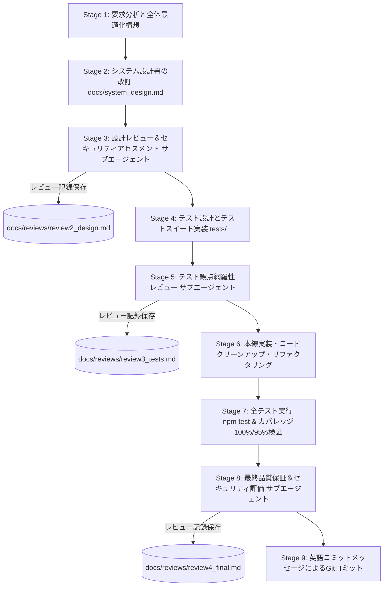

# kogaidocs 開発プロセス定義書 (Development Process Specification)

**文書バージョン**: 1.0.0 
**策定日**: 2026年10月17日 
**適用対象**: `kogaidocs` プロジェクトにおける全機能拡張・改修・品質保証活動

---

## 1. 開発プロセスの目的と基本原則

本開発プロセス定義書は、機微な児童・役員個人情報を取り扱う「完全ローカル・プライバシーファースト型」システムとしての高いセキュリティ・堅牢性・保守性を維持しつつ、ユーザー要求に迅速かつ安全に応えるための標準開発手順を定めるものである。

### 基本原則
1. **Holistic & Objective-Driven Design（全体最適・あるべき姿の追求）**
	- 要求に対する場当たり的・局所的な継ぎ接ぎ修正を厳禁とし、システム全体のアーキテクチャ・データフロー・ユーザー体験（UX）を見渡した全体最適設計を行う。
2. **Defense-in-Depth Security First（多層防御の徹底）**
	- どんな機能改修であっても、ゼロトラスト・暗号化原則（AES-256-GCM, WebAuthn, メモリ限定鍵管理, 入力サニタイズ）を緩めてはならない。
3. **Multi-Stage Subagent Quality Gates（多段階サブエージェント審査）**
	- 設計フェーズ、テスト設計フェーズ、実装完了フェーズの各段階において、独立したサブエージェントによる厳格なレビューゲートを通過することを必須とする。
4. **Zero Dead Code & High Test Coverage（不要コードの完全排除と高網羅率）**
	- 機能追加・改修によって生じた不要コードや旧互換コードを即時削除し、命令網羅（Line）100%、分岐網羅（Branch）95%以上を維持する。

---

## 2. 開発ライフサイクル・ステージ

---

## 3. 各ステージの実施要領

### Stage 1: 要求分析と全体最適化構想
- ユーザー要求の背景・意図（ユーザーが真に解決したい課題）を深く分析する。
- 局所的な対処（例：ただフラグを立てる、単なるボタン増設）を避け、UI階層、状態管理、暗号化基盤の観点から「システムのあるべき姿」を描く。
- セキュリティ影響度（新機能が暗号化や個人情報保護に及ぼすリスク）を事前評価する。

### Stage 2: システム設計書（`docs/system_design.md`）の改訂
- 実装を開始する前に、必ず設計書を最新化する。
- 更新対象セクション：アーキテクチャ図、データモデル、シーケンス、UI/UX仕様、セキュリティ仕様、不要コード削除方針。
- 設計書のバージョンをインクリメントし、タブインデント規約（`\t`）を徹底する。

### Stage 3: 設計レビュー＆セキュリティアセスメント（第1ゲート）
- 独立サブエージェント（QA & Security Lead）を召喚し、改訂された設計書を精査する。
- **レビュー観点**:
	1. ソフトウェア工学観点: 凝集度、結合度、拡張性、既存機能との整合性。
	2. セキュリティ観点: 脅威モデリング（STRIDE）、暗号鍵管理、認証バイパスの有無、XSS/データ漏洩耐性。
- レビュー結果を評価レポートとして `docs/reviews/review2_design.md` に保存する。

### Stage 4: テスト設計とテストスイート実装（TDD/テストファースト）
- 単体テスト（`tests/unit/`）、結合テスト（`tests/integration/`）、システムテスト（`tests/system/`）に新機能の検証ケースを追加する。
- 正常系だけでなく、境界値、異常系、IME入力エラー、権限拒絶、改ざんケースを網羅する。

### Stage 5: テスト観点網羅性レビュー（第2ゲート）
- 独立サブエージェントを召喚し、テストケースの充足度を検証する。
- **レビュー観点**:
	- ユーザー要求のテスト漏れがないか。
	- 境界値・フォールバック・非対応ブラウザ環境のテストが網羅されているか。
- レビュー結果を `docs/reviews/review3_tests.md` に保存する。

### Stage 6: 本線実装・コードクリーンアップ・リファクタリング
- 設計およびテストに基づきプロダクションコードを実装する。
- 改修に伴い不要となった古い変数・関数・DOM要素・下位互換フォールバックを完全に削除する。
- インデント規約（タブ `\t`）を厳格に順守する。

### Stage 7: 全テスト実行＆カバレッジ検証
- `npm test` を実行し、全テストケースの合格（0件失敗）を確認する。
- 命令網羅（Line）100%、分岐網羅（Branch）95.00%以上を全モジュールで達成していることを検証する。

### Stage 8: 最終品質保証＆セキュリティ評価（第3ゲート）
- 独立サブエージェントによる総合監査を実施する。
- 実装されたコード、テスト結果、規約準拠を検証し、リリース合否判定を `docs/reviews/review4_final.md` に記録する。

### Stage 9: 英語コミットメッセージによるGitコミット
- Conventional Commits 規約に準拠した詳細な英語コミットメッセージを作成し、リポジトリに変更をコミットする。

---

## 4. 規約と品質基準

| 項目 | 基準 |
| :--- | :--- |
| **外部依存性** | 外部 npm ランタイムライブラリゼロ（Node.js / Web標準技術のみ） |
| **テスト合格率** | 100%（全件パス、失敗0件） |
| **コードカバレッジ** | Line 100.00%（全モジュール）、Branch 95.00%以上（全モジュール） |
| **インデント規約** | 全ファイル（JS, HTML, CSS, MD, JSON）タブインデント（`\t`） |
| **セキュリティ基準** | AES-256-GCM、PBKDF2 100,000回、WebAuthn PRF、CSP強制、XSSエスケープ |

