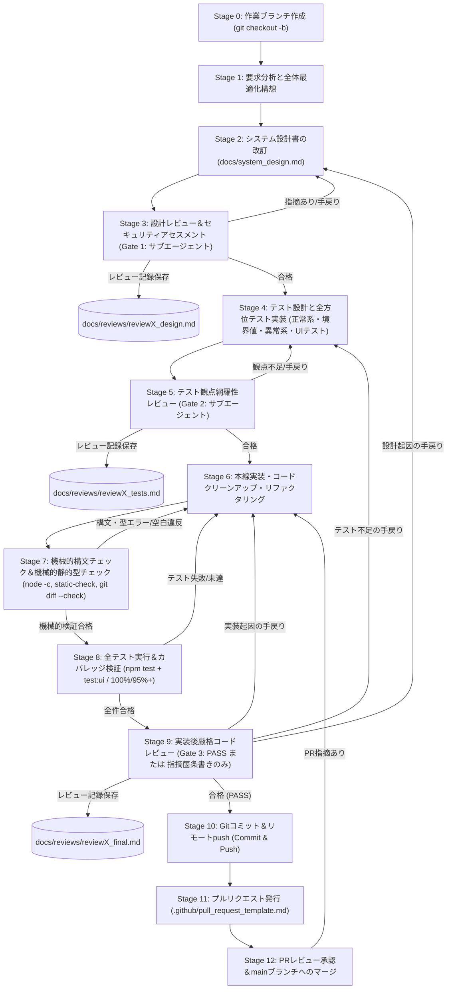
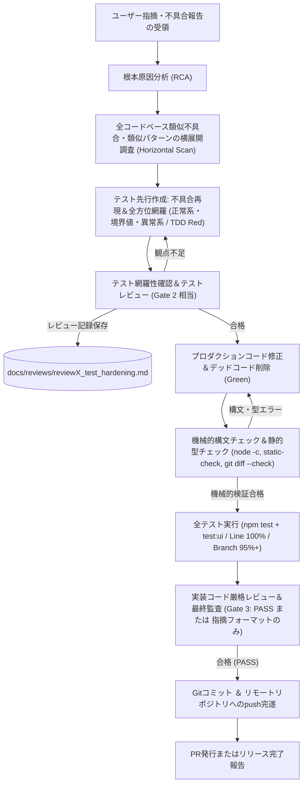

# kogaidocs 開発プロセス定義書 (Development Process Specification)

**文書バージョン**: 1.5.2 
**策定日**: 2026年10月17日 
**改訂日**: 2026年10月21日 (v1.5.2: 任意機微項目の型検証と状態確定前描画検査を追加) 
**適用対象**: `kogaidocs` プロジェクトにおける全機能拡張・改修・不具合是正・品質保証活動

---

## 1. 開発プロセスの目的と基本原則

本開発プロセス定義書は、機微な児童・役員個人情報を取り扱う「完全ローカル・プライバシーファースト型」システムとしての高いセキュリティ・堅牢性・保守性を維持しつつ、ユーザー要求に迅速かつ安全に応えるための標準開発手順を定めるものである。

### 基本原則
1. **Holistic & Objective-Driven Design（全体最適・あるべき姿の追求）**
	- 要求に対する場当たり的・局所的な継ぎ接ぎ修正を厳禁とし、システム全体のアーキテクチャ・データフロー・ユーザー体験（UX）を見渡した全体最適設計を行う。
2. **Defense-in-Depth Security First（多層防御の徹底）**
	- どんな機能改修であっても、ゼロトラスト・暗号化原則（AES-256-GCM, WebAuthn, メモリ限定鍵管理, 入力サニタイズ）を緩めてはならない。
3. **Multi-Stage Subagent Quality Gates & Code Reviews（多段階レビューゲートと実装コードレビュー）**
	- 設計フェーズ（Gate 1）、テストフェーズ（Gate 2）、実装後コードレビュー・総合監査フェーズ（Gate 3）の各段階において、独立したサブエージェントによる厳格なレビューゲートを通過することを必須とする。
4. **Mechanical Syntax & Static Type Verification（機械的構文・静的型チェックの義務化）**
	- 人手の目視確認に依存せず、機械的に構文チェック（`node -c`）および機械的に静的型・DOM整合性・スキーマチェックを実施し、文法・型・参照上の欠陥を完全にゼロとする。
5. **Tri-Tier Test Coverage: Normal, Boundary & Abnormal（正常系・境界値・異常系の全方位テスト実装義務）**
	- テストスイート（単体・結合・システム・ヘッドレスChrome UIテスト）においては、正常系（Happy Path）にとどまらず、境界値（Boundary Values）および異常系（Abnormal / Error / Injection / Validation Failure）のすべてを網羅して実装することを義務付ける。
6. **Headless Chrome Real-UI Testing（ヘッドレスChromeによるUI実体テストの必須化）**
	- モック環境のみの検証を排し、ヘッドレスChrome（Chromium）実ブラウザ環境下で、実DOM構造、CSSレイアウト、イベント発火、モーダル開閉、印刷プレビュー、Web Cryptography API連携を自動検証するUIテストをライフサイクルに組み込む。
7. **Zero Dead Code & High Test Coverage（不要コードの完全排除と高網羅率）**
	- 機能追加・改修によって生じた不要コードや旧互換コードを即時削除し、命令網羅（Line）100%、分岐網羅（Branch）95%以上を全モジュールで維持する。
8. **Commit & Remote Push Completion（コミット＆リモートpush完遂原則）**
	- すべてのプロセス完了時の作業完了定義（Definition of Done: DoD）はローカルコミットにとどまらず、必ずリモートリポジトリへのプッシュ（`git push`）までを完了要件とする。
9. **Branch & Pull Request-Driven Development（ブランチ・プルリク駆動開発の徹底）**
	- `main` ブランチへの直接コミットを原則禁止とし、必ず作業用ブランチ（`feature/*`, `fix/*`, `docs/*` 等）を切って作業を行い、所定のプルリクフォーマットに基づくPR発行・レビューを経てマージする（※ユーザー指示により直接main作業が承認された軽微なドキュメント修正等を除く）。
10. **Strict Rework & Retest Loop（手戻り発生時の全先行検証・レビュー再実行原則）**
	- 開発プロセスの途中でレビュー指摘（Gate 1〜3）やユーザー指摘による手戻りが発生した場合、局所的なパッチ修正を禁止する。修正内容が影響を及ぼす先行ステージ（設計改訂、設計レビュー、テスト実装、テスト網羅性レビュー等）まで必ず立ち戻り、先行する検証およびレビュー手続きを漏れなく再実行すること。
11. **Root-Cause Analysis, Horizontal Scan & Test-Driven Hardening（完了後不具合の横展開調査とテスト先行強化原則）**
	- プロセス完了後（または運用後）にユーザー指摘等で修正・不具合が発生した場合は、単一箇所の修正で終わらせず、システム全体における類似不具合・類似パターンの有無を網羅的に横展開調査すること。さらに、当該不具合および潜在的類似不具合を確実に検知できるようテストスイート（単体・結合・システム・UI実体テスト）を先行して拡充・修正し、テスト側の網羅性確認およびレビューを完了させてから本線修正・マージを行うこと。

---

## 2. 開発ライフサイクル・ステージ

### 2.1 標準機能開発ライフサイクル（構文・型チェック・ヘッドレスUIテスト・pushを含む）

### 2.2 完了後・運用後ユーザー指摘対応サイクル（横展開・構文・型チェック・pushを含む）

---

## 3. 各ステージの実施要領

### Stage 0: フィーチャーブランチの作成と命名規約
- `main` ブランチを最新状態に更新後、作業内容に応じたプレフィックスを付与したブランチを作成する。
- **ブランチ命名規約**:
	- `feature/<feature-name>`: 新機能開発、機能拡張
	- `fix/<bug-name>`: バグ修正、不具合対応
	- `docs/<doc-name>`: 設計書・ドキュメント・テンプレートの改訂
	- `refactor/<refactor-name>`: リファクタリング、コード整理
	- `test/<test-name>`: テストケースの追加・強化
- 例: `git checkout -b feature/headless-ui-tests`
- ※例外措置: ユーザーからの明示的な指示があり、ドキュメントの改訂や軽微な修正等である場合は、直接 `main` ブランチでの作業が認められる（ただし構文チェック・レビュー・push手順は省略不可）。

### Stage 1: 要求分析と全体最適化構想
- ユーザー要求の背景・意図（ユーザーが真に解決したい課題）を深く分析する。
- 局所的な対処（例：ただフラグを立てる、単なるボタン増設）を避け、UI階層、状態管理、暗号化基盤の観点から「システムのあるべき姿」を描く。
- セキュリティ影響度（新機能が暗号化や個人情報保護に及ぼすリスク）を事前評価する。

### Stage 2: システム設計書（`docs/system_design.md`）の改訂
- 実装を開始する前に、必ず設計書を最新化する。
- 更新対象セクション：アーキテクチャ図、データモデル、シーケンス、UI/UX仕様、セキュリティ仕様、不要コード削除方針。
- 設計書のバージョンをインクリメントし、タブインデント規約（`\t`）を徹底する。

### Stage 3: 設計レビュー＆セキュリティアセスメント（第1ゲート）
- 独立サブエージェント（QA & Security Lead）を召喚し、改訂された設計書を精査する。
- **レビュー観点**:
	1. ソフトウェア工学観点: 凝集度、結合度、拡張性、既存機能との整合性。
	2. セキュリティ観点: 脅威モデリング（STRIDE）、暗号鍵管理、認証バイパスの有無、XSS/データ漏洩耐性。
	3. **不足観点精査**: 不足する設計や考慮漏れ、エッジケースの未定義がないかの徹底チェック。
	4. **Mermaid構文チェック**: レビュー報告書内に Mermaid 図を含む場合は構文エラーチェックを必ず実施。
- レビュー結果を評価レポートとして `docs/reviews/reviewX_design.md` に保存する。

### Stage 4: テスト設計と全方位テストスイート実装（TDD/テストファースト）
- 単体テスト（`tests/unit/`）、結合テスト（`tests/integration/`）、システムテスト（`tests/system/`）、およびヘッドレスChrome UIテスト（`tests/system/headless-chrome.test.js`）を実装する。
- **全方位テスト要件（必須）**:
	1. **正常系 (Happy Path)**: 想定される標準的な入力・操作が仕様通り完了すること。
	2. **境界値 (Boundary Values)**: 最小長/最大長（パスワード12文字、0件、1件、最大件数）、空白文字のみ、改行・カンマ混在、学年1〜6年、年度境界値等。
	3. **異常系 (Abnormal / Error Handling)**: 必須項目欠落、型不一致、ID重複、改ざんデータ、暗号化失敗、ストレージロック中の書き込み拒絶、未対応ブラウザAPI例外等。
- **ヘッドレスChrome実ブラウザUIテスト**:
	- ヘッドレスChrome（Chromium）実ブラウザを起動し、実DOMレンダリング、CSS表示制御（display: none / flex / block）、モーダル開閉、印刷パイプライン（`window.print` と `document.title` 同期）、Web Cryptography API実暗号化、URLクエリパラメータ復元（`?mode=...`）を自動検証する。

### Stage 5: テスト観点網羅性レビュー（第2ゲート）
- 独立サブエージェントを召喚し、テストケースの充足度を検証する。
- **レビュー観点**:
	- ユーザー要求および設計書に対するテスト漏れがないか。
	- **正常系・境界値・異常系が全方位で実装されているか**。
	- ヘッドレスChromeによるUI実体テストの観点が含まれているか。
	- レビュー結果を `docs/reviews/reviewX_tests.md` に保存する。

### Stage 6: 本線実装・コードクリーンアップ・リファクタリング
- 設計およびテストに基づきプロダクションコードを実装する。
- 改修に伴い不要となった古い変数・関数・DOM要素・下位互換フォールバックを完全に削除する。
- インデント規約（タブ `\t`）を厳格に順守する。

### Stage 7: 機械的構文チェック＆機械的静的型チェック（Syntax & Static Type Check）
- テスト実行およびコードレビューに先立ち、実装コードの静的・構文的・型整合性を機械的に検証する。
- **機械的検証手順**:
	1. **JavaScript構文検証**: `find js tests -name '*.js' -print0 | xargs -0 -n1 node --check && node --check sw.js` を実行し、構文エラー（SyntaxError）がゼロであることを機械的に確認する。
	2. **静的型・参照整合性検証**:
		- 存在しないプロパティ名・メソッド名の参照がないか。
		- オブジェクト生成時における必須プロパティ（特に id, type, date, target_month 等）の欠落がないか。
		- ID体系の不一致や誤った同一視（例: tx.id と group_id の混同、プレフィックスの不整合）がないか。
		- ドメインルールに存在しない値の使用がないか。
		- 画面要素（DOM）の取得・更新におけるIDのタイポおよび多重イベントリスナー登録がないか。
	3. **グローバルスコープ重複検証**: 単一グローバル環境（`<script>` タグ順次ロード環境）において変数（`let`, `const`, `var`）や関数の重複宣言が存在しないことを確認する。
	4. **空白・インデント検証**: `git diff --check` を実行し、タブインデント規約違反、末尾空白、ファイルの末尾余分な空行が存在しないことを確認する。

### Stage 8: 全テスト実行＆カバレッジ検証
- `npm test`（単体・結合・システム・ヘッドレスChrome UIテスト）を実行し、全テストケースの合格（0件失敗）を確認する。
- 必要に応じて `npm run test:ui` を単独実行し、実ブラウザ上でのUIインタラクションがミリ秒単位で完全にグリーンであることを確認する。
- 命令網羅（Line）100%、分岐網羅（Branch）95.00%以上を全モジュールで達成していることを検証する。

### Stage 9: 実装後厳格コードレビュー＆最終品質保証（第3ゲート）
- 独立サブエージェントによる実装コードレビューおよび総合監査を実施する。
- 本レビューは「4.4 コードレビューの基本原則および重点検査項目」に定義された厳格フォーマットに従い、**問題点がなければ「PASS」の1単語のみ**を出力し、問題点があれば所定の箇条書き形式でのみ出力する。
- レビュー結果を `docs/reviews/reviewX_final.md` に記録する。

### Stage 10: Gitコミット＆リモートリポジトリへのプッシュ（Commit & Push）
- すべての検証・監査を通過後、ローカルコミットだけでなくリモートへのプッシュまでを確実に完遂する。
- Conventional Commits 規約に準拠した詳細な英語コミットメッセージを作成し、作業ブランチに変更をコミットする。
- `git push origin <branch-name>` を実行し、リモートリポジトリへ最新コードを確実に反映させる。

### Stage 11: プルリクエスト（PR）の発行とフォーマット記載
- リモートブランチへプッシュ完了後、`main` ブランチに向けてプルリクエストを発行する。
- [`.github/pull_request_template.md`](file:///home/k/workspace/kogaidocs/.github/pull_request_template.md)（参照: [`docs/pull_request_template.md`](file:///home/k/workspace/kogaidocs/docs/pull_request_template.md)）の所定フォーマットに従い、以下の**5大項目を日本語で漏れなく記載**する：
	1. **背景 (Background)**: 変更理由、課題、関連Issue
	2. **変更内容（設計・ファイル） (Changes: Design & Files)**: 設計書への反映点、主要変更ファイル一覧と修正理由
	3. **確認内容 (Verification Points)**: 動作確認チェックリスト、セキュリティ安全措置チェックリスト
	4. **テスト結果 (Test Results)**: `npm test` 実行結果、Line 100% / Branch 95%以上のカバレッジ結果サマリ
	5. **レビュー結果 (Review Results)**: Gate 1〜Gate 3のレビュー合否判定とレビュー記録リンク

### Stage 12: PRレビュー承認＆mainブランチへのマージ
- レビュアーによるPR内容の精査、CIチェック（自動テスト・カバレッジ検証）の通過を確認する。
- レビュアーの承認（Approve）後、`main` ブランチへ安全にマージ（Squash and Merge または Rebase and Merge）する。
- マージ完了後、役目を終えた作業ブランチを削除（`git branch -d`）し、ローカルの `main` を最新化する。

---

## 4. 手戻り管理規約とレビュワー共通指示

### 4.1 開発途中の手戻り・再検証・再レビュー規約
開発ライフサイクルの各ステージ進行中において、サブエージェントレビュー（Gate 1〜3）での指摘、またはユーザーからの仕様変更・改善指摘によって手戻り（Rework）が発生した場合、以下のプロトコルを厳格に適用する：

1. **安易な対症療法（インプレースパッチ）の禁止**:
	- レビュー指摘やユーザー指摘に対し、実装コード（Stage 6）のみを直接書き換えて済ませる行為を固く禁止する。
2. **手戻り起因ステージへの確実なバックトラック**:
	- **設計変更を伴う場合**: Stage 2（設計書改訂）へ戻り、設計書を更新した上で **Stage 3（設計レビュー・Gate 1）を再受診**する。
	- **テスト観点の不足・漏れの場合**: Stage 4（テスト設計）へ戻り、テストケースを追加・拡充した上で **Stage 5（テスト網羅性レビュー・Gate 2）を再受診**する。
	- **実装不具合・カバレッジ未達の場合**: Stage 6（実装・クリーンアップ）で修正後、**Stage 7（機械的構文・型チェック）およびStage 8（全テスト実行・カバレッジ検証）を再実行**する。
3. **先行検証手続きの連鎖的再実行（Cascading Re-verification）**:
	- 上流ステージ（Stage 2やStage 4）へ戻った場合は、そこから後続するすべてのステージ（構文・型チェック・テスト実行・カバレッジ検証・Gate 3最終監査）を一連のシーケンスとして再度通過しなければならない。途中のゲートを「前回到達したから」という理由で省略してはならない。

### 4.2 完了後・本番稼働後ユーザー指摘における「横展開・テスト先行強化」プロセス
全ステージが完了（または本番運用後）し、リリース後にユーザーから不具合指摘や修正要望が寄せられた場合、単なるバグ修正にとどまらず、品質を根本から底上げするために以下の手順を義務付ける：

1. **ステップ1: 根本原因分析（RCA）と類似不具合の網羅的横展開調査（Horizontal Scan）**:
	- 指摘された不具合のメカニズムを特定する。
	- 単一箇所の修正で終わらせず、全コードベース（全11モジュール、HTML、CSS、ストレージ処理等）において「同じパターンの不具合」「類似の考慮漏れ」「同種のエッジケース脆弱性」が存在しないか、水平展開調査を実施する。
2. **ステップ2: テスト先行（TDD）による再現テストおよび類似ケースの網羅的追加**:
	- プロダクションコードに手を加える前に、まずテストスイート（`tests/`）を改修する。
	- 指摘された不具合を確実に再現し、失敗（Red）することを確認するテストケースを実装する。
	- ステップ1の横展開調査で発見・懸念された類似パターン・境界値に対しても、同様に検知可能なテストケース（正常系・境界値・異常系）を網羅的に追加する。
3. **ステップ3: テスト修正内容の確認およびテスト観点レビューの実施**:
	- 拡充されたテストスイートが、不具合およびその類似ケースを漏れなく捉えられているかを確認する。
	- サブエージェントによるテスト充足性レビュー（Gate 2相当）を受診し、テスト設計の妥当性の承認を得る。
4. **ステップ4: プロダクションコードの修正・機械的構文・型チェック・デッドコード排除**:
	- テストを通過（Green）させる実装修正を行う。
	- `node -c` および `git diff --check` による機械的構文・空白チェックを通過させる。
5. **ステップ5: 全テスト実行・カバレッジ検証および最終監査（Gate 3）**:
	- `npm test` を実行し、全テスト合格（0件失敗）、Line 100%、Branch 95%以上を再検証する。
	- サブエージェントによる最終包括品質・セキュリティ監査を受診し、正式な合格判定を得てコミット・リモートpush・PRへ移行する。

### 4.3 レビュワー（サブエージェント）共通指示規約
各ゲート（Gate 1〜Gate 3）を担当するすべての独立レビュワー（サブエージェント）は、以下の指示事項を厳格に遵守してレビューを実施しなければならない。

レビュワーのモデル・提供元は限定しない。Codexの独立サブエージェントも利用可能である。実装担当自身の自己レビューを独立レビューとみなしてはならない。過去レビューの担当者名は当時の記録であり、以後の担当指定ではない。

1. **Mermaid図示時の構文エラーチェック義務**:
	- レビュー報告書内に Mermaid 図（フローチャート、シーケンス図等）を含める場合は、構文エラーチェック（特殊記号のエスケープ、不正なノード接続、括弧の整合性）を必ず事前に実施し、レンダリングエラーのない完全な構文で記述すること。
2. **不足観点（設計・実装・テスト）の徹底精査義務**:
	- 提出された成果物の正しさ（Positive Check）を確認するだけでなく、**「不足している設計はないか」「考慮が抜けている実装や潜在バグはないか」「検証されていないテスト観点や境界値はないか」**という批判的・網羅的観点（Negative/Gap Check）から徹底的に精査し、不足事項を指摘すること。

### 4.4 コードレビュー（Gate 1〜Gate 3）の基本原則および重点検査項目

#### 基本原則
* **レビューの目的は、欠陥・問題を検出することにある。**
* **お世辞、挨拶、要約、エグゼクティブサマリー、スコアカード（点数付け）、Mermaid図は一切出力しない。**
* **問題点が存在しない場合のみ、出力全体として「PASS」と1単語のみ返す。**
* **問題点が検出された場合は、以下のフォーマットのみで簡潔に箇条書きで出力する。**
  `<ファイル名>:<行番号>: <指摘内容（理由と修正すべきプロパティ名・引数）>`

#### 重点検査項目
1. **存在しないプロパティ名・メソッド名の参照**（呼び出し先の実装・スキーマと一致しているか）
2. **オブジェクト生成時における必須プロパティ（特に id, type, date, target_month 等）の欠落**
3. **ID体系の不一致や誤った同一視**（例: `tx.id` と `group_id` の混同、プレフィックスの不整合）
4. **ドメインルール（`type: 'expense' | 'income' | 'transfer'` 等）に存在しない値の使用**
5. **戻り値の型不一致**（配列を期待する箇所でオブジェクトを扱う、null/undefined の考慮漏れ）
6. **画面要素（DOM）の取得・更新におけるIDのタイポおよび多重イベントリスナー登録の有無**

---

### 4.5 セキュリティ専用アセスメントと是正ゲート

通常の機能レビューとは別に、セキュリティ専用のシステム・テスト・コードレビューをGate 1〜3で行う。カバレッジ達成のみを安全性の根拠としてはならない。

1. **脅威モデルと入力・出力台帳**: 保護対象、攻撃者の能力、信頼境界、平文保存を選択した場合の限界、file/HTTPS起動の差を記録する。フォーム、URL、ファイル、JSON、復号済み内容、LocalStorage、他タブ、Service Workerメッセージを入力として列挙し、HTML本文・属性・イベント・CSS・URL・印刷・保存・外部送信へ至る経路を追跡する。
2. **XSSとブラウザ防御**: HTML・属性・JavaScript・CSS・URLの文脈を区別する。HTMLエスケープをコード文脈へ流用しない。ユーザー値をイベントコードへ埋め込まず、任意式評価・`eval`・`Function`・文字列タイマー・動的グローバル関数解決を禁止する。イベントは外部スクリプトの固定処理へ登録し、CSPでインラインスクリプト・イベントを拒否する。CSPは入力検証・安全な描画の代替ではない。
3. **受入検証と可用性**: 認証済み暗号文・保存復元も不信入力である。スキーマ、真偽値、予約プロパティ、オブジェクト所有キー、座席寸法、ファイル/JSON容量・深さ・件数・日付範囲を状態変更前に検証する。任意項目も存在時の型を明示し、特にパスワード等の機微項目を文字列変換へ暗黙委譲しない。検証・正規化・描画がすべて成功するまで本状態を確定せず、描画例外時も旧状態・DOM・保存値を保持する。辞書は継承プロパティを参照・変更しない。
4. **暗号化・認証・並行処理**: 暗号文改竄・別保存先への差替え、認証メタデータ破損・削除、ロック中書込み、処理完了順序、他タブの全消去・鍵再設定、休止からの復帰を検査する。複数キー更新と同じ共有保存領域の通常読込・平文保存・暗号化保存・全消去を共通の排他境界で扱い、ロック取得後に保護状態を再評価する。保存要求時のデータとセッション世代を保持し、全消去・再設定・ロックをまたいだ待機要求を拒否する。照合直後、各キー書込間、失敗時復元中、および全消去の前後へ別タブ操作・同一タブ自動保存を割り込ませ、部分保存、旧値の復活、平文への降格、新しい値の上書きがないことを実コンテキスト間テストで確認する。保護状態不明時は平文へ移行しない。鍵の生バッファは成功・例外とも可能な範囲でゼロ化し、JavaScriptのコピー・GCまで消去保証できると表現しない。
5. **通信・PWA・運用境界**: 外部送信は明示操作に限定する。新規ウィンドウのopener、フォーム送信・base変更、同一originの別アプリのキャッシュ/SWへの干渉、任意URLの永続キャッシュを確認する。Service Workerでは、filtered responseから非公開となるヘッダーをJavaScript検査だけで保証したとみなさず、匿名要求・固定許可リスト・配信契約を併用する。公開時のTLS・HTTPヘッダー・実認証器は、未検証ならその旨を明記し、ローカル検査のみで合格としない。
6. **攻撃を先に再現するテスト**: 各指摘に識別子・重大度・成立条件・影響・再現手順・根拠テストを付す。悪意ある文字列を取込→保存→実再起動→通常画面→印刷へ通す。実行フラグ、攻撃DOMの不生成、既存DOM/保存値の保全、遅延イベント、拒否時の通知を確認する。暗号化やスキーマのスタブで攻撃経路を隠さない。
7. **独立した合否判定**: Gate 1は脅威と防御設計、Gate 2は攻撃経路と拒否の検査能力、Gate 3は全セキュリティ指摘の解消と回帰・残余リスクを判定する。実証済み問題と潜在的な多層防御不足を区別する。必要な是正を未実施のままPASSにしてはならない。適用外・実機未検証は理由を記録する。
8. **外部工程が拒否された場合**: 自動承認・認証・権限でpushやPRが阻まれた場合は迂回せず、送信先・送信内容・必要な承認/認証と未完了工程を明記する。ローカルで可能な是正・検証・レビュー・コミット・PR本文準備は先に完了する。

## 5. 規約と品質基準

| 項目 | 基準 |
| :--- | :--- |
| **ブランチ戦略** | `main` 直接コミット原則禁止、`feature/*`, `fix/*`, `docs/*` によるPRベース運用（※明示的指示時を除く） |
| **PRフォーマット** | `.github/pull_request_template.md` 準拠（日本語5大項目の記載必須） |
| **テスト観点網羅** | **正常系・境界値・異常系のすべてを漏れなくテスト実装** |
| **UIテスト** | **ヘッドレスChrome（Chromium）による実ブラウザUIテストの自動実行（`npm run test:ui`）** |
| **機械的構文チェック** | 実装後直ちに `find js tests -name '*.js' -print0 \| xargs -0 -n1 node --check && node --check sw.js` を機械的実行（SyntaxError 0件） |
| **機械的静的型チェック**| 存在しないプロパティ/メソッド参照、DOM IDタイポ、戻り値型、ドメイン値の機械的検証 |
| **空白・インデント検証**| `git diff --check` を実行（タブインデント規約違反、末尾空白、空行違反0件） |
| **コードレビュー基準** | **基本原則遵守：問題なし時は「PASS」の1単語のみ返却。問題あり時は `<file>:<line>: <指摘>` のみ出力** |
| **重点検査項目** | ①未存在プロパティ/メソッド ②必須プロパティ欠落 ③ID体系不一致 ④ドメイン値逸脱 ⑤戻り値型/null不備 ⑥DOM IDタイポ/多重リスナー |
| **完了定義 (DoD)** | ローカルコミットにとどまらず、リモートリポジトリへの `git push` までを必須完了要件とする |
| **手戻りプロトコル** | 指摘発生時は起因ステージへ遡及し、後続の全先行検証・レビューを連鎖的に再実行 |
| **完了後不具合対応** | 類似不具合の全コードベース横展開調査、およびテスト先行強化（TDD/Red-Green）・テストレビュー必須 |
| **外部依存性** | 外部 npm ランタイムライブラリゼロ（Node.js / Web標準技術のみ） |
| **テスト合格率** | 100%（全件パス、失敗0件） |
| **コードカバレッジ** | Line 100.00%（全モジュール）、Branch 95.00%以上（全モジュール） |
| **インデント規約** | 全ファイル（JS, HTML, CSS, MD, JSON）タブインデント（`\t`） |
| **セキュリティ基準** | AES-256-GCM、PBKDF2-HMAC-SHA256 600,000回（旧100,000回は読込移行のみ）、WebAuthn PRF、CSP強制、XSSエスケープ |
