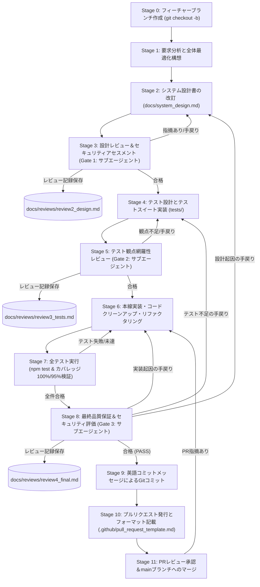
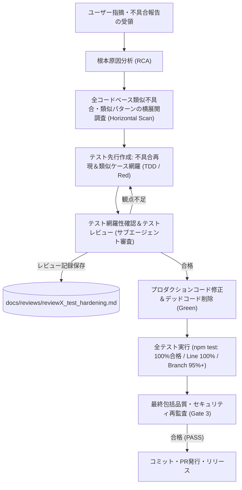

# kogaidocs 開発プロセス定義書 (Development Process Specification)

**文書バージョン**: 1.2.0 
**策定日**: 2026年10月17日 
**改訂日**: 2026年10月17日 (v1.2.0: 開発途中の手戻り再検証・再レビュー規約、および完了後不具合における類似不具合横展開・テスト先行強化プロセスの追加策定) 
**適用対象**: `kogaidocs` プロジェクトにおける全機能拡張・改修・不具合是正・品質保証活動

---

## 1. 開発プロセスの目的と基本原則

本開発プロセス定義書は、機微な児童・役員個人情報を取り扱う「完全ローカル・プライバシーファースト型」システムとしての高いセキュリティ・堅牢性・保守性を維持しつつ、ユーザー要求に迅速かつ安全に応えるための標準開発手順を定めるものである。

### 基本原則
1. **Holistic & Objective-Driven Design（全体最適・あるべき姿の追求）**
	- 要求に対する場当たり的・局所的な継ぎ接ぎ修正を厳禁とし、システム全体のアーキテクチャ・データフロー・ユーザー体験（UX）を見渡した全体最適設計を行う。
2. **Defense-in-Depth Security First（多層防御の徹底）**
	- どんな機能改修であっても、ゼロトラスト・暗号化原則（AES-256-GCM, WebAuthn, メモリ限定鍵管理, 入力サニタイズ）を緩めてはならない。
3. **Multi-Stage Subagent Quality Gates（多段階サブエージェント審査）**
	- 設計フェーズ、テスト設計フェーズ、実装完了フェーズの各段階において、独立したサブエージェントによる厳格なレビューゲートを通過することを必須とする。
4. **Zero Dead Code & High Test Coverage（不要コードの完全排除と高網羅率）**
	- 機能追加・改修によって生じた不要コードや旧互換コードを即時削除し、命令網羅（Line）100%、分岐網羅（Branch）95%以上を維持する。
5. **Branch & Pull Request-Driven Development（ブランチ・プルリク駆動開発の徹底）**
	- `main` ブランチへの直接コミットを原則禁止とし、必ず作業用ブランチ（`feature/*`, `fix/*`, `docs/*` 等）を切って作業を行い、所定のプルリクフォーマットに基づくPR発行・レビューを経てマージする（※ユーザー指示により直接main作業が承認された軽微なドキュメント修正等を除く）。
6. **Strict Rework & Retest Loop（手戻り発生時の全先行検証・レビュー再実行原則）**
	- 開発プロセスの途中でレビュー指摘（Gate 1〜3）やユーザー指摘による手戻りが発生した場合、局所的なパッチ修正を禁止する。修正内容が影響を及ぼす先行ステージ（設計改訂、設計レビュー、テスト実装、テスト網羅性レビュー等）まで必ず立ち戻り、先行する検証およびレビュー手続きを漏れなく再実行すること。
7. **Root-Cause Analysis, Horizontal Scan & Test-Driven Hardening（完了後不具合の横展開調査とテスト先行強化原則）**
	- プロセス完了後（または運用後）にユーザー指摘等で修正・不具合が発生した場合は、単一箇所の修正で終わらせず、システム全体における類似不具合・類似パターンの有無を網羅的に横展開調査すること。さらに、当該不具合および潜在的類似不具合を確実に検知できるようテストスイート（単体・結合・システムテスト）を先行して拡充・修正し、テスト側の網羅性確認およびレビューを完了させてから本線修正・マージを行うこと。

---

## 2. 開発ライフサイクル・ステージ

### 2.1 標準機能開発ライフサイクル（手戻りループを含む）

### 2.2 完了後・運用後ユーザー指摘対応サイクル（類似不具合横展開＆テスト強化）

---

## 3. 各ステージの実施要領

### Stage 0: フィーチャーブランチの作成と命名規約
- `main` ブランチを最新状態に更新後、作業内容に応じたプレフィックスを付与したブランチを作成する。
- **ブランチ命名規約**:
	- `feature/<feature-name>`: 新機能開発、機能拡張
	- `fix/<bug-name>`: バグ修正、不具合対応
	- `docs/<doc-name>`: 設計書・ドキュメント・テンプレートの改訂
	- `refactor/<refactor-name>`: リファクタリング、コード整理
	- `test/<test-name>`: テストケースの追加・強化
- 例: `git checkout -b feature/share-district-data`
- ※例外措置: ユーザーからの明示的な指示があり、ドキュメントの軽微な修正等である場合は、直接 `main` ブランチでのコミットが認められる（ただしレビュー手順は省略不可）。

### Stage 1: 要求分析と全体最適化構想
- ユーザー要求の背景・意図（ユーザーが真に解決したい課題）を深く分析する。
- 局所的な対処（例：ただフラグを立てる、単なるボタン増設）を避け、UI階層、状態管理、暗号化基盤の観点から「システムのあるべき姿」を描く。
- セキュリティ影響度（新機能が暗号化や個人情報保護に及ぼすリスク）を事前評価する。

### Stage 2: システム設計書（`docs/system_design.md`）の改訂
- 実装を開始する前に、必ず設計書を最新化する。
- 更新対象セクション：アーキテクチャ図、データモデル、シーケンス、UI/UX仕様、セキュリティ仕様、不要コード削除方針。
- 設計書のバージョンをインクリメントし、タブインデント規約（`\t`）を徹底する。

### Stage 3: 設計レビュー＆セキュリティアセスメント（第1ゲート）
- 独立サブエージェント（QA & Security Lead）を召喚し、改訂された設計書を精査する。
- **レビュー観点**:
	1. ソフトウェア工学観点: 凝集度、結合度、拡張性、既存機能との整合性。
	2. セキュリティ観点: 脅威モデリング（STRIDE）、暗号鍵管理、認証バイパスの有無、XSS/データ漏洩耐性。
- レビュー結果を評価レポートとして `docs/reviews/review2_design.md` に保存する。

### Stage 4: テスト設計とテストスイート実装（TDD/テストファースト）
- 単体テスト（`tests/unit/`）、結合テスト（`tests/integration/`）、システムテスト（`tests/system/`）に新機能の検証ケースを追加する。
- 正常系だけでなく、境界値、異常系、IME入力エラー、権限拒絶、改ざんケースを網羅する。

### Stage 5: テスト観点網羅性レビュー（第2ゲート）
- 独立サブエージェントを召喚し、テストケースの充足度を検証する。
- **レビュー観点**:
	- ユーザー要求のテスト漏れがないか。
	- 境界値・フォールバック・非対応ブラウザ環境のテストが網羅されているか。
- レビュー結果を `docs/reviews/review3_tests.md` に保存する。

### Stage 6: 本線実装・コードクリーンアップ・リファクタリング
- 設計およびテストに基づきプロダクションコードを実装する。
- 改修に伴い不要となった古い変数・関数・DOM要素・下位互換フォールバックを完全に削除する。
- インデント規約（タブ `\t`）を厳格に順守する。

### Stage 7: 全テスト実行＆カバレッジ検証
- `npm test` を実行し、全テストケースの合格（0件失敗）を確認する。
- 命令網羅（Line）100%、分岐網羅（Branch）95.00%以上を全モジュールで達成していることを検証する。

### Stage 8: 最終品質保証＆セキュリティ評価（第3ゲート）
- 独立サブエージェントによる総合監査を実施する。
- 実装されたコード、テスト結果、規約準拠を検証し、リリース合否判定を `docs/reviews/review4_final.md` に記録する。

### Stage 9: 英語コミットメッセージによるGitコミット
- Conventional Commits 規約に準拠した詳細な英語コミットメッセージを作成し、作業ブランチに変更をコミットする。
- コミットメッセージには、変更の概要、詳細な改修点（機能、セキュリティ、クリーンアップ）、テスト結果を明記する。

### Stage 10: プルリクエスト（PR）の発行とフォーマット記載
- リモートブランチへプッシュ後、`main` ブランチに向けてプルリクエストを発行する。
- [`.github/pull_request_template.md`](file:///home/k/workspace/kogaidocs/.github/pull_request_template.md)（参照: [`docs/pull_request_template.md`](file:///home/k/workspace/kogaidocs/docs/pull_request_template.md)）の所定フォーマットに従い、以下の**5大項目を日本語で漏れなく記載**する：
	1. **背景 (Background)**: 変更理由、課題、関連Issue
	2. **変更内容（設計・ファイル） (Changes: Design & Files)**: 設計書への反映点、主要変更ファイル一覧と修正理由
	3. **確認内容 (Verification Points)**: 動作確認チェックリスト、セキュリティ安全措置チェックリスト
	4. **テスト結果 (Test Results)**: `npm test` 実行結果、Line 100% / Branch 95%以上のカバレッジ結果サマリ
	5. **レビュー結果 (Review Results)**: Gate 1〜Gate 3のレビュー合否判定とレビュー記録リンク

### Stage 11: PRレビュー承認＆mainブランチへのマージ
- レビュアーによるPR内容の精査、CIチェック（自動テスト・カバレッジ検証）の通過を確認する。
- レビュアーの承認（Approve）後、`main` ブランチへ安全にマージ（Squash and Merge または Rebase and Merge）する。
- マージ完了後、役目を終えた作業ブランチを削除（`git branch -d`）し、ローカルの `main` を最新化する。

---

## 4. 手戻り管理規約と是正再実行プロトコル

### 4.1 開発途中の手戻り・再検証・再レビュー規約
開発ライフサイクルの各ステージ進行中において、サブエージェントレビュー（Gate 1〜3）での指摘、またはユーザーからの仕様変更・改善指摘によって手戻り（Rework）が発生した場合、以下のプロトコルを厳格に適用する：

1. **安易な対症療法（インプレースパッチ）の禁止**:
	- レビュー指摘やユーザー指摘に対し、実装コード（Stage 6）のみを直接書き換えて済ませる行為を固く禁止する。
2. **手戻り起因ステージへの確実なバックトラック**:
	- **設計変更を伴う場合**: Stage 2（設計書改訂）へ戻り、設計書を更新した上で **Stage 3（設計レビュー・Gate 1）を再受診**する。
	- **テスト観点の不足・漏れの場合**: Stage 4（テスト設計）へ戻り、テストケースを追加・拡充した上で **Stage 5（テスト網羅性レビュー・Gate 2）を再受診**する。
	- **実装不具合・カバレッジ未達の場合**: Stage 6（実装・クリーンアップ）で修正後、**Stage 7（全テスト実行・カバレッジ検証）を再実行**する。
3. **先行検証手続きの連鎖的再実行（Cascading Re-verification）**:
	- 上流ステージ（Stage 2やStage 4）へ戻った場合は、そこから後続するすべてのステージ（テスト設計・実装・カバレッジ検証・Gate 3最終監査）を一連のシーケンスとして再度通過しなければならない。途中のゲートを「前回到達したから」という理由で省略してはならない。

### 4.2 完了後・本番稼働後ユーザー指摘における「横展開・テスト先行強化」プロセス
全ステージが完了（または本番運用後）し、リリース後にユーザーから不具合指摘や修正要望が寄せられた場合、単なるバグ修正にとどまらず、品質を根本から底上げするために以下の5ステップを義務付ける：

1. **ステップ1: 根本原因分析（RCA）と類似不具合の網羅的横展開調査（Horizontal Scan）**:
	- 指摘された不具合のメカニズムを特定する。
	- 単一箇所の修正で終わらせず、全コードベース（全10モジュール、HTML、CSS、ストレージ処理等）において「同じパターンの不具合」「類似の考慮漏れ」「同種のエッジケース脆弱性」が存在しないか、水平展開調査を実施する。
2. **ステップ2: テスト先行（TDD）による再現テストおよび類似ケースの網羅的追加**:
	- プロダクションコードに手を加える前に、まずテストスイート（`tests/`）を改修する。
	- 指摘された不具合を確実に再現し、失敗（Red）することを確認するテストケースを実装する。
	- ステップ1の横展開調査で発見・懸念された類似パターン・境界値に対しても、同様に検知可能なテストケースを網羅的に追加する。
3. **ステップ3: テスト修正内容の確認およびテスト観点レビューの実施**:
	- 拡充されたテストスイートが、不具合およびその類似ケースを漏れなく捉えられているかを確認する。
	- サブエージェントによるテスト充足性レビュー（Gate 2相当）を受診し、テスト設計の妥当性の承認を得る。
4. **ステップ4: プロダクションコードの修正・リファクタリング・デッドコード排除**:
	- テストを通過（Green）させる実装修正を行う。
	- 併せて、類似箇所の是正、不要コードや互換性フォールバックのクリーンアップを実施する。
5. **ステップ5: 全テスト実行・カバレッジ検証および最終監査（Gate 3）**:
	- `npm test` を実行し、全テスト合格（0件失敗）、Line 100%、Branch 95%以上を再検証する。
	- サブエージェントによる最終包括品質・セキュリティ監査を受診し、正式な合格判定を得てコミット・PRへ移行する。

---

## 5. 規約と品質基準

| 項目 | 基準 |
| :--- | :--- |
| **ブランチ戦略** | `main` 直接コミット禁止、`feature/*`, `fix/*`, `docs/*` によるPRベース運用（※明示的指示時を除く） |
| **PRフォーマット** | `.github/pull_request_template.md` 準拠（日本語5大項目の記載必須） |
| **手戻りプロトコル** | 指摘発生時は起因ステージへ遡及し、後続の全先行検証・レビューを連鎖的に再実行 |
| **完了後不具合対応** | 類似不具合の全コードベース横展開調査、およびテスト先行強化（TDD/Red-Green）・テストレビュー必須 |
| **外部依存性** | 外部 npm ランタイムライブラリゼロ（Node.js / Web標準技術のみ） |
| **テスト合格率** | 100%（全件パス、失敗0件） |
| **コードカバレッジ** | Line 100.00%（全モジュール）、Branch 95.00%以上（全モジュール） |
| **インデント規約** | 全ファイル（JS, HTML, CSS, MD, JSON）タブインデント（`\t`） |
| **セキュリティ基準** | AES-256-GCM、PBKDF2 100,000回、WebAuthn PRF、CSP強制、XSSエスケープ |
