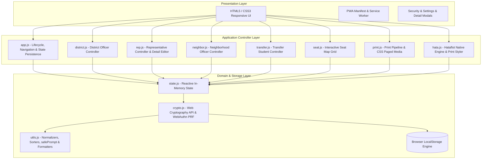
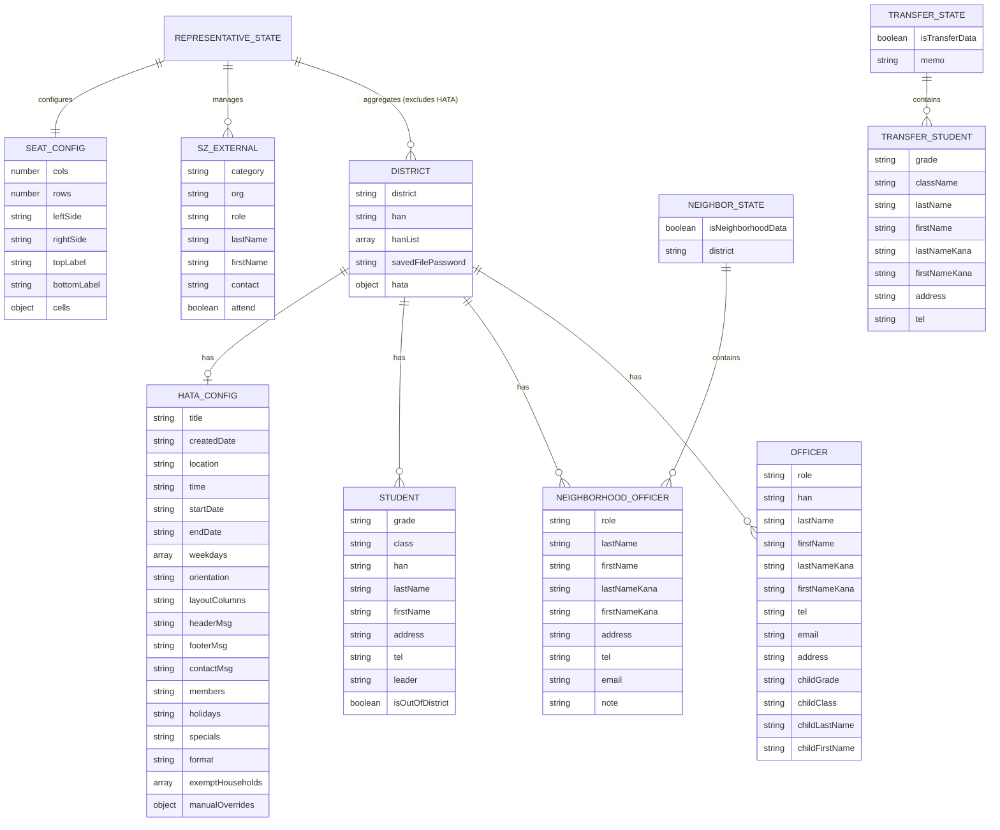
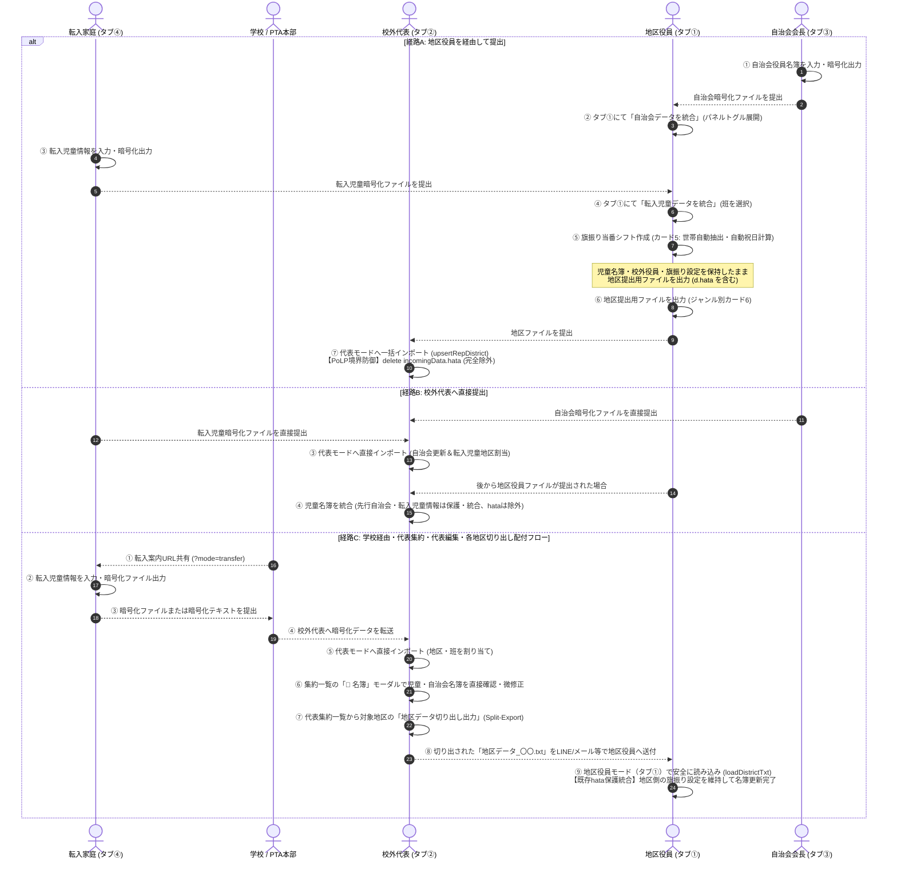

# kogaidocs 内部仕様書

**文書版**: 1.0（アプリケーション 2.8.4 対応） 
**改訂日**: 2026年10月24日 
**文体・規範**: 本文の「する」「である」は要求または仕様を表す。試験済みという意味ではない。

[外部仕様書](external_design.md)の実現方式を定める。過去改修のレビューは[レビュー記録](reviews/)に保持する。

## I-01 アーキテクチャと責務

### 3.1 レイヤー構造

### 3.2 モジュール構成と責務

| モジュール | パス | 主要責務 |
| :--- | :--- | :--- |
| **App Lifecycle** | `js/app.js` | 初期化、4タブ切り替え（地区/代表/自治会/転入者）、前回選択モード復元、PWA登録・強制アップデート、セキュリティバッジ表示、ロック解除モーダル制御 |
| **Crypto Engine** | `js/crypto.js` | Web Cryptography API（AES-GCM 256bit）、PBKDF2-HMAC-SHA256（新規600,000回、旧100,000回読込移行）、WebAuthn PRF、LocalStorage透過的暗号化・復号、ファイル暗号化、パスキー増殖防止固定ID |
| **UI Events** | `js/events.js` | 固定アクション表、許可引数とイベント委譲、重複登録防止 |
| **State Manager** | `js/state.js` | 地区役員データ（`currentDistrict`）、校外代表データ（`repState`）、自治会役員データ（`neighborState`）、転入者データ（`transferState`）のインメモリ管理、LocalStorage自動永続化 |
| **District Mode** | `js/district.js` | 地区名・班名リスト、複数校外役員入力、自治会役員統合取込、転入児童データ統合取込、児童名簿テーブル、児童・自治会役員削除確認、年度更新（進級/卒業）、ファイル入出力、hata保護統合 |
| **Representative Mode**| `js/rep.js` | 各地区・自治会・転入ファイルの一括読込、クリップボード復号、集約一覧、集約地区削除確認、スクゾ外部関係者削除確認、カード1ジャンル別4大セクション化、**各地区名簿（児童・自治会・役員）モーダル閲覧・編集**、単一地区切り出し出力（Split-Export、パスワード案内是正）、**取り込み時hata物理削除（PoLP）**、一括印刷ディスパッチ |
| **Neighborhood Mode** | `js/neighbor.js` | 自治会役員名簿CRUD、役員名札・名簿印刷、自治会単独暗号化ファイル出力/読込、年度更新（役職保持・名簿リセット） |
| **Transfer Mode** | `js/transfer.js` | 転入児童情報入力（学年・組・氏名・カナ・住所・TEL・複数児童対応）、転入児童削除確認、暗号化ファイル（`転入児童データ_〇〇.txt`）出力、暗号化テキストコピー |
| **Seat Map** | `js/seat.js` | スクゾ協議会座席表エディタ、動的グリッド拡張/縮小、窓際/廊下側表示入れ替え、出席者プルダウン割当、空席・施設マーカー |
| **Hataflot Native Engine**| `js/hata.js` | 児童名簿からの世帯自動集約（住所数字＋苗字）、免除世帯管理、オフライン日本の祝日自動計算、期間プリセット、シフト自動生成（均等配分）、個別日付担当者スワップ・調整オーバーライド保持、スマホ向け縦リスト表示、A4多段組印刷組版、LINE用テキスト生成、公式JSON双方向インポート/エクスポート |
| **Print Pipeline** | `js/print.js` | A4四つ折り自立型名札（中央オリセン・180度反転面）、3x4子供経由封筒宛名、学校用/PTA用役員名簿、児童名簿、自治会名簿等の動的生成 |
| **Utilities** | `js/utils.js` | HTMLエスケープ、姓名・ふりがな分割結合、班名抽出・重複排除、3段階児童ソート、学年別集計、パスワード強度検証、セマンティックバージョン比較（`isNewerVersion`）、安全プロンプト（`safePrompt`） |

## I-02 暗号化・認証・保存トランザクション

提出形式は `ENC:2:` + Base64（salt 16B、IV 12B、AES-GCM暗号文と128bit認証タグ）の順である。新規PBKDF2-HMAC-SHA256は600,000回である。旧`ENC:`/接頭辞なしBase64だけ100,000回で読み込み、未知version・改竄の新形式は旧形式へフォールバックしない。44B未満は復号前に拒否する。提出本文を保存キーに束縛するAADは用いず、端末保存とは区別する。

保存キーは `kogai_district_v2`、`kogai_rep_v2`、`kogai_neighbor_v2`、`kogai_transfer_v2`、認証情報は `kogai_auth_meta` である。保存形式は `STORAGE_ENC:2:` + Base64（IV 12B + 暗号文/タグ）で、AADは `kogaidocs:storage:2:` + 保存キーのUTF-8である。鍵はメモリ内CryptoKeyで保持し、パスワードラップと任意のWebAuthn PRFラップだけを認証メタデータへ保存する。

WebAuthn `user.id` はASCII `kogaidocs` の固定配列である。パスキーマネージャー側での上書き挙動そのものは実装から保証しない。PRF非対応・取消時は通知してパスワード保護を利用する。`file:` ではWebAuthnを開始しない。

- **保護状態の整合性**: メモリ鍵は解除時の認証メタデータ内容と結び付ける。別タブの削除・再設定・破損を保存・読込・解除の開始と非同期完了時に照合し、不一致なら鍵・状態・DOMを破棄して書込みを拒否する。storageイベントでも同じ破棄を実行し、認証キー個別変更に加えて `localStorage.clear()` の `key === null` 通知を保護状態の消失として扱う。暗号文が残るのに認証情報が消失・不正である場合、および保護済みタブが別タブの全消去を検知した場合は未暗号化と扱わない。全消去を実行した当該タブだけは明示的に未暗号化初期状態へ移行する。

- **複数キー確定の競合制御**: 平文状態を含む通常保存・読込・初期設定・再設定・旧形式移行・生体認証情報更新・全消去は、Web Locks API対応環境では同一origin・同一アプリ名のロックを必ず通す。読込は共有ロック、それ以外は排他ロックとし、ロック取得後に認証情報と暗号文の有無を再評価してから平文または暗号化の経路を決定する。保存要求は呼出時点のデータ直列化結果とセッション世代を保持し、ロック待機中に全消去・再設定・ロックが完了して世代が変わった場合は、取得後の平文/暗号化再判定へ進まず要求を拒否する。全4モードと認証情報のトランザクション書込および失敗時復元を1回の排他ロック保持中に完了する。これにより、照合と書込み、各キー間、失敗時復元の間へ別タブのアプリ操作が入ること、初期設定途中へ別タブの平文保存が入ること、および全消去より後に待機中の自動保存が旧データを平文復活させることを防ぐ。全消去要求が書込中に発生した場合は書込完了後に排他ロックを取得して全対象を削除するため、旧処理が後からデータを復活させない。Web Locks APIを利用できない環境では未暗号化データの単一キー読込・保存・全消去だけを許可し、暗号化の設定・解除・読込・保存・変更は開始せず、対応ブラウザを要求して平文へ降格しない。ブラウザ機能や開発者操作によるロック外の保存領域消去は `storage` の `key === null` 通知で保護セッションを直ちに無効化し、その後の保存を拒否する。

- **保存暗号文のAAD**: 新形式は `STORAGE_ENC:2:` とし、AES-GCMのadditionalDataにアプリ識別子・形式・保存キーを含める。保存先の入替・改竄・異なる形式の偽装を拒否する。既存形式はパスワード・WebAuthn PRFのいずれも鍵取得後の共通処理で全モードを復号・検証して新形式へ原子的に移行し、認証情報へ形式2を確定する。失敗時は旧値を保持し、解除成功としない。形式2の認証情報で旧形式へ降格しない。生マスター鍵バッファはラップ・インポート・生体認証の成功/失敗にかかわらずfinallyでゼロ化する。

- **パスワード導出強度**: 新規の保存鍵ラップと提出ファイルはPBKDF2-HMAC-SHA256を600,000回実行する。保存鍵ラップの認証メタデータには反復回数を保持し、100,000回または600,000回以外をKDF実行前に拒否して計算量DoSを防ぐ。反復回数を持たない旧保存形式は100,000回としてパスワード解除し、全4モードの復号・検証、必要な保存暗号文再暗号化、600,000回での生鍵再ラップをすべて完了してから、保存値と認証情報を同一トランザクションで確定する。書込失敗、ロック、他タブ変更時は原本を復元して解除失敗とする。生体認証解除はパスワードを取得できないため旧パスワードラップを保持し、次回のパスワード解除まで反復回数移行を保留する。提出ファイルは新形式`ENC:2:`を600,000回、旧`ENC:`および既存の接頭辞なしBase64を100,000回として復号する。未知の`ENC:<version>:`はKDF実行前に拒否し、新形式の認証失敗後に旧形式へフォールバックしない。

- **自動ロックと保存順序**: 自動ロックの絶対期限を保持し、操作・表示復帰時には延長する前に期限切れを確認する。復帰のイベント処理は個人情報操作より先に行う。15分以内の正規操作は期限を更新する。更新処理は4モードの保存完了を待ち、容量不足・暗号化失敗を通知してナビゲーションを中止する。保存の呼出順ではなく完了順が前後しても最新値が残るよう、同じキーの書込みを順序管理する。

## I-03 データモデルと受入制約

### 7.1 エンティティ関係図（ERD）

### 現行モデル契約

| モデル | 受入・正規化 |
| :--- | :--- |
| 地区 | districtは文字列、officers/students/neighborhoodは行配列である。省略/nullの任意配列は空配列にする。旧officerは境界で配列へ移行し、描画はofficersを用いる。savedFilePasswordは存在時文字列だけである。 |
| 代表 | districts必須、各地区を検証してhata/hatafurotto/savedFilePasswordを除外する。szExternalsは任意配列、attendは存在時booleanである。 |
| 自治会 | district文字列とneighborhood配列である。提出識別子はisNeighborhoodData:trueである。役員行の既知個人項目は文字列または許容されたnullである。 |
| 転入提出 | isTransferData:true、children（旧studentsも読込可）に1件以上、各行lastName/firstName/address/telは空白だけでない文字列である。現行クラス項目はclassName、連絡事項はmemoである。 |
| 転入下書き | children配列（0件可）、memoは存在時文字列である。未入力の児童も許す。提出必須条件を保存へ適用しない。 |
| 座席 | colsは2〜10、rowsは2〜14の整数（数字文字列を数値へ正規化）である。cellsキーは範囲内のr_c、refKey/customTextは文字列または許容されたnullである。 |
| 旗振り | タイトル/メタ情報/日付/特別枠/書式は文字列、weekdaysは0〜6整数配列、orientationはportrait/landscape、layoutColumnsは1〜6である。schedule/manualOverridesの文字列・boolean項目も検証する。 |

旧文書7.2のJSON Schema断片には保存キーv1、転入studentsだけを必須とする記述、layoutColumnsをstringだけとする記述があり、実行バリデータと一致しなかった。現行契約は本表および `validateImportData` / `validateStoredData` / `validateHataConfig` であり、旧断片を完全なスキーマとして再掲しない。未知項目を一律拒否する閉じたスキーマではないため、年度更新時は別途保持項目の許可リストを適用する。

- **復元の受入境界**: ファイルだけでなく平文/暗号化LocalStorageの全4モードを検証する。復号・型検証・旧形式正規化が全モードで成功するまで本状態を置換しない。失敗時は保存値を保持し、鍵・部分読込状態を破棄して解除成功と表示しない。任意の `savedFilePassword` は存在時に文字列だけを許可し、暗黙の文字列変換や描画例外へ到達させない。旗振り設定は標準項目と表示用別名を同じ型台帳で検証し、`scheduleCreatedDate` と `district` を含む描画文字列へオブジェクトを許可しない。転入ローカル保存は未入力・0件も許容し、提出用の必須入力検査とは区別する。座席寸法は保存スキーマと描画側の双方で2〜10列・2〜14行の整数へ固定する。HTML本文・属性は適切にエスケープし、旗振り日付・曜日も文字列として出力する。

- **辞書と構造**: 担当者・参照値の辞書はnullプロトタイプまたはMapと所有キーで処理する。入力オブジェクト中の `__proto__`・`constructor`・`prototype` キーは拒否するが、氏名等の文字列値は通常データとして保持する。全JSONは4MiB、入力テキスト/ファイルは8MiB、深さ20、各配列10,000件、総ノード100,000以下とする。旗振りの基本期間は3,660日以下、休日・特別枠は範囲展開後の合計を3,660件以下、列数は1〜6とする。この検査は公式JSONだけでなく地区モデルの共通受入境界で実施し、ファイル・貼付・平文保存・暗号化保存・旧形式移行のすべてで状態置換前に適用する。範囲外は状態・DOM・保存値を変更せず拒否する。容量上限は読込前のFile.sizeと読込後の内容にも適用する。

### 日付境界の追加是正（SEC-19）

`validateDateExpansion` は空でない端点をそれぞれISO実在日検証した後、両端がある場合だけ順序・日数を検証する。これを共用することで、単独の不正開始日/終了日が描画前に拒否される。空の片側は下書きとして許す。休日省略時の自動生成は開始年2000〜2099だけを対象とし、翌年も2099までに制限する。範囲外の有効ISO期間は拒否せず休日を空へ補完し、明示された休日・空文字は保持する。この範囲は技術上の実行範囲であり、法改正・特例日の正確性を保証するものではない。ファイル・貼付・保存復元・公式JSONはこの検証を共有し、型検証を描画後へ遅延させない。

## I-04 統合・名簿・旗振り・年度更新

### 5.6 データ統合・同期パイプライン

- **4モードの保存保護**: 暗号化設定・全消去には `kogai_transfer_v2` を含む全4モードを適用する。暗号鍵を持たないロック状態では既存暗号文を上書きしない。移行では新鍵と全4モードの暗号文をメモリ上で生成・検証してから書込みを開始し、全保存成功後に認証メタデータを確定する。失敗を呼出元へ伝播し、書込み済みキーを保存前の値へ戻して旧鍵を維持する。復旧も失敗した場合は成功扱いにせず、失敗を通知する。
- **ロック時の破棄範囲**: 地区旗振り設定・生成済み当番表、代表外部関係者・座席設定、自治会・転入者、代表地区編集の複製とDOM、印刷DOM、全パスワード・確認・復号入力欄、貼付テキストを消去する。表示切替でtext型となったパスワードも対象である。既存暗号文は保持し、正しい解除により再描画する。解除成功後のパスワード欄も消去する。ロック・全消去・暗号化設定確定で処理世代を更新し、開始世代が異なる読込・復号・JSON読込・解除・保存は状態更新・DOM描画・ストレージ書込みを行わない。ファイル読込開始前の世代を完了後まで引き継ぎ、ロック後の処理開始自体も拒否する。初回暗号化・簡易設定・解除成功直後から15分の自動ロックを開始する。
- **旗振り復元**: 非空の休日を含め全設定をDOMへ反映した後にプレビュー・保存を行う。児童名簿の追加・編集・削除後は免除世帯の選択肢も自動的に再描画する。休日の空文字はユーザーによる除外解除として保持する。公式JSONの空ファイル・構文・ネストした設定型を検証し、不正時は元設定・DOM・保存値を保持して通知する。休日配列は各要素の日付・理由を検証し、日付・理由の改行区切りテキストへ正規化して復元・保存する。読込成功・失敗ともファイル入力を空に戻して同一ファイルの再選択を可能とする。地区内の世帯membersは児童名簿を元に再生成し、公式JSONの外部membersを児童名簿として取り込まない。
- **引用符・コード注入対策**: 世帯キーをイベント属性のJavaScript文字列へ連結しない。DOMのdata属性へHTMLエスケープして格納し、固定ハンドラーからその値を受け取る。
- **座席参照**: 既存の `OFF_地区index_役員index`、`EXT_index`、`NEI_地区名_index` の保存形式を維持する。削除時は対象本人の割当を解除し、後続インデックスを繰り下げて別人への割当変化を防ぐ。詳細モーダルでは校外・自治会双方の元行対応表を下書きとともに保持し、氏名・役職・連絡先の通常編集でも本人の出席・座席を維持し、保存時のみ本状態と座席へ適用する。キャンセル時は本状態を変更しない。自治会出席チェックも同じ対応表で維持する。地区・名簿・印刷対象の変更後は集約・出席者・座席候補を同期して再描画する。外部ファイルによる名簿置換時は同一人物の継続を確認できない割当を解除する。同一地区名の複数班では、変更前後に選ばれる自治会代表名簿を比較し、氏名・役職・連絡先で同一人物を一意に確認できる場合のみ参照を継続する。比較が曖昧な場合は座席参照・出席チェックを解除する。
- **貼付復元**: 地区の貼付復元はファイル復元と同じ復号・上書き確認・hata保護経路を使用し、成功時のみ入力テキストを消去する。
- **受入スキーマ**: 認証済み暗号文でも内容を信頼しない。各取込経路の種別・文字列項目・名簿配列・行オブジェクト・座席設定を、状態を変更する前に検証する。不正な型・必須構造欠落は旧状態・DOM・保存値を保持して拒否する。地区名が文字列である旧形式と省略・nullの任意配列は空配列へ正規化する。転入データは少なくとも氏名・住所・電話番号を持つ児童配列を要求する。代表集約へ保存パスワードを引き渡さない。
- **旧形式役員**: 単一 `officer` にも `officers` の各行と同じ文字列項目の型検証を適用する。旧形式の `childName`・`kana`・`childKana` と分割済み子ふりがなも検証対象である。正常な旧形式は既存の姓名・子氏名分割と役員配列への正規化を維持する。不正な班・氏名・役職等は地区復元と代表マスター復元の双方で状態置換前に拒否する。
- **ファイル振分**: 代表の一般ファイル選択・貼付・統合ファイル復元は同じ種別ディスパッチャーを通す。転入識別子を優先判定して専用取込と同じ地区・班割当へ渡し、自治会は自治会統合、代表マスターは全体復元、地区は地区集約へ渡す。キャンセルした取込を成功件数へ計上しない。
- **暗号化コピー**: 自治会コピーでもファイル保存と同じパスワード強度・確認一致検査を適用する。
- **印刷**: 自治会名札は `buildTentCardPageHtml(subTitle, mainName, mainKana, role)` の契約に従う。UIテストは呼出回数に加えて氏名・かな・役職と選択帳票・連絡先非表示を意味単位で検査する。旗振り印刷中は古い通常帳票の出力領域を非表示にし、選択向きの@page設定を適用する。印刷後は画面・タイトル・一時スタイルを復元する。

### 年度更新の追加是正（SEC-18）

自治会役員行はroleと空の正式個人項目（lastName/firstName/lastNameKana/firstNameKana/address/tel/email/note）だけへ再構築する。代表外部関係者行はcategory/org/role、attend:trueと空の正式個人項目（lastName/firstName/lastNameKana/firstNameKana/contact）だけへ再構築する。name/kana、別用途の連絡先、未知の追加プロパティをコピーしない。確認取消の場合は元の全項目を保持する。地区年度更新は進級対象児童を再構築し、役員・自治会を初期化する既存方式を維持する。

## I-05 描画・イベント・印刷

- **厳格CSPとイベント**: インラインscriptとイベント属性を除去し、`js/events.js` の固定処理表へ移す。`data-click/input/change/submit/keydown` と `data-index/field/target` 等は宣言的なアクション名・検証済み引数のみであり、コード文字列ではない。任意コード評価・汎用式解釈・`window[name]` 実行は禁止する。動的名簿にもdocumentの委譲を適用し、停止・preventDefault・モーダル背景判定・Enterを維持する。CSPは `script-src 'self'; script-src-attr 'none'; object-src 'none'; base-uri 'none'; form-action 'none'` を含む。既存の印刷CSSに必要なstyleのinline許容は維持する。frame-ancestorsはmetaでは機能しないため、実配信ヘッダー未確認を対策済みとしない。

HTML本文・引用符付き属性の値はescで `& < > " '` をエスケープする。URLやCSS/数値の文脈はHTMLエスケープだけで安全とせず、固定URLと範囲検証を用いる。印刷DOMも同じ境界で扱う。`window.print` とCSS `@page` を用い、タイトル・一時style・表示をfinally等で復元する。名札の4面と180度回転、宛名12面とページ分割は出力契約である。詳細は外部仕様E-07である。

## I-06 PWA・更新・通信

- **PWA・外部境界**: SWは自身のscope内の公開静的資産だけを扱い、クエリ付き要求・未知URL・外部origin・非GET・認証付き要求を永続保存しない。install時を含め、公開資産は `credentials: 'omit'`・`cache: 'no-store'` で取得し、`Cache-Control: private/no-store` の応答を保存しない。Fetch仕様上、ブラウザのfiltered responseでは `Set-Cookie` がJavaScriptから非公開となるため、ヘッダー名の検査だけを保証根拠としない。Set-Cookie検査はヘッダーが露出する環境での追加防御であり、匿名要求、固定許可リスト、公開応答の配信契約を主要境界とする。version.jsonはキャッシュしない。activate/更新で削除するcacheは当該scopeのアプリ接頭辞だけとし、解除するSWは当該scriptURL・scopeだけである。外部共有ウィンドウにnoopener/noreferrerを付し、共有は利用者の明示操作に限定する。

アプリURL共有と名簿の暗号化共有は別機能である。アプリ共有は固定紹介文とモードURLだけである。名簿共有は明示操作時だけ暗号化本文を引き渡す。LINE/mail件名・ファイル名・提出ヘッダーの地区名等まで秘匿する設計ではない。外部共有windowはnoopener/noreferrerを付す。

## I-07 品質検証・追跡

### 10.1 テスト方針
Node.js 24組み込みのテストランナー（`node:test`）、アサーション（`node:assert`）、WebCrypto環境を活用し、**外部npm依存ゼロ（Zero External Dependencies）**で完全自動テストスイートを維持する。

### 10.2 カバレッジ目標
すべてのモジュールにおいて、**命令網羅（Line）100.00%**、**分岐網羅（Branch）95.00%以上**、**関数網羅（Funcs）95.00%以上** を維持・達成する。

### 10.3 テスト観点マトリクス（新機能・全機能網羅）
1. **単体テスト（Unit Tests）**:
	- `app.js`:
		- URLパラメータ `mode`（`district`, `rep`, `neighbor`, `transfer`、数値 `1〜4`）による直接選択、無効パラメータフォールバック、直前選択モードとの優先順位。
		- モード指定URL共有（`shareAppUrl(specificMode)`）: クエリ付加、Web Share API呼び出し、クリップボードフォールバック。
		- 4モード選択肢の動的折りたたみUX: 初期状態、各モード選択後の自動折りたたみ、展開バッジのクリックによる再展開。
		- 前回選択モードの永続化と復元: `switchTab` での `localStorage` 記録、起動時の自動復元、不正モード名の安全なフォールバック。
		- PWAバージョンチェック（`checkAppVersion`）: オンライン時の最新バージョン検知、更新確認ダイアログ、手動更新ボタンのdisabled制御と復帰、直前更新試行履歴（`sessionStorage`）による自動ダイアログ抑制（無限ループ防止フェイルセーフ）、手動更新時のバイパス。
		- 強制アップデート（`performAppUpdate`）: 独立try-catchによる全4モード（地区・代表・自治会・転入者）状態同期保存、`sessionStorage` への更新試行バージョン・時刻の記録、キャッシュ破棄、登録解除、リロード。
	- `version-consistency.test.js`:
		- `package.json`、`version.json`、`sw.js`（`CACHE_NAME`）、`js/app.js`（`CURRENT_APP_VERSION`）の4ファイル間にバージョン乖離がないことを恒久的に機械アサート。
	- `crypto.js`:
		- 固定 `WEBAUTHN_USER_ID` の検証: 1Password等パスキー管理ツールでの上書き更新互換性。
		- ストレージ暗号化とWebAuthn一本化: ストレージ暗号化済み環境での重複登録抑止。
	- `transfer.js`:
		- 転入児童CRUD（追加・削除・入力更新・複数児童対応）。
		- 転入児童削除確認ダイアログ（入力値がある場合の `confirm`、キャンセル時中断）。
		- **住所・電話番号必須バリデーション**: 住所または電話番号が空の場合の出力・コピー抑止と警告表示。
		- 暗号化ファイル（`.txt`）出力・暗号化テキストコピー・復号読込。
		- 提出先文言「指定された提出先」の確認。
		- 転入者用URL共有ボタンの動作検証。
		- 入力リセット（クリア）動作（確認付き）。
	- `district.js`:
		- 自治会統合パネルのトグル開閉（初期非表示、トグル反転）。
		- 転入児童統合パネルのトグル開閉（初期非表示、トグル反転）。
		- 自治会役員削除確認ダイアログ（`removeN`、`confirm` 表示、キャンセル時中断）。
		- 児童名簿削除確認ダイアログ（`removeS`、`confirm` 表示、キャンセル時中断）。
		- 自治会名簿および児童名簿における上下ツールバー・フッター「行を追加」「児童を追加」ボタンの動作。
		- カード6（ジャンル別4大セクション）における各ボタン群の動作。
		- 転入児童データの受入・統合（班割り当て、重複チェック、名簿追記、ソート、保存）。
		- 地区ファイル読み込み時の既存 `hata` 保護統合（読み込みデータに `hata` がなくローカルに `hata` がある場合の保持）。
		- 年度更新時の `hata` 設定保持（場所・時間・曜日・連絡先・向き）およびスケジュール・個別調整初期化。
	- `hata.js`:
		- **ハタフロット設定・データの永続化**: `saveDistrictLocal` によるDOMから `currentDistrict.hata` への同期、LocalStorage保存、読込時画面復元。
		- **デフォルト値検証**: 印刷向きが `portrait`、多段組み列数が `2` であること。
		- **PDF印刷時動的タイトル連動**: `printHataSchedule` 呼出時の `document.title` 一時置換と印刷後自動復元。
		- 世帯自動集約、祝日自動計算、期間プリセット、シフト均等生成、個別スワップ・調整、公式JSON連携。
	- `rep.js`:
		- 代表カード1のジャンル別4大セクション整理の動作。
		- 集約地区一覧個別削除確認ダイアログ（`deleteRepDistrict`、`confirm` 表示、キャンセル時中断）。
		- スクゾ外部関係者個別削除確認ダイアログ（`deleteSzExternalRow`、`confirm` 表示、キャンセル時中断）。
		- **各地区の手動追加（`addNewRepDistrict` ＆ DOMモーダル）**: `openAddDistrictModal` によるモーダル起動・自動フォーカス、未入力・重複時のインラインエラー表示（`#rep-new-district-error`）、正常追加時のモーダルクローズ・カード1自動展開・集約テーブル反映・LocalStorage保存、キャンセル/ESC/背景クリックでのクローズ、`addNewRepDistrict(dName)` 直接呼出互換、`prompt()` に一切依存しないことの検証。
		- **集約地区名簿（児童・自治会・校外役員）モーダル閲覧・編集（`openRepDistrictDetailModal`）**: モーダル展開、児童・自治会役員・校外役員の追加・編集・削除、モーダル保存・閉じる際の集約テーブル同期再計算およびローカル永続化。
		- 代表モードからの地区データ切り出し出力（PoLP、パスワード案内メッセージ・フォーカス是正）。
		- **代表取り込み時の旗振りデータ物理削除（PoLP）**: `upsertRepDistrict` で `d.hata` が完全削除され、代表マスターに混入しないことの検証。
	- `neighbor.js`:
		- **名簿行追加ボタン近接配置**: テーブル直前および直下の「＋ 行を追加」ボタンの動作検証。
		- **4大セクション統合カード（`#card-n-file`）**: パスワード設定、ファイル出力・テキストコピー、ファイル読込・テキスト貼付、年度更新の動作検証。
	- `print.js`:
		- **動的タイトル連動**: 帳票印刷時の `document.title` 一時置換（帳票名＋地区名）と印刷後自動復元。
		- **個別PDF保存パイプライン（`printSingleDistrictSeparately`）**: 選択された各帳票の順次レンダリングと印刷ダイアログ呼び出し。
	- `hata.js`（ハタフロットネイティブ統合）:
		- **ハタフロット設定・データの永続化**: `saveDistrictLocal` によるDOMから `currentDistrict.hata` への同期、LocalStorage保存、読込時画面復元。
		- **デフォルト値検証**: 印刷向きが `portrait`、多段組み列数が `2` であること。
		- **PDF印刷時動的タイトル連動**: `printHataSchedule` 呼出時の `document.title` 一時置換と印刷後自動復元。
		- 児童名簿からの世帯自動集約（住所数字正規化＋苗字、兄弟姉妹統合、同一世帯キー生成）。
		- 免除世帯管理（`exemptHouseholds`）: 免除切り替え、当番候補からの除外。
		- 日本の祝日・振替休日自動計算エンジン: 春分・秋分、ハッピーマンデー、振替休日、連休判定の精度検証。
		- 期間プリセット（前期、後期、通年、学期別）による開始・終了日自動設定。
		- シフト自動生成アルゴリズム: 均等ラウンドロビン割り当て、特別追加枠（行事・固定担当）の優先反映。
		- 個別日付スワップ・調整オーバーライド（`manualOverrides`）: 2世帯間の担当スワップ、直接編集、休み指定、初期復帰。
		- スマホ向け縦リストビューおよびPC向けグリッドビューのHTML生成。
		- A4印刷用組版（`@media print`）およびLINE用テキスト生成。
		- 公式ハタフロットJSONとの双方向互換（エクスポートJSON構造、インポート変換）。
2. **結合テスト（Integration Tests - 多層データ統合パイプライン）**:
	- **パターンA（自治会統合）**: 自治会出力 → 地区統合（児童・校外役員保持） → 地区出力 → 代表インポート。
	- **パターンB（転入児童統合）**: 転入者出力 → 地区受入（班割当統合） → 地区出力 → 代表インポート。
	- **パターンC（転入児童代表直接）**: 転入者出力 → 代表受入（地区選択統合）。
	- **パターンD（同一地区複数班統合）**: 同一地区の複数班ファイルインポート時における自治会役員・児童の重複排除および整合性同期。
	- **パターンE（代表集約・モーダル編集・各地区切り出し配付）**: 転入者出力 → 代表直接受入（地区・班割当） → 代表モーダルで名簿直接修正 → 代表から特定地区切り出し出力（Split-Export） → 地区役員モードで受入・名簿反映（地区側の旗振り設定が保護維持されること）。
	- **パターンF（ハタフロットPoLP境界防御）**: 地区で旗振り設定作成 → 地区暗号化出力（`hata` 含む） → 代表モード取り込み（`hata` が代表マスターに一切含まれないことの検証） → 代表切り出し出力（`hata` なし） → 地区側再読み込み（既存 `hata` が安全に復元・保護されること）。
3. **システムテスト（System Tests - E2E / セキュリティ）**:
	- 4タブ（①地区 ⇄ ②代表 ⇄ ③自治会 ⇄ ④転入者）の全画面巡回、タブ切り替え時の入力中フォーム値の保持。
	- URLクエリパラメータ付きURLでの直接モード起動E2E検証。
	- ブラウザランタイム統合テスト（単一グローバル環境でのスクリプトロード・エラーゼロ検証）。
	- 全削除操作における確認ダイアログの動作E2E検証。
	- 代表モードでの地区詳細モーダル編集E2E検証。
	- ハタフロット自動シフト生成〜スワップ〜印刷プレビュー〜公式JSON保存E2E検証。
	- 利用者向け画面の統合・結合という用語の一貫性を確認する。

### 10.4 カバレッジ達成目標
- 全モジュールにおいて **命令網羅 100.00%**、**分岐網羅 95.00%以上** を維持する。

本番12モジュールとService Workerを監査対象とする。node:testのV8レポートはNodeでロードしたjsモジュールの数値であり、別プロセスの実ChromiumやVMのsw.jsを同じ数値で網羅したとは扱わない。SWは専用の正常・異常要求試験で確認する。

全仕様の根拠・不足・環境制約は[トレーサビリティ](specification_traceability.md)に記録する。実UI試験はfile起動、実DOM、375/768/1280px、実再読込、実WebCryptoを用いる。OS印刷・共有・認証器や配信SWは別検証である。通信観測はCDPの対象ページ要求を検査し、正常画像の要求を検出できる対照試験を置く。ブラウザ全プロセス・他アプリ・実配信の通信無漏洩保証には拡張しない。
