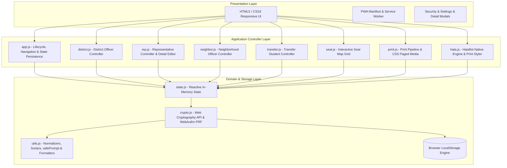
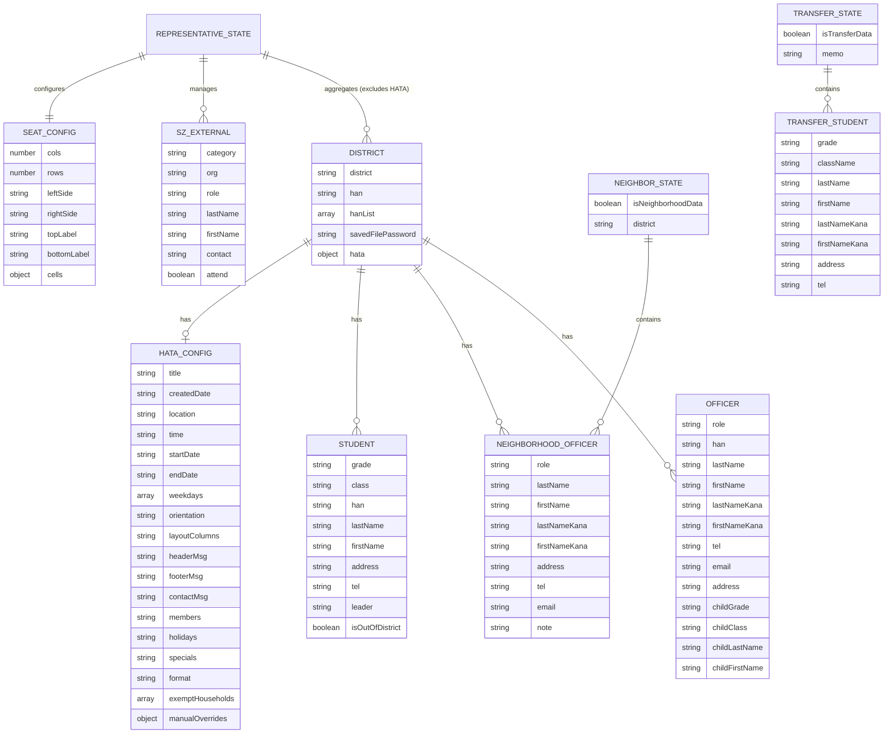
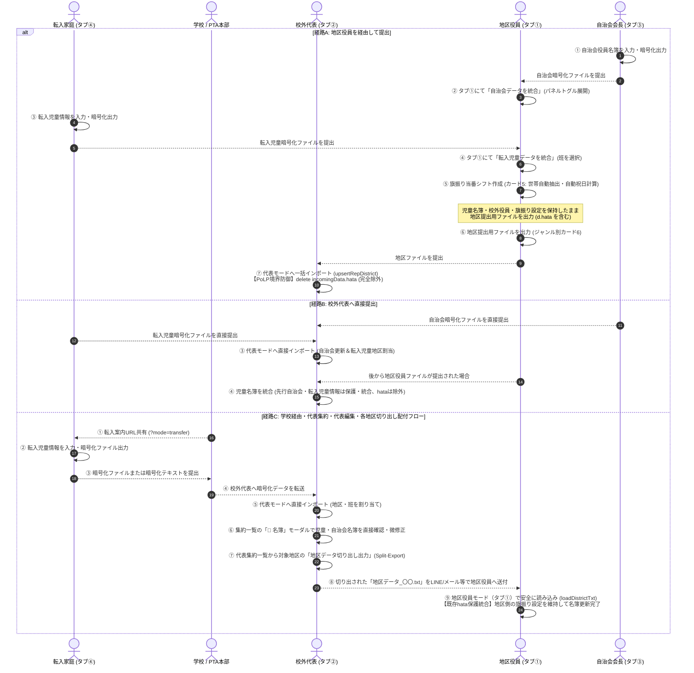

# kogaidocs 内部仕様書

**文書版**: 1.11（アプリケーション 2.12.1 対応） 
**改訂日**: 2026年11月24日 
**文体・規範**: 本文の「する」「である」は要求または仕様を表す。試験済みという意味ではない。

[外部仕様書](external_design.md)の実現方式を定める。過去改修のレビューは[レビュー記録](reviews/)に保持する。

## I-01 アーキテクチャと責務

### 3.1 レイヤー構造

### 3.2 モジュール構成と責務

| モジュール | パス | 主要責務 |
| :--- | :--- | :--- |
| **App Lifecycle** | `js/app.js` | 初期化、4タブ切り替え（地区/代表/自治会/転入者）、前回選択モード復元、PWA登録・強制アップデート、セキュリティバッジ表示、ロック解除モーダル制御 |
| **Crypto Engine** | `js/crypto.js` | Web Cryptography API（AES-GCM 256bit）、PBKDF2-HMAC-SHA256（新規600,000回、旧100,000回読込移行）、WebAuthn PRF、LocalStorage透過的暗号化・復号、ファイル暗号化、パスキー増殖防止固定ID |
| **UI Events** | `js/events.js` | 固定アクション表、許可引数とイベント委譲、重複登録防止 |
| **State Manager** | `js/state.js` | 地区役員データ（`currentDistrict`）、校外代表データ（`repState`）、自治会役員データ（`neighborState`）、転入者データ（`transferState`）のインメモリ管理、LocalStorage自動永続化 |
| **District Mode** | `js/district.js` | 地区名・班名リスト、複数校外役員入力、自治会役員統合取込、転入児童データ統合取込、児童名簿テーブル、児童・自治会役員削除確認、年度更新（進級/卒業）、ファイル入出力、hata保護統合 |
| **Representative Mode**| `js/rep.js` | 各地区・自治会・転入ファイルの一括読込、クリップボード復号、集約一覧、集約地区削除確認、スクゾ外部関係者削除確認、カード1ジャンル別4大セクション化、**各地区名簿（児童・自治会・役員）モーダル閲覧・編集**、単一地区切り出し出力（Split-Export、パスワード案内是正）、**取り込み時hata物理削除（PoLP）**、一括印刷ディスパッチ |
| **Neighborhood Mode** | `js/neighbor.js` | 自治会役員名簿CRUD、役員名札・名簿印刷、自治会単独暗号化ファイル出力/読込、年度更新（役職保持・名簿リセット） |
| **Transfer Mode** | `js/transfer.js` | 家庭情報入力（住所・TEL、児童の氏名・学年・組、複数児童対応）、転入児童削除確認、暗号化ファイル（`家庭情報データ.txt`）出力、暗号化テキストコピー |
| **Seat Map** | `js/seat.js` | スクゾ協議会座席表エディタ、動的グリッド拡張/縮小、窓際/廊下側表示入れ替え、出席者プルダウン割当、空席・施設マーカー |
| **Hataflot Native Engine**| `js/hata.js` | 児童名簿からの世帯自動集約（住所数字＋苗字）、免除世帯管理、オフライン日本の祝日自動計算、期間プリセット、シフト自動生成（均等配分）、個別日付担当者スワップ・調整オーバーライド保持、スマホ向け縦リスト表示、A4多段組印刷組版、LINE用テキスト生成、公式JSONの読込 |
| **Browser Handoff** | `js/handoff.js` | LINE内ブラウザ警告、通常ブラウザへの案内、全モードと未確定編集の暗号化引き継ぎ、世代付き復元UI |
| **Print Pipeline** | `js/print.js` | A4四つ折り自立型名札（中央オリセン・180度反転面）、3x4子供経由封筒宛名、学校用/PTA用役員名簿、児童名簿、自治会名簿等の動的生成 |
| **Utilities** | `js/utils.js` | HTMLエスケープ、姓名・ふりがな分割結合、班名抽出・重複排除、3段階児童ソート、学年別集計、パスワード強度検証、セマンティックバージョン比較（`isNewerVersion`）、安全プロンプト（`safePrompt`） |

## I-02 暗号化・認証・保存トランザクション

提出形式は `ENC:2:` + Base64（salt 16B、IV 12B、AES-GCM暗号文と128bit認証タグ）の順である。新規PBKDF2-HMAC-SHA256は600,000回である。旧`ENC:`/接頭辞なしBase64だけ100,000回で読み込み、未知version・改竄の新形式は旧形式へフォールバックしない。44B未満は復号前に拒否する。提出本文を保存キーに束縛するAADは用いず、端末保存とは区別する。

保存キーは `kogai_district_v2`、`kogai_rep_v2`、`kogai_neighbor_v2`、`kogai_transfer_v2`、認証情報は `kogai_auth_meta` である。保存形式は `STORAGE_ENC:2:` + Base64（IV 12B + 暗号文/タグ）で、AADは `kogaidocs:storage:2:` + 保存キーのUTF-8である。鍵はメモリ内CryptoKeyで保持し、パスワードラップと任意のWebAuthn PRFラップだけを認証メタデータへ保存する。

WebAuthn `user.id` はASCII `kogaidocs` の固定配列である。パスキーマネージャー側での上書き挙動そのものは実装から保証しない。PRF非対応・取消時は通知してパスワード保護を利用する。`file:` ではWebAuthnを開始しない。

- **保護状態の整合性**: メモリ鍵は解除時の認証メタデータ内容と結び付ける。別タブの削除・再設定・破損を保存・読込・解除の開始と非同期完了時に照合し、不一致なら鍵・状態・DOMを破棄して書込みを拒否する。storageイベントでも同じ破棄を実行し、認証キー個別変更に加えて `localStorage.clear()` の `key === null` 通知を保護状態の消失として扱う。暗号文が残るのに認証情報が消失・不正である場合、および保護済みタブが別タブの全消去を検知した場合は未暗号化と扱わない。全消去を実行した当該タブだけは明示的に未暗号化初期状態へ移行する。

- **複数キー確定の競合制御**: 平文状態を含む通常保存・読込・初期設定・再設定・旧形式移行・生体認証情報更新・全消去は、Web Locks API対応環境では同一origin・同一アプリ名のロックを必ず通す。読込は共有ロック、それ以外は排他ロックとし（ただし未暗号化の読込（I-16-03）は、読込・反映・既知値の記録・世代の前進を1回の排他ロックの中で行う）、ロック取得後に認証情報と暗号文の有無を再評価してから平文または暗号化の経路を決定する。保存要求は呼出時点のデータ直列化結果とセッション世代を保持し、ロック待機中に全消去・再設定・ロックが完了して世代が変わった場合は、取得後の平文/暗号化再判定へ進まず要求を拒否する。全4モードと認証情報のトランザクション書込および失敗時復元を1回の排他ロック保持中に完了する。これにより、照合と書込み、各キー間、失敗時復元の間へ別タブのアプリ操作が入ること、初期設定途中へ別タブの平文保存が入ること、および全消去より後に待機中の自動保存が旧データを平文復活させることを防ぐ。全消去要求が書込中に発生した場合は書込完了後に排他ロックを取得して全対象を削除するため、旧処理が後からデータを復活させない。Web Locks APIを利用できない環境では未暗号化データの読込・保存・取込・引き継ぎの復元・全消去だけを許可し（I-16-02）、暗号化の設定・解除・読込・保存・変更は開始せず、対応ブラウザを要求して平文へ降格しない。ブラウザ機能や開発者操作によるロック外の保存領域消去は `storage` の `key === null` 通知で保護セッションを直ちに無効化し、その後の保存を拒否する。

- **保存暗号文のAAD**: 新形式は `STORAGE_ENC:2:` とし、AES-GCMのadditionalDataにアプリ識別子・形式・保存キーを含める。保存先の入替・改竄・異なる形式の偽装を拒否する。既存形式はパスワード・WebAuthn PRFのいずれも鍵取得後の共通処理で全モードを復号・検証して新形式へ原子的に移行し、認証情報へ形式2を確定する。失敗時は旧値を保持し、解除成功としない。形式2の認証情報で旧形式へ降格しない。生マスター鍵バッファはラップ・インポート・生体認証の成功/失敗にかかわらずfinallyでゼロ化する。

- **パスワード導出強度**: 新規の保存鍵ラップと提出ファイルはPBKDF2-HMAC-SHA256を600,000回実行する。保存鍵ラップの認証メタデータには反復回数を保持し、100,000回または600,000回以外をKDF実行前に拒否して計算量DoSを防ぐ。反復回数を持たない旧保存形式は100,000回としてパスワード解除し、全4モードの復号・検証、必要な保存暗号文再暗号化、600,000回での生鍵再ラップをすべて完了してから、保存値と認証情報を同一トランザクションで確定する。書込失敗、ロック、他タブ変更時は原本を復元して解除失敗とする。生体認証解除はパスワードを取得できないため旧パスワードラップを保持し、次回のパスワード解除まで反復回数移行を保留する。提出ファイルは新形式`ENC:2:`を600,000回、旧`ENC:`および既存の接頭辞なしBase64を100,000回として復号する。未知の`ENC:<version>:`はKDF実行前に拒否し、新形式の認証失敗後に旧形式へフォールバックしない。

- **自動ロックと保存順序**: 自動ロックの絶対期限を保持し、操作・表示復帰時には延長する前に期限切れを確認する。復帰のイベント処理は個人情報操作より先に行う。15分以内の正規操作は期限を更新する。更新処理は4モードの保存完了を待ち、容量不足・暗号化失敗を通知してナビゲーションを中止する。保存の呼出順ではなく完了順が前後しても最新値が残るよう、同じキーの書込みを順序管理する。

## I-03 データモデルと受入制約

### 7.1 エンティティ関係図（ERD）

### 現行モデル契約

| モデル | 受入・正規化 |
| :--- | :--- |
| 地区 | districtは文字列、officers/students/neighborhoodは行配列である。省略/nullの任意配列は空配列にする。旧officerは境界で配列へ移行し、描画はofficersを用いる。savedFilePasswordは存在時文字列だけである。 |
| 代表 | districts必須、各地区を検証してhata/hatafurotto/savedFilePasswordを除外する。szExternalsは任意配列、attendは存在時booleanである。 |
| 自治会 | district文字列とneighborhood配列である。提出識別子はisNeighborhoodData:trueである。役員行の既知個人項目は文字列または許容されたnullである。 |
| 家庭情報提出 | isTransferData:true、version:2、直下のaddress/telと、1件以上のchildrenのlastName/firstName/classNameを必須とする。gradeは1〜6である。各児童にも同じaddress/telを複写し、studentsを併記する。旧version:1や省略時は児童ごとの氏名・住所・電話を検証して受け入れる。 |
| 家庭情報下書き | children配列（0件可）、address/telは存在時4096文字以内の文字列、memoは存在時文字列である。未入力の家庭情報・児童も許す。提出必須条件を保存へ適用しない。 |
| 座席 | colsは2〜10、rowsは2〜14の整数（数字文字列を数値へ正規化）である。cellsキーは範囲内のr_c、refKey/customTextは文字列または許容されたnullである。 |
| 旗振り | タイトル/メタ情報/日付/特別枠/書式は文字列、weekdaysは0〜6整数配列、orientationはportrait/landscape、layoutColumnsは1〜6である。schedule/manualOverridesの文字列・boolean項目も検証する。 |

旧文書7.2のJSON Schema断片には保存キーv1、転入studentsだけを必須とする記述、layoutColumnsをstringだけとする記述があり、実行バリデータと一致しなかった。現行契約は本表および `validateImportData` / `validateStoredData` / `validateHataConfig` であり、旧断片を完全なスキーマとして再掲しない。未知項目を一律拒否する閉じたスキーマではないため、年度更新時は別途保持項目の許可リストを適用する。

- **復元の受入境界**: ファイルだけでなく平文/暗号化LocalStorageの全4モードを検証する。復号・型検証・旧形式正規化が全モードで成功するまで本状態を置換しない。失敗時は保存値を保持し、鍵・部分読込状態を破棄して解除成功と表示しない。任意の `savedFilePassword` は存在時に文字列だけを許可し、暗黙の文字列変換や描画例外へ到達させない。旗振り設定は標準項目と表示用別名を同じ型台帳で検証し、`scheduleCreatedDate` と `district` を含む描画文字列へオブジェクトを許可しない。転入ローカル保存は未入力・0件も許容し、提出用の必須入力検査とは区別する。座席寸法は保存スキーマと描画側の双方で2〜10列・2〜14行の整数へ固定する。HTML本文・属性は適切にエスケープし、旗振り日付・曜日も文字列として出力する。

- **辞書と構造**: 担当者・参照値の辞書はnullプロトタイプまたはMapと所有キーで処理する。入力オブジェクト中の `__proto__`・`constructor`・`prototype` キーは拒否するが、氏名等の文字列値は通常データとして保持する。全JSONは4MiB、入力テキスト/ファイルは8MiB、深さ20、各配列10,000件、総ノード100,000以下とする。旗振りの基本期間は3,660日以下、休日・特別枠は範囲展開後の合計を3,660件以下、列数は1〜6とする。この検査は公式JSONだけでなく地区モデルの共通受入境界で実施し、ファイル・貼付・平文保存・暗号化保存・旧形式移行のすべてで状態置換前に適用する。範囲外は状態・DOM・保存値を変更せず拒否する。容量上限は読込前のFile.sizeと読込後の内容にも適用する。

### 日付境界の追加是正（SEC-19）

`validateDateExpansion` は空でない端点をそれぞれISO実在日検証した後、両端がある場合だけ順序・日数を検証する。これを共用することで、単独の不正開始日/終了日が描画前に拒否される。空の片側は下書きとして許す。休日省略時の自動生成は開始年2000〜2099だけを対象とし、翌年も2099までに制限する。範囲外の有効ISO期間は拒否せず休日を空へ補完し、明示された休日・空文字は保持する。この範囲は技術上の実行範囲であり、法改正・特例日の正確性を保証するものではない。ファイル・貼付・保存復元・公式JSONはこの検証を共有し、型検証を描画後へ遅延させない。

## I-04 統合・名簿・旗振り・年度更新

### 5.6 データ統合・同期パイプライン

- **4モードの保存保護**: 暗号化設定・全消去には `kogai_transfer_v2` を含む全4モードを適用する。暗号鍵を持たないロック状態では既存暗号文を上書きしない。移行では新鍵と全4モードの暗号文をメモリ上で生成・検証してから書込みを開始し、全保存成功後に認証メタデータを確定する。失敗を呼出元へ伝播し、書込み済みキーを保存前の値へ戻して旧鍵を維持する。復旧も失敗した場合は成功扱いにせず、失敗を通知する。
- **ロック時の破棄範囲**: 地区旗振り設定・生成済み当番表、代表外部関係者・座席設定、自治会・転入者、代表地区編集の複製とDOM、印刷DOM、全パスワード・確認・復号入力欄、貼付テキストを消去する。表示切替でtext型となったパスワードも対象である。既存暗号文は保持し、正しい解除により再描画する。解除成功後のパスワード欄も消去する。ロック・全消去・暗号化設定確定で処理世代を更新し、開始世代が異なる読込・復号・JSON読込・解除・保存は状態更新・DOM描画・ストレージ書込みを行わない。ファイル読込開始前の世代を完了後まで引き継ぎ、ロック後の処理開始自体も拒否する。初回暗号化・簡易設定・解除成功直後から15分の自動ロックを開始する。
- **旗振り復元**: 非空の休日を含め全設定をDOMへ反映した後にプレビュー・保存を行う。当番名簿の編集・児童名簿の明示反映後は免除候補も再描画する。休日の空文字はユーザーによる除外解除として保持する。公式JSONの空ファイル・構文・ネストした設定型を検証し、不正時は元設定・DOM・保存値を保持して通知する。休日配列は各要素の日付・理由を検証し、日付・理由の改行区切りテキストへ正規化して復元・保存する。読込成功・失敗ともファイル入力を空に戻して同一ファイルの再選択を可能とする。当番membersは独立した編集名簿として保持し、公式JSONのmembersも当番名簿へ取り込む。児童名簿の行へは取り込まない。
- **引用符・コード注入対策**: 世帯キーをイベント属性のJavaScript文字列へ連結しない。DOMのdata属性へHTMLエスケープして格納し、固定ハンドラーからその値を受け取る。
- **座席参照**: 既存の `OFF_地区index_役員index`、`EXT_index`、`NEI_地区名_index` の保存形式を維持する。削除時は対象本人の割当を解除し、後続インデックスを繰り下げて別人への割当変化を防ぐ。詳細モーダルでは校外・自治会双方の元行対応表を下書きとともに保持し、氏名・役職・連絡先の通常編集でも本人の出席・座席を維持し、保存時のみ本状態と座席へ適用する。キャンセル時は本状態を変更しない。自治会出席チェックも同じ対応表で維持する。地区・名簿・印刷対象の変更後は集約・出席者・座席候補を同期して再描画する。外部ファイルによる名簿置換時は同一人物の継続を確認できない割当を解除する。同一地区名の複数班の出席チェックは、取込以外の経路では、変更前後に選ばれる自治会代表名簿を比較し、氏名・役職・連絡先で同一人物を一意に確認できる場合のみ継続し、比較が曖昧な場合は解除する。地区・自治会データの取込（`upsertRepDistrict`・`mergeNeighborDataIntoRep` を通るすべての取込。名簿のない地区ファイル・自地区データを含む）の出席チェックは I-13-02 だけに従う（比較元との照合、比較元がない場合の初期チェック、同名エントリの作り直し、名簿のない取込の各場合を含め、場合分けは I-13-02 による）。座席参照は、取込・地区詳細モーダルの保存・印刷対象の切替（一括を含む）・地区の削除・外部関係者の行削除など `reconcileSeatState` を通るすべての経路で、代表名簿の比較ではなく I-13-02 の照合による（自治会役員は所属と本人の識別子（氏名・役職・電話・住所）で照合し、変更前後の座席候補のエントリでそれぞれ一意な同じ本人の出席者にだけ引き継ぐ。地区詳細モーダルで編集した行の扱いは I-13-02 による）。
- **貼付復元**: 地区の貼付復元はファイル復元と同じ復号・上書き確認・hata保護経路を使用し、成功時のみ入力テキストを消去する。
- **受入スキーマ**: 認証済み暗号文でも内容を信頼しない。各取込経路の種別・文字列項目・名簿配列・行オブジェクト・座席設定を、状態を変更する前に検証する。不正な型・必須構造欠落は旧状態・DOM・保存値を保持して拒否する。地区名が文字列である旧形式と省略・nullの任意配列は空配列へ正規化する。転入データは少なくとも氏名・住所・電話番号を持つ児童配列を要求する。代表集約へ保存パスワードを引き渡さない。
- **旧形式役員**: 単一 `officer` にも `officers` の各行と同じ文字列項目の型検証を適用する。旧形式の `childName`・`kana`・`childKana` と分割済み子ふりがなも検証対象である。正常な旧形式は既存の姓名・子氏名分割と役員配列への正規化を維持する。不正な班・氏名・役職等は地区復元と代表マスター復元の双方で状態置換前に拒否する。
- **ファイル振分**: 代表の一般ファイル選択・貼付・統合ファイル復元は同じ種別ディスパッチャーを通す。転入識別子を優先判定して専用取込と同じ地区・班割当へ渡し、自治会は自治会統合、代表マスターは全体復元、地区は地区集約へ渡す。キャンセルした取込を成功件数へ計上しない。
- **暗号化コピー**: 自治会コピーでもファイル保存と同じパスワード強度・確認一致検査を適用する。
- **印刷**: 自治会名札は `buildTentCardPageHtml(subTitle, mainName, mainKana, role)` の契約に従う。UIテストは呼出回数に加えて氏名・かな・役職と選択帳票・連絡先非表示を意味単位で検査する。旗振り印刷中は古い通常帳票の出力領域を非表示にし、選択向きの@page設定を適用する。印刷後は画面・タイトル・一時スタイルを復元する。

### 年度更新の追加是正（SEC-18）

自治会役員行はroleと空の正式個人項目（lastName/firstName/lastNameKana/firstNameKana/address/tel/email/note）だけへ再構築する。代表外部関係者行はcategory/org/role、attend:trueと空の正式個人項目（lastName/firstName/lastNameKana/firstNameKana/contact）だけへ再構築する。name/kana、別用途の連絡先、未知の追加プロパティをコピーしない。確認取消の場合は元の全項目を保持する。地区年度更新は進級対象児童を再構築し、役員・自治会を初期化する既存方式を維持する。

## I-05 描画・イベント・印刷

- **厳格CSPとイベント**: インラインscriptとイベント属性を除去し、`js/events.js` の固定処理表へ移す。`data-click/input/change/submit/keydown` と `data-index/field/target` 等は宣言的なアクション名・検証済み引数のみであり、コード文字列ではない。任意コード評価・汎用式解釈・`window[name]` 実行は禁止する。動的名簿にもdocumentの委譲を適用し、停止・preventDefault・モーダル背景判定・Enterを維持する。CSPの全文と配置は I-14-01 を正とする（`script-src 'self'; script-src-attr 'none'; object-src 'none'; base-uri 'none'; form-action 'none'` を含む）。スタイルのインライン許可は置かない（I-15）。frame-ancestorsはmetaでは機能しないため、実配信ヘッダー未確認を対策済みとしない。

HTML本文・引用符付き属性の値はescで `& < > " '` をエスケープする。URLやCSS/数値の文脈はHTMLエスケープだけで安全とせず、固定URLと範囲検証を用いる。印刷DOMも同じ境界で扱う。`window.print` とCSS `@page` を用い、タイトル・印刷の向きの link の `media`・表示を finally で戻す（I-15-05）。名札の4面と180度回転、宛名12面とページ分割は出力契約である。詳細は外部仕様E-07である。

## I-06 PWA・更新・通信

- **PWA・外部境界**: SWは自身のscope内の公開静的資産だけを扱い、クエリ付き要求・未知URL・外部origin・非GET・認証付き要求を永続保存しない。install時を含め、公開資産は `credentials: 'omit'`・`cache: 'no-store'` で取得し、`Cache-Control: private/no-store` の応答を保存しない。Fetch仕様上、ブラウザのfiltered responseでは `Set-Cookie` がJavaScriptから非公開となるため、ヘッダー名の検査だけを保証根拠としない。Set-Cookie検査はヘッダーが露出する環境での追加防御であり、匿名要求、固定許可リスト、公開応答の配信契約を主要境界とする。version.jsonはキャッシュしない。activate/更新で削除するcacheは当該scopeのアプリ接頭辞だけとし、解除するSWは当該scriptURL・scopeだけである。外部共有ウィンドウにnoopener/noreferrerを付し、共有は利用者の明示操作に限定する。

アプリURL共有と名簿の暗号化共有は別機能である。アプリ共有は固定紹介文とモードURLだけである。名簿共有は明示操作時だけ暗号化本文を引き渡す。LINE/mail件名・ファイル名・提出ヘッダーの地区名等まで秘匿する設計ではない。外部共有windowはnoopener/noreferrerを付す。

## I-07 品質検証・追跡

### 10.1 テスト方針
Node.js 24組み込みのテストランナー（`node:test`）、アサーション（`node:assert`）、WebCrypto環境を活用し、**外部npm依存ゼロ（Zero External Dependencies）**で完全自動テストスイートを維持する。

### 10.2 カバレッジ目標
すべてのモジュールにおいて、**命令網羅（Line）100.00%**、**分岐網羅（Branch）95.00%以上**、**関数網羅（Funcs）95.00%以上** を維持・達成する。

### 10.3 テスト観点マトリクス（新機能・全機能網羅）
1. **単体テスト（Unit Tests）**:
	- `app.js`:
		- URLパラメータ `mode`（`district`, `rep`, `neighbor`, `transfer`、数値 `1〜4`）による直接選択、無効パラメータフォールバック、直前選択モードとの優先順位。
		- モード指定URL共有（`shareAppUrl(specificMode)`）: クエリ付加、Web Share API呼び出し、クリップボードフォールバック。
		- 4モード選択肢の動的折りたたみUX: 初期状態、各モード選択後の自動折りたたみ、展開バッジのクリックによる再展開。
		- 前回選択モードの永続化と復元: `switchTab` での `localStorage` 記録、起動時の自動復元、不正モード名の安全なフォールバック。
		- PWAバージョンチェック（`checkAppVersion`）: オンライン時の最新バージョン検知、更新確認ダイアログ、手動更新ボタンのdisabled制御と復帰、直前更新試行履歴（`sessionStorage`）による自動ダイアログ抑制（無限ループ防止フェイルセーフ）、手動更新時のバイパス。
		- 強制アップデート（`performAppUpdate`）: 独立try-catchによる全4モード（地区・代表・自治会・転入者）状態同期保存、`sessionStorage` への更新試行バージョン・時刻の記録、キャッシュ破棄、登録解除、リロード。
	- `version-consistency.test.js`:
		- `package.json`、`version.json`、`sw.js`（`CACHE_NAME`）、`js/app.js`（`CURRENT_APP_VERSION`）の4ファイル間にバージョン乖離がないことを恒久的に機械アサート。
	- `crypto.js`:
		- 固定 `WEBAUTHN_USER_ID` の検証: 1Password等パスキー管理ツールでの上書き更新互換性。
		- ストレージ暗号化とWebAuthn一本化: ストレージ暗号化済み環境での重複登録抑止。
	- `transfer.js`:
		- 転入児童CRUD（追加・削除・入力更新・複数児童対応）。
		- 転入児童削除確認ダイアログ（入力値がある場合の `confirm`、キャンセル時中断）。
		- **住所・電話番号必須バリデーション**: 住所または電話番号が空の場合の出力・コピー抑止と警告表示。
		- 暗号化ファイル（`.txt`）出力・暗号化テキストコピー・復号読込。
		- 提出先文言「指定された提出先」の確認。
		- 上部のアプリ共有から家庭情報入力URLを共有する検証。
		- 入力リセット（クリア）動作（確認付き）。
	- `district.js`:
		- 自治会統合パネルのトグル開閉（初期非表示、トグル反転）。
		- 転入児童統合パネルのトグル開閉（初期非表示、トグル反転）。
		- 自治会役員削除確認ダイアログ（`removeN`、`confirm` 表示、キャンセル時中断）。
		- 児童名簿削除確認ダイアログ（`removeS`、`confirm` 表示、キャンセル時中断）。
		- 自治会名簿および児童名簿における上下ツールバー・フッター「行を追加」「児童を追加」ボタンの動作。
		- カード6（ジャンル別4大セクション）における各ボタン群の動作。
		- 転入児童データの受入・統合（班割り当て、重複チェック、名簿追記、ソート、保存）。
		- 地区ファイル読み込み時の既存 `hata` 保護統合（読み込みデータに `hata` がなくローカルに `hata` がある場合の保持）。
		- 年度更新時の `hata` 設定保持（場所・時間・曜日・連絡先・向き）およびスケジュール・個別調整初期化。
	- `hata.js`:
		- **ハタフロット設定・データの永続化**: `saveDistrictLocal` によるDOMから `currentDistrict.hata` への同期、LocalStorage保存、読込時画面復元。
		- **デフォルト値検証**: 印刷向きが `portrait`、多段組み列数が `2` であること。
		- **PDF印刷時動的タイトル連動**: `printHataSchedule` 呼出時の `document.title` 一時置換と印刷後自動復元。
		- 世帯自動集約、祝日自動計算、期間プリセット、シフト均等生成、個別スワップ・調整、公式JSON連携。
	- `rep.js`:
		- 代表カード1のジャンル別4大セクション整理の動作。
		- 集約地区一覧個別削除確認ダイアログ（`deleteRepDistrict`、`confirm` 表示、キャンセル時中断）。
		- スクゾ外部関係者個別削除確認ダイアログ（`deleteSzExternalRow`、`confirm` 表示、キャンセル時中断）。
		- **各地区の手動追加（`addNewRepDistrict` ＆ DOMモーダル）**: `openAddDistrictModal` によるモーダル起動・自動フォーカス、未入力・重複時のインラインエラー表示（`#rep-new-district-error`）、正常追加時のモーダルクローズ・カード1自動展開・集約テーブル反映・LocalStorage保存、キャンセル/ESC/背景クリックでのクローズ、`addNewRepDistrict(dName)` 直接呼出互換、`prompt()` に一切依存しないことの検証。
		- **集約地区名簿（児童・自治会・校外役員）モーダル閲覧・編集（`openRepDistrictDetailModal`）**: モーダル展開、児童・自治会役員・校外役員の追加・編集・削除、モーダル保存・閉じる際の集約テーブル同期再計算およびローカル永続化。
		- 代表モードからの地区データ切り出し出力（PoLP、パスワード案内メッセージ・フォーカス是正）。
		- **代表取り込み時の旗振りデータ物理削除（PoLP）**: `upsertRepDistrict` で `d.hata` が完全削除され、代表マスターに混入しないことの検証。
	- `neighbor.js`:
		- **名簿行追加ボタン近接配置**: テーブル直前および直下の「＋ 行を追加」ボタンの動作検証。
		- **4大セクション統合カード（`#card-n-file`）**: パスワード設定、ファイル出力・テキストコピー、ファイル読込・テキスト貼付、年度更新の動作検証。
	- `print.js`:
		- **動的タイトル連動**: 帳票印刷時の `document.title` 一時置換（帳票名＋地区名）と印刷後自動復元。
		- **個別PDF保存パイプライン（`printSingleDistrictSeparately`）**: 選択された各帳票の順次レンダリングと印刷ダイアログ呼び出し。
	- `hata.js`（ハタフロットネイティブ統合）:
		- **ハタフロット設定・データの永続化**: `saveDistrictLocal` によるDOMから `currentDistrict.hata` への同期、LocalStorage保存、読込時画面復元。
		- **デフォルト値検証**: 印刷向きが `portrait`、多段組み列数が `2` であること。
		- **PDF印刷時動的タイトル連動**: `printHataSchedule` 呼出時の `document.title` 一時置換と印刷後自動復元。
		- 児童名簿からの世帯自動集約（住所数字正規化＋苗字、兄弟姉妹統合、同一世帯キー生成）。
		- 免除世帯管理（`exemptHouseholds`）: 免除切り替え、当番候補からの除外。
		- 日本の祝日・振替休日自動計算エンジン: 春分・秋分、ハッピーマンデー、振替休日、連休判定の精度検証。
		- 期間プリセット（前期、後期、通年、学期別）による開始・終了日自動設定。
		- シフト自動生成アルゴリズム: 均等ラウンドロビン割り当て、特別追加枠（行事・固定担当）の優先反映。
		- 個別日付スワップ・調整オーバーライド（`manualOverrides`）: 2世帯間の担当スワップ、直接編集、休み指定、初期復帰。
		- スマホ向け縦リストビューおよびPC向けグリッドビューのHTML生成。
		- A4印刷用組版（`@media print`）およびLINE用テキスト生成。
		- 公式ハタフロットJSONの読込互換（旧aliasを含む変換）。
2. **結合テスト（Integration Tests - 多層データ統合パイプライン）**:
	- **パターンA（自治会統合）**: 自治会出力 → 地区統合（児童・校外役員保持） → 地区出力 → 代表インポート。
	- **パターンB（転入児童統合）**: 転入者出力 → 地区受入（班割当統合） → 地区出力 → 代表インポート。
	- **パターンC（転入児童代表直接）**: 転入者出力 → 代表受入（地区選択統合）。
	- **パターンD（同一地区複数班統合）**: 同一地区の複数班ファイルインポート時における自治会役員・児童の重複排除および整合性同期。
	- **パターンE（代表集約・モーダル編集・各地区切り出し配付）**: 転入者出力 → 代表直接受入（地区・班割当） → 代表モーダルで名簿直接修正 → 代表から特定地区切り出し出力（Split-Export） → 地区役員モードで受入・名簿反映（地区側の旗振り設定が保護維持されること）。
	- **パターンF（ハタフロットPoLP境界防御）**: 地区で旗振り設定作成 → 地区暗号化出力（`hata` 含む） → 代表モード取り込み（`hata` が代表マスターに一切含まれないことの検証） → 代表切り出し出力（`hata` なし） → 地区側再読み込み（既存 `hata` が安全に復元・保護されること）。
3. **システムテスト（System Tests - E2E / セキュリティ）**:
	- 4タブ（①地区 ⇄ ②代表 ⇄ ③自治会 ⇄ ④転入者）の全画面巡回、タブ切り替え時の入力中フォーム値の保持。
	- URLクエリパラメータ付きURLでの直接モード起動E2E検証。
	- ブラウザランタイム統合テスト（単一グローバル環境でのスクリプトロード・エラーゼロ検証）。
	- 全削除操作における確認ダイアログの動作E2E検証。
	- 代表モードでの地区詳細モーダル編集E2E検証。
	- ハタフロット自動シフト生成〜スワップ〜印刷プレビュー〜公式JSON読込と地区暗号化保存のE2E検証。
	- 利用者向け画面の統合・結合という用語の一貫性を確認する。

### 10.4 カバレッジ達成目標
- 全モジュールにおいて **命令網羅 100.00%**、**分岐網羅 95.00%以上** を維持する。

本番12モジュールとService Workerを監査対象とする。node:testのV8レポートはNodeでロードしたjsモジュールの数値であり、別プロセスの実ChromiumやVMのsw.jsを同じ数値で網羅したとは扱わない。SWは専用の正常・異常要求試験で確認する。

全仕様の根拠・不足・環境制約は[トレーサビリティ](specification_traceability.md)に記録する。実UI試験はfile起動、実DOM、375/768/1280px、実再読込、実WebCryptoを用いる。OS印刷・共有・認証器や配信SWは別検証である。通信観測はCDPの対象ページ要求を検査し、正常画像の要求を検出できる対照試験を置く。ブラウザ全プロセス・他アプリ・実配信の通信無漏洩保証には拡張しない。

## I-04-08 旗振り設定の収集・互換性

`renderHataCard` は未定義の `members` だけ児童名簿から初期化する。明示した空文字は保持する。`syncHataMembersFromStudents` は明示操作であり、非空の異なる名簿には置換確認を要求する。生成時に無条件同期してはならない。

`saveDistrictLocal` は旗振り全入力を空文字も含めて同期し、曜日を配列、`dedup` を真偽値として収集する。選択肢不正値は設定へ採用しない。公式JSON取込は `validateHataConfig` を通してから確定し、現行上流のキーを優先して旧metaキーも受け付ける。`??` によって空文字・空配列・falseを既定値と区別する。地区ファイルは `hata` 全体を暗号化し、代表集約の最小権限境界は維持する。

`buildHataLineText` はシフトとメタ情報をテキスト化し、コピー失敗時にread-only欄を表示する。名簿重複検出はMapを用い、警告にtextContentを用いる。新しい欄も既存のロック時消去対象となる。

## I-06-08 iOSインストール導線

`isIosDevice` はiOS UAとMac型UAのタッチ対応端末を認識する。`updatePwaInstallButton` は安全な配信・未インストール状態・iOSまたは保留プロンプトを条件とする。standaloneは `navigator.standalone` とdisplay-modeの両方を確認する。iOS案内はnative dialogであり、外部通信・端末情報の保存は行わない。`appinstalled` は保留プロンプトを破棄してボタンを隠す。Service Workerとアプリのバージョンを同時更新して既存キャッシュからの更新を可能にする。

## I-06-09 ブラウザ間引き継ぎ

`js/handoff.js` はLINE UA検知、固定情報のみの外部ブラウザURL、暗号化データ作成・ファイル/コピー・復元UIを管理する。データ形式は `type: kogaidocs-browser-handoff`、`version: 1`、`mode`、`models`（地区/代表/自治会/転入者）、`drafts`（固定IDの文字列）、`repDraft`（原本index、地区下書き、旧行index配列）である。

`validateBrowserHandoff` はサイズ・深さ・予約キー検証後に全4モデルへ `validateStoredData` を適用する。転入者は保存用の下書き仕様を使う。記憶パスワードを除外し、貼付欄IDは固定の許可リストで検査する。代表の行indexは原本の範囲内・重複なし・nullは新規行に限定する。下書きは原本へ暗黙確定しない。

`replaceStoredAppData` は同一Web Lock内で全モデルを検証・暗号化してから `writeStorageTransaction` で保存する。保存済み端末の暗号化設定は変更しない。保存成功後に処理世代を進め、古い保存・取込を無効化する。復元UIは保存成功後だけモデルとDOMを確定する。閉じる・ロックのUI世代とストレージ世代を双方検査し、処理中の二重実行を抑止する。

移動用URLはorigin/path・固定モード・LINE外部ブラウザ指定だけから構築する。引き継ぎデータ・鍵をquery/hashへ埋め込まない。送受信する専用サーバーやLINE SDKは導入しない。

## I-04-09 旗振り書式と安全な入力収集

書式変換を buildHataMembersText に集約する。児童の複製を正規化し、元データは変更しない。児童名簿変更時は免除候補だけを再描画する。旧 updateHataPreview/copyHataList と関連DOM・イベントを削除する。collectHataScheduleInputs は startDate/endDate/holidays/specials を候補へまとめて検証する。失敗時は有効な4項目を保持し、任意の inputDrafts 辞書に生入力を保存する。辞書は当該4キーの文字列だけを許可し、日付展開には使用しない。成功時は4項目を一括反映し辞書を削除する。通常保存・再描画・地区ファイル・引き継ぎは辞書を保持する。復元時はネイティブ引き継ぎdialogを閉じてから地区追加/代表編集モーダルを開き、フォーカスがinert背景に奪われる順序を避ける。

renderHataExemptList は members を基準とし、未設定の旧データだけ児童世帯を代用する。既存の住所数字_苗字キーを当番表記と照合し、旧キー/表示名の選択・解除を両方扱う。児童の情報から重複数を表示できる場合は従来の世帯人数も付す。members の編集・明示反映時に再描画する。

## I-04-10 保存データの文字列増幅対策

validateHataTextBudget / validateHataScheduleOutput を共通受入検証、生成、HTML/印刷/LINE本文へ適用する。buildHataMembersText は単一の固定トークン正規表現を用い、各置換値を結合する前に行長を検査し、追加前に総UTF-8量を検査する。collectHataScheduleInputs は既存4項目に members/format を加えて一括検証する。inputDrafts はこの6キーの文字列のみを許可し、未完成値を展開しない。

保存ファイルの取込と自治会・転入統合は、検証済み候補の保存完了を待ってから本状態と画面へ反映する。失敗した場合は元のモデル・画面・保存原本を保ち、保存失敗を通知して再試行を可能とする。

班・氏名・住所等の短文は4096文字以下とする。班選択肢の行数との積は4MiB、全候補参加者の座席数との積は16MiBの保守的な見積もりで制限する。名簿・日付指定の改行分割は空行も含め10000行以下とする。

### 家庭情報入力のデータ契約（2026年11月11日）

`transferState` の直下に `address`、`tel`（4096文字以内の文字列）を保存する。未入力下書きは許容する。旧保存値で家庭の住所・電話が未定義の場合のみ先頭児童から補完する。ロック・提出後リセットでは家庭欄・児童欄・パスワードをすべて消去する。

新規提出は `version: 2` とし、家庭の必須項目、児童の姓・名・学年1〜6・組を検証する。出力用児童は許可フィールドから構築し、家庭の住所・電話を各児童にも複写する。既存の受入処理との互換用に `children` と `students`、`className` と `class` を維持する。旧提出（version 1または省略）は従来どおり受け入れる。地区・代表の児童行へ住所・電話番号を保持し、保存・再出力で失わない。家庭欄の更新イベントは固定のフィールド許可リストを用いる。

## I-08 アクセス制御・非同期起動

起動時に役員保存必須ポリシーを有効化し、地区・代表の平文書込を保存層で拒否する。旧平文読込は暗号化移行用に維持し、初期描画中はCSSで役員フォームを隠す。activeAppModeと初期化済みフラグを保持し、モード変更・設定完了・解除・ロック時に同一のアクセス更新関数を通す。保護中の役員タブはhidden表示とinertを併用し、委譲イベントも拒否する。モーダルを閉じても必須ポリシーを解除しない。暗号化済み未解除の自治会・家庭情報入力はメモリ上の新規フォームだけを利用し、保存関数は従来通りfalseで拒否する。解除時には保存済みデータで置換する旨を説明する。

バージョン通信は遅延実行を維持し、AbortControllerとPromise.raceによる5秒の期限を取得とres.jsonに適用する。期限タイマーはfinallyで破棄する。タイムアウト後の応答は更新確認やリロードを実行しない。当番回数欄は閉状態overflow:hidden、展開状態overflow-y:autoかつmax-height:min(400px,60vh)とする。フォーム外の選択・copy/cutはイベントでも拒否し、選択元がinput/textareaの場合だけ許可する。

### 初回アセスメント

保護対象は既存役員名簿・認証鍵・パスワードである。誤操作利用者、悪意ある取込、別タブの認証変更を信頼しない。モード変更は認証解除ではなく表示権限の変更であり、保存暗号文・鍵は開放しない。JavaScript自体を操作できる攻撃者、ブラウザ拡張、OS画面取得、コピー後の他アプリ、HTTPS配信の保証はWeb内の制御範囲外である。フォームを隠すだけでなく平文書込拒否と既存セッション世代検査を併用する。実装後に別工程として入力・出力・非同期・保存境界を再評価し、発見した問題を攻撃再現テストから是正する。

オフライン起動は、バージョン確認の分離だけでなくService WorkerのモードURLへの応答を含む。自アプリのルート・index.htmlへのGETナビゲーションで、mode/openExternalBrowser以外のクエリがない場合だけ、匿名取得した固定index.htmlへ正規化する。URL自体は維持し、キャッシュキーへ個別クエリを保存しない。_update付き更新、別パス・別origin、認証ヘッダー付き要求は従来通りネットワークへ渡す。保存領域のアクセス拒否は保護状態不明としてロック扱いとし、モード変更で平文扱いへ降格しない。初回ネットワーク取得とキャッシュ保存が完了していない端末のオフライン起動は保証しない。

通常のscript/CSS要求ではブラウザがcredentials:includeを付け得るため、固定許可リストの資産も匿名Requestへ正規化してから照合する。元のAuthorization/Cookieヘッダーは保持したまま検査して拒否する。固定公開コードを匿名取得する配信契約は維持する。ナビゲーション正規化もAuthorization/Cookie付き要求を拒否する。任意パスやクエリのキャッシュ許可へ拡張しない。

実HTTP再起動試験は `tests/manual/offline-http.js` に保持する。本実行環境ではNode自身のループバック接続は成功するが、最小のChromium HTTP起動でもサーバーへ要求が届かずタイムアウトした。通常スイートへ未検証の合格・skipを混在させず、実HTTP/PWA起動の確認は未完了として記録する。

## I-09 追加セキュリティ是正

SEC-22では設定・解除の操作世代とbusy状態を管理する。閉じる・モード変更・再操作で旧世代を無効化する。暗号側へguardを渡し、排他取得後と書込/鍵有効化の直前で照合する。鍵有効化後に画面離脱した場合は鍵を破棄し、読込状態の採用直前にもguardを照合する。古いcatch/finallyは新規入力・新規操作を変更しない。未暗号化の旧保存値と移行用メモリは取消時に消去せず保持する。

SEC-23では全ての暗号化ファイル・コピー・共有・代表地区切出しに開始時保存世代を保持する共通guardを適用する。暗号化完了からOSへ渡す前、および失敗後の代替出力前に世代を再評価し、不一致はfalseで中止する。ゲストの新規提出は解除状態を要求せず、開始から終了まで世代が同じ場合だけ許可する。OSへ既に渡したクリップボードやファイルの撤回・失効は保証しない。

地区出力のファイル名・平文見出し・共有タイトルは、暗号化本文を直列化する時点の地区・班を保持して構築する。暗号処理待機中の通常編集で出力先の識別情報と本文を食い違わせない（SEC-24）。

出力guardは保存世代だけでなく開始時の認証メタデータ文字列も保持し、出力直前に照合する。別タブのstorage通知前に認証情報を変更・削除された場合にも中止する。認証状態を取得できない場合は出力を許可しない。

## I-10 SEC-25 〜 SEC-29 の実装仕様

- **SEC-25（ゲスト引き継ぎ・更新と役員データ分離）**:
	- `hasOfficerData(modelKey, value)` / `hasNonEmptyOfficerModels(models)`（`js/crypto.js`）および `hasOfficerHandoffData(payload)`（`js/handoff.js`）における未編集既定値と変更値の境界を以下の通り定義する。
		- `kogai_district_v2`: `district` 非空、`han` 非空（または `hanList` に1件以上の非空要素あり）、`savedFilePassword` 非空、旧互換キー（`officer` / `hatafurotto` / `szNeighborChecks` の存在または非空、あるいは `selectedForPrint === false`）、`officers`（`length > 1` または初期1件目で `role` が `''` / `'校外委員'` / `undefined` 以外、あるいは `role` 以外の全フィールドに非空・真値の入力あり。`length === 0` は空扱い）、`neighborhood`（`length > 1` または初期1件目で `role` が `''` / `'会長'` / `undefined` 以外、あるいは `role` 以外の他項目非空。`length === 0` は空扱い）、`students`（`length > 1` または初期1件目で `isOutOfDistrict` が真・他項目非空・`!((grade === '6' && class === '1') || (grade === '1' && class === '') || (!grade && !class))`。`length === 0` は空扱い）、`hata`（`js/state.js`・`saveDistrictLocal()` で `district`/`location`/`contactMsg`/`specials` は `""`、`exemptHouseholds`/`schedule` は `[]`、`manualOverrides` は `{}` として常時プロパティが存在するため、プロパティ有無ではなく非空値・非既定値で判定する：`members`（`undefined | '' | []` 以外）非空、`district`・`location`・`contactMsg`・`specials` 非空、`inputDrafts`（`undefined`・全空 `{}` 以外の非空値あり）、`exemptHouseholds`・`schedule` が空配列以外、`manualOverrides` にキー存在、別名キー群〔`scheduleTitle`, `metaCreatedDate`, `scheduleCreatedDate`, `metaLocation`, `metaTime`, `metaHeaderMsg`, `metaFooterMsg`, `metaContactMsg`, `metaOrientation`, `metaLayoutColumns`〕の非空・非既定値存在、`orientation` が `undefined` / `''` / `'portrait'` 以外、`layoutColumns` が `undefined` / `''` / `2` / `'2'` 以外、`weekdays` が `undefined` / `[1,2,3,4,5]` 以外、`dedup === false`、`title` が `undefined` / `''` / `'登校見守り活動シフト表'` 以外、`time` が `undefined` / `''` / `'7:55 〜 8:25'` / `'7:45〜8:15'` 以外、`headerMsg` が `undefined` / `''` / `'※雨天時も原則実施します。ご協力をお願いいたします。'` 以外、`footerMsg` が `undefined` / `''` / `'※都合がつかない場合は、各自で他の担当者と交代してください。'` 以外、`format` が `undefined` / `''` / `'{住所数字} {苗字}'` 以外、`createdDate` が `undefined` / `''` / `/^作成日：\d{4}年\d{1,2}月\d{1,2}日$/` 以外、`startDate`/`endDate` が `undefined` / `''` / `getPeriodPresetDates('zenki', yr)`（当年・前年・翌年の各 `{ startDate: '${yr}-04-06', endDate: '${yr}-09-30' }`）一致以外、`holidays` が `undefined` / `''` / `[]` / `generateJapaneseHolidays(yr, Math.min(yr + 1, 2099)).map(x => `${x.date},${x.name}`).join('\n')`（設定中 `startDate` 基準年または当年生成一覧、およびそのオブジェクト配列形式）一致以外の場合に役員データありと判定する）のいずれかを満たす場合に役員データありと判定する。
		- `kogai_rep_v2`: `districts` 非空、`szExternals`（`length !== 0` のとき、`js/state.js` の規定6件テンプレート〔各行規定 `category`/`org`/`role`・`attend === true`・`lastName`/`firstName`/`lastNameKana`/`firstNameKana`/`contact` 全空〕と一致しない変更または行増減。`length === 0` および未編集6件テンプレートは空扱い）、`seatConfig`（`seatConfig != null` のとき、規定〔`cols === 4`, `rows === 5`, `leftSide === undefined | '' | '窓側'`, `rightSide === undefined | '' | '廊下側'`, `topLabel === undefined | '' | '前方（演台・司会・スクリーン側）' | '前方'`, `bottomLabel === undefined | '' | '後方（出入口側）' | '後方'`, `cells` が空 `{}`〕から逸脱している場合。`seatConfig == null` および規定一致は空扱い）のいずれかを満たす場合に役員データありと判定する。
		- `hasOfficerHandoffData(payload)`: `payload.mode` が `'district'` / `'rep'`、`hasNonEmptyOfficerModels(payload.models)`、`payload.repDraft` が非 `null`・非空、`payload.drafts` 内の実在役員系下書き（`['d-paste-box', 'd-neighbor-paste-box', 'd-transfer-paste-box', 'rep-paste-box', 'rep-transfer-paste-box', 'rep-new-district-name']`）が非空のいずれかを満たす場合を役員データありと判定する。
	- `js/app.js` から `getActiveAppMode()` および `resetActiveAppMode()`（または `setActiveAppMode(null)`）を公開し、`tests/helpers/dom-mock.js` の `setupDomEnvironment()` でも `resetActiveAppMode()` を呼び出してテスト間で前モードが残留しないようにする。`collectBrowserHandoff()`（および `updateLineBrowserNotice()`）は `getActiveAppMode()` が有効値（`'district'|'rep'|'neighbor'|'transfer'`）を返す場合は `localStorage.getItem('kogai_active_mode')` より優先して現在モードを決定する。全4保存を並列実行して `result === false && !officerPlaintextWriteDenied(HANDOFF_KEYS[index])` のみ失敗扱いとする。`officerPlaintextWriteDenied('kogai_district_v2')` が真のときは、`activeMode` が `'district'` または `'rep'` なら暗号化必須エラーを投げ、ゲストモードなら空のデフォルト役員モデル・`repDraft: null`・`'neighbor-paste-box'` のみ（他役員下書き除外）の `drafts` を返却する。
	- `restoreBrowserHandoff()` は `confirm()` および `replaceStoredAppData()` の前に `officerPlaintextWriteDenied('kogai_district_v2') && hasOfficerHandoffData(payload)` を検査して `STORAGE_ENCRYPTION_REQUIRED` を送出する。さらに `replaceStoredAppData(models, guard)` の `withStorageLock('exclusive', ...)` 内部でも `officerPlaintextWriteDenied('kogai_district_v2')` と `hasNonEmptyOfficerModels(values)` を再検証し、ゲストデータのみ時は `kogai_neighbor_v2` と `kogai_transfer_v2` のみを `writeStorageTransaction` へ渡す。引き継ぎ復元時のフォーム復元では全 `HANDOFF_DRAFT_IDS` を走査し、`payload.drafts[id] || ''` で既定初期化（旧下書き残留防止）する。
	- `performAppUpdate(targetVersion)` は `[storageKey, saveFn]` ペア配列（フィルタによる添字ずれ防止）で保存し、`result === false && !officerPlaintextWriteDenied(key)` のみ失敗扱いとするとともに、保存待機前後の `getStorageSessionGeneration()` および `isStorageEncrypted()` 一致を検査する。
- **SEC-26（非同期設定・WebAuthnゼロ化・メタ検証）**:
	- `quickSetupEncryptionFromCard(inputId)` はロック中なら `showStorageUnlockModal()` を開いて `false` を返す。`!['neighbor-pass', 'rep-pass'].includes(inputId)`（既存テストの直接パスワード文字列渡しとの互換維持・自治会/代表カードのみ地区汚染禁止）を基準とする。解除済み時（`isStorageUnlocked()`）に `'neighbor-pass'` / `'rep-pass'` から呼ばれた場合は `currentDistrict.savedFilePassword`・`#d-save-password-optin.checked`・`#d-pass.value` の設定と `saveDistrictLocal()` を行わず、`resetAutoLockTimer()` を実行してカード専用の完了通知のみ返す（地区系元で `await saveDistrictLocal()` が `false` を返した場合は記憶完了通知を出さず `false` を返す）。新規設定時（`!isStorageEncrypted()`）は同期 `confirm()` の後（または失敗時リセット付帯）に `beginStorageAccess()` を開始して `access.guard()` で `setupStorageEncryption(password, enableBio, access.guard)`・`updateSecurityBadge('unlocked')`・`updateOfficerAccess()`・`resetAutoLockTimer()` を必ず実行し、さらに `handleEnableEncryptionSubmit()` と同様に成功時・`catch` 時の双方で `access.current()` 確認および `storageAccessBusy = false` 解除（`!access.current()` 時は無通知で `return false`）を行う。その上で `'neighbor-pass'` / `'rep-pass'` 由来時のみ地区側状態（`currentDistrict.savedFilePassword`・`#d-save-password-optin.checked`・`#d-pass.value`）設定と `saveDistrictLocal()` を抑止しカード専用完了通知を返す。
	- `handleAddOrUpdateBiometric()` は既存解除セッションの誤ロックを防ぐため `storageAccessBusy = true`（`beginStorageAccess()`）を立てず、`storageAccessEpoch`・`getStorageSessionGeneration()`・`isStorageUnlocked()` を照合する専用 `guard` を `registerWebAuthnForActiveKey(guard)`（排他境界内外で実行）へ渡し、中断時は設定書込み・再表示・通知を抑止する。
	- `zeroBuffer(buffer)` は `ArrayBuffer.isView(buffer)` 時に `new Uint8Array(buffer.buffer, buffer.byteOffset, buffer.byteLength).fill(0)`、`buffer instanceof ArrayBuffer` 時に `new Uint8Array(buffer).fill(0)` を行い、`registerWebAuthnPrf` / `unwrapKeyWithWebAuthn` の `finally` で `prfResult` をゼロ化する（なお単一 `Uint8Array` を再利用する既存モック〔`tests/helpers/dom-mock.js`, `tests/unit/security-crypto.test.js`, `tests/unit/security-kdf.test.js`〕は Stage 4 で呼出し毎に独立コピーを返すよう更新する）。`requireStorageAuthMeta` に `meta.webauthn != null` 時のみ非配列オブジェクトかつ `credentialId`/`prfSalt`/`iv`/`wrappedKey` が非空文字列であることを検査する `isValidWebAuthnMeta(meta.webauthn)` 検証を追加する。
- **SEC-27（ロック後の非同期通知・プロンプト・印刷遮断）**:
	- `parseTxtContent(text, password, generation, kind)` の `decryptPayload` 失敗時にもまず `assertStorageSession(generation)` を検証し、ロック中の場合は `STORAGE_SESSION_CHANGED` を再送出する。実在する全インポート処理（`loadDistrictTxt`, `loadPastedTextToDistrict`, `loadTransferFileIntoDistrict`, `loadPastedTransferTextIntoDistrict`, `loadNeighborFileIntoDistrict`, `loadPastedNeighborTextIntoDistrict`, `loadHataOfficialFile`, `loadMultipleDistrictFiles`, `loadPastedTextToRep`, `loadRepMasterTxt`, `loadTransferFileIntoRep`, `loadPastedTransferTextIntoRep`, `loadNeighborTxt`, `loadPastedTextToNeighbor`）は冒頭 `assertStorageSession(generation)` または捕捉で `STORAGE_SESSION_CHANGED` を検知した場合、`safePrompt`・ファイルループ継続・`renderRepAll()`・`alert()` を行わず即時終了する。
	- `exportSingleDistrictFromRep(index, explicitPass, explicitMode)` に、`!explicitPass && !usedPrompt`（`#rep-pass` 参照時）限定での `#rep-pass-confirm` 一致検証および 2,000 文字超 `'line'`/`'mail'` 時のクリップボード退避（成功後・失敗後の `outputIsCurrent()` 照合後、暗号文を含まない定型案内文URLのみ起動）を追加する。`copyHataForLine()` は `#hata-line-text` への代入・表示（`output.value = text; output.hidden = false`）前と `navigator.clipboard.writeText()` 完了後・例外後の全箇所で `outputIsCurrent() && !(isStorageEncrypted() && !isStorageUnlocked())` を検証し、不整合・ロック時は `output.value = ''; output.hidden = true;` へ戻して `focus()`/`select()`/`alert()` を行わない。全クリップボード・共有処理で `writeText` 前後・例外後に `outputIsCurrent()` を照合する。
	- 役員印刷（`printSingleDistrictSelected`, `printSingleDistrictSeparately`, `executeRepSelectedPrint`, `printHataSchedule`）は `outputIsCurrent() && !(isStorageEncrypted() && !isStorageUnlocked())` を事前・各帳票直前・`window.print()` 後に確認して不整合時は `#print-area` を空にして中止する。自治会印刷（`printNeighborRoster`, `printNeighborTentCards`）は E-10-01 のロック中印刷維持のため `outputIsCurrent()` のみを確認し、変化時は `#print-area` を空にする。
- **SEC-28（パスワード可視化解除とDOM消去）**:
	- `resetPasswordInputs(root)`（`js/utils.js`）で対象パスワード欄の `.value = ''`、`type = 'password'`、`.btn-toggle-pass` の `'👁️'` 復帰、パスワード系判定メッセージ（`#d-pass-match-msg`, `#rep-pass-match-msg`, `#neighbor-pass-match-msg`, `#modal-set-pass-msg`, `#modal-unlock-error` に限定し、`class="pass-feedback-msg pass-msg-ng"` を静的保持する `#rep-new-district-error` は明示除外するため汎用 `.pass-feedback-msg` 一括走査は行わない）消去を一括実行する。なお全12箇所の `.btn-toggle-pass` のうち9箇所（`index.html` 7箇所＋`js/app.js` 2箇所）に `id` 属性がなく、`tests/helpers/dom-mock.js` では `document.body` 直下にフラット配置され `#settings-modal-body.innerHTML = ''` 後も `#modal-set-pass`・`#modal-set-pass-confirm`・`#modal-set-pass-msg` が `document.elements` 上に残留するため、`root !== document` 時は `#storage-settings-modal`（`modal-set-pass`, `modal-set-pass-confirm`, `modal-set-pass-msg`）および `#storage-lock-modal`（`modal-unlock-pass`, `modal-unlock-error`）等 `root.id` ごとの対象ID表で `document.getElementById` を参照し、全 `.btn-toggle-pass` の `data-password-target` と対象入力ID集合を照合して `'👁️'` へ戻す。
	- 適用箇所を `clearMemoryAndDomForLock()`、`hideStorageUnlockModal()`、`runDistrictYearUpdate()`、`runRepYearUpdate()`、`runNeighborYearUpdate()`、`resetTransferForm()`、`clearTransferForm()`、`restoreBrowserHandoff()` とし、さらに `#hata-line-text` をロック・地区年度更新・引き継ぎ復元・`loadDistrictTxt()` で空・非表示化、`#print-area` をロック・全モード年度更新・`clearAllRepDistricts()`・家庭情報入力フォームリセット・引き継ぎ復元で消去する。
- **SEC-29（スキーマ文字長・モーダル確定・保存欠損・バージョン/SW境界）**:
	- `validateHataConfig` は `strings` 配列（複数行 `<textarea>` を含む `time`/`headerMsg`/`footerMsg` 含む全メタ・書式項目、`specials` のみ除外）・`exemptHouseholds` 各要素・`manualOverrides` キー/各文字列項目・`schedule` 各文字列項目・`holidays[].name` に4,096文字上限を適用し、`specials`・文字列形式 `holidays`・`members` の行リストは `validateHataTextBudget`（1行4,096文字・最大10,000行・1MiB以下）で検査する。さらに `validateImportData`（`seatConfig` 文字列と `cells[k].refKey`/`customText`）、`validateStoredData`（`transferState.memo`）に4,096文字上限を追加し、HTML（`index.html` の重複 `maxlength="50"` 削除・`#rep-new-district-name` の `maxlength="4096"` 統一・単一行旗振り入力欄 `#hata-title`, `#hata-created-date`, `#hata-district`, `#hata-location`, `#hata-format`, `#hata-contact-msg` 等への付与）・動的テーブル入力（`district.js` / `neighbor.js`）へ `maxlength="4096"` を付与する。
	- `saveAndCloseRepDistrictDetailModal()` は確定前複製を `validateImportData(candidate, 'rep')` に通し、失敗時はアラート表示のうえ確定・クローズを中止する。
	- `loadStorageDecryptedUnlocked()` は `!isStorageEncrypted()` 判定後に `if (!activeStorageSessionIsCurrent()) throw new Error('STORAGE_LOCKED')` を評価し、その後に `STORAGE_DATA_KEYS` 対象の `!raw` を `STORAGE_DATA_MISSING` として拒否する。`js/crypto.js` から `STORAGE_DATA_KEYS` をエクスポート（`global` / `module.exports`）し、`initAutoLockListeners()`（`js/app.js`）は `isStorageEncrypted()` 時のみ `STORAGE_DATA_KEYS` の `storage` イベントを監視して `!event.newValue || typeof event.newValue !== 'string' || !event.newValue.startsWith('STORAGE_ENC:') || (meta?.storageFormat === 2 && !event.newValue.startsWith('STORAGE_ENC:2:'))` 検知時に即時無効化・ロックする。
	- `isNewerVersion` は `String(v || '').trim().replace(/^v/, '')` で先頭 `'v'`（1文字のみ）を除去したうえで純数字ドット形式（`/^\d+(?:\.\d+)*$/`、最大32文字）に厳格化し、`checkAppVersion` の `fetch` に `credentials: 'omit'` を付与する。`sw.js` の `message` リスナーは `SCOPE_PREFIX = CACHE_SCOPE.endsWith('/') ? CACHE_SCOPE : CACHE_SCOPE + '/'` を定義し、`event.origin === SCOPE_ORIGIN` に加え `typeof event.source?.url === 'string'` かつ `try/catch` 内の `new URL(event.source.url)` が `SCOPE_ORIGIN` かつ `CACHE_SCOPE` / `SCOPE_PREFIX` 配下であることを必須検証（`MessagePort` や不正URL・別スコープを拒否）する。

## I-11 長文の下書き復旧と児童行限定取込

- `collectHataScheduleInputs` の対象を表示メタ8項目にも広げ、4096文字検証を有効値への採用前に実施する。`saveDistrictLocal` とイベント処理は同じ経路を通す。超過時は有効値を保持し `hata.inputDrafts` へ全文を保存する。構造全体の4MiB等の上限は維持する。
- `validateStoredData` は地区の旧保存表示メタ8項目の長文だけを、複製上で同名の `inputDrafts` へ移して有効値を空にする。既存の明示下書きがあれば優先する。型不正・未知下書きキー・その他のスキーマ違反は従来通り拒否し、元保存値は読込だけでは書き換えない。描画時は下書きを優先し、修正後の保存で再解除可能な有効モデルを作る。
- `exportSingleDistrictFromRep` の退避処理はコピー例外を成功へ変換しない。呼出元の既存エラー処理とセッションガードへ伝播し、外部起動前に中止する。
- `loadDistrictStudentsTxt` はファイルサイズ検査・復号・地区スキーマ検証後、児童行だけを複製・正規化する。児童0件や別用途フラグは拒否する。既存モデルの複製の `students` だけへ追記し、合成結果の容量・描画予算検査を行う。確認後 `commitImportedModel` と `adoptImportedModel` で保存・採用し、成功時だけ名簿・集計・免除候補を描画する。ロックは無通知中断し、保存失敗と取消では既存モデル・DOM・保存値を変更しない。
- 通常地区読込の種別推論は `officers` または旧 `officer` のある入力を地区と扱う。明示的な `isNeighborhoodData` は自治会を優先する。これにより `students` 省略の次年度役員ファイルも通常読込できる。

## I-12 保存前検証・取込信頼範囲・他タブ整合（SEC-30 〜 SEC-35、QA-01 〜 QA-11）

### I-12-01 構造操作の候補検証（SEC-30）

- `applyStorableChange(storageKey, model, mutate)`（`js/state.js`）は、`model` の直列化スナップショットを取り、`mutate(model)` 後に修復なしの厳格な `validateStorageModel(model, storageKey)` を実行する。失敗時は `model` の自身のプロパティを削除してスナップショットから同一参照へ復元し、上限超過の通知を1回出して `false` を返す。成功時は `true` を返し、呼出元が保存・描画する。
- 適用先: `resizeSeatGrid`（下記）、`addCurrentDistrictToRep`（`upsertRepDistrict(..., persist=false)` を候補内で実行）、`addNewRepDistrict`、`addSzExternalRow`、`addStudentRow`、`addOfficer`、`addNeighborhoodRow`、`onHanListInput`。`onHanListInput` の取消時は入力欄を復元後の `hanList` の値へ戻す。
- 自由記述の1文字ごとの入力は `maxlength` と I-12-02 の保存前検証で守る。

### I-12-02 保存前検証と拒否状態（SEC-30）

- `validateStoredData(data, storageKey, options = {})` と `validateStorageModel(value, storageKey, options = {})` は、`options.repair === true` のときだけ I-12-05 の修復を行う。既定は修復なしの厳格検証であり、I-12-01・I-12-02・`commitImportedModel`・`replaceStoredAppData` は厳格検証を使う。修復を使うのは `activateStorageKey`、`loadAppDataFromStorage`、`validateBrowserHandoff` だけである。
- `saveStorageDataUnlocked(storageKey, serialized, { validate = false, allowSuspended = false } = {})` は、未暗号化時の `officerPlaintextWriteDenied`、暗号化時の `activeStorageSessionIsCurrent()`、I-12-07 の書込停止、I-12-06 の外部更新照合をすべて通過した後に、`validate` が真なら厳格な `validateStorageModel(JSON.parse(serialized), storageKey)` を実行する。検証対象は解除時に一括検証される4つのデータキーに限る。`saveStorageData` は `{ validate: true }` で呼ぶ。第3引数はオブジェクトだけを受け付け、それ以外（旧シグネチャの真偽値等）は `TypeError` を送出して書き込まない。`commitImportedModel`・`replaceStoredAppData` は検証済み値のため従来どおりとする。`setupStorageEncryptionUnlocked` は冒頭（パスワード検証の後、`generateMasterKey` の前）でメモリ上の4モデルを一度だけ `JSON.stringify` し、その直列化文字列を `JSON.parse` して厳格な `validateStorageModel` で検証する。不合格なら `STORAGE_SAVE_REJECTED`（端末に保存できない内容がある旨）で中止し、鍵生成・WebAuthn登録・書込みを行わない。暗号化には同じ直列化文字列を使い、検証後のメモリ変更を書き込まない。
- 検証失敗時は書き込まず `false` を返し、`storageSaveRejectedKeys`（`Set`）へ追加する。成功時は当該キーを除く。集合を空にするのは、メモリ上のモデルを既定値へ消去する `clearMemoryAndDomForLock()`（`clearStorageSaveRejections()` を呼ぶ）と `clearStorageSecurity()` だけとする。いずれも空にした後に `reportStorageSaveState([], null)`（存在時のみ）を呼んで警告を隠す（追加キーがないため `alert` は出さない）。`lockStorage()` 単独では集合を変更しない。`commitImportedModel` は書込み成功時に当該キーを、`replaceStoredAppData` は書き込んだ各キーを集合から外し、排他区間を抜けた後に `reportStorageSaveState(keys, null)` を呼ぶ。集合の変化は排他区間内で記録だけ行い、`saveStorageData` は `withStorageLock` を抜けた後に `reportStorageSaveState(keys, addedKey)`（`js/app.js`、存在時のみ）を呼ぶ。排他区間内で `alert` を出さない。
- `reportStorageSaveState` は、拒否集合が空でなければ `#storage-save-warning`（`role="alert"`）に対象モード名を表示し、新しく追加されたキーについてだけ `alert` する。I-12-07 の停止中のキーがある間は停止の案内も同じ要素に表示し続ける。拒否集合と停止中のキーがともに空のときだけ警告を隠す。拒否集合または停止中のキー（I-12-07）が空でない間は、編集が端末に保存されないため `beforeunload` で離脱確認を求める。`getStorageSaveRejectedKeys()` を `js/crypto.js` から公開する。
- `performAppUpdate` と `collectBrowserHandoff` は、保存結果が `false` で集合が空でない場合、「端末に保存できない内容があります。直前の変更を元に戻してから再試行してください。」と通知する（空き容量の案内と区別する）。

### I-12-03 派生値の上限（SEC-30）

- `MAX_DERIVED_TEXT_LENGTH = 4096 * 2 + 1` とし、`validateImportData` の `checkRow` は派生値に次の条件で適用する（姓4096文字＋空白＋名4096文字）。他の短文は4096文字のままとする。
	- `kana`・`childKana`: 正規化で分割しないため、常に `MAX_DERIVED_TEXT_LENGTH` 以下とする。
	- `name`: `typeof lastName === 'string'`（正規化で分割されない）かつ `lastName` または `firstName` が非空の文字列である行だけ `MAX_DERIVED_TEXT_LENGTH` 以下とし、それ以外の行は4096文字以下とする（`normalizeNameFields` が `lastName` のない `name` を分割して移し、`getFullName` は姓名がともに空なら `name` を返すため）。
	- `childName`: `typeof childLastName === 'string'` かつ `childLastName` または `childFirstName` が非空の文字列である行だけ `MAX_DERIVED_TEXT_LENGTH` 以下とし、それ以外の行は4096文字以下とする（`normalizeOfficerChildNames` と同じ理由）。
- `validateHataConfig` の `exemptHouseholds` 要素（`${住所}_${苗字または氏名}`）も `MAX_DERIVED_TEXT_LENGTH` とする。`extractHouseholdsFromStudents` の `targetName` は苗字（4096文字以下）、または姓名から作る氏名か `name`（姓名がともに空の行では4096文字以下）であるため、キーは8193文字を超えない。苗字がなく名だけの行の氏名も名（4096文字以下）である。
- 座席セル `refKey` は `MAX_SEAT_REF_KEY_LENGTH = 4096 + 64` とする（`NEI_`＋地区名＋`_`＋添字）。4160文字は受理し、4161文字は拒否する。

### I-12-04 座席の段・列変更（SEC-30）

- `resizeSeatGrid()` は入力値を `cols`（2〜10）・`rows`（2〜14）へ正規化した候補で、範囲外かつ `refKey` または `customText` が非空のセル数を数える。1以上なら件数を示して `confirm` し、取消時は DOM を元の段・列へ戻して通知せず終了する。
- 承認時および非空セルが0件のときは、空セルを含む範囲外セルをすべて削除する。変更は I-12-01 の `applyStorableChange` で行い、描画予算超過時は通知して元の段・列と DOM へ戻す。段・列とセルの更新は同期的に確定し、保存は非同期に行う。

### I-12-05 保存済み不合格値の修復（SEC-30・SEC-31、旧版互換）

- `validateStoredData(data, storageKey, { repair: true, repairs })` は、厳格検証が失敗した場合に限り、複製上で次の修復を行って再検証する。修復した項目は `repairs`（配列）へ `'seat-cells'`・`'seat-grid'`・`'hata-budget'`・`'hata-legacy-text'` として追加する。ファイル取込の `validateImportData` は厳格なまま。旧別名キーの長文復旧（下記）と従来の表示メタ8項目の長文復旧は、厳格検証の前に行う既存の互換処理として修復有無にかかわらず実施する。
	- 代表: `seatConfig` の段・列が2〜14・2〜10の整数なら範囲外セルを削除する。その上で `validateRepRenderBudget` を満たさない場合は段・列を4×5へ戻して範囲外セルを再削除し、なお超過なら従来どおり拒否する。
	- 地区の旗振り: 旗振りの展開・文字予算（`validateHataExpansionBudget`・`validateHataTextBudget`・`validateDateExpansion`）が不合格の場合、`startDate`・`endDate`・`holidays`・`specials`・`members`・`format` のうち存在する値を、明示下書きがない項目について `inputDrafts` へ移し、有効値を空文字列にする。この修復は、元の旗振り設定に対して3つの予算検査のいずれかが例外を送出した場合に限る（構造不正は修復しない）。配列形式の `holidays`（`{date, name}`）・`members` は、`validateHataConfig` と同じ形の検査（要素がオブジェクト・`date` が `YYYY-MM-DD`・`name` が4096文字以下の文字列、`members` 要素が文字列）に合格した場合だけ、同じ規則（`${date},${name || '祝日'}` の改行結合、文字列の改行結合）で文字列化してから移す。修復後の再検証に失敗した場合は元の例外を送出する。
	- 旧別名キー（QA-06）: 4096文字超の `scheduleTitle`→`title`、`metaCreatedDate`/`scheduleCreatedDate`→`createdDate`（この順で先に処理したものを優先）、`metaLocation`→`location`、`metaTime`→`time`、`metaHeaderMsg`→`headerMsg`、`metaFooterMsg`→`footerMsg`、`metaContactMsg`→`contactMsg` は、正式キーが `undefined` かつ同名の明示下書きがない場合だけ下書きへ移す。いずれの場合も超過した別名キーは削除する。4096文字超の `format` は明示下書きがなければ下書きへ移し、有効値を空文字列にする。
- 修復は読込時の複製だけに行う。保存原本は、次回の正常保存、または `activateStorageKey` の旧形式からの形式移行（修復済み値を再暗号化して書く）まで変更しない。地区の描画予算超過は修復せず拒否する（I-12-01 により新規発生を防ぐ。残余 R-SEC-D）。
- `activateStorageKey` は解除時の修復結果を、解除後のセッション世代とともに上書きで保持し、直後の `loadAppDataFromStorage` が一度だけ引き継ぐ（旧形式端末では形式移行で修復済み値を書くため、読み直しでは修復が検出されない）。保持した結果は、引き継いだ時点、`lockStorage()`・`clearStorageSecurity()`、および引き継ぎ時に世代が一致しない場合に破棄し、別のセッションへ通知を持ち越さない。`loadAppDataFromStorage` は4キーを `repair: true` で検証し、自身と引き継いだ修復結果の重複を除いた `{ repairs }` を採用後に返す。描画しない。呼出元（`handlePasswordUnlock`・`handleWebAuthnUnlock`・`startUnencryptedSession`）は、`access.guard()`・`assertStorageSession` の確認と描画を終えた後に、`notifyStorageRepairs(repairs)` で `repairs` が空でなければ「保存データの一部を修復して開きました」と修復内容（範囲外の座席を削除／座席表を4列×5段に戻した／旗振りの期間・休日・名簿などを下書きへ移した／長い旧項目を下書きへ移した）を1回 `alert` する。確認前にロック・中断した場合は通知しない。

### I-12-06 他タブ更新（SEC-34）

- `js/crypto.js` は `knownStorageValues`（`Map`）に、各データキーについて自タブが最後に読んだ・書いた暗号文を保持する。`activateStorageKey` の読込時、`saveStorageDataUnlocked` の暗号化書込み後、`writeStorageTransaction` の成功後に更新し、`lockStorage()`・`clearStorageSecurity()` で空にする。
- 暗号化時の `saveStorageDataUnlocked` は排他区間内で、既知値があるキーの現在値が既知値と異なる場合に `STORAGE_FOREIGN_UPDATE` を送出する。`saveStorageData` は排他区間の外でこれを捕捉し、`handleForeignStorageUpdate()`（`js/app.js`、存在時のみ）を呼んで `false` を返す。`commitImportedModel` は `STORAGE_FOREIGN_UPDATE` を `IMPORT_SAVE_FAILED` へ変換せず、排他区間の外で `handleForeignStorageUpdate()` を呼んで `STORAGE_SESSION_CHANGED` を送出する（取込呼出元は無通知で中止し、ロック理由が表示される）。`replaceStoredAppData` も排他区間内の書込み前に同じ照合を行い、不一致なら `STORAGE_FOREIGN_UPDATE` を送出する。排他区間の外でこれを捕捉し、`handleForeignStorageUpdate()` を呼んで `STORAGE_SESSION_CHANGED` を送出する。`runHandoffTask` は `STORAGE_SESSION_CHANGED` の場合に「引き継ぎに失敗しました」を表示せず状態表示を空にする（ロック理由は解除画面・ゲスト案内に表示される）。
- `initAutoLockListeners` の `storage` 処理は、暗号化中のデータキーについて有効な接頭辞の新値でも、`isStorageUnlocked()` なら `handleForeignStorageUpdate()` を呼ぶ。不正値・削除は従来どおり `invalidateStorageSecurity()` を伴う。
- `handleForeignStorageUpdate()` は `storageLockReason` に「別のタブで保存データが更新されました。最新の内容を読み込むため、もう一度解除してください。」を設定して `handleImmediateLock()` を実行する。`showStorageUnlockModal()` は `storageLockReason` があれば `#modal-unlock-error` へ表示する。ゲストモードでは `#guest-storage-notice-reason` へ表示する。`handlePasswordUnlock`・`handleWebAuthnUnlock` の失敗表示は、試行中に `storageLockReason` が設定されていればその理由を優先する。解除成功時に `storageLockReason` を消去する。

### I-12-07 平文起動時の読込失敗（SEC-30）

- `startUnencryptedSession()`（`js/app.js`、起動処理の未暗号化分岐）は、未暗号化の読込（I-16-03）で、各データキーの平文を `repair: true` で個別に検証し、失敗したキーだけを `suspendStorageWrites(keys)`（`js/crypto.js`）でキー単位に書込停止し、そのモードは既定値で開く。他のキーは通常どおり読み込む。`isStorageWriteSuspended(key)` を公開する。
- 未暗号化の読込が予期しない例外で失敗した場合（反映の関数の中と外。I-16-03）は、保存値が存在するすべてのデータキーを停止し、既定状態で起動して原本を上書きしない（「安全な初期状態で起動しました」を通知する）。読めない保存値のモードの通知も、保存値ごとの検証で求めて出す。
- 暗号化中の解除の読込（`loadAppDataFromStorage`）は、停止中のキーを読まず、今のメモリのモデルを使う。
- 停止中のキーについて、`saveStorageDataUnlocked` は書き込まず `false` を返す（拒否集合へは入れない）。`#storage-save-warning` に対象モードの保存停止と、全消去または正しいデータの復元の案内を表示し、起動時に1回 `alert` する。
- `performAppUpdate` は、`officerPlaintextWriteDenied(key)` と同じく `isStorageWriteSuspended(key)` のキーの `false` を失敗として扱わない（アプリ更新を止めない）。
- `collectBrowserHandoff` は、停止中のキーが1つでもあれば保存前に「保存を停止しているモードがあるため、引き継ぎを作成できません。全消去するか、正しいデータを復元してください。」で中止する（既定モデルが復元先の有効なデータを上書きしないため）。
- `setupStorageEncryption` は停止中のキーがある場合 `STORAGE_WRITES_SUSPENDED` で拒否し、原本を上書きしない（設定画面は全消去を案内する）。
- `commitImportedModel(storageKey, model, generation, { replace = false } = {})` は、`replace` が真のときだけ `saveStorageDataUnlocked` へ `{ allowSuspended: true }` を渡して停止中のキーへの書込みを許し、成功後に当該キーの停止を解除する。`replace` が偽で停止中のキーへ書こうとした場合は書き込まず、`code = 'IMPORT_SAVE_FAILED'` の例外（「保存を停止しているため読み込みを中止しました。全消去するか、正しいデータを復元してください。」）を送出する。`replace: true` を渡すのは保存値の全体を置き換える読込（`loadNeighborTxt`・`loadPastedTextToNeighbor`）だけであり、既存モデルへ部分的に合成する取込は停止中のキーへ書き込まない。`replaceStoredAppData` は書き込んだキーの停止を解除する。`clearStorageSecurity()` は全停止を解除する。

### I-12-08 解除失敗の表示（SEC-30）

- `describeUnlockFailure(err, fallback)`（`js/app.js`）は、`err.code === 'INVALID_IMPORT_DATA'` なら「保存データの検証に失敗しました。パスワードは正しい可能性があります。旧版の保存値を修復できなかったため、全消去または正しいデータの復元が必要です。」、`err.message === 'STORAGE_LOCKS_UNAVAILABLE'` なら従来の Web Locks 非対応文言、それ以外は `fallback` を返す。`handlePasswordUnlock` は `fallback` に「パスワードが正しくないか、復号に失敗しました。」、`handleWebAuthnUnlock` は `err.message` または既定文言を渡す。

### I-12-09 期間プリセット（SEC-31）

- `applyHataPeriodPreset(presetKey)` は DOM の開始・終了日を更新した後、`collectHataScheduleInputs(hata, { startDate, endDate })`（I-13-03 の休日置換え時は `holidays` を含む）で採用し、失敗時は `renderHataInputStatus()` で案内する。有効値を直接代入しない。
- 基準年は I-13-03 の `getFiscalYear()` とする。`getPeriodPresetDates('zenki'|'kouki'|'full', baseYear)` は、それぞれ `${y}-04-06〜${y}-09-30`、`${y}-10-01〜${y+1}-03-24`、`${y}-04-06〜${y+1}-03-24` を返す（SPEC-Q4 は I-13-03 で確定）。

### I-12-10 復号前切出し（SEC-32）

- `extractEncryptedPayload(text)` を `js/crypto.js` に設ける。`text.indexOf('BEGIN_DATA:')` の後方で最初の `':END_DATA'` を `indexOf` で探し、両方ある場合は間の文字列を、ない場合は全体を `trim()` して返す。正規表現を使わない。

### I-12-11 記憶パスワード（SEC-33）

- `parseTxtContent` は `kind` 指定時の検証結果から `savedFilePassword` を削除する。`loadDistrictTxt` は採用前に `currentDistrict.savedFilePassword` が文字列なら候補へ引き継ぐ。`exportDistrictTxt`・`shareDistrictData` は `savedFilePassword` を除いた複製を暗号化する。

### I-12-12 引き継ぎ（SEC-35・QA-01）

- `validateBrowserHandoff` は `rep-new-district-name` を4096文字以下に限る。`addNewRepDistrict` は正規化後4096文字超を `#rep-new-district-error` へ表示して追加しない。
- `replaceStoredAppData` は `hasNonEmptyOfficerModels(values)` が偽なら暗号化有無にかかわらず `targetIndices = [2, 3]` とし、戻り値に `replacedKeys` を含める。`restoreBrowserHandoff` は確認文の分岐にも同じ `hasNonEmptyOfficerModels(payload.models)` を使い、偽なら地区・代表を保持する旨を表示する。`replacedKeys` に含まれるモデルだけをメモリへ採用する。平文端末での拒否判定（`hasOfficerHandoffData`）は従来どおりとする。

### I-12-13 児童行の取込（QA-02・QA-03）

- `isBlankStudentRow(row)`（`js/utils.js`）は、`lastName`・`firstName`・`lastNameKana`・`firstNameKana`・`name`・`address`・`tel`・`leader` が空白のみで、`isOutOfDistrict` が真でない行を真とする。
- `parseTxtContent` は種別解決後が `district`（`students`）または `rep`（各地区の `students`）の場合、空行を除き、残る行の `grade` が `/^[1-6]$/` を満たさなければ `code = 'INVALID_IMPORT_GRADE'` の例外（「児童「氏名」の学年「値」は1〜6年ではありません。」）を送出する。`validateStoredData` は変更しない。
- `loadDistrictTxt`・`loadDistrictStudentsTxt`・代表の地区・マスター読込は、`INVALID_IMPORT_GRADE` の場合にその文言を通知する（`importFailureMessage(err, fallback)`）。
- `loadDistrictStudentsTxt` は既存児童から空行を除いてから追記する。
- 家庭情報の検証（`validateImportData(..., 'transfer')`）は版にかかわらず、児童の `grade` が存在して空でなければ `/^[1-6]$/` を要求し、違反は `INVALID_IMPORT_GRADE`（「家庭情報の児童「氏名」の学年「値」は1〜6年ではありません。」）とする。版1の空学年は従来どおり統合時に `'1'` とする。
- `loadTransferFileIntoDistrict`・`loadPastedTransferTextIntoDistrict`・`loadTransferFileIntoRep`・`loadPastedTransferTextIntoRep` は `INVALID_IMPORT_GRADE` の場合、パスワード再入力を求めずにその文言を通知する。

### I-12-14 共有・コピー（QA-04・QA-08）

- `shareDistrictData` の2000文字超 `line`/`email` は、API不在・書込例外時に `outputIsCurrent()` を確認し、現行なら失敗を通知して `false` を返す。外部起動しない。`exportSingleDistrictFromRep` の `copy` はAPI不在時に通知して `false` を返す。

### I-12-15 出力日付・注記・自動生成・死にコード（QA-05・QA-07・QA-09・QA-11）

- `formatLocalDateStamp(date = new Date())` を `js/utils.js` に設け、ローカルの年・月・日から `YYYY-MM-DD` を返す。出力ファイル名・見出しの日付に使用する。
- `generateHataSchedule` と `validateHataTextBudget` は、休日行の注記を `parts.slice(1).join(',')`（空なら既定）、特別枠の注記を `parts.slice(2).join(',')`（空なら既定）として同じ計算で扱う。
- `runAutoHataGeneration()` はスケジュール生成の例外を捕捉し、「旗振りシフトを生成できませんでした：{例外の文言}」を通知してプレビューを再描画し、中止する。名簿・既存の下書き・保存値は変更しない。
- `loadDistrictTxt` の `#d-file-pass` 参照を削除する。

## I-13 出席初期チェックと期間プリセットの基準年（R-24、SPEC-Q1・Q2・Q4）

### I-13-01 会長の判定と新しい名簿の初期チェック（SPEC-Q1）

- `js/seat.js` に `NEIGHBOR_CHAIRMAN_ROLES = ['会長', '自治会長', '町内会長', '町会長']` と `isNeighborChairman(row)` を設ける。`row` がオブジェクトで `row.role` が文字列のとき、`row.role.trim()` が `NEIGHBOR_CHAIRMAN_ROLES` のいずれかと一致すれば真とする。それ以外（`null`・非文字列の `role`・部分一致・「区長」等）は偽とする。
- `defaultNeighborChecks(rows)` を同じく設ける。配列でなければ `{}` を返す。`neighborIdentity(row)` が `rows` 内で一意な行だけを対象とし、`isNeighborChairman(row) && getFullName(row) !== ''` の対象行の添字を `true` とする新しいオブジェクトを返す。該当がなく、かつ `isNeighborChairman(row) && getFullName(row) !== ''` の行が（重複行を含めて）1件もなければ、`getFullName(row) !== ''` の最初の対象行の添字だけを `true` とし、それもなければ `{}` を返す。氏名のある会長が重複行だけの場合は `{}` を返す。
- `upsertRepDistrict` と `mergeNeighborDataIntoRep` の初期チェック算出は `defaultNeighborChecks` を使い、`includes('会長')` による部分一致を削除する。

### I-13-02 名簿差替え時の会長チェック（SPEC-Q2）

- `js/seat.js` に `neighborCheckCandidate(entry)` を設け、`{ identities: (entry?.neighborhood || []).map(neighborIdentity), checks: { ...(entry?.szNeighborChecks || {}) } }` を返す（`captureSeatState` と同じ形）。
- `resolveImportedNeighborChecks(rows, candidates, options = {})` を同じく設ける。`rows` が配列でなければ `{}` を返す。`candidates` は候補 `{ identities, checks }` の配列（配列でなければ空とみなし、オブジェクトでない要素は飛ばす）で、`identities` のうち氏名部分（`JSON.parse(identity)[0]`）が空でないものを1件以上持つ最初の候補を比較元とする。
	- 比較元がなく `options.chairmanDefaults !== false` なら `defaultNeighborChecks(rows)` を返す（E-13-01）。`options.chairmanDefaults === false` なら `{}` を返す。
	- 比較元がある場合、`getFullName(row) === ''` の行と、識別子が `rows` 内で一意でない行にはキーを作らない。それ以外の行は、識別子が比較元でちょうど1件に一致すれば「引き継ぎ元あり」とし、比較元の `checks` にその添字の所有キーがあれば値を引き継ぎ、なければキーを作らない。ただし、比較元が `candidates` の先頭の要素（差替え前の代表組。先頭が `null` やオブジェクトでない場合を含め、先頭以外が比較元になった場合は代替の比較元）でなく、引き継ぐ値が `false` でなく、`isNeighborChairman(row)` が偽の行は、引き継がずに「引き継ぎ元なし」として扱う（E-13-02。代替の比較元からは `false` と会長の行の値だけを引き継ぐ）。引き継ぎ元のない行（比較元で一致0件または複数）は、`options.chairmanDefaults !== false` かつ `isNeighborChairman(row)` なら `true` とする。
	- 返り値は新しいオブジェクトであり、比較元にない添字のキーは含まない。
- `upsertRepDistrict` は、置換対象 `existingIdx`（同名・同班のエントリ、なければ従来の仮エントリ `placeholderIdx`）のエントリを置換前に保持し（`existingIdx`・`placeholderIdx`・`existingWithNeighbors` は従来どおり `district` の完全一致で選ぶ。代表組の検索 `findNeighborGroup` と同名エントリの作り直しは前後の空白を除いて比べる）、次のとおり `szNeighborChecks` を決める。
	- 取込データに自治会役員名簿がある（`incomingHasNeighbors`。前後の空白を除いて空でない役職か、空でない `getFullName`（旧形式の `name` だけの行を含み、前後の空白を除く）を持つ行が1行以上ある。氏名・役職が空白だけの行は名簿に数えない。`existingWithNeighbors` の名簿の判定も同じ）場合: 候補を「`previous.neighbors` のうち `(group.district || '').trim()` が `(d.district || '').trim()` と一致する組（差替え前の代表組）」「置換対象エントリの `neighborCheckCandidate`（置換対象がなければ省く）」の順に渡す。
	- 取込データに名簿がなく、従来の保護で `existingWithNeighbors` の名簿を写した場合: 写し元が置換対象エントリ自身なら、そのエントリの `szNeighborChecks` の複製（未定義なら未定義のまま）を使う。別のエントリなら `resolveImportedNeighborChecks(rows, [代表組, neighborCheckCandidate(写し元)], { chairmanDefaults: false })` とする。
	- 取込データに名簿がなく写す名簿もない場合: `defaultNeighborChecks([])`（`{}`）とする。
- `upsertRepDistrict` は、名簿を置き換えたエントリ以外で `(entry.district || '').trim()` が `(d.district || '').trim()` と一致するエントリについて、取込データに自治会役員名簿がある（`incomingHasNeighbors`）場合と、名簿のない取込で写し元が置換対象と異なる（`copiedFrom && copiedFrom !== replaced`。置換対象がなく新しく加える場合を含む）場合に、`alignNeighborChecksToGroup(entry, [代表組, neighborCheckCandidate(置き換えたエントリ)], { clearDuplicatesOf: 置き換えたエントリの識別子の配列 })` を適用する（写し元を含む。名簿のない取込で自エントリの名簿を写した場合と、写す名簿がない場合は、他のエントリを変更しない）。`clearDuplicatesOf` は取込データに名簿がある場合だけ置き換えたエントリの識別子の配列とし、名簿のない取込の写しでは `[]` とする（写した名簿の重複は写し元に元からあるため）。`resolveImportedNeighborChecks`・`alignNeighborChecksToGroup`・`reconcileSeatState` の出席の照合は、比較元・揃える元・`clearDuplicatesOf` ごとに識別子から添字の一覧を引く表（`neighborIdentityIndex`）を1回だけ作って引く（受入上限の名簿で行数の2乗の処理をしない）。`alignNeighborChecksToGroup(entry, sources, options = {})`（`js/seat.js`）は、`entry.szNeighborChecks` を本人単位で作り直す（E-13-02。第4引数なしの `reconcileSeatState` と同じく、照合で決まらない行にキーを残さない）。`sources`（配列でなければ空とみなす）から、オブジェクトでない要素と、氏名のある識別子を持たない要素を除く。`entry.neighborhood`（配列でなければ空とみなす）の行のうち、名簿内で一意で、`getFullName(row) !== ''` で、識別子が `options.clearDuplicatesOf`（配列でなければ空とみなす）に2件以上ない行ごとに、識別子がちょうど1件に一致する最初の要素を揃える元とし、揃える元の `checks`（なければ空）にその添字の所有キーがあれば値を設定する。それ以外の行（氏名のない行、名簿内で一意でない行、`clearDuplicatesOf` に2件以上ある行、揃える元のない行、揃える元に所有キーのない行）と、名簿の範囲外の添字にはキーを作らない（使える要素がなければ全行がキーなしとなる）。結果が元（未定義なら `{}`）と同じなら `szNeighborChecks` を変更しない（未定義のままにする）。
- `toggleSzNeighbor(dIdx, nIdx, flag)`（`js/rep.js`）は、`dIdx` のエントリの添字 `nIdx` へ `flag` を設定する（`szNeighborChecks` がなければ作る）。`dIdx` のエントリの地区名（前後の空白を除く）が空でなければ、地区名が同じ他のエントリへ次のとおり同期する（E-03-06・E-13-02。同期先の `szNeighborChecks` がなければ作る）。`neighborhood`（なければ空）の識別子の並びが `dIdx` のエントリと同じエントリには、従来どおり添字 `nIdx` へ設定する。並びの異なるエントリには、`dIdx` のエントリの `neighborhood[nIdx]` の行があり（行は取込・保存値の検証でオブジェクトに限られる）、その識別子が同じエントリの名簿内で一意で、同期先の `neighborhood` で識別子がちょうど1件に一致する場合だけ、その行の添字へ設定する。それ以外のエントリ（一致しない・複数一致する・`neighborhood` がない並びの異なるエントリ）と、同じ添字の別の行は変更しない。
- `mergeNeighborDataIntoRep` は、名簿を置き換える同名の全エントリ（`matching`）について、候補を「同名の代表組」「各エントリの置換前の `neighborCheckCandidate`（`matching` の順）」の順に渡して1回だけ算出し、同じ値の複製を全エントリへ設定する。`nList` に役職・氏名のある行がない場合（空の配列を含む）も、従来どおり `matching` の全エントリの名簿を置き換える（出席は `{}`）。同名のエントリがなく新しく加える場合は `defaultNeighborChecks(nList)` とする。
- 両関数は、名簿の置換えと同名エントリの作り直しをすべて終えた後に `reconcileSeatState(previous, {}, target, { neighborChecksResolved: true })` を呼ぶ。`options.neighborChecksResolved === true` のとき、`reconcileSeatState(previous, explicitKeys = {}, target = repState, options = {})` は `target` の出席チェックを照合し直さない（地区ごとの `szNeighborChecks` の再計算を行わず、取込で決めた出席を保つ）。これにより、他の地区（重複行の `true` を含む）の `szNeighborChecks` は変更されず、同名の別班は上記の作り直し以外では変更されない。第4引数を渡さない呼出しの出席チェックの照合は従来どおりとする。
- 座席セルの `refKey` の再対応は、第4引数の有無によらず、`reconcileSeatState` を通るすべての経路で次のとおりとする（E-13-02）。空の参照・自由入力（`CUSTOM`）・設備（`FAC_`）の座席は、従来どおり再対応の対象にせず、そのまま残す。`explicitKeys` にある参照は従来どおりその対応で写す。ただし、写し先が自治会役員の候補で `identity` が `null`（座席候補のエントリの名簿内で重複する行）なら解除する。それ以外は、座席候補の識別子が変更前後でそれぞれ1件に一致する場合だけ引き継ぐ。引継ぎ先は変更前の参照（`refKey`）ごとに求め、異なる変更前の参照が同じ候補に当たる場合は、それらをすべて解除する（`explicitKeys` の写しを含む。同じ参照を持つ複数のセルは1つの参照として扱う）。
	- 自治会役員の候補（`NEI_`）の識別子は `JSON.stringify([org, identity, 'neighbor'])` とし、`identity` が `null` の候補は一致させない。校外役員・外部関係者の候補の識別子は、従来どおり `participantIdentity`（`[org, name]`）とする（要素数が異なり、互いに一致しない）。
	- `getAllSzParticipantsForSeat` は自治会役員の候補に `identity` を持たせる。値はその行の `neighborIdentity` で、候補を出したエントリ（`getUniqueNeighborhoodDistricts(target.districts, true)` が返すエントリ）の名簿内で一意でなければ `null` とする。一意性は `neighborIdentityFlags`（件数の Map）で求める。
	- 地区詳細モーダルの保存（`saveAndCloseRepDistrictDetailModal`）では、編集したエントリが変更前の座席候補のエントリで、変更後も座席候補のエントリなら、従来どおり `explicitKeys` で写す。変更後は別のエントリが座席候補のエントリになる場合は、`previous.participants` のうち編集したエントリの候補（`NEI_${original.district}_${oldIndex}`）に、`modalNeighborIndexes` で対応する編集後の行の `org`・`name`・`identity` を `edited` として加える（削除した行と、編集後の名簿内で一意でない行には加えない）。座席の照合では、`edited` を持つ候補について、編集前の識別子と編集後の識別子のそれぞれに一致する変更後の候補を求める。一致する候補がある識別子がちょうど1つで、その候補がちょうど1件の場合だけ、その候補へ引き継ぐ（編集前と編集後の識別子が同じなら1つとみなす）。両方の識別子に一致する候補があれば解除する。変更前の候補の一意性は、従来どおり編集前の識別子で確かめる。
- 適用経路は、`applyRepImport` 経由のファイル読込（`loadMultipleDistrictFiles`）・マスター読込欄（`loadRepMasterTxt`）・貼付読込（`loadPastedTextToRep`）と、自地区の合算（`addCurrentDistrictToRep`）である。`applyRepImport` は候補モデルへ適用して `commitImportedModel` の成功後だけ採用するため、検証・保存（`IMPORT_SAVE_FAILED`、保存停止中を含む）の失敗時は `repState` と保存値を変更しない。`addCurrentDistrictToRep` は `applyStorableChange` の検証失敗時に元へ戻す（後続の `saveRepLocal()` の失敗は E-12-02 の拒否表示とし、本改修で変更しない）。
- 地区詳細モーダルの保存（`saveAndCloseRepDistrictDetailModal`）・印刷対象切替（`setDistrictPrintSelection`）・地区削除などの他の呼出しは第4引数を渡さず、従来どおり、代表組のエントリと `district` が完全に一致するエントリだけを代表組と照合する（`group.district === d.district`。前後の空白だけが異なるエントリは照合せず、`szNeighborChecks` を変えない）。したがって、取込で代表でない同名エントリ（代表組と `district` が完全に一致するもの）に付いた出席は、代表組と本人が一致する行だけ代表組の値へ置き換わり、一致しない行は解除される。代表組のエントリ自身の出席は、名簿が変わらなければ一意な行のまま維持される（取込は重複行にキーを作らないため、取込で付いたチェックが後続の照合で失われることはない）。

### I-13-03 期間プリセットの年度（SPEC-Q4）

- `js/utils.js` に `getFiscalYear(date = new Date())` を設ける。`date` が `Date` で時刻が有効でなければ `new Date()` を使い、端末ローカルの `getMonth() < 3` なら `getFullYear() - 1`、それ以外は `getFullYear()` を返す。
- `getPeriodPresetDates(presetKey, baseYear)` は `Number.isInteger(baseYear)` でなければ `getFiscalYear()` を使う。`applyHataPeriodPreset` は `getFiscalYear()` を基準年 `yr` とする。
- `applyHataPeriodPreset` は、`hata.holidays` が空でなく（空文字・空配列でない）、`hata.inputDrafts?.holidays` が未定義で、`isDefaultHolidayValue(hata)` が真（従来どおり、設定中の開始日の年と当年、開始日がなければ当年・前年・翌年の生成一覧と一致）で、`2000 <= yr <= 2099` のとき、`generateJapaneseHolidays(yr, Math.min(yr + 1, 2099))` を `date,name` の改行区切りにした文字列を `#hata-holidays` へ表示し、`collectHataScheduleInputs(hata, { startDate, endDate, holidays })` で期間と一括して採用する。採用に失敗した場合は、`collectHataScheduleInputs` の既存の動作により期間・休日の有効値を変えず、入力値を `inputDrafts` に保持する（以後のプリセットは休日の下書きがあるため休日を置き換えない）。それ以外は従来どおり `{ startDate, endDate }` だけを渡し、休日を変更しない。生成一覧が現在の休日と同じ場合も同じ経路で採用し、結果は変わらない。
- `renderHataCard` の初期期間（`getPeriodPresetDates('zenki', new Date().getFullYear())`）・初期休日と、`isDefaultStartEndDates`・`isDefaultHolidayValue` は暦年を明示する従来どおりとし、変更しない。1〜3月にプリセットで設定した前年度の前期と、その開始年で生成し直した休日は、従来の判定範囲（期間は当年・前年・翌年、休日は開始日の年と当年）に含まれるため既定と判定される。

## I-14 意図しない外部通信の遮断（R-25）

### I-14-01 CSP と head の順序

- index.html の `<head>` は、`<meta charset="UTF-8">` の直後を CSP の `<meta http-equiv="Content-Security-Policy">` とし、内容は E-14-01 の文字列と完全一致させる。CSP の meta は1つだけとする。
- その直後に referrer と x-dns-prefetch-control の meta を置き、そのあとに viewport などの meta、manifest・icon の link、title、stylesheet、script を置く。
- `<base>` 要素と、`http-equiv="refresh"` の meta は置かない。
- **配信するファイル**: リポジトリの直下の index.html・manifest.json・version.json・sw.js と、css/（`.css`）・js/（`.js`）・icons/（`.png`・`.svg`）のファイルだけとする。HTML の文書は index.html だけである。sw.js の `ASSETS` と index.html の `src`・`href` が指すファイルは、すべて配信するファイルに含まれる。
- **配信しないもの**: tests/・docs/・.github/・.git/・node_modules/・package.json・package-lock.json・README.md・.editorconfig・.gitignore。直下には、配信するファイル・ディレクトリと配信しないもののほかに、ファイル・ディレクトリを置かない。
- **手元のもの**: 名前が `.` か `#` で始まるもの、`~` で終わるもの、`Thumbs.db`（エディタ・OS・開発支援の設定と一時ファイル。`.DS_Store`・`.vscode/`・`.claude/`・vim のスワップ・Emacs の一時ファイルなど）。それだけを含む（または空の）ディレクトリとともに、範囲に数えず走査もしない。
- **配信側の前提**: 配信しないものと手元のものを、配信側が公開しないことを前提とする（E-14-05）。Jekyll は名前が `.`・`#` で始まるもの、`~` で終わるものを既定で公開から外す（`.htaccess` を除く）が、`Thumbs.db` は外さないため、配信側の除外の設定に含める。
- **静的試験の一覧**: ディレクトリを読んで作る（Git に依存しない）。走査するファイルの一覧と、変異の試料の試験の写しも同じ一覧から作る。

### I-14-02 外部 URL・通信 API・ページ移動・HTML の固定

CSP で制限できない経路（E-14-05）は、次の字句で固定する。対象は I-14-01 の配信するファイルのうちテキストのもの（index.html・manifest.json・version.json・sw.js・css/*.css・js/*.js・icons/*.svg）とする。許可する箇所は、ファイル・行の内容（行番号ではない）・件数で固定する。許可した行の内容を変えたとき、別のファイルへ移したときも検出するためである。

- **照合の規則**: 字句の照合は、URL 解析で同じ宛先になる形を見逃さないよう、次のとおりとする。
	- スキーム・タグ名・属性名は大文字小文字を区別しない。
	- `\` を `/` と同じに扱う（`https:\\host`・`/\host` を含む）。
	- 特別スキーム（`http`・`https`・`ws`・`wss`・`ftp`・`file`）は、`:` の後のスラッシュの有無を問わない（`https:host` を含む）。ただし、文字列全体がプロトコル名のもの（`'https:'` など）と、直後が空白・引用符のもの（文中の「file:」など）は除く。
	- `mailto:`・`data:`・`blob:`・`javascript:`・`stun:`・`stuns:`・`turn:`・`turns:` は、文字列・属性値・`url(` の先頭にあるものに限る（オブジェクトのキー `data:` などを除く）。
	- 属性は、`=` の前後の空白を許す。
	- 照合は、コメントと正規表現リテラルを取り除いた内容に対して行う。js・sw.js は簡易な字句解析で、行コメント・ブロックコメントを空白に、正規表現リテラルを同じ長さの `0` と空白に置き換える（行の数と文字の位置は保ち、取り除いた後のコードが構文として正しいことを試験で確かめる）。前置・後置の `++`・`--` は1つの字句とし、その後の `/` は除算とみなす。文字列とテンプレートの文字は残し、テンプレートの `${…}` の中はコードとして扱う。`/` は、直前の字句が演算子・区切り（`(`・`,`・`=`・`:`・`[`・`!`・`&`・`|`・`?`・`{`・`}`・`;` など）・`return` などのキーワード、またはファイルの先頭のときに正規表現の始まりとみなす。index.html の `<!-- … -->` と css の `/* … */` も同じく取り除く。
	- スキームは、直前が英数字・`+`・`-`・`.` でない位置から始まるトークン全体とする（`rows:5` の `ws:` などを除く）。
	- プロトコル相対の URL は、文字列・属性値の区切り（`"`・`'`・`` ` ``・`(`・`=`、`srcset` の候補の区切りの `,`）の直後に `/`・`\` が2つ以上（数を問わない）続き、その後にホストの文字（`/`・`\`・空白・引用符以外）が続くものとする。ホスト名に `.` を含むことは条件としない（単一ラベルの UNC の `\\fileserver`・`//nasbox`、数値の IPv4、IPv6 のリテラルを含む）。js・json の文字列では、実行時の `\` がソースでは `\\` と書かれることに注意する（`'/\\host'`・`'\\\\host\\share'`（UNC）・`'///host'` を含む）。
	- タグ名は、`<` の直後（空白を許す）にあり、直後が空白・`>`・`/` のものとする（`<abbr` などを除く）。
	- 属性名は、直前が英数字・`_`・`-`・`.`・`$` でないものとし、`=` の後の値が引用符・`` ` ``・`${`・エスケープした引用符で始まるものとする（`errEl =`・`mapping =`・`a.href =`・`data-href=` などを除く）。
	- API の名前は、大文字小文字を区別した部分一致で照合し、ベンダー接頭辞の付いた別名（`webkitRTCPeerConnection`・`webkitSpeechRecognition` など）も検出する。`submit()`・`requestSubmit()` は、メンバーの呼出し（`.submit(`・`.requestSubmit(`）として照合する（`handleEnableEncryptionSubmit()` などを除く）。
	- 名前による固定の「語」は、前後が語の文字（英数字・`_`・`$`・`-`）でない出現とする。`-` を語の文字に含めるため、クラス名の `'hata-location'` などは数えない。属性名の境界もこれにそろえる。
- **URL の定義**: 上の規則で、`スキーム://`（スラッシュは `\` を含む）で始まる部分、特別スキームの `スキーム:` で始まる部分、プロトコル相対の `//host`（`/\host`・`\\host`・`///host`、ドットのないホスト・数値の IPv4・IPv6 のリテラルを含む）、`mailto:`・`data:`・`blob:`・`javascript:`・`stun:`・`stuns:`・`turn:`・`turns:` で始まる部分を URL とする（後の8つは文字列・属性値・`url(` の先頭にあるものに限る）。次のものは URL として扱わない。
	- プロトコル名だけの文字列（`'https:'`・`'http:'`・`'file:'`）。URL のプロトコルの比較に使う（js/app.js・js/handoff.js・js/crypto.js）。
	- SVG の名前空間 URI（`http://www.w3.org/2000/svg`）。
- **許可する URL**: `https://line.me/R/msg/text/?`（js/district.js 2か所・js/rep.js 1か所の LINE 共有）と、`mailto:`（js/district.js 2か所・js/rep.js 1か所のメール共有）だけとする。`file:`・`javascript:`・`data:`・`blob:` の URL と、プロトコル相対の URL は含めない。manifest.json の URL は相対とする。
- **名前による固定**: 書き方（プロパティ・添字・オブジェクトのキー・文字列・`setAttribute`・`setAttributeNS`・`Object.assign` など）によらず検出するため、次の名前は、コメントと正規表現リテラルを除いた js・sw.js の中の語としての出現（大文字小文字を区別しない）を、ファイル・行の内容・件数で固定する。変更するときは、この許可リストと試験を見直す。
	- `href`: js/app.js 1か所（更新の `location.href` への代入）、js/handoff.js 3か所（現在の URL の読出し1か所、組み立てた URL の読出し1か所、LINE 内ブラウザ向けのリンクへの代入1か所）、js/rep.js 1か所（メール共有の `location.href` への代入）、js/utils.js 1か所（ファイルの保存のリンクへの代入）、sw.js 4か所（3行。URL の読出し）。
	- `open`: `window.open` の6か所（js/district.js 4・js/rep.js 2）、`typeof window.open` の確認2か所（js/rep.js）、ダイアログの `open` の読出し2か所（js/handoff.js）、クラス名の `'open'` 3か所（js/hata.js）、`caches.open` 2か所（sw.js）。
	- `navigate`: sw.js 1か所（`request.mode` との比較）。
	- 許可した移動先へ渡す URL を作る名前: `newUrl`（js/app.js 5か所。更新の再読込とモードの履歴の同期）、`lineUrl`（js/rep.js 2か所）、`mailUrl`（js/rep.js 3か所）。`fetch` の出現（js/app.js 1か所、sw.js 4か所。イベント名の `'fetch'` を含む）も行の内容で固定する。
	- `credentials`（js/app.js 1・js/crypto.js 4・sw.js 6）と `publicKey`（js/crypto.js 3）の出現も行の内容で固定する（WebAuthn の選択肢を変数で組み立てて渡す形を検出する）。
	- js/utils.js の `downloadTextFile` と js/handoff.js の `buildExternalBrowserUrl` は、関数の本体の全行を固定する（保存のリンク・LINE 内ブラウザ向けのリンクの宛先を作る値を変えさせない）。
	- `location`: js/app.js 26・js/crypto.js 2・js/district.js 2・js/events.js 1・js/handoff.js 4・js/hata.js 7・js/rep.js 2・js/state.js 1・js/utils.js 3（計48か所、36行。旗振りの場所の項目名 `location` を含む）。行の内容は静的試験で固定する。`location`・`window.location` を別の名前の変数に代入すること・引数として渡すことは、js/handoff.js の `buildExternalBrowserUrl` の引数の既定値と、同じファイルの `updateLineBrowserNotice` の呼出しの引数の2か所だけとし、この関数の中では読出し（`location.href`）だけを行う。
	- `hostname`: js/app.js 3か所（2行。安全な配信元の判定の読出し）。`protocol`: js/app.js 3・js/crypto.js 1・js/handoff.js 1（計5か所、4行。読出しだけ）。`host`・`port`: 0件。これらへの代入（URL オブジェクト・リンク・`location` を問わず、`Object.assign` などのキーを含む）は使わない。URL のホスト・スキームを書き換えると、URL のリテラルなしで外部の宛先を作れるためである。sw.js も同じとする（sw.js には CSP が適用されない）。
	- 出現を0件とする名前: js・sw.js の `openWindow`・`rel`・`ping`・`http-equiv`・`httpEquiv` と、sw.js の `add`・`addAll`（Cache への追加は任意の宛先を取得して保存するため使わない）。
	- sw.js の `put` は2か所（許可リストの資産の応答の保存）、`clients` は1か所（`clients.claim()`）とする。
	- sw.js の `redirect`・`Refresh` は0件とする（ナビゲーションへのリダイレクト応答を作らない）。`Location` ヘッダーは、上の `location` の固定（sw.js は0件）で検出する。
- **通信 API**:
	- `fetch` の呼出しは、js/app.js の `./version.json`（1か所）と、sw.js の公開資産・version.json の取得（3か所）だけとする。
	- `navigator.serviceWorker.register` は `./sw.js` だけに使う。
	- 次の API は使わない（名前は部分一致で照合する）: `XMLHttpRequest`、`WebSocket`、`WebTransport`、`EventSource`、`navigator.sendBeacon`、`fetchLater`、`importScripts`、`new Worker`、`SharedWorker`、`RTCPeerConnection`（`webkitRTCPeerConnection` を含む）、`SpeechRecognition`（`webkitSpeechRecognition` を含む）、`speechSynthesis`、`geolocation`、`PaymentRequest`、`PresentationRequest`、`postMessage`、`BroadcastChannel`、`MessageChannel`、ブラウザ内蔵の AI の API（`Translator`・`LanguageDetector`・`Summarizer`・`LanguageModel`・`Writer`・`Rewriter`・`Proofreader`。言語パック・モデルをベンダーのサーバーから取得しうる）。
	- 名前による固定で、`opener`・`parent` は0件とする（`noopener` などの語の一部は数えない）。
	- 生体認証連携（js/crypto.js の WebAuthn）の選択肢: js/crypto.js の `publicKey` の選択肢の3か所（`navigator.credentials.create` の1か所と `get` の2か所）は、複数行の塊の全行を行の内容で固定する。`user` の `id`（`WEBAUTHN_USER_ID`）の定義の行も固定する。
		- `rp` は名前（`name: "kogaidocs - 校外委員名簿管理システム"`）だけ、`user` は `id: WEBAUTHN_USER_ID`・`name: "kogaidocs-user"`・`displayName: "PTA校外委員会 名簿管理"` だけとする。
		- `extensions` は3か所とも `prf` の `eval.first`（PRF の塩）だけとする。認証器に任意のデータを保存させる `largeBlob`・`credBlob` は0件とする。
		- `rpId` は0件とする（`rp.id` も `rp` の塊の固定で検出する）。
- **ページ移動**:
	- `open(` の呼出しは、`window.open`（LINE とメールの共有、js/district.js と js/rep.js の計6か所。`'_blank', 'noopener,noreferrer'` で開く）と、sw.js の `caches.open`（2か所）だけとする（上の名前による固定で、`document.open`・`globalThis.open`・`self.open`・添字の形などを含めて検出する）。
	- `location` の操作は、次のものだけとする。
		- `location.replace`: js/app.js の更新で、同じオリジン・同じパスへ `?_update=` を付けて再読込する（1か所）。
		- `location.href` への代入: js/app.js の更新で `location.replace` が使えない場合（1か所）と、js/rep.js のメール共有の `mailto:`（1か所）。
		- `location.reload()`: js/app.js の全消去の後の再読込（1か所）。
	- 属性名・添字の形を問わず、それ以外の `location` への代入・呼出しは使わない（`location.assign`、`location.host`・`hostname`・`protocol`・`port`・`pathname`・`search`・`hash` への代入、`location[…]`、`location` そのものへの代入を含む）。値の読出しは制限しない。
	- ここでの `location` は、`window`・`self`・`document`・`top`・`parent`・`opener`・`globalThis` の `.location`、局所で宣言されていない `location`、および実際の `Location` を受け取る js/handoff.js の `buildExternalBrowserUrl` の引数 `location` である。旗振りの場所の項目名（js/hata.js の `const location` など）は `Location` ではない。いずれも、上の名前による固定で行の内容を固定する。
	- `navigation.navigate`、フォームの `submit()`・`requestSubmit()` は使わない。
	- Service Worker（sw.js）の `clients` の操作は `clients.claim()` だけとする。js・sw.js で `.navigate(`・`openWindow`・`showNotification`・`pushManager`・`backgroundFetch`・`sync.register` は使わない。sw.js で Cache の `add`・`addAll` は使わない。
- **HTML の生成**:
	- js の文字列・テンプレート（`innerHTML`・`insertAdjacentHTML` に渡すものを含む）では、`<a`・`<area`・`<link`・`<meta`・`<base`・`<form`・`<iframe`・`<object`・`<embed`・`<script` のタグと、`href=`・`rel=`・`ping=`・`action=`・`formaction=`・`http-equiv` を使わない。
	- `document.createElement` で作る要素のうち、`a`・`area`・`link`・`meta`・`base`・`form`・`iframe`・`object`・`embed`・`script` は、js/utils.js のファイルの保存の `a`（1か所）だけとする。
- **リンク・資源ヒント**:
	- js の `href` は、上の名前による固定のとおりとする。代入は、上記の `location.href` のほかに、次の2つだけである（オブジェクトのキー・文字列の `'href'`・`setAttribute`・`setAttributeNS`・`Object.assign` による設定を含めて、ほかにない）。
		- js/utils.js のファイルの保存: `Blob` と `URL.createObjectURL` で作る URL を、ページ内のリンクの `download` に使う。外部へは通信しない。
		- js/handoff.js の LINE 内ブラウザ向けのリンク: 現在の URL から利用者名・パスワード・検索・断片を除き、`mode` と `openExternalBrowser` だけを付けた同じアプリの URL（http・https のときだけ）とする。
	- js で `setAttribute` による `href`・`rel`・`ping`・`action`・`formaction`・`http-equiv` の設定と、`.rel`・`.ping`・`.action`・`.formAction`・`.httpEquiv` への代入は使わない。
	- index.html の `rel` は、`manifest`・`icon`・`apple-touch-icon`・`stylesheet`・`noopener noreferrer` だけとする。資源ヒント（`dns-prefetch`・`preconnect`・`prefetch`・`prerender`・`preload`・`modulepreload`）は、対象のどのファイルでも使わない（`x-dns-prefetch-control` の meta の名前は資源ヒントではない）。
- **スペルチェックと入力の候補表示**: index.html の `<body>` に `spellcheck="false"` と `writingsuggestions="false"` を置く。
	- index.html と js の `spellcheck`・`writingsuggestions`（大文字小文字を区別しない）は、値が `false` の属性（引用符の有無・大文字小文字を問わない）と、次の代入だけとする。`true`・空の値・値なしは使わない。
		- `.spellcheck` は真偽値の IDL 属性のため、真偽値の `false` の代入だけとする（文字列の `'false'` は真に変換され、スペルチェックが有効に戻る）。
		- `.writingSuggestions` は文字列の IDL 属性のため、`false` と `'false'` の代入を許す。
	- js で `setAttribute`・`toggleAttribute`・`removeAttribute` によりこれらの属性を操作しない。
	- 例外: js/utils.js の描画の補助（I-15-02）の、属性の許可リストの行と、`spellcheck` を値が `false` のときだけ残す判定の行の2行（行の内容で固定する。描画の補助は値が `false` 以外の `spellcheck` を取り除くので、有効に戻す経路にならない）。

### I-14-03 試験

- **静的試験**（`tests/system/csp-external-block.test.js`）:
	- head の要素の順序、CSP の完全一致と各ディレクティブの許可元（ホスト・スキーム・`data:` を許可しない）、指定しないディレクティブ、referrer・x-dns-prefetch-control、`<base>`・meta refresh がないこと。
	- I-14-02 の URL・通信 API・ページ移動・HTML の生成・リンク・資源ヒント・スペルチェックの許可リスト。許可する箇所は、ファイル・行の内容（行番号ではない）・件数で固定する。
	- 照合の検出力: 現行コードには禁止する形がないため、規則ごとに違反の試料（文字列）を同じ照合の関数に与えて検出されることを確かめる。試料には、Gate 1 で実証された形を含める（`document.open`・`globalThis.open`・`self.open`・`location.host =`・`location['href'] =`・`navigation.navigate`・`requestSubmit()`・`WebTransport`・`clients.openWindow`・`client.navigate(`・js の文字列の `<link rel="preconnect">`・`<A HREF = "HTTPS://…">`・meta refresh・`setAttribute('rel', …)`・`HTTPS://`・`https:\\`・`https:host`・`//host`・`/\host`、スペルチェックと候補表示を有効に戻す `setAttribute('spellcheck', 'true')`・`setAttribute('spellcheck', '')`・`toggleAttribute('spellcheck')`・`removeAttribute('spellcheck')`・`spellcheck='true'`・`spellcheck=true`・`spellcheck="TRUE"`・`spellcheck=""`・値なしの `spellcheck`・`writingsuggestions="true"`・`el.spellcheck = 'false'`・`document.body.spellcheck = 'false'`、`new webkitRTCPeerConnection(…)`・`'stun:…'`・`'turns:…'`・`new webkitSpeechRecognition()`・`speechSynthesis.speak(…)`・`new PaymentRequest(…)`、js の `'/\\host.example'`・`'\\\\host.example\\share'`・`'///host.example'`・`'\\\\fileserver\\share\\a.png'`・`'//nasbox/share/b.png'`・`'//2130706433/'`・`'//[2001:db8::1]/'` と index.html の属性値の `/\host.example`、sw.js の `cache.add(url)`・`cache.addAll([…])`、`Object.assign(a, { href: u })`・`setAttributeNS(null, 'href', u)`・`window['open'](u)`）。除外する形（`'https:'`・SVG の名前空間・`x-dns-prefetch-control`・`caches.open`・文中の「file:」・オブジェクトのキー `data:`・旗振りの場所の項目名の `location`（行の内容で固定したもの）・正規表現リテラルの `/\d+/g`・`/\n/g`・`/\./g`・コメントの中の URL・`rows:5`・`errEl =`・`mapping =`・`<abbr`・`data-href=`・`spellcheck="false"`）が検出されないことも確かめる。字句解析が、現行コードのコメントと正規表現リテラルだけを取り除くことも確かめる。meta の `http-equiv` は、引用符の有無・大文字小文字を問わずに確かめる（単引用符・引用符なしの refresh の試料）。ファイルの中に置く形の試料（`location` の別名、sw.js のリダイレクト応答と Cache の追加、WebAuthn の選択肢の変更と変数で渡す形、`buildExternalBrowserUrl` の中の移動、AI の API、`srcset` のプロトコル相対の URL）は、配信するファイルを一時ディレクトリへ写して加え、この静的試験を子プロセスで実行して失敗することを確かめる（変更しない写しが合格することを対照とする）。名前による固定は、許可した行を件数を変えずに書き換えた試料（`link.href = url;` を `link.href = importedModel.homepage;` にするなど）と、許可した行を別のファイルへ移した試料でも検出されることを確かめる。`location` の別名（`const loc = window.location;`）、sw.js の `Response.redirect(u)`・`new Response(null, { status: 302, headers: { Location: u } })`・`headers: { Refresh: '0;url=' + u }`、`navigator.geolocation.getCurrentPosition(…)`、`parent.postMessage(d, '*')`・`window.opener.postMessage(d, '*')`・`new BroadcastChannel('x').postMessage(d)`・`new MessageChannel()`、WebAuthn の `rp: { id: 'example.com', … }`・`user: { name: currentDistrict.district, … }`・`rpId: 'example.com'`・複数行の `user` の `displayName` の書換え・`extensions` への `largeBlob` の追加・`WEBAUTHN_USER_ID` の定義の変更、配信するファイルの範囲の外に置いたファイル（直下の `help.html`・`js/vendor/a.js`、合成の試料の名前が `.js` で終わるディレクトリ `js/vendor.js`）、`buildExternalBrowserUrl` の中への `location.replace(x)`・`location.host = 'x'` の追加、`link.hostname = 'x'`・`url.host = 'x'`・`Object.assign(link, { host: 'x' })`・sw.js の `u.host = 'x'` も違反の試料とする。
- **実Chromium**（`tests/system/headless-csp-external.test.js`、file 起動、試験用の外部オリジンは Node の HTTP サーバー）:
	- 試験用の外部サーバーは2つとし、サーバーの受信で確かめる6つの手段と、それ以外の手段を別のポートへ送る。受信されない手段の要求は接続を張らないまま保留され、同じホスト・ポートへの同時接続の枠（6本）をふさぐため、同じサーバーに送ると後の要求（マニフェストなど）が十数秒待たされるためである。
	- 陽性の対照: CSP を持たない対照ページを同じ Chromium で開き、各手段の送信が観測できることを先に確かめる。観測は CDP の `Network.requestWillBeSent`（WebSocket は `Network.webSocketCreated`）で行う。この環境の試験用サーバーが実際に受信するのは、fetch・XHR・EventSource・動的 `import()`・`@font-face`・マニフェストだけである（画像・script・stylesheet・`@import`・`<a ping>`・sendBeacon・video・入れ子文書・フォームは、CDP に要求が出るがサーバーは受信しない）。このため、これらの6つだけをサーバーの受信でも確かめる。
	- アプリのページ: 通常の起動で CSP 違反が0件であることを確かめる。そのうえで、外部オリジンへ次の手段で送信を試み、それぞれが該当する `effectiveDirective` の CSP 違反として拒否されることを、違反イベントで確かめる。`blockedURI` の期待値は手段ごとに次のとおりとする。入れ子文書（`frame-src`）と object（`object-src`）は試験用オリジンだけ、WebSocket は試験用サーバーの `ws:` の URL、`blob:`・`data:` の Worker は `blob`・`data`、それ以外は要求の URL（試験用オリジンで始まる）である。
		- fetch、XHR、WebSocket、EventSource、sendBeacon、`<a ping>`（`connect-src`）
		- 画像、インライン style の `url()`（`img-src`）
		- script 要素、動的 `import()`（`script-src-elem`。R-26 で、アプリのページの script 要素は Trusted Types の TypeError で確かめ、`script-src-elem` は動的 `import()` で確かめる形に改めた。I-15-06）
		- stylesheet の link、インライン style の `@import`（`style-src-elem`。R-26 でインライン style も拒否されるため、`@import` は一時のスタイルシート（自オリジンの file: URL）の link の中で確かめる形に改めた。I-15-06）
		- `@font-face`（`font-src`）、video（`media-src`）、object（`object-src`）、iframe（`frame-src`）、form の送信（`form-action`）、`<link rel="prefetch">`（`default-src`）
		- アイコンの link（`img-src`）
		- マニフェスト（`manifest-src`）: `link[rel=manifest]` の宛先を試験用オリジンへ向け、CDP の `Page.getAppManifest` で取得させる。
		- `blob:`・`data:` の Worker（`worker-src`。`blockedURI` は `blob`・`data`）。対照ページでは Worker が実行されて応答することを確かめる。R-26 で、アプリのページでは文字列の URL の Worker を Trusted Types が拒否する（TypeError）ため `worker-src` の違反は観測できず、`worker-src` は CSP の文字列の固定で確かめる形に改めた（I-15-06）。外部オリジンの Worker は、file 起動では CSP の判定より前に例外となるため対象にしない。
	- 外部の宛先への `Network.requestWillBeSent` が出たものは、すべて `Network.loadingFailed` の `blockedReason: 'csp'` で終わることを確かめる。CDP への現れ方は手段で異なる（Chromium 150 で観測）。XHR・EventSource・ping・画像・`url()`・script・`import()`・stylesheet・`@import`・font・prefetch・マニフェストは要求が出て `blockedReason: 'csp'` で失敗する。iframe・form は要求が出ず、`blockedReason` のない `loadingFailed`（`net::ERR_BLOCKED_BY_CSP`）が出て、同じ requestId でエラーページの受信・完了が続く。fetch・sendBeacon・video・object・アイコン・WebSocket は CDP に現れず、違反イベントだけになる。iframe を送信先とする form の送信では、`form-action` の違反（`blockedURI` は要求の URL）に加えて `frame-src` の違反（`blockedURI` はオリジン）も出るため、違反の一覧は試験の送信によるものだけであることを確かめ、form の試験を `form-action` の違反だけと判定しない。このため、拒否の根拠は違反イベントとし、CDP の観測は補助とする。対照ページで試験用サーバーが受信した手段について、アプリのページでは受信が0件であることも確かめる。
	- iframe・form の送信は、宛先の名前解決・接続が先行しうる（E-14-05）。このため、試験用サーバーへの TCP 接続の有無は判定に使わない。
	- スペルチェックと入力の候補表示: 地区モードなどの入力欄と後から作る入力欄の `spellcheck` が `false`、`writingSuggestions` が `'false'` であることを確かめる。
	- 実際のファイルの保存: `downloadTextFile` を差し替えずに呼び、CDP の `Browser.setDownloadBehavior` で指定した場所にファイルが保存され、内容が一致し、CSP 違反が0件であることを確かめる。ダウンロードの完了は、期待する件数の開始の通知が届き、すべて完了するまで待つ（開始の通知の前に抜けない）。
- **既存の実Chromium 試験一式**が、新しい CSP のもとで合格することを確かめる。既存の試験の多くは、ファイルの保存と印刷を `ui.captureDownloads()`・`ui.capturePrints()` で差し替えている。同一オリジンの入れ子文書で複数タブを再現していた SEC-34 の3件は、`frame-src 'none'` のもとでは動かないため、試験から開いた同一オリジンの別ウィンドウで再現する形に改める（利用者操作として評価し、ポップアップを許可する）。
- **未検証**: HTTP 配信での実ブラウザの確認（Service Worker の登録と更新、自オリジンのマニフェストの取得を含む）は、この試験環境では行わない。Service Worker の処理（`clients` の操作など）は静的試験だけで固定する。file 起動では自オリジンのマニフェストの取得が CORS で失敗し、ローカルの Chromium から試験用サーバーへの要求は上記の6つの手段でしか届かない。

## I-15 描画の多層防御（R-26・E-15）

用語:

- **描画の補助**: js/utils.js に置く関数 `renderHtml`（新設）。HTML の文字列を、許可リストで取り除いてから要素の中身にする。
- **ポリシー**: Trusted Types のポリシー `kogai`。js/utils.js が読込時に1回だけ作る。
- **移し先のクラス**: 従来の style 属性の宣言を移した、css/style.css の末尾のクラス（`u-` で始まる名前）。

### I-15-01 CSP とポリシー

- CSP は E-14-01 の文字列と完全一致させる。`style-src` は `'self'` だけとし、`require-trusted-types-for 'script'` と `trusted-types kogai` を加える。
- ポリシーは、`window.trustedTypes` があるときだけ `window.trustedTypes.createPolicy('kogai', …)` で作る。作った値は即時関数の中に閉じ込め、グローバルの名前から参照できないようにする。外へ出すのは、描画の補助と、Service Worker の URL を返す関数 `trustedServiceWorkerUrl`（新設）だけとする。
	- `policy.createHTML` は受け取った文字列をそのまま返す。描画の補助が、文書に属さない `<template>` での解析にだけ使う。解析した木は、I-15-02 の取り除きを経てから文書に入る。
	- `policy.createScriptURL` は `'./sw.js'` だけを受け付け、それ以外は例外とする。
	- `'allow-duplicates'` を指定しないので、読込の後に同じ名前のポリシーは作れない。別の名前のポリシーも CSP で作れない（Chromium で実測）。
- 文字列のまま HTML を入れる操作（`element.innerHTML` への代入など）は、Trusted Types に対応するブラウザでは、空の文字列を含めて例外となる（Chromium で実測）。

### I-15-02 描画の補助

`renderHtml`（要素、HTML の文字列）は、次の順に処理する。戻り値は、取り除いた要素と属性の名前（`elements`・`attributes`）である。

1. `document.createElement('template')` を作り、ポリシーがあれば `policy.createHTML(html)`、なければ文字列のままを `template.innerHTML` に代入して解析させる。template の内容は文書に属さないため、解析の間にスクリプトの実行・資源の読込・イベントは起きない。表の行（`<tr>`）・セル（`<td>`）・選択肢（`<option>`）だけの HTML も、template の中ではそのまま解析される。
2. 内容の木を走査し、次のとおり取り除く。
	- 許可リストにない要素は、子孫ごと取り除く（中の文字も残さない。取り除いた要素の中身は、その要素の文脈で解析された木であり、別の文脈へ移すと意味が変わりうるためである）。
	- 要素と文字以外のノード（コメントなど）は取り除く。
	- 残った要素から、許可リストにない属性と、値が許可リストにない属性を取り除く。属性の値は変えない（エスケープは従来どおり組み立てる側の `esc()` による）。
3. `element.replaceChildren(template.content)` で、要素の元の子をすべて置き換える（複製せずに移す）。
4. 取り除いたものがあれば、`console.error` に、取り除いた要素と属性の名前だけを記録する（値は名簿を含みうるため記録しない）。

- **要素の許可リスト**: `div`・`span`・`p`・`br`・`hr`・`strong`・`label`・`button`・`input`・`select`・`option`・`table`・`thead`・`tbody`・`tr`・`th`・`td`（アプリのテンプレートが使うものだけ）。
- **属性の許可リスト**: `class`・`id`・`type`・`value`・`placeholder`・`maxlength`・`title`・`colspan`・`checked`・`selected`・`disabled`・`spellcheck`・`inputmode`・`autocorrect`・`autocapitalize`、`data-` の後に英小文字・数字・`-` が続く名前、`aria-` の後に英小文字が続く名前。
	- `type` は、`input` では `text`・`tel`・`email`・`password`・`checkbox`、`button` では `button` の値だけを残す。`spellcheck` は値が `false` のものだけを残す（I-14-02。有効に戻させない）。ほかの値の属性は取り除く。
	- `style`、`on` で始まる属性、URL を取る属性（`href`・`src`・`srcset`・`action`・`formaction`・`xlink:href` など）は、許可リストにないので取り除く。
- **style 属性を取り除く理由**（Chromium 150.0.7871.181 で実測）: template の中で解析した style 属性は、CSP により解析の時点で `style-src-attr` の違反（`blockedURI` が `inline`）として拒否され、`element.replaceChildren` で文書へ移した後も効かない。ところが、その要素を `node.cloneNode`・`document.importNode` で複製すると、複製した要素では style 属性が効く（移した後の要素を複製しても効く）。アプリのコードは今は要素を複製しないが、残しておくと後の複製で注入したスタイルが効くため、取り除く。
- **文字列で取り除かない理由**: HTML を文字列のまま消毒して再び解析すると、2回の解析の結果が異なる形（mXSS）が生じうる。描画の補助は、1回だけ解析し、取り除いた木そのものを文書へ移す。
- **描画の補助で防がないもの（残余。R-26・E-15-05）**: 許可リストの `class`・`id`・`data-` の属性は残すため、エスケープ（R-15）に漏れがあれば、注入された要素は次のことができる。これらはエスケープで防ぐ。
	- アプリのクラスで、本物のボタンなどと同じ見た目を作る。
	- `data-click`・`data-change`・`data-input` の操作名で、js/events.js に登録された処理（全消去を含む）を、利用者のクリック・入力で呼ぶ。
	- `id` の重複で、`document.getElementById` の参照先を奪う。
- 許可リストを変えるのは、アプリのテンプレートが新しい要素・属性・値を使うときだけとする。アプリの通常の描画で取り除くものがないことを、試験（I-15-06）で確かめる。
- 中身の消去は `element.replaceChildren()`（引数なし）で行う。

### I-15-03 HTML を入れる箇所

- js の次の操作は、描画の補助の中の `template.innerHTML` への代入の1か所だけとする（静的試験で、ファイル・行の内容・件数を固定する。照合の規則は I-14-02 と同じ）: `innerHTML`・`outerHTML` への代入、`insertAdjacentHTML`、`DOMParser`、`range.createContextualFragment`、`document.write`・`document.writeln`、`document.execCommand`（その insertHTML の命令は、Trusted Types のないブラウザで描画の補助を通らずに HTML を入れる。js は `document.execCommand` を使わない）、`srcdoc`、`element.setHTMLUnsafe`、`Document.parseHTMLUnsafe`。
- HTML を入れる箇所（21の関数の30か所）は描画の補助に、中身の消去（22か所）は `element.replaceChildren()` に替える（I-15-08）。HTML の組立て（テンプレートとエスケープ）は変えない。
- style の文字列を設定する操作は使わない（不信の値がスタイルの文字列に入る経路を作らない）: `setAttribute('style', …)`・`setAttributeNS(…, 'style', …)`、`el.style.cssText` への代入、`el.style` への文字列の代入（`el.style = '…'` と `Object.assign(el, { style: … })`）、style の属性のノードの値への代入（`el.attributes`・`el.getAttributeNode` から得たもの）。要素のスタイルは、プロパティごとの代入と読出しだけとし、使うプロパティは `el.style.display` と `el.style.gridTemplateColumns` だけとする。静的試験で、js の `style` の語の出現のうち、`.style.display`・`.style.gridTemplateColumns` の形以外を0件とする（照合の規則は I-14-02 の名前による固定と同じ。`el.style.cssText` と `el.attributes.style.value` はこの形に当たらないので検出される）。
- スタイルの規則・宣言を文字列で作る API も使わない（構築したスタイルシートは `style-src` で拒否されないため、不信の値がスタイルに入る経路になる。Chromium 150 で実測）: `sheet.insertRule`、`sheet.replaceSync`、`CSSStyleSheet`（構築。`replace` もこれを要する）、`document.adoptedStyleSheets`、`document.styleSheets`、`el.attributeStyleMap`。静的試験で、これらの名前の出現（大文字小文字を区別しない語）を0件とする。

### I-15-04 Service Worker の登録

- js/app.js の登録は、`navigator.serviceWorker.register` の第1引数を `trustedServiceWorkerUrl` の戻り値とし、第2引数は従来どおり `{ updateViaCache: 'none' }` とする。`trustedServiceWorkerUrl` は、ポリシーがあれば `policy.createScriptURL('./sw.js')`、なければ `'./sw.js'` を返す。Trusted Types のもとでは、登録の URL に文字列を渡すと例外になるためである（登録の分岐に入るのは、HTTPS 配信と、http の `localhost`・`127.0.0.1` の配信のとき。失敗はコンソールに記録されるだけで、オフライン起動が失われる）。実際の登録は手動の試験 `tests/manual/offline-http.js`（127.0.0.1 からの配信）で確かめる。この試験環境では Chromium の HTTP の起動が要求を届けずに時間切れになるため（I-08）、自動の試験は単体試験で登録に渡す値を確かめ、実際の登録は未検証とする。

### I-15-05 スタイルの移し替え

- **ファイルの構成**: css/style.css の末尾に、移し先のクラスの規則を置く（移し先のクラスのためにはファイルを分けず、sw.js の `ASSETS` も変えない。印刷の向きの css/print-landscape.css は下の「印刷の向き」による）。
- **優先の順位**: 移し先のクラスの選択子は、`.<名前>:not(#_):not(#_):not(#_)` とする。`:not(#_)` は id が `_` でない要素（アプリのすべての要素）に当たり、1つにつき id 1つ分の詳細度を足すので、選択子の詳細度は (3,1,0) になる。css/style.css のほかの規則の選択子の詳細度は最大で (1,1,2)（`#hata-print-active-sheet table.schedule-table th` など）なので、移し先のクラスの通常の宣言は、ほかのどの規則の通常の宣言よりも優先し、`!important` の宣言には負ける。これは、従来の style 属性とほかの規則の関係（style 属性は詳細度によらず通常の宣言より優先し、`!important` の宣言には負ける）と同じである。スクリプトが CSSOM で設定する要素のスタイル（`el.style.display` など）は、従来どおり両方より優先する。
	- カスケードレイヤー（`@layer`）は使わない。レイヤーに対応しないブラウザ（アプリが今の版で必要とする `Object.hasOwn` に対応する Chrome 93〜98・Firefox 92〜96 を含む）では、`@import … layer()` の読込そのものが無効になり、画面全体のスタイルが失われるためである。`:not()` に単純な選択子を与える形は、これらのブラウザでも使える。
	- 静的試験で、ほかの規則の選択子の詳細度の id の数が3未満であること、index.html・js が id `_` を使わないことを確かめる。
- **クラスの名前**: 宣言1つにつき1つのクラスとし、名前は `u-<プロパティの略号>-<値>` とする（例: `margin-top: 6px` は `u-mt-6px`、`text-align: center` は `u-ta-center`）。略号の表と値の書き方（英数字以外の文字の置き換え）は、css/style.css の移し先のクラスの前の注記に書く。1つの名前には1つの宣言だけが当たることを試験で確かめる。
- **宣言の順**: 1つの style 属性の中で広い一括指定と狭い指定（`margin` と `margin-top`、`border` と `border-top` など）が重なるときは、宣言の順の結果が変わらないよう、広い一括指定のクラスを狭い指定のクラスより前に置く。後の広い一括指定が前の狭い指定を上書きしていた属性は、その属性だけの1つのクラス（`us-<番号>`）にまとめる（今の index.html・js にはない）。
- **移し替えの方法**: index.html と js のテンプレートの `style="…"` を取り除き、その宣言の移し先のクラスを同じ要素の `class` に加える（`class` がなければ作る）。作業用のスクリプトで機械的に行い、I-15-07 で同等を確かめる。
- **クラスの置き換え**: 既存の要素のクラスを `className` の代入で丸ごと置き換えると、移し先のクラスが消える。パスワードの確認の表示（js/app.js `validateModalPasswords`・js/district.js `validateDistrictPasswords`・js/rep.js `validateRepPasswords`・js/neighbor.js `validateNeighborPasswords`、js/utils.js `resetPasswordInputs` の表示の初期化）は、`#d-pass-match-msg`・`#rep-pass-match-msg`・`#neighbor-pass-match-msg`・`#modal-set-pass-msg`（従来は style 属性の余白を持つ）のクラスを置き換えるため、状態のクラス（`mismatch`・`match`・`pass-msg-ng`・`pass-msg-ok`）だけを `classList` で替える補助 `setPassFeedbackState`（js/utils.js に新設。`pass-feedback-msg` を加え、状態のクラスを1つにする）を使う形に改める。
	- 字句の `className` の代入は、作ったばかりの要素への代入（js/district.js の役員の欄・js/hata.js の要約・js/seat.js の座席の欄の3か所）と、家庭情報の児童のデータの項目（組）への代入（js/transfer.js の1か所。要素ではない）の4か所だけとし、静的試験でファイル・行の内容・件数を固定する。クラスを丸ごと置き換える・消すほかの書き方（`el['className'] =`・`Object.assign(el, { className })`・`class` の属性の `setAttribute`・`setAttributeNS`・`removeAttribute`・`toggleAttribute`、属性のノードの取得・作成・名前付きの操作（getAttributeNode・createAttribute・getNamedItem・removeNamedItem・setNamedItem・setAttributeNode）、`attributes.class`・`classList.value =`・`classList =`、`Reflect.set`・`Reflect.defineProperty`・`Object.defineProperty` の `className`・`classList`（`Reflect.set(el.classList, 'value', x)` を含む）、`Object.assign`・`Object.defineProperties` の引数の `className`（省略記法・引用符・計算された名前を含む）、分割代入の対象の `className`・`classList`）は0件とし、同じ固定で検出する。代入は `=`・`+=` と論理代入（`||=`・`&&=`・`??=`）を、行をまたぐ書き方も含めて照合する（改行を空白にした内容に照合する）。
- **初めに隠す要素**: 初めに `display: none` を指定していた index.html の22個の要素と、テンプレートの同じ指定は、移し先のクラス `u-d-none` を持つ。スクリプトは従来どおり `el.style.display` で表示を切り替える（要素のスタイルはクラスより優先する）。
	- そのため、これらの要素の `el.style.display` の初めの値は、`'none'` から空（`''`）に変わる。表示中かを `el.style.display` で判定する箇所は、表示するときに設定する値との一致で判定する。js/events.js の `togglePastePanel`（`'block'` のときだけ隠し、それ以外は表示する）と、js/rep.js の Esc の処理（`'flex'` のときだけ地区の追加の画面を閉じる）を改める。js/district.js の2か所（空を非表示として扱う）、js/app.js の `toggleModeSelector`（初めに値を設定する要素）と解除の画面の判定（`'flex'` との一致）は変えない。
- **実行時に決まる値**: js/print.js の座席表の列（`repeat(<列の数>, 1fr)`）は、要素の `data-cols` に列の数を置き、描画の後に `applyPrintSeatColumns`（js/print.js に新設）で `el.style.gridTemplateColumns` に設定する（js/seat.js と同じ方式。2〜10 の整数でない値は設定しない）。列の数は座席の設定の受入検証（I-12-04）の範囲の整数である。
- **印刷の向き**: 横向きの `@page`（`size: A4 landscape; margin: 10mm;`）だけを持つ自オリジンのスタイルシート css/print-landscape.css を、index.html で css/style.css の後に `<link rel="stylesheet" href="css/print-landscape.css" media="not all" id="hata-print-landscape">` として読み込む（`media` が `not all` の間は当たらない）。js/hata.js の `printHataSchedule` は、`<style>` 要素の代わりに、設定の向きが横のときだけ、この link の `media` を印刷の間だけ `print` にし、`finally` で `not all` に戻す。後に読み込んだスタイルシートの `@page` が css/style.css の `@page`（縦）より優先する。sw.js の `ASSETS` に `./css/print-landscape.css` を加える。
	- link の `media` の切替は、構築したスタイルシート（`document.adoptedStyleSheets`。Firefox 101・Safari 16.4 から）に対応しない版（アプリが使える Firefox 96〜100・Safari 15.4〜16.3）でも働く。file 起動のスタイルシートの規則（`sheet.cssRules`・`sheet.insertRule`）は、ブラウザによって別のオリジンとして扱われて操作できないため使わない。

### I-15-06 試験

- **静的試験**（`tests/system/csp-external-block.test.js` などに加える）:
	- CSP の完全一致、`style-src` が `'self'` だけであること、`require-trusted-types-for 'script'` と `trusted-types kogai`。
	- index.html・js の文字列とテンプレートに style 属性がないこと、js・index.html に `<style` 要素がないこと。
	- I-15-03 の HTML を入れる操作の固定、ポリシーの作成（`window.trustedTypes.createPolicy`）の1か所、`style` の語の固定（`.style.display`・`.style.gridTemplateColumns` だけ）。違反の試料（`document.execCommand` の insertHTML の命令・`el.style = '…'`・`el.style.cssText = '…'`・`Object.assign(el, { style: … })`・`setAttributeNS(null, 'style', …)`・`el.attributes.style.value = …`・`el.style.color = …`・`insertAdjacentHTML`・`outerHTML =` など）を同じ照合の関数に与えて検出されることを確かめる。
	- 字句の `className` の代入の4か所の固定。
	- index.html の css/print-landscape.css の link（`media="not all"`、css/style.css の後）と、css/print-landscape.css の内容（横向きの `@page` だけ）、sw.js の `ASSETS`。
	- index.html と js が使う `u-`・`us-` のクラスがすべて css/style.css に定義され、定義したクラスがどこかで使われていること、1つの名前に1つの宣言であること。移し先のクラスの選択子の形と、ほかの規則の詳細度（id が3未満）、id `_` を使わないこと。
- **単体試験**（Node。`tests/helpers/dom-mock.js` に template の解析・属性の走査と取り除き・`element.replaceChildren` を加える。描画の補助で何も取り除かなかったときは、要素の `innerHTML` の読出しが入れた文字列のままになるようにし、取り除いたときは残った子から作る。描画した HTML の文字列を確かめる既存の単体試験は、許可リストの中の HTML では従来と同じ文字列が読めることを前提とし、異なる箇所は I-15-08 の試験の改めに含める）:
	- 描画の補助の取り除き（要素・属性・`type` と `spellcheck` の値・`data-`・`aria-`・コメント）と記録の内容（名前だけ）、ポリシーがあるとき・ないとき。
	- `trustedServiceWorkerUrl` の拒否と、Service Worker の登録（`navigator.serviceWorker.register` の差し替え）に、ポリシーがあるときはポリシーが作った値が、ないときは `'./sw.js'` が渡ること。
- **実Chromium**:
	- 全モードの画面、モーダル、帳票のプレビューと印刷の領域の描画、パスワードの確認の表示、狭い画面幅で、CSP 違反（`securitypolicyviolation`）が0件、描画の補助の取り除きの記録が0件であること。
	- Trusted Types の強制: ページの中で、`element.innerHTML` に文字列を代入すること、script 要素の `src`・`textContent`、object の `data`、文字列の URL の Worker の構築、`setAttribute('onclick', …)` が TypeError になること、`kogai` の2つ目と別の名前のポリシーを作れないこと。
	- 描画の補助の取り除き: ``・style 属性・`<a href>`・`<svg>`・`<template>`・`<form>`・`<meta http-equiv="refresh">`・`<link>`・`<iframe>`・`<style>`・`<script>`・`spellcheck="true"`・`type="file"` を含む HTML を与え、取り除かれること、資源の要求・スクリプトの実行・スタイルの適用が起きないこと。CSP 違反は、試料の style 属性の数だけの `style-src-attr`（`blockedURI` が `inline`。template での解析の時点で報告される）だけであること。描画した要素を `node.cloneNode` で複製しても、スタイルが効かないこと（取り除いてあるため）。
	- 移し先のクラスの効果: 上の各画面の状態で、移し先のクラスを持つ要素ごとに、computed style が、そのクラスを外して同じ宣言を CSSOM で要素のスタイルに設定したとき（従来の style 属性と同じ優先の順位）と同じであることを確かめる。要素のスタイルにすでにあるプロパティ（スクリプトが設定した `display` など）は設定しない（従来も、スクリプトの CSSOM の代入が style 属性の宣言を置き換えていた）。
	- スタイルの API の固定: 違反の試料（`document.styleSheets[0].insertRule(…)`・`new CSSStyleSheet()`・`sheet.replaceSync(…)`・`document.adoptedStyleSheets = […]`・`el.attributeStyleMap.set(…)`）が検出されること（静的試験）。
	- 印刷の向き: `printHataSchedule` の `window.print` の呼出しの間に、横の設定では css/print-landscape.css の link の `media` が `print` で、縦の設定では `not all` のままであり、呼出しの後に `not all` に戻ること。印刷のメディアを模擬した状態で、横の設定の呼出しの間の `@page` の規則が横向きであること（`link.sheet` の規則、または CDP の `Page.printToPDF` で CSS の用紙の指定を使ったときの用紙の向き）。
	- 表示の切替: 貼付の欄の1回目の操作で表示されること、地区の追加の画面を開いていないときの Esc で何も変わらないこと。
- **既存の試験の改め**（I-15-08）:
	- `tests/system/headless-csp-external.test.js`: Trusted Types のもとでは、ページのスクリプトから外部の script 要素・object・Worker・インラインの script・イベント属性を作れず、`<style>` 要素とインライン style も拒否されるため、手段ごとに次のとおり改める。
		- `<style>` の中の `@import`（`at-import`）: `<style>` 要素そのものが `inline` として拒否されて `@import` は評価されず、構築したスタイルシートの中の `@import` は違反も出さずに無視される（Chromium 150 で実測）。このため、試験の一時ディレクトリに外部の URL を `@import` する一時のスタイルシートを置き、link で読ませる（file 起動では `'self'` が file: URL に一致するので読込は許される）。その `@import` が、外部の URL への `style-src-elem` として拒否されることを確かめる。
		- CSP の各指令の拒否は、Trusted Types を通らない CDP の `DOM.setOuterHTML` で要素を入れて確かめる: object（`object-src`）、イベント属性（`script-src-attr`）、`<style>` 要素（`style-src-elem`。`blockedURI` が `inline`）、style 属性（`style-src-attr`）。CDP で入れた script 要素は実行の対象にならないため、`script-src-elem` は従来どおり動的 `import()` で確かめる（Chromium 150 で実測）。
		- インライン style の `url()` は CSSOM（`el.style.backgroundImage`）で設定して `img-src` の拒否を、`@font-face` は構築したスタイルシートに入れて `font-src` の拒否を確かめる。外部の stylesheet の `style-src-elem` の拒否は、従来の link の項目で確かめる。
		- Worker は、Trusted Types のもとでは文字列の URL で構築できない（TypeError）ため、`worker-src` の拒否は実Chromium では確かめられない。TypeError になることを確かめ、`worker-src 'self'` は CSP の文字列の固定（静的試験）で確かめる。対照ページ（CSP なし）での Worker の実行の確かめは残す。
		- 「試料による違反だけ」を確かめる判定は、Trusted Types の違反（`require-trusted-types-for`）と `blockedURI` の `inline` を、試料が起こすものとして数える。
	- `tests/system/headless-security.test.js` の CSP の試験（`script-src-elem`・`script-src-attr`・`script-src`・`base-uri`・`form-action` の違反がそろうのを待つ）は、Trusted Types のもとで次のとおり改める（Chromium 150 で実測）。
		- script の `textContent` への代入と `setAttribute('onclick', …)`: TypeError になることを確かめる。イベント属性の `script-src-attr` の拒否は、CDP の `DOM.setOuterHTML` で入れて確かめる。
		- `window.eval` と `new Function`: EvalError と、`require-trusted-types-for` の違反（`script-src` の違反は報告されない）を確かめる。
		- インラインの script の `script-src-elem` と、`eval` の `script-src` の拒否は、実Chromium では観測できないため、CSP の文字列の固定（`'unsafe-inline'`・`'unsafe-eval'` を含まない）で確かめる。
		- 待機の条件は、`script-src-attr`・`base-uri`・`form-action`・`require-trusted-types-for` の違反とする。
	- `tests/system/headless-workflows.test.js` の印刷の向きの試験は、`<style>` 要素の規則の代わりに css/print-landscape.css の link の `media` を確かめる。
	- `tests/unit/security-render-coverage.test.js` の座席表の HTML の `grid-template-columns` の文字列の試験は、`data-cols` と描画の後の要素のスタイルを確かめる。
	- `tests/system/csp-external-block.test.js` の js/hata.js の `location` の行の内容（style 属性を含む）の固定は、移し替えた後の行に合わせる。
	- ページの中で文字列を `innerHTML` に入れていた実Chromium の試験（`tests/system/headless-specification-contracts.test.js` の2か所、`tests/system/headless-workflows.test.js` の1か所）は、描画の補助か DOM の操作にする。

### I-15-07 見た目の同等（移し替えの確かめ）

- 比較元（eaec46a）と作業ツリーの index.html を同じ Chromium で開き、同じ操作の列（全モード、モーダル、帳票のプレビュー、印刷の領域の描画、パスワードの確認の表示（短い・一致しない・一致する）、ロックの後、印刷のメディアの模擬、2つの画面幅）の後に、全要素の computed style（全プロパティ）を集めて比べる。差が0件であること（差があれば理由）を検証記録に書く。
- 比較元の木を要するため、作業用の手順で行い、試験には入れない。手順は検証記録に書く。

### I-15-08 影響範囲の一覧

| 経路 | 箇所 | 変える／変えない | 旧版との差 |
| :--- | :--- | :--- | :--- |
| HTML の描画 | js の21の関数の30か所（js/app.js `openStorageSettingsModal`・`updateSecurityBadge`、js/district.js の名簿の表3つ、js/hata.js の要約・免除・プレビュー・印刷、js/neighbor.js の表と印刷2つ、js/print.js の印刷3つ、js/rep.js の詳細の画面・地区の表・外部関係者・自治会の選択、js/seat.js の座席の編集、js/transfer.js の家庭情報の表） | 変える（描画の補助） | 同じ（許可リストの外の要素・属性を取り除く） |
| 中身の消去 | js の22か所（ロック時の消去、出力の領域の消去、表の作り直しの前の消去など） | 変える（`element.replaceChildren()`） | 同じ |
| style 属性 | index.html の239か所、js のテンプレートの181か所 | 変える（移し先のクラス） | 同じ（I-15-07） |
| クラスの置き換え | js の `className` の代入（パスワードの確認の表示の4つの関数と `resetPasswordInputs`、作ったばかりの要素の3か所） | 変える（パスワードの確認の表示は `classList`）／変えない（作ったばかりの要素） | 同じ |
| 印刷の向き | js/hata.js の `printHataSchedule`、index.html の link、css/print-landscape.css（新規）、sw.js の `ASSETS` | 変える（link の `media` の切替） | 同じ |
| 座席表の列 | js/print.js の座席表の印刷 | 変える（`data-cols` と CSSOM） | 同じ |
| 表示中の判定 | js/events.js の `togglePastePanel`、js/rep.js の Esc | 変える（表示の値との一致） | 同じ（初めの値が空になったための改め） |
| 表示の切替の書込み | js の `el.style.display`・`el.style.gridTemplateColumns` の代入（js/app.js・js/district.js・js/rep.js・js/events.js・js/seat.js） | 変えない | 同じ |
| 要素の複製 | js の `node.cloneNode`・`document.importNode`（0件） | 変えない | 同じ |
| Service Worker の登録 | js/app.js | 変える（`trustedServiceWorkerUrl`） | 同じ |
| スタイルシート | css/style.css（末尾に移し先のクラス） | 変える | 同じ |
| 配信するファイル | css/print-landscape.css（I-14-01 の css/ の `.css`） | 変える（加える） | 静的試験の配信するファイルの一覧に含まれる |
| HTML の組立てとエスケープ | js のテンプレートと `esc()` | 変えない | 同じ |
| 試験 | `tests/system/csp-external-block.test.js` の CSP の期待値・許可リスト・js/hata.js の行の固定、`tests/system/headless-csp-external.test.js` の各手段と違反の判定、`tests/system/headless-security.test.js` の script・イベント属性の試験、`tests/system/headless-workflows.test.js` の印刷の向きと `innerHTML` の1か所、`tests/system/headless-specification-contracts.test.js` の `innerHTML` の2か所、`tests/unit/security-render-coverage.test.js` の座席表の列、`tests/helpers/dom-mock.js` | 変える | 試験の改め（I-15-06） |

## I-16 未暗号化の保存データの他タブ更新（R-27・E-16）

用語:

- **既知値**: js/crypto.js の `knownStorageValues` に、データキーごとに持つ、照合の基準とする保存値（保存値がないことは `null`）。このタブが最後に読んだ値、または最後に書いた値で、記録する場面は I-16-01 に並べる。ふつうはメモリの内容の元になった値だが、反映の失敗と起動時の失敗の後は、メモリがその値に基づかないことがある（そのキーは保存を停止する）。
- **他タブの書込み**: このタブの既知値と、今の保存値が異なること。
- **未暗号化の読込**: 暗号化していないときに、4つのデータキーを読み、メモリへ反映する処理（起動時と読み直し）。js/crypto.js に新設する関数 `loadUnencryptedStorage` で行う。反映の関数は js/app.js の `applyUnencryptedStorage`（新設）とする。

### I-16-01 既知値の範囲

- 既知値は、次の場面で記録する。ふつうはメモリへの反映と同時に記録し、読んだだけでは記録しない。例外は、反映の失敗（読んだ値を記録したうえで、メモリの元の値と異なるキーの保存を停止する）と、起動時の反映の外の例外（`rememberUnreflectedStorageValues`）の2つである。
	- 未暗号化の読込（I-16-03）: 読んだ値（ないときは `null`。JSON として読めない値もそのまま）を、メモリへ反映したときに記録する。反映の関数の例外（予期しない失敗）のときも、同じ排他区間の中で読んだ値を記録する。このときメモリは読んだ値に基づかないため、メモリの元の値と読んだ値が異なるキーの保存を停止する（I-16-03 の手順5）。
	- 起動時の、反映の関数の外の例外（排他区間の要求の失敗など）: 既知値のないキーに、そのときの保存値を記録する（js/crypto.js に新設する `rememberUnreflectedStorageValues`。既知値のあるキーは変えない。I-16-03）。
	- 平文の保存（`saveStorageDataUnlocked` の平文の分岐）: 書いた値を記録する。
	- `writeStorageTransaction`: 従来どおり、書いた値を記録する（平文の復元と暗号化の設定を含む）。
	- 暗号化中の読込・解除: 従来どおり（`activateStorageKey` などが暗号文を記録する。SEC-34）。
- 既知値を空にするのは、`lockStorage` を呼んだときに `isStorageEncrypted()` が真のとき（認証情報か暗号文がある、解除中、または無効化の印がある）だけとする。偽のとき（暗号化していない状態で、処理中に `cancelStorageAccess` が呼ぶときなど）は空にしない。空にすると、次の読み直しまでの平文の保存が照合なしで通るためである。
	- 他タブの `localStorage.clear()` の通知（`key === null`）は、従来どおり `invalidateStorageSecurity` で無効化の印を立ててから `handleImmediateLock` を呼ぶ。このため `isStorageEncrypted()` は真になり、既知値は空になり、その後の保存は施錠中として拒否される（I-02。照合にも読み直しにも進まない）。
- このタブの全消去（`clearStorageSecurityUnlocked`）は、4つのデータキーの既知値を `null` にする（保存値がないことと一致する）。
- 既知値のないキーの扱い:
	- 暗号化中は、従来どおり照合しない（解除の前から読んでいないキー）。
	- 暗号化していないときは、既知値のないキーの平文の保存・取込・復元・暗号化の設定を、照合の失敗と同じく拒否する（`STORAGE_FOREIGN_UPDATE`。読み直しになる）。暗号化していないときに既知値がないのは、起動時の未暗号化の読込がまだ終わっていない（「読んだ」でも予期しない失敗でもない）ときだけである（その後は、読込・反映の失敗・起動時の失敗・保存・全消去でいつも記録がある）。読込の前の保存で、保存済みのデータを js/state.js の初期値と入力で上書きしないためである。

### I-16-02 書込みの前の照合

- 暗号化していないときも、次の書込みの前に `assertNoForeignStorageUpdate` で照合する。照合は排他区間の中で行う。照合するのは4つのデータキーだけとする（既知値も4つのデータキーだけを記録する。ほかのキーの保存は従来どおり照合しない）。
	- `saveStorageDataUnlocked` の平文の分岐: 役員のデータの平文の拒否と停止中の判定の後、受入検証と書込みの前（暗号化中と同じ位置）。`commitImportedModel` の取込もこの関数を通る。
	- `replaceStoredAppData`: 暗号化の有無によらず、書き換えるキーについて書込みの前に照合する（従来の `if (encrypted)` を外す）。
	- `setupStorageEncryptionUnlocked`: 4つのデータキーについて、メモリの内容を直列化する前と `writeStorageTransaction` の前に照合する。設定は、このタブのメモリの内容を暗号化して書き込むため、他タブの書込みの後では古い内容で上書きするためである。暗号化中の再設定にも同じ照合を行う（暗号化中の他タブの書込みは SEC-34 の扱いになる）。
- Web Locks がないとき（`withStorageLock` はロックなしで処理を呼ぶ）も、未暗号化の保存（`saveStorageData`）・取込（`commitImportedModel`）・引き継ぎの復元（`replaceStoredAppData`）・全消去・未暗号化の読込は動く（暗号化の設定・解除・暗号化中の保存は動かない）。このとき、照合と書込みは同じタスクの中で続けて行う。`saveStorageDataUnlocked` の平文の分岐と、`replaceStoredAppData` の平文の経路（暗号化の `await` を通らない）は、照合から書込みまでに `await` がないため、ほかのタスク（入力のイベント・storage イベント）が間に入らない。
- 照合の失敗（`STORAGE_FOREIGN_UPDATE`）は、従来どおり排他区間の外で `notifyForeignStorageUpdate` を呼ぶ。`saveStorageData` は `false` を返し、`commitImportedModel`・`replaceStoredAppData` は `STORAGE_SESSION_CHANGED` を送出する（取込・復元の呼出元は失敗の通知を出さない。案内が出る）。`setupStorageEncryption` も同じく排他区間の外で `notifyForeignStorageUpdate` を呼び、`STORAGE_SESSION_CHANGED` を送出する。設定の2つの呼出元（js/app.js の設定の画面の `handleEnableEncryptionSubmit`（「暗号化の有効化に失敗しました: 」）と、カードからの設定の `quickSetupEncryptionFromCard`（「暗号化設定に失敗しました: 」））は、この例外では失敗の alert を出さない。読み直しが、保留にするときも含めて先に設定の画面を閉じ、処理中の設定を取り消す（`cancelStorageAccess`）ため、呼出元は取消の判定（`access.current()`）で通知の前に戻る（I-16-03）。
- 保存の結果で利用者に完了を伝える処理は、`false` のときに完了を伝えない。家庭情報入力の提出後の消去（js/transfer.js `resetTransferForm`。メモリと画面を消してから保存する）は、保存が `false` のとき「家庭・児童の情報を端末から消去できませんでした。最新の内容を確かめて、もう一度消去してください。」を表示して `false` を返す（他タブの新しい内容を消さない。E-16-03）。ただし、保存の前から暗号化中のロックの状態のとき（ゲストのモードはメモリだけで入力し、保存しない）と、家庭情報入力の保存の停止（I-12-07）による `false` は、従来どおり消去を完了とする。ロックは保存の前に判定する。暗号化中で解除しているときに別のタブの書込みと競合したときは、保存の中の照合で SEC-34 のロックになる（`saveStorageData` が戻る前にロックする）ため、保存の後にロックを判定すると、完了と誤る。このときもロックと理由の表示に加えて、未暗号化と同じく「消去できませんでした」を表示して `false` を返す（E-16-03）。

### I-16-03 未暗号化の読込と読み直し

- **既定値**: js/state.js の読込の時点の4つのモデルの初期値の写し（読込の後の変更を含まない。`defaultStateModels` が毎回新しい写しを返す）。保存値がないキーと読めないキーのモデルは、この写しから作り、起動時と同じ正規化（`loadAppDataFromStorage` のモデルの組立て）を当てる。比較元の起動時は、保存値がないキーに読込の前のメモリ（= js/state.js の初期値）を使うため、起動時のモデルは比較元と同じになる（代表の外部関係者の既定の6行、座席表の見出し、地区の役員・児童の既定の行を含む）。`clearMemoryAndDomForLock` の値（ロック時の消去の値。外部関係者が空など）は使わない。
- **未暗号化の読込**（`loadUnencryptedStorage`（世代、反映の関数））は、1つの排他区間の中で、次を続けて行う。結果は「読んだ」「読まなかった」「例外」のいずれかとする。
	1. 排他区間に入ったとき、`isStorageEncrypted()` が真なら、読まずに「読まなかった」で終える。
	2. 呼出元が呼出しの時点で取った世代が、今の世代と異なれば、読まずに `STORAGE_SESSION_CHANGED` を送出する（排他区間を待つ間のロック・`cancelStorageAccess`・取込の確定などで世代が進んだとき）。
	3. 4つのデータキーの保存値を読む。
	4. 反映の関数（js/app.js が渡す）を同期で呼ぶ。反映の関数は、保存値を検証・修復してモデルを作り、メモリへ反映する。保存値がないキーと、読めない（受入検証に合格しない）キーのモデルは既定値とし、今のメモリの内容は使わない。読めないキーは保存を停止し（I-12-07）、停止中のキーで読めるようになったもの（保存値がなくなったもの（別のタブの全消去など）を含む。起動時と同じく、保存値のないキーは読めないキーとしない）は保存を再開する（E-16-05）。メモリを置き換えるので、4つのキーの保存の拒否の状態を解除する（`clearStorageSaveRejections`。`clearMemoryAndDomForLock` と同じ）。
	5. 反映の関数が例外を送出しなければ、3. で読んだ値を既知値として記録し、処理の世代を進めて「読んだ」で終える（`commitImportedModel` と同じく、排他区間に入る前に直列化した保存の要求に、反映した内容を上書きさせない）。例外のとき（反映の関数の不具合などの予期しない失敗）は、メモリと世代を変えないまま、同じ排他区間の中で次を行ってから送出する。
		- メモリの元の値（既知値。ないときは `null`。起動の前のメモリは js/state.js の初期値で、保存値がないことに当たる）と、3. で読んだ値が異なるキーの保存を停止する（古いメモリで保存値を上書きしない）。起動時は保存値のあるキーが停止し、保存値のないキーは、比較元の起動時の予期しない失敗と同じく保存できる。読み直しでは、別のタブが書き換えたキー（削除を含む）が停止し、書き換えていないキーは保存できる（メモリがその保存値に基づく）。
		- 3. で読んだ値を、4つのキーの既知値として記録する。停止中のキーは、比較元と同じく、置換の取込（`commitImportedModel` の `replace`。停止を越えて照合に進む）・引き継ぎの復元・全消去で解ける。この記録がないと、照合で拒否され、読み直し・同じ失敗を繰り返す。記録の後の別のタブの書込みは、照合で拒否する。
- **このタブの保存との順序**: 排他区間に入る前に始まった保存の要求は、次のどちらかになり、他タブの書込みを古い内容で上書きしない。
	- 未暗号化の読込より先に排他区間に入った要求: 既知値（古い値）と今の保存値が異なるため照合で拒否され、もう一度の読み直しになる。
	- 後に入った要求: 要求の時点の世代と、5. で進めた世代が異なるため保存しない（`saveStorageData` の世代の判定）。取込（`commitImportedModel` の世代）も同じく中止する。
	- 排他区間の後に始まった保存は、反映した内容を直列化するため、照合を通る。
- **起動時**（`startUnencryptedSession`）: 未暗号化の読込で読み、「読んだ」ときに全モードの画面を描く。起動時の通知（読めないモード・修復）は従来どおり出す。
	- 「読まなかった」とき（排他区間に入ったときに暗号化中。別のタブの暗号化の設定による無効化とロックなど）は、保存データが不正なものとして扱わない（全キーの保存の停止と「端末内の保存データが不正なため、安全な初期状態で起動しました。」を出さない）。メモリは変えず、画面の描画は比較元と同じく行う（ロックは認証情報の変更の通知が行う）。
	- `STORAGE_SESSION_CHANGED` で終わったとき（排他区間を待つ間に、暗号化に関係しない世代の前進があったとき。設定の画面で暗号化の設定を送信してから閉じたときの `cancelStorageAccess` など）も、不正なものとして扱わない。世代を取り直して未暗号化の読込をやり直し、「読んだ」か「読まなかった」で終わるまで繰り返す（やり直しが要るのは、利用者の操作などによる1回ごとの世代の前進のときだけである）。やり直しの間の平文の保存は、既知値がないため拒否される（I-16-01）。
	- ほかの例外は、従来どおり、保存値のあるキーの保存をすべて停止し、「端末内の保存データが不正なため、安全な初期状態で起動しました。」を出す（I-12-07）。読めない保存値のモードの通知（「保存データを読み込めないため、…の保存を停止しました。…」）も、比較元と同じく、その後に出す。反映の関数が戻らなかったため、読めないキーは、例外の処理で保存値ごとに `validateStoredData`（`repair: true`）で検証して求める（比較元の起動の前の検証と同じ）。反映の関数が修復を見つけた後に失敗したときも、修復した値を開いていないため、修復の通知は出さない（比較元と同じ。修復は反映が終わったときだけ引き継ぐ）。反映の関数の例外は、未暗号化の読込の手順5が既知値を記録している。反映の関数の外の例外（排他区間の要求の失敗など。手順5を通らない）では、`rememberUnreflectedStorageValues` で既知値のないキーにそのときの保存値を記録する（手順5の記録は変えない）。どちらも、保存値のないキーは従来どおり保存でき、停止中のキーは置換の取込・復元で解ける。
- **読み直し**: `handleForeignStorageUpdate`（js/app.js）は、暗号化中（`isStorageEncrypted()` が真）は従来どおりロックする（I-12-06）。偽のときは、読み直しの関数 `reloadUnencryptedSession`（新設）を呼ぶ。
	1. 設定の画面（`closeStorageSettingsModal`）と引き継ぎの画面（`clearBrowserHandoff`）を閉じる（下の保留にするときも、先に閉じる）。案内が、これらのモーダルの背後に隠れないようにするためである（暗号化中のロックも、これらの画面を閉じる）。
	2. 処理の世代を進める（js/crypto.js に新設する `advanceStorageSessionGeneration`。`storageSessionGeneration` を進めるだけで、既知値は変えない）。これより前に始めていた印刷・提出用ファイルの出力（`captureStorageOutputGuard`）は、世代の判定で中止する。進めた後の世代を取る。
	3. 取った世代で未暗号化の読込を行う。
		- 「読んだ」: 全モードの画面を描き直し、印刷の領域（`#print-area`）を空にし（`element.replaceChildren()`。古い名簿をブラウザの印刷で出力させない。ロック・引き継ぎの復元・提出後の消去・年度更新と同じ）、案内（`#storage-foreign-update-notice`）を表示する（`hidden` を外す）。起動時と同じく、読めないモードの通知（「保存データを読み込めないため、…の保存を停止しました。…」）と修復の通知（`notifyStorageRepairs`）を出す（E-16-05）。停止の警告（`#storage-save-warning`）は、反映の関数の停止・再開の後の `clearStorageSaveRejections` が描き直す（再開の `resumeStorageWrites` は報告を保留にするだけで、画面を描き直さない）。案内の文は index.html に置き、スクリプトは文を作らない。「閉じる」のボタン（`data-click` の `dismissForeignStorageNotice`）で `hidden` に戻す。
		- 「読まなかった」: 何もしない（描き直しも案内もしない。暗号化への切替は認証情報の変更の通知とロックで扱う）。
		- `STORAGE_SESSION_CHANGED`: 描き直しも案内もせず、もう一度の読み直しを1回だけ予約する。
		- ほかの例外（反映の関数の不具合など。読めないキーは手順4で扱うので、ここには来ない）: 未暗号化の読込が、別のタブが書き換えたキーの保存を停止して（停止の警告 `#storage-save-warning` が出る）、読んだ値を既知値として記録してから送出する（手順5）。読み直しはコンソールに記録し、案内は出さない。反映の関数の外の例外（排他区間の要求の失敗など）では、既知値は前の値のままで、停止もしない。別のタブが書き換えたキーの保存は照合で拒否され、そのたびに読み直しを求める。
	- 読み直しは1つずつ行う。実行中に次の通知が来たら、終わった後にもう一度だけ行う。
	- 起動（`startUnencryptedSession`）が終わる前に届いた通知は、起動が終わるまで保留し、起動の後に1回だけ読み直す。
	- 保留・予約した読み直しは、実行するときにも `handleForeignStorageUpdate` と同じ暗号化の判定を通す（暗号化中なら行わない。ロックは認証情報の変更の通知が行っている）。
	- 世代を進めた後、未暗号化の読込が終わる前のこのタブの保存は、上の「このタブの保存との順序」のとおり上書きしない。

### I-16-04 storage イベント

- `initAutoLockListeners` の `storage` の処理で、暗号化していないときのデータキーの変更（`oldValue` と `newValue` が異なるもの）にも、`handleForeignStorageUpdate` を呼ぶ。
	- 新しい値が `STORAGE_ENC:` で始まるときは何もしない。別のタブの暗号化の設定は、データキーと認証情報（`kogai_auth_meta`）を1回の書込みで書くため、認証情報の変更の通知（従来どおり無効化とロック）で扱う。
	- 暗号化中の処理（有効な接頭辞の新しい値なら解除中だけ `handleForeignStorageUpdate` を呼び、それ以外は無効化とロック）と、認証情報・`localStorage.clear()`（`key === null`）の処理は変えない。`localStorage.clear()` の後は、無効化の印により暗号化中として扱われ、保存は施錠中として拒否される（I-16-01）。
- 別のタブの全消去（`clearStorageSecurityUnlocked`）は、データキーを1つずつ消すため、データキーごとの通知（`newValue` が `null`）として届き、読み直しで既定値の状態になる（E-16-04）。

### I-16-05 家庭情報入力の保存の関数（BL-007）

- js/transfer.js の `saveTransferLocal`（js/state.js と同じ名前の2つ目の宣言。index.html の読込みの順で後のため、こちらが使われていた）と、本番で呼ばれない読込の関数（js/transfer.js の loadTransferLocal）を除く。保存は js/state.js の `saveTransferLocal` だけとし、読込は起動時・解除時の読込（`loadAppDataFromStorage`・未暗号化の読込）だけとする。
- js/transfer.js の版の `state.transferState = transferState` は CommonJS の試験のためだけのもので、ブラウザでは `state` は定義されない。js/state.js の CommonJS のエクスポートは、すでに `transferState` を共有のグローバルとして扱う。

### I-16-06 試験

- **単体試験**:
	- 平文の既知値の記録（未暗号化の読込での反映と同時の記録、反映の例外のときの記録と停止（起動時・読み直し。別のタブが書き換えたキーだけの停止、置換の取込・復元による再開、失敗の間と後の別のタブの書込みの拒否）、起動時の反映の外の例外の記録（既知値のない状態から。保存値のないキーの保存、置換の取込による再開）、保存・`writeStorageTransaction`、ない値の `null`、読めない値、全消去の `null`）。暗号化していないときの `lockStorage`（処理中の `cancelStorageAccess` を含む）で既知値が空にならないこと。
	- 平文の保存の照合（他の値への書換え・削除・初めにない値の追加の後の保存を拒否し、保存値を変えないこと）、`replaceStoredAppData`・`setupStorageEncryptionUnlocked`（平文と暗号化中）の照合、Web Locks がないときの照合。
	- 未暗号化の読込とこのタブの保存の順序: 読込の前に排他区間に入った保存の拒否、読込の後に排他区間に入った古い世代の保存と取込の中止、読込の後に始めた保存の成功。保存値がないキー・停止中のキーの既定値（js/state.js の初期値の写し。保存値のない起動のモデルが比較元の起動と同じであること）、停止と再開（停止の警告の表示と消去。読める値に変わったとき・保存値がなくなったとき）、読み直しでの読めないキーの停止と通知・修復の通知、保存の拒否の状態の解除。読込の結果（読んだ・読まなかった・世代の変化・ほかの例外）ごとの描き直し・印刷の領域の消去・案内・保存の停止の有無。起動時の世代の変化のやり直しと、その間の保存の拒否。既知値のないキーの平文の保存の拒否。停止中のキーの保存値がなくなったときの再開。
	- 読み直しの手順（設定の画面・引き継ぎの画面を閉じること、世代の前進、案内、1つずつの実行、起動中の通知の保留、保留・予約した読み直しの暗号化の判定、起動時の「読まなかった」・`STORAGE_SESSION_CHANGED` を不正として扱わないこと、ロックとの競合）。`storage` の平文の分岐（`STORAGE_ENC:` の新しい値と同じ値の無視）。
	- 起動の経路の総当たり（失敗なし・反映の中の失敗・反映の外の失敗と、各キーの保存値（読めない・修復が要る・有効・なし）の組合せ）で、通知・停止・停止の警告・保存の可否と保存値が比較元の起動と同じであること（試験ファイルは比較元のコードでも合格する）。
	- `resetTransferForm` の保存が `false` のときの表示と戻り値（暗号化中で解除しているときの、実際の別のタブの暗号文の書込みによる SEC-34 のロックを含む）。
	- `saveTransferLocal` の宣言が1つであること（`precheck.js` の重複の検査で、比較元の変更外の1件がなくなる）。
- **実Chromium**（file 起動の同一オリジンの2つのウィンドウ。SEC-34 の試験と同じ形）:
	- 自治会モード: 一方の保存の後に、他方が読み直して最新の内容を表示し、案内を表示すること。他方の保存の待機中に一方が保存したとき、他方が上書きしないこと（保存値が一方の内容のまま）。一方の全消去の後に、他方が既定値の状態を表示し、印刷の領域が空になり（名簿の印刷の後）、他方の入力の保存で古い値が戻らないこと。取込・引き継ぎの復元・端末暗号化の設定が、他方の保存の後では書き込まずに読み直すこと。
	- 家庭情報入力モード: 一方の保存の後に、他方が読み直して最新の内容を表示すること。提出後の消去が、他方の保存の後では書き込まずに読み直し、「消去できませんでした」を表示すること（排他の待機と全消去は、モードによらない同じ処理のため、自治会モードで確かめる）。
- **退行**: 暗号化中の SEC-34 の試験（`tests/system/headless-save-invariant.test.js` ほか）がそのまま合格すること。

### I-16-07 影響範囲の一覧

| 経路 | 箇所 | 変える／変えない | 旧版との差 |
| :--- | :--- | :--- | :--- |
| 未暗号化の読込 | js/crypto.js `loadUnencryptedStorage`（新設）・`rememberUnreflectedStorageValues`（新設。起動時の反映の外の例外）、js/app.js `startUnencryptedSession`・`loadAppDataFromStorage`（モデルの組立てを共通にする）、js/state.js（初期値の写し） | 変える | 起動時は同じ（保存値がないキーは js/state.js の初期値。予期しない失敗では保存値のあるキーを停止し、停止中のキーは置換の取込・復元で解ける）。読み直しは新設 |
| 停止の警告 | js/app.js `reportStorageSaveState`（← js/crypto.js `clearStorageSaveRejections`・`suspendStorageWrites`。未暗号化の読込の反映の関数が、停止・再開の後に描き直させる） | 変えない（呼ぶ順を決める） | 同じ（読み直しで再開したモードを警告から外す） |
| 読み直しで閉じる画面 | js/app.js `closeStorageSettingsModal`、js/handoff.js `clearBrowserHandoff` | 変えない（読み直しから呼ぶ） | 同じ |
| 案内 | index.html の `#storage-foreign-update-notice`（文と「閉じる」のボタン）、js/events.js の固定の処理の表 `uiEventHandlers`（「閉じる」の処理を加える） | 変える（加える） | 意図して変える |
| 処理の世代 | js/crypto.js `advanceStorageSessionGeneration`（新設。読み直しの手順2） | 変える（加える） | 意図して変える |
| 印刷の領域 | index.html の `#print-area`（読み直しで空にする） | 変える | 意図して変える |
| 暗号化中の読込 | js/crypto.js `loadStorageDecryptedUnlocked`・`loadStorageDecrypted`（← `loadAppDataFromStorage` ← 解除） | 変えない | 同じ |
| 平文の保存 | js/crypto.js `saveStorageDataUnlocked`（呼出元: `saveStorageData` ← 4つのモードの保存の関数・旗振り・座席など、`commitImportedModel` ← 地区・代表・自治会・旗振りの取込） | 変える（照合と既知値の記録） | 意図して変える（他タブの書込みの後は保存しない） |
| 引き継ぎの復元 | js/crypto.js `replaceStoredAppData`（呼出元: js/handoff.js の復元） | 変える（平文でも照合） | 意図して変える |
| 暗号化の設定 | js/crypto.js `setupStorageEncryptionUnlocked`（呼出元: `setupStorageEncryption` ← js/app.js の設定の画面・カードからの設定） | 変える（照合） | 意図して変える（暗号化中の再設定を含む） |
| 書込みの取引 | js/crypto.js `writeStorageTransaction` | 変えない（既知値の記録は従来どおり） | 同じ |
| 全消去 | js/crypto.js `clearStorageSecurityUnlocked` | 変える（既知値を `null` にする） | 同じ（別のタブでは読み直しになる） |
| ロック | js/crypto.js `lockStorage`（呼出元: `handleImmediateLock`・js/app.js `cancelStorageAccess`・全消去ほか） | 変える（暗号化していないときは既知値を空にしない） | 暗号化中は同じ |
| 他タブの書込みの通知 | js/app.js `handleForeignStorageUpdate`、js/crypto.js `notifyForeignStorageUpdate` | 変える（平文では読み直し） | 意図して変える（暗号化中は同じ） |
| storage イベント | js/app.js `initAutoLockListeners`（`startUnencryptedSession` より前に登録される） | 変える（平文のデータキー、起動中の保留） | 意図して変える（暗号化中・認証情報・`key === null` は同じ） |
| 家庭情報入力の保存 | js/transfer.js `saveTransferLocal` と読込の関数、js/state.js `saveTransferLocal` | 変える（js/transfer.js の2つを除く） | 同じ（使われる関数の内容は同じ） |
| 提出後の消去 | js/transfer.js `resetTransferForm` | 変える（保存が `false` なら完了としない。ロックは保存の前に判定する） | 意図して変える |
| 保存の結果を使う呼出元 | js/handoff.js の引き継ぎの作成（4つの保存のどれかが `false` なら「入力の保存に失敗しました。引き継ぎを中止します。」で中止）、js/app.js `performAppUpdate`（保存の失敗・世代の変化で更新を中止） | 変えない | 同じ（照合で拒否したときも上書きせずに中止し、案内が出る） |
| 暗号化中の他タブの書込み | SEC-34（I-12-06） | 変えない | 同じ |
| 試験 | `tests/unit/transfer.test.js`・`tests/unit/household-transfer.test.js` の js/transfer.js の保存・読込の関数を使う試験、`tests/system/browser-runtime-evaluation.test.js` の読込の関数が `window` にあることの確かめ、`tests/unit/branch-coverage.test.js` の読込の関数の退避と復元、平文の保存の照合を前提としない単体試験（同じ値を2つのタブから書く形など） | 変える | 試験の改め |
