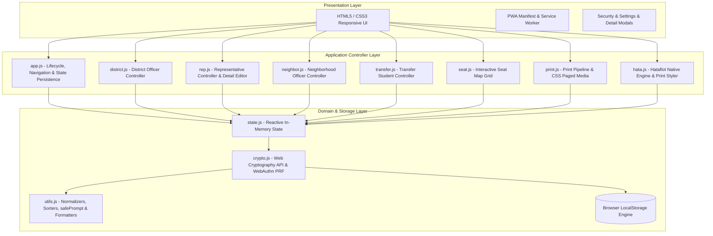
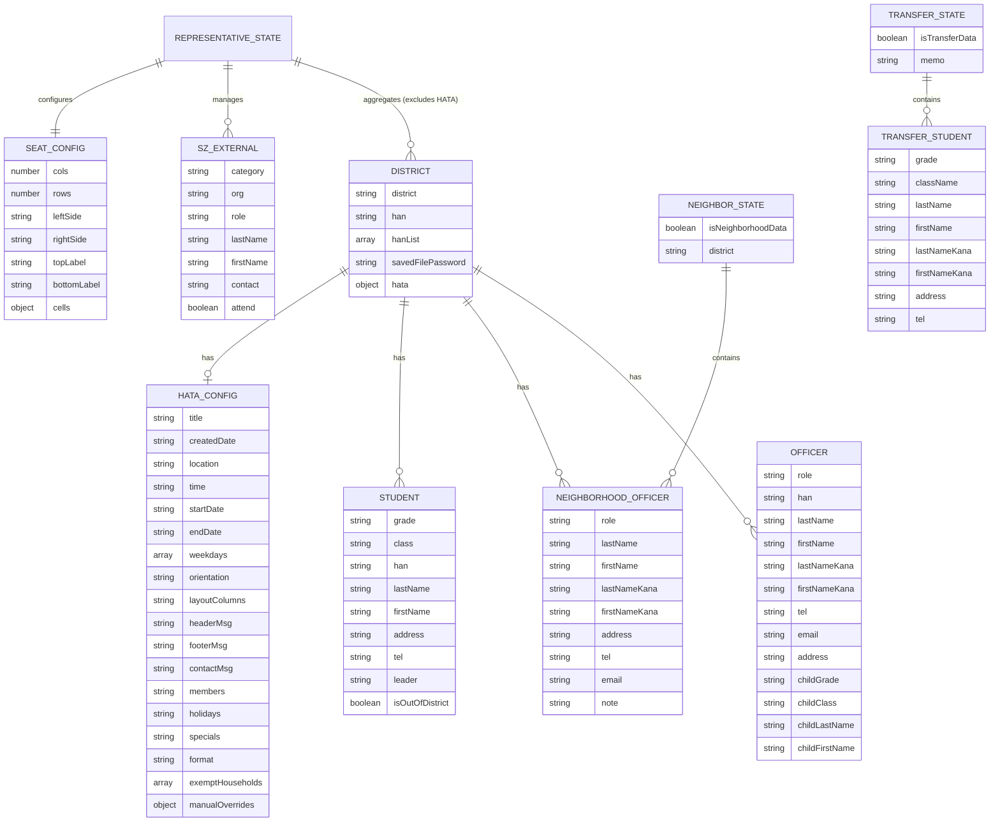
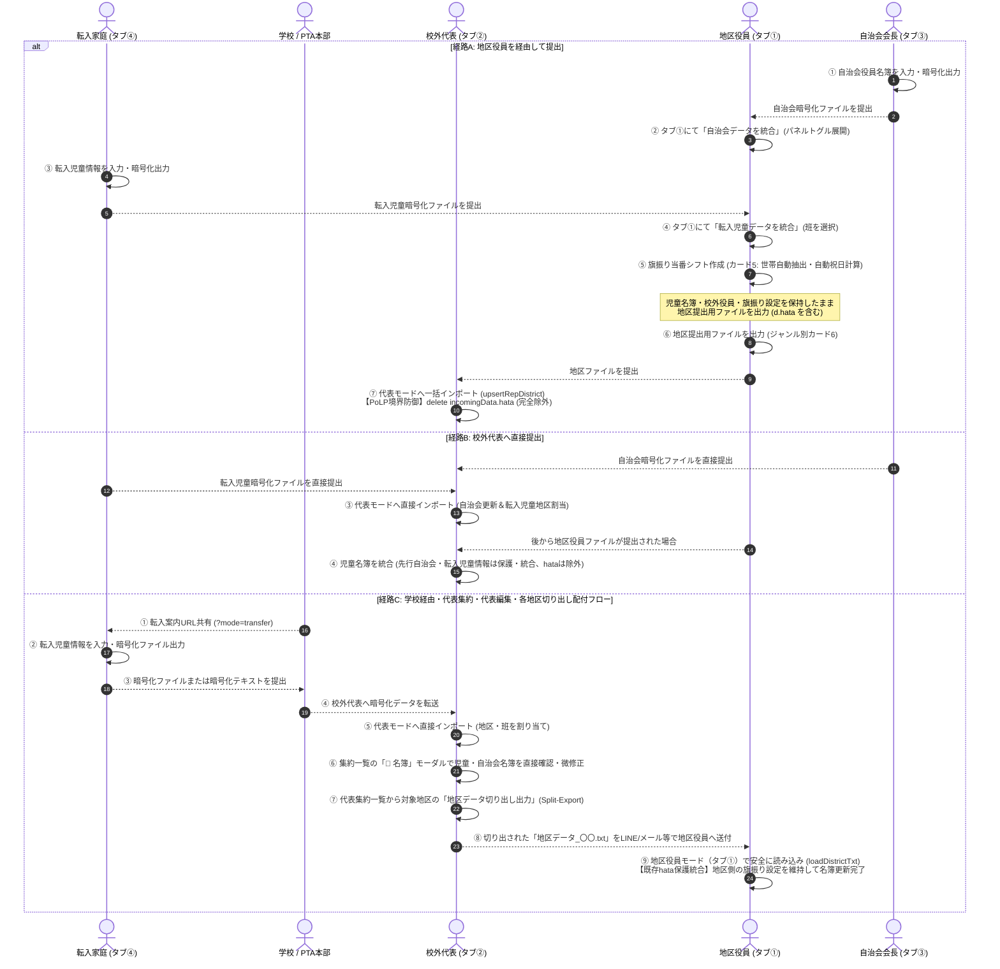

# kogaidocs 内部仕様書

**文書版**: 1.9（アプリケーション 2.12.1 対応） 
**改訂日**: 2026年11月21日 
**文体・規範**: 本文の「する」「である」は要求または仕様を表す。試験済みという意味ではない。

[外部仕様書](external_design.md)の実現方式を定める。過去改修のレビューは[レビュー記録](reviews/)に保持する。

## I-01 アーキテクチャと責務

### 3.1 レイヤー構造

### 3.2 モジュール構成と責務

| モジュール | パス | 主要責務 |
| :--- | :--- | :--- |
| **App Lifecycle** | `js/app.js` | 初期化、4タブ切り替え（地区/代表/自治会/転入者）、前回選択モード復元、PWA登録・強制アップデート、セキュリティバッジ表示、ロック解除モーダル制御 |
| **Crypto Engine** | `js/crypto.js` | Web Cryptography API（AES-GCM 256bit）、PBKDF2-HMAC-SHA256（新規600,000回、旧100,000回読込移行）、WebAuthn PRF、LocalStorage透過的暗号化・復号、ファイル暗号化、パスキー増殖防止固定ID |
| **UI Events** | `js/events.js` | 固定アクション表、許可引数とイベント委譲、重複登録防止 |
| **State Manager** | `js/state.js` | 地区役員データ（`currentDistrict`）、校外代表データ（`repState`）、自治会役員データ（`neighborState`）、転入者データ（`transferState`）のインメモリ管理、LocalStorage自動永続化 |
| **District Mode** | `js/district.js` | 地区名・班名リスト、複数校外役員入力、自治会役員統合取込、転入児童データ統合取込、児童名簿テーブル、児童・自治会役員削除確認、年度更新（進級/卒業）、ファイル入出力、hata保護統合 |
| **Representative Mode**| `js/rep.js` | 各地区・自治会・転入ファイルの一括読込、クリップボード復号、集約一覧、集約地区削除確認、スクゾ外部関係者削除確認、カード1ジャンル別4大セクション化、**各地区名簿（児童・自治会・役員）モーダル閲覧・編集**、単一地区切り出し出力（Split-Export、パスワード案内是正）、**取り込み時hata物理削除（PoLP）**、一括印刷ディスパッチ |
| **Neighborhood Mode** | `js/neighbor.js` | 自治会役員名簿CRUD、役員名札・名簿印刷、自治会単独暗号化ファイル出力/読込、年度更新（役職保持・名簿リセット） |
| **Transfer Mode** | `js/transfer.js` | 家庭情報入力（住所・TEL、児童の氏名・学年・組、複数児童対応）、転入児童削除確認、暗号化ファイル（`家庭情報データ.txt`）出力、暗号化テキストコピー |
| **Seat Map** | `js/seat.js` | スクゾ協議会座席表エディタ、動的グリッド拡張/縮小、窓際/廊下側表示入れ替え、出席者プルダウン割当、空席・施設マーカー |
| **Hataflot Native Engine**| `js/hata.js` | 児童名簿からの世帯自動集約（住所数字＋苗字）、免除世帯管理、オフライン日本の祝日自動計算、期間プリセット、シフト自動生成（均等配分）、個別日付担当者スワップ・調整オーバーライド保持、スマホ向け縦リスト表示、A4多段組印刷組版、LINE用テキスト生成、公式JSONの読込 |
| **Browser Handoff** | `js/handoff.js` | LINE内ブラウザ警告、通常ブラウザへの案内、全モードと未確定編集の暗号化引き継ぎ、世代付き復元UI |
| **Print Pipeline** | `js/print.js` | A4四つ折り自立型名札（中央オリセン・180度反転面）、3x4子供経由封筒宛名、学校用/PTA用役員名簿、児童名簿、自治会名簿等の動的生成 |
| **Utilities** | `js/utils.js` | HTMLエスケープ、姓名・ふりがな分割結合、班名抽出・重複排除、3段階児童ソート、学年別集計、パスワード強度検証、セマンティックバージョン比較（`isNewerVersion`）、安全プロンプト（`safePrompt`） |

## I-02 暗号化・認証・保存トランザクション

提出形式は `ENC:2:` + Base64（salt 16B、IV 12B、AES-GCM暗号文と128bit認証タグ）の順である。新規PBKDF2-HMAC-SHA256は600,000回である。旧`ENC:`/接頭辞なしBase64だけ100,000回で読み込み、未知version・改竄の新形式は旧形式へフォールバックしない。44B未満は復号前に拒否する。提出本文を保存キーに束縛するAADは用いず、端末保存とは区別する。

保存キーは `kogai_district_v2`、`kogai_rep_v2`、`kogai_neighbor_v2`、`kogai_transfer_v2`、認証情報は `kogai_auth_meta` である。保存形式は `STORAGE_ENC:2:` + Base64（IV 12B + 暗号文/タグ）で、AADは `kogaidocs:storage:2:` + 保存キーのUTF-8である。鍵はメモリ内CryptoKeyで保持し、パスワードラップと任意のWebAuthn PRFラップだけを認証メタデータへ保存する。

WebAuthn `user.id` はASCII `kogaidocs` の固定配列である。パスキーマネージャー側での上書き挙動そのものは実装から保証しない。PRF非対応・取消時は通知してパスワード保護を利用する。`file:` ではWebAuthnを開始しない。

- **保護状態の整合性**: メモリ鍵は解除時の認証メタデータ内容と結び付ける。別タブの削除・再設定・破損を保存・読込・解除の開始と非同期完了時に照合し、不一致なら鍵・状態・DOMを破棄して書込みを拒否する。storageイベントでも同じ破棄を実行し、認証キー個別変更に加えて `localStorage.clear()` の `key === null` 通知を保護状態の消失として扱う。暗号文が残るのに認証情報が消失・不正である場合、および保護済みタブが別タブの全消去を検知した場合は未暗号化と扱わない。全消去を実行した当該タブだけは明示的に未暗号化初期状態へ移行する。

- **複数キー確定の競合制御**: 平文状態を含む通常保存・読込・初期設定・再設定・旧形式移行・生体認証情報更新・全消去は、Web Locks API対応環境では同一origin・同一アプリ名のロックを必ず通す。読込は共有ロック、それ以外は排他ロックとし、ロック取得後に認証情報と暗号文の有無を再評価してから平文または暗号化の経路を決定する。保存要求は呼出時点のデータ直列化結果とセッション世代を保持し、ロック待機中に全消去・再設定・ロックが完了して世代が変わった場合は、取得後の平文/暗号化再判定へ進まず要求を拒否する。全4モードと認証情報のトランザクション書込および失敗時復元を1回の排他ロック保持中に完了する。これにより、照合と書込み、各キー間、失敗時復元の間へ別タブのアプリ操作が入ること、初期設定途中へ別タブの平文保存が入ること、および全消去より後に待機中の自動保存が旧データを平文復活させることを防ぐ。全消去要求が書込中に発生した場合は書込完了後に排他ロックを取得して全対象を削除するため、旧処理が後からデータを復活させない。Web Locks APIを利用できない環境では未暗号化データの単一キー読込・保存・全消去だけを許可し、暗号化の設定・解除・読込・保存・変更は開始せず、対応ブラウザを要求して平文へ降格しない。ブラウザ機能や開発者操作によるロック外の保存領域消去は `storage` の `key === null` 通知で保護セッションを直ちに無効化し、その後の保存を拒否する。

- **保存暗号文のAAD**: 新形式は `STORAGE_ENC:2:` とし、AES-GCMのadditionalDataにアプリ識別子・形式・保存キーを含める。保存先の入替・改竄・異なる形式の偽装を拒否する。既存形式はパスワード・WebAuthn PRFのいずれも鍵取得後の共通処理で全モードを復号・検証して新形式へ原子的に移行し、認証情報へ形式2を確定する。失敗時は旧値を保持し、解除成功としない。形式2の認証情報で旧形式へ降格しない。生マスター鍵バッファはラップ・インポート・生体認証の成功/失敗にかかわらずfinallyでゼロ化する。

- **パスワード導出強度**: 新規の保存鍵ラップと提出ファイルはPBKDF2-HMAC-SHA256を600,000回実行する。保存鍵ラップの認証メタデータには反復回数を保持し、100,000回または600,000回以外をKDF実行前に拒否して計算量DoSを防ぐ。反復回数を持たない旧保存形式は100,000回としてパスワード解除し、全4モードの復号・検証、必要な保存暗号文再暗号化、600,000回での生鍵再ラップをすべて完了してから、保存値と認証情報を同一トランザクションで確定する。書込失敗、ロック、他タブ変更時は原本を復元して解除失敗とする。生体認証解除はパスワードを取得できないため旧パスワードラップを保持し、次回のパスワード解除まで反復回数移行を保留する。提出ファイルは新形式`ENC:2:`を600,000回、旧`ENC:`および既存の接頭辞なしBase64を100,000回として復号する。未知の`ENC:<version>:`はKDF実行前に拒否し、新形式の認証失敗後に旧形式へフォールバックしない。

- **自動ロックと保存順序**: 自動ロックの絶対期限を保持し、操作・表示復帰時には延長する前に期限切れを確認する。復帰のイベント処理は個人情報操作より先に行う。15分以内の正規操作は期限を更新する。更新処理は4モードの保存完了を待ち、容量不足・暗号化失敗を通知してナビゲーションを中止する。保存の呼出順ではなく完了順が前後しても最新値が残るよう、同じキーの書込みを順序管理する。

## I-03 データモデルと受入制約

### 7.1 エンティティ関係図（ERD）

### 現行モデル契約

| モデル | 受入・正規化 |
| :--- | :--- |
| 地区 | districtは文字列、officers/students/neighborhoodは行配列である。省略/nullの任意配列は空配列にする。旧officerは境界で配列へ移行し、描画はofficersを用いる。savedFilePasswordは存在時文字列だけである。 |
| 代表 | districts必須、各地区を検証してhata/hatafurotto/savedFilePasswordを除外する。szExternalsは任意配列、attendは存在時booleanである。 |
| 自治会 | district文字列とneighborhood配列である。提出識別子はisNeighborhoodData:trueである。役員行の既知個人項目は文字列または許容されたnullである。 |
| 家庭情報提出 | isTransferData:true、version:2、直下のaddress/telと、1件以上のchildrenのlastName/firstName/classNameを必須とする。gradeは1〜6である。各児童にも同じaddress/telを複写し、studentsを併記する。旧version:1や省略時は児童ごとの氏名・住所・電話を検証して受け入れる。 |
| 家庭情報下書き | children配列（0件可）、address/telは存在時4096文字以内の文字列、memoは存在時文字列である。未入力の家庭情報・児童も許す。提出必須条件を保存へ適用しない。 |
| 座席 | colsは2〜10、rowsは2〜14の整数（数字文字列を数値へ正規化）である。cellsキーは範囲内のr_c、refKey/customTextは文字列または許容されたnullである。 |
| 旗振り | タイトル/メタ情報/日付/特別枠/書式は文字列、weekdaysは0〜6整数配列、orientationはportrait/landscape、layoutColumnsは1〜6である。schedule/manualOverridesの文字列・boolean項目も検証する。 |

旧文書7.2のJSON Schema断片には保存キーv1、転入studentsだけを必須とする記述、layoutColumnsをstringだけとする記述があり、実行バリデータと一致しなかった。現行契約は本表および `validateImportData` / `validateStoredData` / `validateHataConfig` であり、旧断片を完全なスキーマとして再掲しない。未知項目を一律拒否する閉じたスキーマではないため、年度更新時は別途保持項目の許可リストを適用する。

- **復元の受入境界**: ファイルだけでなく平文/暗号化LocalStorageの全4モードを検証する。復号・型検証・旧形式正規化が全モードで成功するまで本状態を置換しない。失敗時は保存値を保持し、鍵・部分読込状態を破棄して解除成功と表示しない。任意の `savedFilePassword` は存在時に文字列だけを許可し、暗黙の文字列変換や描画例外へ到達させない。旗振り設定は標準項目と表示用別名を同じ型台帳で検証し、`scheduleCreatedDate` と `district` を含む描画文字列へオブジェクトを許可しない。転入ローカル保存は未入力・0件も許容し、提出用の必須入力検査とは区別する。座席寸法は保存スキーマと描画側の双方で2〜10列・2〜14行の整数へ固定する。HTML本文・属性は適切にエスケープし、旗振り日付・曜日も文字列として出力する。

- **辞書と構造**: 担当者・参照値の辞書はnullプロトタイプまたはMapと所有キーで処理する。入力オブジェクト中の `__proto__`・`constructor`・`prototype` キーは拒否するが、氏名等の文字列値は通常データとして保持する。全JSONは4MiB、入力テキスト/ファイルは8MiB、深さ20、各配列10,000件、総ノード100,000以下とする。旗振りの基本期間は3,660日以下、休日・特別枠は範囲展開後の合計を3,660件以下、列数は1〜6とする。この検査は公式JSONだけでなく地区モデルの共通受入境界で実施し、ファイル・貼付・平文保存・暗号化保存・旧形式移行のすべてで状態置換前に適用する。範囲外は状態・DOM・保存値を変更せず拒否する。容量上限は読込前のFile.sizeと読込後の内容にも適用する。

### 日付境界の追加是正（SEC-19）

`validateDateExpansion` は空でない端点をそれぞれISO実在日検証した後、両端がある場合だけ順序・日数を検証する。これを共用することで、単独の不正開始日/終了日が描画前に拒否される。空の片側は下書きとして許す。休日省略時の自動生成は開始年2000〜2099だけを対象とし、翌年も2099までに制限する。範囲外の有効ISO期間は拒否せず休日を空へ補完し、明示された休日・空文字は保持する。この範囲は技術上の実行範囲であり、法改正・特例日の正確性を保証するものではない。ファイル・貼付・保存復元・公式JSONはこの検証を共有し、型検証を描画後へ遅延させない。

## I-04 統合・名簿・旗振り・年度更新

### 5.6 データ統合・同期パイプライン

- **4モードの保存保護**: 暗号化設定・全消去には `kogai_transfer_v2` を含む全4モードを適用する。暗号鍵を持たないロック状態では既存暗号文を上書きしない。移行では新鍵と全4モードの暗号文をメモリ上で生成・検証してから書込みを開始し、全保存成功後に認証メタデータを確定する。失敗を呼出元へ伝播し、書込み済みキーを保存前の値へ戻して旧鍵を維持する。復旧も失敗した場合は成功扱いにせず、失敗を通知する。
- **ロック時の破棄範囲**: 地区旗振り設定・生成済み当番表、代表外部関係者・座席設定、自治会・転入者、代表地区編集の複製とDOM、印刷DOM、全パスワード・確認・復号入力欄、貼付テキストを消去する。表示切替でtext型となったパスワードも対象である。既存暗号文は保持し、正しい解除により再描画する。解除成功後のパスワード欄も消去する。ロック・全消去・暗号化設定確定で処理世代を更新し、開始世代が異なる読込・復号・JSON読込・解除・保存は状態更新・DOM描画・ストレージ書込みを行わない。ファイル読込開始前の世代を完了後まで引き継ぎ、ロック後の処理開始自体も拒否する。初回暗号化・簡易設定・解除成功直後から15分の自動ロックを開始する。
- **旗振り復元**: 非空の休日を含め全設定をDOMへ反映した後にプレビュー・保存を行う。当番名簿の編集・児童名簿の明示反映後は免除候補も再描画する。休日の空文字はユーザーによる除外解除として保持する。公式JSONの空ファイル・構文・ネストした設定型を検証し、不正時は元設定・DOM・保存値を保持して通知する。休日配列は各要素の日付・理由を検証し、日付・理由の改行区切りテキストへ正規化して復元・保存する。読込成功・失敗ともファイル入力を空に戻して同一ファイルの再選択を可能とする。当番membersは独立した編集名簿として保持し、公式JSONのmembersも当番名簿へ取り込む。児童名簿の行へは取り込まない。
- **引用符・コード注入対策**: 世帯キーをイベント属性のJavaScript文字列へ連結しない。DOMのdata属性へHTMLエスケープして格納し、固定ハンドラーからその値を受け取る。
- **座席参照**: 既存の `OFF_地区index_役員index`、`EXT_index`、`NEI_地区名_index` の保存形式を維持する。削除時は対象本人の割当を解除し、後続インデックスを繰り下げて別人への割当変化を防ぐ。詳細モーダルでは校外・自治会双方の元行対応表を下書きとともに保持し、氏名・役職・連絡先の通常編集でも本人の出席・座席を維持し、保存時のみ本状態と座席へ適用する。キャンセル時は本状態を変更しない。自治会出席チェックも同じ対応表で維持する。地区・名簿・印刷対象の変更後は集約・出席者・座席候補を同期して再描画する。外部ファイルによる名簿置換時は同一人物の継続を確認できない割当を解除する。同一地区名の複数班の出席チェックは、取込以外の経路では、変更前後に選ばれる自治会代表名簿を比較し、氏名・役職・連絡先で同一人物を一意に確認できる場合のみ継続し、比較が曖昧な場合は解除する。地区・自治会データの取込（`upsertRepDistrict`・`mergeNeighborDataIntoRep` を通るすべての取込。名簿のない地区ファイル・自地区データを含む）の出席チェックは I-13-02 だけに従う（比較元との照合、比較元がない場合の初期チェック、同名エントリの作り直し、名簿のない取込の各場合を含め、場合分けは I-13-02 による）。座席参照は、取込・地区詳細モーダルの保存・印刷対象の切替（一括を含む）・地区の削除・外部関係者の行削除など `reconcileSeatState` を通るすべての経路で、代表名簿の比較ではなく I-13-02 の照合による（自治会役員は所属と本人の識別子（氏名・役職・電話・住所）で照合し、変更前後の座席候補のエントリでそれぞれ一意な同じ本人の出席者にだけ引き継ぐ。地区詳細モーダルで編集した行の扱いは I-13-02 による）。
- **貼付復元**: 地区の貼付復元はファイル復元と同じ復号・上書き確認・hata保護経路を使用し、成功時のみ入力テキストを消去する。
- **受入スキーマ**: 認証済み暗号文でも内容を信頼しない。各取込経路の種別・文字列項目・名簿配列・行オブジェクト・座席設定を、状態を変更する前に検証する。不正な型・必須構造欠落は旧状態・DOM・保存値を保持して拒否する。地区名が文字列である旧形式と省略・nullの任意配列は空配列へ正規化する。転入データは少なくとも氏名・住所・電話番号を持つ児童配列を要求する。代表集約へ保存パスワードを引き渡さない。
- **旧形式役員**: 単一 `officer` にも `officers` の各行と同じ文字列項目の型検証を適用する。旧形式の `childName`・`kana`・`childKana` と分割済み子ふりがなも検証対象である。正常な旧形式は既存の姓名・子氏名分割と役員配列への正規化を維持する。不正な班・氏名・役職等は地区復元と代表マスター復元の双方で状態置換前に拒否する。
- **ファイル振分**: 代表の一般ファイル選択・貼付・統合ファイル復元は同じ種別ディスパッチャーを通す。転入識別子を優先判定して専用取込と同じ地区・班割当へ渡し、自治会は自治会統合、代表マスターは全体復元、地区は地区集約へ渡す。キャンセルした取込を成功件数へ計上しない。
- **暗号化コピー**: 自治会コピーでもファイル保存と同じパスワード強度・確認一致検査を適用する。
- **印刷**: 自治会名札は `buildTentCardPageHtml(subTitle, mainName, mainKana, role)` の契約に従う。UIテストは呼出回数に加えて氏名・かな・役職と選択帳票・連絡先非表示を意味単位で検査する。旗振り印刷中は古い通常帳票の出力領域を非表示にし、選択向きの@page設定を適用する。印刷後は画面・タイトル・一時スタイルを復元する。

### 年度更新の追加是正（SEC-18）

自治会役員行はroleと空の正式個人項目（lastName/firstName/lastNameKana/firstNameKana/address/tel/email/note）だけへ再構築する。代表外部関係者行はcategory/org/role、attend:trueと空の正式個人項目（lastName/firstName/lastNameKana/firstNameKana/contact）だけへ再構築する。name/kana、別用途の連絡先、未知の追加プロパティをコピーしない。確認取消の場合は元の全項目を保持する。地区年度更新は進級対象児童を再構築し、役員・自治会を初期化する既存方式を維持する。

## I-05 描画・イベント・印刷

- **厳格CSPとイベント**: インラインscriptとイベント属性を除去し、`js/events.js` の固定処理表へ移す。`data-click/input/change/submit/keydown` と `data-index/field/target` 等は宣言的なアクション名・検証済み引数のみであり、コード文字列ではない。任意コード評価・汎用式解釈・`window[name]` 実行は禁止する。動的名簿にもdocumentの委譲を適用し、停止・preventDefault・モーダル背景判定・Enterを維持する。CSPは `script-src 'self'; script-src-attr 'none'; object-src 'none'; base-uri 'none'; form-action 'none'` を含む。既存の印刷CSSに必要なstyleのinline許容は維持する。frame-ancestorsはmetaでは機能しないため、実配信ヘッダー未確認を対策済みとしない。

HTML本文・引用符付き属性の値はescで `& < > " '` をエスケープする。URLやCSS/数値の文脈はHTMLエスケープだけで安全とせず、固定URLと範囲検証を用いる。印刷DOMも同じ境界で扱う。`window.print` とCSS `@page` を用い、タイトル・一時style・表示をfinally等で復元する。名札の4面と180度回転、宛名12面とページ分割は出力契約である。詳細は外部仕様E-07である。

## I-06 PWA・更新・通信

- **PWA・外部境界**: SWは自身のscope内の公開静的資産だけを扱い、クエリ付き要求・未知URL・外部origin・非GET・認証付き要求を永続保存しない。install時を含め、公開資産は `credentials: 'omit'`・`cache: 'no-store'` で取得し、`Cache-Control: private/no-store` の応答を保存しない。Fetch仕様上、ブラウザのfiltered responseでは `Set-Cookie` がJavaScriptから非公開となるため、ヘッダー名の検査だけを保証根拠としない。Set-Cookie検査はヘッダーが露出する環境での追加防御であり、匿名要求、固定許可リスト、公開応答の配信契約を主要境界とする。version.jsonはキャッシュしない。activate/更新で削除するcacheは当該scopeのアプリ接頭辞だけとし、解除するSWは当該scriptURL・scopeだけである。外部共有ウィンドウにnoopener/noreferrerを付し、共有は利用者の明示操作に限定する。

アプリURL共有と名簿の暗号化共有は別機能である。アプリ共有は固定紹介文とモードURLだけである。名簿共有は明示操作時だけ暗号化本文を引き渡す。LINE/mail件名・ファイル名・提出ヘッダーの地区名等まで秘匿する設計ではない。外部共有windowはnoopener/noreferrerを付す。

## I-07 品質検証・追跡

### 10.1 テスト方針
Node.js 24組み込みのテストランナー（`node:test`）、アサーション（`node:assert`）、WebCrypto環境を活用し、**外部npm依存ゼロ（Zero External Dependencies）**で完全自動テストスイートを維持する。

### 10.2 カバレッジ目標
すべてのモジュールにおいて、**命令網羅（Line）100.00%**、**分岐網羅（Branch）95.00%以上**、**関数網羅（Funcs）95.00%以上** を維持・達成する。

### 10.3 テスト観点マトリクス（新機能・全機能網羅）
1. **単体テスト（Unit Tests）**:
	- `app.js`:
		- URLパラメータ `mode`（`district`, `rep`, `neighbor`, `transfer`、数値 `1〜4`）による直接選択、無効パラメータフォールバック、直前選択モードとの優先順位。
		- モード指定URL共有（`shareAppUrl(specificMode)`）: クエリ付加、Web Share API呼び出し、クリップボードフォールバック。
		- 4モード選択肢の動的折りたたみUX: 初期状態、各モード選択後の自動折りたたみ、展開バッジのクリックによる再展開。
		- 前回選択モードの永続化と復元: `switchTab` での `localStorage` 記録、起動時の自動復元、不正モード名の安全なフォールバック。
		- PWAバージョンチェック（`checkAppVersion`）: オンライン時の最新バージョン検知、更新確認ダイアログ、手動更新ボタンのdisabled制御と復帰、直前更新試行履歴（`sessionStorage`）による自動ダイアログ抑制（無限ループ防止フェイルセーフ）、手動更新時のバイパス。
		- 強制アップデート（`performAppUpdate`）: 独立try-catchによる全4モード（地区・代表・自治会・転入者）状態同期保存、`sessionStorage` への更新試行バージョン・時刻の記録、キャッシュ破棄、登録解除、リロード。
	- `version-consistency.test.js`:
		- `package.json`、`version.json`、`sw.js`（`CACHE_NAME`）、`js/app.js`（`CURRENT_APP_VERSION`）の4ファイル間にバージョン乖離がないことを恒久的に機械アサート。
	- `crypto.js`:
		- 固定 `WEBAUTHN_USER_ID` の検証: 1Password等パスキー管理ツールでの上書き更新互換性。
		- ストレージ暗号化とWebAuthn一本化: ストレージ暗号化済み環境での重複登録抑止。
	- `transfer.js`:
		- 転入児童CRUD（追加・削除・入力更新・複数児童対応）。
		- 転入児童削除確認ダイアログ（入力値がある場合の `confirm`、キャンセル時中断）。
		- **住所・電話番号必須バリデーション**: 住所または電話番号が空の場合の出力・コピー抑止と警告表示。
		- 暗号化ファイル（`.txt`）出力・暗号化テキストコピー・復号読込。
		- 提出先文言「指定された提出先」の確認。
		- 上部のアプリ共有から家庭情報入力URLを共有する検証。
		- 入力リセット（クリア）動作（確認付き）。
	- `district.js`:
		- 自治会統合パネルのトグル開閉（初期非表示、トグル反転）。
		- 転入児童統合パネルのトグル開閉（初期非表示、トグル反転）。
		- 自治会役員削除確認ダイアログ（`removeN`、`confirm` 表示、キャンセル時中断）。
		- 児童名簿削除確認ダイアログ（`removeS`、`confirm` 表示、キャンセル時中断）。
		- 自治会名簿および児童名簿における上下ツールバー・フッター「行を追加」「児童を追加」ボタンの動作。
		- カード6（ジャンル別4大セクション）における各ボタン群の動作。
		- 転入児童データの受入・統合（班割り当て、重複チェック、名簿追記、ソート、保存）。
		- 地区ファイル読み込み時の既存 `hata` 保護統合（読み込みデータに `hata` がなくローカルに `hata` がある場合の保持）。
		- 年度更新時の `hata` 設定保持（場所・時間・曜日・連絡先・向き）およびスケジュール・個別調整初期化。
	- `hata.js`:
		- **ハタフロット設定・データの永続化**: `saveDistrictLocal` によるDOMから `currentDistrict.hata` への同期、LocalStorage保存、読込時画面復元。
		- **デフォルト値検証**: 印刷向きが `portrait`、多段組み列数が `2` であること。
		- **PDF印刷時動的タイトル連動**: `printHataSchedule` 呼出時の `document.title` 一時置換と印刷後自動復元。
		- 世帯自動集約、祝日自動計算、期間プリセット、シフト均等生成、個別スワップ・調整、公式JSON連携。
	- `rep.js`:
		- 代表カード1のジャンル別4大セクション整理の動作。
		- 集約地区一覧個別削除確認ダイアログ（`deleteRepDistrict`、`confirm` 表示、キャンセル時中断）。
		- スクゾ外部関係者個別削除確認ダイアログ（`deleteSzExternalRow`、`confirm` 表示、キャンセル時中断）。
		- **各地区の手動追加（`addNewRepDistrict` ＆ DOMモーダル）**: `openAddDistrictModal` によるモーダル起動・自動フォーカス、未入力・重複時のインラインエラー表示（`#rep-new-district-error`）、正常追加時のモーダルクローズ・カード1自動展開・集約テーブル反映・LocalStorage保存、キャンセル/ESC/背景クリックでのクローズ、`addNewRepDistrict(dName)` 直接呼出互換、`prompt()` に一切依存しないことの検証。
		- **集約地区名簿（児童・自治会・校外役員）モーダル閲覧・編集（`openRepDistrictDetailModal`）**: モーダル展開、児童・自治会役員・校外役員の追加・編集・削除、モーダル保存・閉じる際の集約テーブル同期再計算およびローカル永続化。
		- 代表モードからの地区データ切り出し出力（PoLP、パスワード案内メッセージ・フォーカス是正）。
		- **代表取り込み時の旗振りデータ物理削除（PoLP）**: `upsertRepDistrict` で `d.hata` が完全削除され、代表マスターに混入しないことの検証。
	- `neighbor.js`:
		- **名簿行追加ボタン近接配置**: テーブル直前および直下の「＋ 行を追加」ボタンの動作検証。
		- **4大セクション統合カード（`#card-n-file`）**: パスワード設定、ファイル出力・テキストコピー、ファイル読込・テキスト貼付、年度更新の動作検証。
	- `print.js`:
		- **動的タイトル連動**: 帳票印刷時の `document.title` 一時置換（帳票名＋地区名）と印刷後自動復元。
		- **個別PDF保存パイプライン（`printSingleDistrictSeparately`）**: 選択された各帳票の順次レンダリングと印刷ダイアログ呼び出し。
	- `hata.js`（ハタフロットネイティブ統合）:
		- **ハタフロット設定・データの永続化**: `saveDistrictLocal` によるDOMから `currentDistrict.hata` への同期、LocalStorage保存、読込時画面復元。
		- **デフォルト値検証**: 印刷向きが `portrait`、多段組み列数が `2` であること。
		- **PDF印刷時動的タイトル連動**: `printHataSchedule` 呼出時の `document.title` 一時置換と印刷後自動復元。
		- 児童名簿からの世帯自動集約（住所数字正規化＋苗字、兄弟姉妹統合、同一世帯キー生成）。
		- 免除世帯管理（`exemptHouseholds`）: 免除切り替え、当番候補からの除外。
		- 日本の祝日・振替休日自動計算エンジン: 春分・秋分、ハッピーマンデー、振替休日、連休判定の精度検証。
		- 期間プリセット（前期、後期、通年、学期別）による開始・終了日自動設定。
		- シフト自動生成アルゴリズム: 均等ラウンドロビン割り当て、特別追加枠（行事・固定担当）の優先反映。
		- 個別日付スワップ・調整オーバーライド（`manualOverrides`）: 2世帯間の担当スワップ、直接編集、休み指定、初期復帰。
		- スマホ向け縦リストビューおよびPC向けグリッドビューのHTML生成。
		- A4印刷用組版（`@media print`）およびLINE用テキスト生成。
		- 公式ハタフロットJSONの読込互換（旧aliasを含む変換）。
2. **結合テスト（Integration Tests - 多層データ統合パイプライン）**:
	- **パターンA（自治会統合）**: 自治会出力 → 地区統合（児童・校外役員保持） → 地区出力 → 代表インポート。
	- **パターンB（転入児童統合）**: 転入者出力 → 地区受入（班割当統合） → 地区出力 → 代表インポート。
	- **パターンC（転入児童代表直接）**: 転入者出力 → 代表受入（地区選択統合）。
	- **パターンD（同一地区複数班統合）**: 同一地区の複数班ファイルインポート時における自治会役員・児童の重複排除および整合性同期。
	- **パターンE（代表集約・モーダル編集・各地区切り出し配付）**: 転入者出力 → 代表直接受入（地区・班割当） → 代表モーダルで名簿直接修正 → 代表から特定地区切り出し出力（Split-Export） → 地区役員モードで受入・名簿反映（地区側の旗振り設定が保護維持されること）。
	- **パターンF（ハタフロットPoLP境界防御）**: 地区で旗振り設定作成 → 地区暗号化出力（`hata` 含む） → 代表モード取り込み（`hata` が代表マスターに一切含まれないことの検証） → 代表切り出し出力（`hata` なし） → 地区側再読み込み（既存 `hata` が安全に復元・保護されること）。
3. **システムテスト（System Tests - E2E / セキュリティ）**:
	- 4タブ（①地区 ⇄ ②代表 ⇄ ③自治会 ⇄ ④転入者）の全画面巡回、タブ切り替え時の入力中フォーム値の保持。
	- URLクエリパラメータ付きURLでの直接モード起動E2E検証。
	- ブラウザランタイム統合テスト（単一グローバル環境でのスクリプトロード・エラーゼロ検証）。
	- 全削除操作における確認ダイアログの動作E2E検証。
	- 代表モードでの地区詳細モーダル編集E2E検証。
	- ハタフロット自動シフト生成〜スワップ〜印刷プレビュー〜公式JSON読込と地区暗号化保存のE2E検証。
	- 利用者向け画面の統合・結合という用語の一貫性を確認する。

### 10.4 カバレッジ達成目標
- 全モジュールにおいて **命令網羅 100.00%**、**分岐網羅 95.00%以上** を維持する。

本番12モジュールとService Workerを監査対象とする。node:testのV8レポートはNodeでロードしたjsモジュールの数値であり、別プロセスの実ChromiumやVMのsw.jsを同じ数値で網羅したとは扱わない。SWは専用の正常・異常要求試験で確認する。

全仕様の根拠・不足・環境制約は[トレーサビリティ](specification_traceability.md)に記録する。実UI試験はfile起動、実DOM、375/768/1280px、実再読込、実WebCryptoを用いる。OS印刷・共有・認証器や配信SWは別検証である。通信観測はCDPの対象ページ要求を検査し、正常画像の要求を検出できる対照試験を置く。ブラウザ全プロセス・他アプリ・実配信の通信無漏洩保証には拡張しない。

## I-04-08 旗振り設定の収集・互換性

`renderHataCard` は未定義の `members` だけ児童名簿から初期化する。明示した空文字は保持する。`syncHataMembersFromStudents` は明示操作であり、非空の異なる名簿には置換確認を要求する。生成時に無条件同期してはならない。

`saveDistrictLocal` は旗振り全入力を空文字も含めて同期し、曜日を配列、`dedup` を真偽値として収集する。選択肢不正値は設定へ採用しない。公式JSON取込は `validateHataConfig` を通してから確定し、現行上流のキーを優先して旧metaキーも受け付ける。`??` によって空文字・空配列・falseを既定値と区別する。地区ファイルは `hata` 全体を暗号化し、代表集約の最小権限境界は維持する。

`buildHataLineText` はシフトとメタ情報をテキスト化し、コピー失敗時にread-only欄を表示する。名簿重複検出はMapを用い、警告にtextContentを用いる。新しい欄も既存のロック時消去対象となる。

## I-06-08 iOSインストール導線

`isIosDevice` はiOS UAとMac型UAのタッチ対応端末を認識する。`updatePwaInstallButton` は安全な配信・未インストール状態・iOSまたは保留プロンプトを条件とする。standaloneは `navigator.standalone` とdisplay-modeの両方を確認する。iOS案内はnative dialogであり、外部通信・端末情報の保存は行わない。`appinstalled` は保留プロンプトを破棄してボタンを隠す。Service Workerとアプリのバージョンを同時更新して既存キャッシュからの更新を可能にする。

## I-06-09 ブラウザ間引き継ぎ

`js/handoff.js` はLINE UA検知、固定情報のみの外部ブラウザURL、暗号化データ作成・ファイル/コピー・復元UIを管理する。データ形式は `type: kogaidocs-browser-handoff`、`version: 1`、`mode`、`models`（地区/代表/自治会/転入者）、`drafts`（固定IDの文字列）、`repDraft`（原本index、地区下書き、旧行index配列）である。

`validateBrowserHandoff` はサイズ・深さ・予約キー検証後に全4モデルへ `validateStoredData` を適用する。転入者は保存用の下書き仕様を使う。記憶パスワードを除外し、貼付欄IDは固定の許可リストで検査する。代表の行indexは原本の範囲内・重複なし・nullは新規行に限定する。下書きは原本へ暗黙確定しない。

`replaceStoredAppData` は同一Web Lock内で全モデルを検証・暗号化してから `writeStorageTransaction` で保存する。保存済み端末の暗号化設定は変更しない。保存成功後に処理世代を進め、古い保存・取込を無効化する。復元UIは保存成功後だけモデルとDOMを確定する。閉じる・ロックのUI世代とストレージ世代を双方検査し、処理中の二重実行を抑止する。

移動用URLはorigin/path・固定モード・LINE外部ブラウザ指定だけから構築する。引き継ぎデータ・鍵をquery/hashへ埋め込まない。送受信する専用サーバーやLINE SDKは導入しない。

## I-04-09 旗振り書式と安全な入力収集

書式変換を buildHataMembersText に集約する。児童の複製を正規化し、元データは変更しない。児童名簿変更時は免除候補だけを再描画する。旧 updateHataPreview/copyHataList と関連DOM・イベントを削除する。collectHataScheduleInputs は startDate/endDate/holidays/specials を候補へまとめて検証する。失敗時は有効な4項目を保持し、任意の inputDrafts 辞書に生入力を保存する。辞書は当該4キーの文字列だけを許可し、日付展開には使用しない。成功時は4項目を一括反映し辞書を削除する。通常保存・再描画・地区ファイル・引き継ぎは辞書を保持する。復元時はネイティブ引き継ぎdialogを閉じてから地区追加/代表編集モーダルを開き、フォーカスがinert背景に奪われる順序を避ける。

renderHataExemptList は members を基準とし、未設定の旧データだけ児童世帯を代用する。既存の住所数字_苗字キーを当番表記と照合し、旧キー/表示名の選択・解除を両方扱う。児童の情報から重複数を表示できる場合は従来の世帯人数も付す。members の編集・明示反映時に再描画する。

## I-04-10 保存データの文字列増幅対策

validateHataTextBudget / validateHataScheduleOutput を共通受入検証、生成、HTML/印刷/LINE本文へ適用する。buildHataMembersText は単一の固定トークン正規表現を用い、各置換値を結合する前に行長を検査し、追加前に総UTF-8量を検査する。collectHataScheduleInputs は既存4項目に members/format を加えて一括検証する。inputDrafts はこの6キーの文字列のみを許可し、未完成値を展開しない。

保存ファイルの取込と自治会・転入統合は、検証済み候補の保存完了を待ってから本状態と画面へ反映する。失敗した場合は元のモデル・画面・保存原本を保ち、保存失敗を通知して再試行を可能とする。

班・氏名・住所等の短文は4096文字以下とする。班選択肢の行数との積は4MiB、全候補参加者の座席数との積は16MiBの保守的な見積もりで制限する。名簿・日付指定の改行分割は空行も含め10000行以下とする。

### 家庭情報入力のデータ契約（2026年11月11日）

`transferState` の直下に `address`、`tel`（4096文字以内の文字列）を保存する。未入力下書きは許容する。旧保存値で家庭の住所・電話が未定義の場合のみ先頭児童から補完する。ロック・提出後リセットでは家庭欄・児童欄・パスワードをすべて消去する。

新規提出は `version: 2` とし、家庭の必須項目、児童の姓・名・学年1〜6・組を検証する。出力用児童は許可フィールドから構築し、家庭の住所・電話を各児童にも複写する。既存の受入処理との互換用に `children` と `students`、`className` と `class` を維持する。旧提出（version 1または省略）は従来どおり受け入れる。地区・代表の児童行へ住所・電話番号を保持し、保存・再出力で失わない。家庭欄の更新イベントは固定のフィールド許可リストを用いる。

## I-08 アクセス制御・非同期起動

起動時に役員保存必須ポリシーを有効化し、地区・代表の平文書込を保存層で拒否する。旧平文読込は暗号化移行用に維持し、初期描画中はCSSで役員フォームを隠す。activeAppModeと初期化済みフラグを保持し、モード変更・設定完了・解除・ロック時に同一のアクセス更新関数を通す。保護中の役員タブはhidden表示とinertを併用し、委譲イベントも拒否する。モーダルを閉じても必須ポリシーを解除しない。暗号化済み未解除の自治会・家庭情報入力はメモリ上の新規フォームだけを利用し、保存関数は従来通りfalseで拒否する。解除時には保存済みデータで置換する旨を説明する。

バージョン通信は遅延実行を維持し、AbortControllerとPromise.raceによる5秒の期限を取得とres.jsonに適用する。期限タイマーはfinallyで破棄する。タイムアウト後の応答は更新確認やリロードを実行しない。当番回数欄は閉状態overflow:hidden、展開状態overflow-y:autoかつmax-height:min(400px,60vh)とする。フォーム外の選択・copy/cutはイベントでも拒否し、選択元がinput/textareaの場合だけ許可する。

### 初回アセスメント

保護対象は既存役員名簿・認証鍵・パスワードである。誤操作利用者、悪意ある取込、別タブの認証変更を信頼しない。モード変更は認証解除ではなく表示権限の変更であり、保存暗号文・鍵は開放しない。JavaScript自体を操作できる攻撃者、ブラウザ拡張、OS画面取得、コピー後の他アプリ、HTTPS配信の保証はWeb内の制御範囲外である。フォームを隠すだけでなく平文書込拒否と既存セッション世代検査を併用する。実装後に別工程として入力・出力・非同期・保存境界を再評価し、発見した問題を攻撃再現テストから是正する。

オフライン起動は、バージョン確認の分離だけでなくService WorkerのモードURLへの応答を含む。自アプリのルート・index.htmlへのGETナビゲーションで、mode/openExternalBrowser以外のクエリがない場合だけ、匿名取得した固定index.htmlへ正規化する。URL自体は維持し、キャッシュキーへ個別クエリを保存しない。_update付き更新、別パス・別origin、認証ヘッダー付き要求は従来通りネットワークへ渡す。保存領域のアクセス拒否は保護状態不明としてロック扱いとし、モード変更で平文扱いへ降格しない。初回ネットワーク取得とキャッシュ保存が完了していない端末のオフライン起動は保証しない。

通常のscript/CSS要求ではブラウザがcredentials:includeを付け得るため、固定許可リストの資産も匿名Requestへ正規化してから照合する。元のAuthorization/Cookieヘッダーは保持したまま検査して拒否する。固定公開コードを匿名取得する配信契約は維持する。ナビゲーション正規化もAuthorization/Cookie付き要求を拒否する。任意パスやクエリのキャッシュ許可へ拡張しない。

実HTTP再起動試験は `tests/manual/offline-http.js` に保持する。本実行環境ではNode自身のループバック接続は成功するが、最小のChromium HTTP起動でもサーバーへ要求が届かずタイムアウトした。通常スイートへ未検証の合格・skipを混在させず、実HTTP/PWA起動の確認は未完了として記録する。

## I-09 追加セキュリティ是正

SEC-22では設定・解除の操作世代とbusy状態を管理する。閉じる・モード変更・再操作で旧世代を無効化する。暗号側へguardを渡し、排他取得後と書込/鍵有効化の直前で照合する。鍵有効化後に画面離脱した場合は鍵を破棄し、読込状態の採用直前にもguardを照合する。古いcatch/finallyは新規入力・新規操作を変更しない。未暗号化の旧保存値と移行用メモリは取消時に消去せず保持する。

SEC-23では全ての暗号化ファイル・コピー・共有・代表地区切出しに開始時保存世代を保持する共通guardを適用する。暗号化完了からOSへ渡す前、および失敗後の代替出力前に世代を再評価し、不一致はfalseで中止する。ゲストの新規提出は解除状態を要求せず、開始から終了まで世代が同じ場合だけ許可する。OSへ既に渡したクリップボードやファイルの撤回・失効は保証しない。

地区出力のファイル名・平文見出し・共有タイトルは、暗号化本文を直列化する時点の地区・班を保持して構築する。暗号処理待機中の通常編集で出力先の識別情報と本文を食い違わせない（SEC-24）。

出力guardは保存世代だけでなく開始時の認証メタデータ文字列も保持し、出力直前に照合する。別タブのstorage通知前に認証情報を変更・削除された場合にも中止する。認証状態を取得できない場合は出力を許可しない。

## I-10 SEC-25 〜 SEC-29 の実装仕様

- **SEC-25（ゲスト引き継ぎ・更新と役員データ分離）**:
	- `hasOfficerData(modelKey, value)` / `hasNonEmptyOfficerModels(models)`（`js/crypto.js`）および `hasOfficerHandoffData(payload)`（`js/handoff.js`）における未編集既定値と変更値の境界を以下の通り定義する。
		- `kogai_district_v2`: `district` 非空、`han` 非空（または `hanList` に1件以上の非空要素あり）、`savedFilePassword` 非空、旧互換キー（`officer` / `hatafurotto` / `szNeighborChecks` の存在または非空、あるいは `selectedForPrint === false`）、`officers`（`length > 1` または初期1件目で `role` が `''` / `'校外委員'` / `undefined` 以外、あるいは `role` 以外の全フィールドに非空・真値の入力あり。`length === 0` は空扱い）、`neighborhood`（`length > 1` または初期1件目で `role` が `''` / `'会長'` / `undefined` 以外、あるいは `role` 以外の他項目非空。`length === 0` は空扱い）、`students`（`length > 1` または初期1件目で `isOutOfDistrict` が真・他項目非空・`!((grade === '6' && class === '1') || (grade === '1' && class === '') || (!grade && !class))`。`length === 0` は空扱い）、`hata`（`js/state.js`・`saveDistrictLocal()` で `district`/`location`/`contactMsg`/`specials` は `""`、`exemptHouseholds`/`schedule` は `[]`、`manualOverrides` は `{}` として常時プロパティが存在するため、プロパティ有無ではなく非空値・非既定値で判定する：`members`（`undefined | '' | []` 以外）非空、`district`・`location`・`contactMsg`・`specials` 非空、`inputDrafts`（`undefined`・全空 `{}` 以外の非空値あり）、`exemptHouseholds`・`schedule` が空配列以外、`manualOverrides` にキー存在、別名キー群〔`scheduleTitle`, `metaCreatedDate`, `scheduleCreatedDate`, `metaLocation`, `metaTime`, `metaHeaderMsg`, `metaFooterMsg`, `metaContactMsg`, `metaOrientation`, `metaLayoutColumns`〕の非空・非既定値存在、`orientation` が `undefined` / `''` / `'portrait'` 以外、`layoutColumns` が `undefined` / `''` / `2` / `'2'` 以外、`weekdays` が `undefined` / `[1,2,3,4,5]` 以外、`dedup === false`、`title` が `undefined` / `''` / `'登校見守り活動シフト表'` 以外、`time` が `undefined` / `''` / `'7:55 〜 8:25'` / `'7:45〜8:15'` 以外、`headerMsg` が `undefined` / `''` / `'※雨天時も原則実施します。ご協力をお願いいたします。'` 以外、`footerMsg` が `undefined` / `''` / `'※都合がつかない場合は、各自で他の担当者と交代してください。'` 以外、`format` が `undefined` / `''` / `'{住所数字} {苗字}'` 以外、`createdDate` が `undefined` / `''` / `/^作成日：\d{4}年\d{1,2}月\d{1,2}日$/` 以外、`startDate`/`endDate` が `undefined` / `''` / `getPeriodPresetDates('zenki', yr)`（当年・前年・翌年の各 `{ startDate: '${yr}-04-06', endDate: '${yr}-09-30' }`）一致以外、`holidays` が `undefined` / `''` / `[]` / `generateJapaneseHolidays(yr, Math.min(yr + 1, 2099)).map(x => `${x.date},${x.name}`).join('\n')`（設定中 `startDate` 基準年または当年生成一覧、およびそのオブジェクト配列形式）一致以外の場合に役員データありと判定する）のいずれかを満たす場合に役員データありと判定する。
		- `kogai_rep_v2`: `districts` 非空、`szExternals`（`length !== 0` のとき、`js/state.js` の規定6件テンプレート〔各行規定 `category`/`org`/`role`・`attend === true`・`lastName`/`firstName`/`lastNameKana`/`firstNameKana`/`contact` 全空〕と一致しない変更または行増減。`length === 0` および未編集6件テンプレートは空扱い）、`seatConfig`（`seatConfig != null` のとき、規定〔`cols === 4`, `rows === 5`, `leftSide === undefined | '' | '窓側'`, `rightSide === undefined | '' | '廊下側'`, `topLabel === undefined | '' | '前方（演台・司会・スクリーン側）' | '前方'`, `bottomLabel === undefined | '' | '後方（出入口側）' | '後方'`, `cells` が空 `{}`〕から逸脱している場合。`seatConfig == null` および規定一致は空扱い）のいずれかを満たす場合に役員データありと判定する。
		- `hasOfficerHandoffData(payload)`: `payload.mode` が `'district'` / `'rep'`、`hasNonEmptyOfficerModels(payload.models)`、`payload.repDraft` が非 `null`・非空、`payload.drafts` 内の実在役員系下書き（`['d-paste-box', 'd-neighbor-paste-box', 'd-transfer-paste-box', 'rep-paste-box', 'rep-transfer-paste-box', 'rep-new-district-name']`）が非空のいずれかを満たす場合を役員データありと判定する。
	- `js/app.js` から `getActiveAppMode()` および `resetActiveAppMode()`（または `setActiveAppMode(null)`）を公開し、`tests/helpers/dom-mock.js` の `setupDomEnvironment()` でも `resetActiveAppMode()` を呼び出してテスト間で前モードが残留しないようにする。`collectBrowserHandoff()`（および `updateLineBrowserNotice()`）は `getActiveAppMode()` が有効値（`'district'|'rep'|'neighbor'|'transfer'`）を返す場合は `localStorage.getItem('kogai_active_mode')` より優先して現在モードを決定する。全4保存を並列実行して `result === false && !officerPlaintextWriteDenied(HANDOFF_KEYS[index])` のみ失敗扱いとする。`officerPlaintextWriteDenied('kogai_district_v2')` が真のときは、`activeMode` が `'district'` または `'rep'` なら暗号化必須エラーを投げ、ゲストモードなら空のデフォルト役員モデル・`repDraft: null`・`'neighbor-paste-box'` のみ（他役員下書き除外）の `drafts` を返却する。
	- `restoreBrowserHandoff()` は `confirm()` および `replaceStoredAppData()` の前に `officerPlaintextWriteDenied('kogai_district_v2') && hasOfficerHandoffData(payload)` を検査して `STORAGE_ENCRYPTION_REQUIRED` を送出する。さらに `replaceStoredAppData(models, guard)` の `withStorageLock('exclusive', ...)` 内部でも `officerPlaintextWriteDenied('kogai_district_v2')` と `hasNonEmptyOfficerModels(values)` を再検証し、ゲストデータのみ時は `kogai_neighbor_v2` と `kogai_transfer_v2` のみを `writeStorageTransaction` へ渡す。引き継ぎ復元時のフォーム復元では全 `HANDOFF_DRAFT_IDS` を走査し、`payload.drafts[id] || ''` で既定初期化（旧下書き残留防止）する。
	- `performAppUpdate(targetVersion)` は `[storageKey, saveFn]` ペア配列（フィルタによる添字ずれ防止）で保存し、`result === false && !officerPlaintextWriteDenied(key)` のみ失敗扱いとするとともに、保存待機前後の `getStorageSessionGeneration()` および `isStorageEncrypted()` 一致を検査する。
- **SEC-26（非同期設定・WebAuthnゼロ化・メタ検証）**:
	- `quickSetupEncryptionFromCard(inputId)` はロック中なら `showStorageUnlockModal()` を開いて `false` を返す。`!['neighbor-pass', 'rep-pass'].includes(inputId)`（既存テストの直接パスワード文字列渡しとの互換維持・自治会/代表カードのみ地区汚染禁止）を基準とする。解除済み時（`isStorageUnlocked()`）に `'neighbor-pass'` / `'rep-pass'` から呼ばれた場合は `currentDistrict.savedFilePassword`・`#d-save-password-optin.checked`・`#d-pass.value` の設定と `saveDistrictLocal()` を行わず、`resetAutoLockTimer()` を実行してカード専用の完了通知のみ返す（地区系元で `await saveDistrictLocal()` が `false` を返した場合は記憶完了通知を出さず `false` を返す）。新規設定時（`!isStorageEncrypted()`）は同期 `confirm()` の後（または失敗時リセット付帯）に `beginStorageAccess()` を開始して `access.guard()` で `setupStorageEncryption(password, enableBio, access.guard)`・`updateSecurityBadge('unlocked')`・`updateOfficerAccess()`・`resetAutoLockTimer()` を必ず実行し、さらに `handleEnableEncryptionSubmit()` と同様に成功時・`catch` 時の双方で `access.current()` 確認および `storageAccessBusy = false` 解除（`!access.current()` 時は無通知で `return false`）を行う。その上で `'neighbor-pass'` / `'rep-pass'` 由来時のみ地区側状態（`currentDistrict.savedFilePassword`・`#d-save-password-optin.checked`・`#d-pass.value`）設定と `saveDistrictLocal()` を抑止しカード専用完了通知を返す。
	- `handleAddOrUpdateBiometric()` は既存解除セッションの誤ロックを防ぐため `storageAccessBusy = true`（`beginStorageAccess()`）を立てず、`storageAccessEpoch`・`getStorageSessionGeneration()`・`isStorageUnlocked()` を照合する専用 `guard` を `registerWebAuthnForActiveKey(guard)`（排他境界内外で実行）へ渡し、中断時は設定書込み・再表示・通知を抑止する。
	- `zeroBuffer(buffer)` は `ArrayBuffer.isView(buffer)` 時に `new Uint8Array(buffer.buffer, buffer.byteOffset, buffer.byteLength).fill(0)`、`buffer instanceof ArrayBuffer` 時に `new Uint8Array(buffer).fill(0)` を行い、`registerWebAuthnPrf` / `unwrapKeyWithWebAuthn` の `finally` で `prfResult` をゼロ化する（なお単一 `Uint8Array` を再利用する既存モック〔`tests/helpers/dom-mock.js`, `tests/unit/security-crypto.test.js`, `tests/unit/security-kdf.test.js`〕は Stage 4 で呼出し毎に独立コピーを返すよう更新する）。`requireStorageAuthMeta` に `meta.webauthn != null` 時のみ非配列オブジェクトかつ `credentialId`/`prfSalt`/`iv`/`wrappedKey` が非空文字列であることを検査する `isValidWebAuthnMeta(meta.webauthn)` 検証を追加する。
- **SEC-27（ロック後の非同期通知・プロンプト・印刷遮断）**:
	- `parseTxtContent(text, password, generation, kind)` の `decryptPayload` 失敗時にもまず `assertStorageSession(generation)` を検証し、ロック中の場合は `STORAGE_SESSION_CHANGED` を再送出する。実在する全インポート処理（`loadDistrictTxt`, `loadPastedTextToDistrict`, `loadTransferFileIntoDistrict`, `loadPastedTransferTextIntoDistrict`, `loadNeighborFileIntoDistrict`, `loadPastedNeighborTextIntoDistrict`, `loadHataOfficialFile`, `loadMultipleDistrictFiles`, `loadPastedTextToRep`, `loadRepMasterTxt`, `loadTransferFileIntoRep`, `loadPastedTransferTextIntoRep`, `loadNeighborTxt`, `loadPastedTextToNeighbor`）は冒頭 `assertStorageSession(generation)` または捕捉で `STORAGE_SESSION_CHANGED` を検知した場合、`safePrompt`・ファイルループ継続・`renderRepAll()`・`alert()` を行わず即時終了する。
	- `exportSingleDistrictFromRep(index, explicitPass, explicitMode)` に、`!explicitPass && !usedPrompt`（`#rep-pass` 参照時）限定での `#rep-pass-confirm` 一致検証および 2,000 文字超 `'line'`/`'mail'` 時のクリップボード退避（成功後・失敗後の `outputIsCurrent()` 照合後、暗号文を含まない定型案内文URLのみ起動）を追加する。`copyHataForLine()` は `#hata-line-text` への代入・表示（`output.value = text; output.hidden = false`）前と `navigator.clipboard.writeText()` 完了後・例外後の全箇所で `outputIsCurrent() && !(isStorageEncrypted() && !isStorageUnlocked())` を検証し、不整合・ロック時は `output.value = ''; output.hidden = true;` へ戻して `focus()`/`select()`/`alert()` を行わない。全クリップボード・共有処理で `writeText` 前後・例外後に `outputIsCurrent()` を照合する。
	- 役員印刷（`printSingleDistrictSelected`, `printSingleDistrictSeparately`, `executeRepSelectedPrint`, `printHataSchedule`）は `outputIsCurrent() && !(isStorageEncrypted() && !isStorageUnlocked())` を事前・各帳票直前・`window.print()` 後に確認して不整合時は `#print-area` を空にして中止する。自治会印刷（`printNeighborRoster`, `printNeighborTentCards`）は E-10-01 のロック中印刷維持のため `outputIsCurrent()` のみを確認し、変化時は `#print-area` を空にする。
- **SEC-28（パスワード可視化解除とDOM消去）**:
	- `resetPasswordInputs(root)`（`js/utils.js`）で対象パスワード欄の `.value = ''`、`type = 'password'`、`.btn-toggle-pass` の `'👁️'` 復帰、パスワード系判定メッセージ（`#d-pass-match-msg`, `#rep-pass-match-msg`, `#neighbor-pass-match-msg`, `#modal-set-pass-msg`, `#modal-unlock-error` に限定し、`class="pass-feedback-msg pass-msg-ng"` を静的保持する `#rep-new-district-error` は明示除外するため汎用 `.pass-feedback-msg` 一括走査は行わない）消去を一括実行する。なお全12箇所の `.btn-toggle-pass` のうち9箇所（`index.html` 7箇所＋`js/app.js` 2箇所）に `id` 属性がなく、`tests/helpers/dom-mock.js` では `document.body` 直下にフラット配置され `#settings-modal-body.innerHTML = ''` 後も `#modal-set-pass`・`#modal-set-pass-confirm`・`#modal-set-pass-msg` が `document.elements` 上に残留するため、`root !== document` 時は `#storage-settings-modal`（`modal-set-pass`, `modal-set-pass-confirm`, `modal-set-pass-msg`）および `#storage-lock-modal`（`modal-unlock-pass`, `modal-unlock-error`）等 `root.id` ごとの対象ID表で `document.getElementById` を参照し、全 `.btn-toggle-pass` の `data-password-target` と対象入力ID集合を照合して `'👁️'` へ戻す。
	- 適用箇所を `clearMemoryAndDomForLock()`、`hideStorageUnlockModal()`、`runDistrictYearUpdate()`、`runRepYearUpdate()`、`runNeighborYearUpdate()`、`resetTransferForm()`、`clearTransferForm()`、`restoreBrowserHandoff()` とし、さらに `#hata-line-text` をロック・地区年度更新・引き継ぎ復元・`loadDistrictTxt()` で空・非表示化、`#print-area` をロック・全モード年度更新・`clearAllRepDistricts()`・家庭情報入力フォームリセット・引き継ぎ復元で消去する。
- **SEC-29（スキーマ文字長・モーダル確定・保存欠損・バージョン/SW境界）**:
	- `validateHataConfig` は `strings` 配列（複数行 `<textarea>` を含む `time`/`headerMsg`/`footerMsg` 含む全メタ・書式項目、`specials` のみ除外）・`exemptHouseholds` 各要素・`manualOverrides` キー/各文字列項目・`schedule` 各文字列項目・`holidays[].name` に4,096文字上限を適用し、`specials`・文字列形式 `holidays`・`members` の行リストは `validateHataTextBudget`（1行4,096文字・最大10,000行・1MiB以下）で検査する。さらに `validateImportData`（`seatConfig` 文字列と `cells[k].refKey`/`customText`）、`validateStoredData`（`transferState.memo`）に4,096文字上限を追加し、HTML（`index.html` の重複 `maxlength="50"` 削除・`#rep-new-district-name` の `maxlength="4096"` 統一・単一行旗振り入力欄 `#hata-title`, `#hata-created-date`, `#hata-district`, `#hata-location`, `#hata-format`, `#hata-contact-msg` 等への付与）・動的テーブル入力（`district.js` / `neighbor.js`）へ `maxlength="4096"` を付与する。
	- `saveAndCloseRepDistrictDetailModal()` は確定前複製を `validateImportData(candidate, 'rep')` に通し、失敗時はアラート表示のうえ確定・クローズを中止する。
	- `loadStorageDecryptedUnlocked()` は `!isStorageEncrypted()` 判定後に `if (!activeStorageSessionIsCurrent()) throw new Error('STORAGE_LOCKED')` を評価し、その後に `STORAGE_DATA_KEYS` 対象の `!raw` を `STORAGE_DATA_MISSING` として拒否する。`js/crypto.js` から `STORAGE_DATA_KEYS` をエクスポート（`global` / `module.exports`）し、`initAutoLockListeners()`（`js/app.js`）は `isStorageEncrypted()` 時のみ `STORAGE_DATA_KEYS` の `storage` イベントを監視して `!event.newValue || typeof event.newValue !== 'string' || !event.newValue.startsWith('STORAGE_ENC:') || (meta?.storageFormat === 2 && !event.newValue.startsWith('STORAGE_ENC:2:'))` 検知時に即時無効化・ロックする。
	- `isNewerVersion` は `String(v || '').trim().replace(/^v/, '')` で先頭 `'v'`（1文字のみ）を除去したうえで純数字ドット形式（`/^\d+(?:\.\d+)*$/`、最大32文字）に厳格化し、`checkAppVersion` の `fetch` に `credentials: 'omit'` を付与する。`sw.js` の `message` リスナーは `SCOPE_PREFIX = CACHE_SCOPE.endsWith('/') ? CACHE_SCOPE : CACHE_SCOPE + '/'` を定義し、`event.origin === SCOPE_ORIGIN` に加え `typeof event.source?.url === 'string'` かつ `try/catch` 内の `new URL(event.source.url)` が `SCOPE_ORIGIN` かつ `CACHE_SCOPE` / `SCOPE_PREFIX` 配下であることを必須検証（`MessagePort` や不正URL・別スコープを拒否）する。

## I-11 長文の下書き復旧と児童行限定取込

- `collectHataScheduleInputs` の対象を表示メタ8項目にも広げ、4096文字検証を有効値への採用前に実施する。`saveDistrictLocal` とイベント処理は同じ経路を通す。超過時は有効値を保持し `hata.inputDrafts` へ全文を保存する。構造全体の4MiB等の上限は維持する。
- `validateStoredData` は地区の旧保存表示メタ8項目の長文だけを、複製上で同名の `inputDrafts` へ移して有効値を空にする。既存の明示下書きがあれば優先する。型不正・未知下書きキー・その他のスキーマ違反は従来通り拒否し、元保存値は読込だけでは書き換えない。描画時は下書きを優先し、修正後の保存で再解除可能な有効モデルを作る。
- `exportSingleDistrictFromRep` の退避処理はコピー例外を成功へ変換しない。呼出元の既存エラー処理とセッションガードへ伝播し、外部起動前に中止する。
- `loadDistrictStudentsTxt` はファイルサイズ検査・復号・地区スキーマ検証後、児童行だけを複製・正規化する。児童0件や別用途フラグは拒否する。既存モデルの複製の `students` だけへ追記し、合成結果の容量・描画予算検査を行う。確認後 `commitImportedModel` と `adoptImportedModel` で保存・採用し、成功時だけ名簿・集計・免除候補を描画する。ロックは無通知中断し、保存失敗と取消では既存モデル・DOM・保存値を変更しない。
- 通常地区読込の種別推論は `officers` または旧 `officer` のある入力を地区と扱う。明示的な `isNeighborhoodData` は自治会を優先する。これにより `students` 省略の次年度役員ファイルも通常読込できる。

## I-12 保存前検証・取込信頼範囲・他タブ整合（SEC-30 〜 SEC-35、QA-01 〜 QA-11）

### I-12-01 構造操作の候補検証（SEC-30）

- `applyStorableChange(storageKey, model, mutate)`（`js/state.js`）は、`model` の直列化スナップショットを取り、`mutate(model)` 後に修復なしの厳格な `validateStorageModel(model, storageKey)` を実行する。失敗時は `model` の自身のプロパティを削除してスナップショットから同一参照へ復元し、上限超過の通知を1回出して `false` を返す。成功時は `true` を返し、呼出元が保存・描画する。
- 適用先: `resizeSeatGrid`（下記）、`addCurrentDistrictToRep`（`upsertRepDistrict(..., persist=false)` を候補内で実行）、`addNewRepDistrict`、`addSzExternalRow`、`addStudentRow`、`addOfficer`、`addNeighborhoodRow`、`onHanListInput`。`onHanListInput` の取消時は入力欄を復元後の `hanList` の値へ戻す。
- 自由記述の1文字ごとの入力は `maxlength` と I-12-02 の保存前検証で守る。

### I-12-02 保存前検証と拒否状態（SEC-30）

- `validateStoredData(data, storageKey, options = {})` と `validateStorageModel(value, storageKey, options = {})` は、`options.repair === true` のときだけ I-12-05 の修復を行う。既定は修復なしの厳格検証であり、I-12-01・I-12-02・`commitImportedModel`・`replaceStoredAppData` は厳格検証を使う。修復を使うのは `activateStorageKey`、`loadAppDataFromStorage`、`validateBrowserHandoff` だけである。
- `saveStorageDataUnlocked(storageKey, serialized, { validate = false, allowSuspended = false } = {})` は、未暗号化時の `officerPlaintextWriteDenied`、暗号化時の `activeStorageSessionIsCurrent()`、I-12-07 の書込停止、I-12-06 の外部更新照合をすべて通過した後に、`validate` が真なら厳格な `validateStorageModel(JSON.parse(serialized), storageKey)` を実行する。検証対象は解除時に一括検証される4つのデータキーに限る。`saveStorageData` は `{ validate: true }` で呼ぶ。第3引数はオブジェクトだけを受け付け、それ以外（旧シグネチャの真偽値等）は `TypeError` を送出して書き込まない。`commitImportedModel`・`replaceStoredAppData` は検証済み値のため従来どおりとする。`setupStorageEncryptionUnlocked` は冒頭（パスワード検証の後、`generateMasterKey` の前）でメモリ上の4モデルを一度だけ `JSON.stringify` し、その直列化文字列を `JSON.parse` して厳格な `validateStorageModel` で検証する。不合格なら `STORAGE_SAVE_REJECTED`（端末に保存できない内容がある旨）で中止し、鍵生成・WebAuthn登録・書込みを行わない。暗号化には同じ直列化文字列を使い、検証後のメモリ変更を書き込まない。
- 検証失敗時は書き込まず `false` を返し、`storageSaveRejectedKeys`（`Set`）へ追加する。成功時は当該キーを除く。集合を空にするのは、メモリ上のモデルを既定値へ消去する `clearMemoryAndDomForLock()`（`clearStorageSaveRejections()` を呼ぶ）と `clearStorageSecurity()` だけとする。いずれも空にした後に `reportStorageSaveState([], null)`（存在時のみ）を呼んで警告を隠す（追加キーがないため `alert` は出さない）。`lockStorage()` 単独では集合を変更しない。`commitImportedModel` は書込み成功時に当該キーを、`replaceStoredAppData` は書き込んだ各キーを集合から外し、排他区間を抜けた後に `reportStorageSaveState(keys, null)` を呼ぶ。集合の変化は排他区間内で記録だけ行い、`saveStorageData` は `withStorageLock` を抜けた後に `reportStorageSaveState(keys, addedKey)`（`js/app.js`、存在時のみ）を呼ぶ。排他区間内で `alert` を出さない。
- `reportStorageSaveState` は、拒否集合が空でなければ `#storage-save-warning`（`role="alert"`）に対象モード名を表示し、新しく追加されたキーについてだけ `alert` する。I-12-07 の停止中のキーがある間は停止の案内も同じ要素に表示し続ける。拒否集合と停止中のキーがともに空のときだけ警告を隠す。拒否集合または停止中のキー（I-12-07）が空でない間は、編集が端末に保存されないため `beforeunload` で離脱確認を求める。`getStorageSaveRejectedKeys()` を `js/crypto.js` から公開する。
- `performAppUpdate` と `collectBrowserHandoff` は、保存結果が `false` で集合が空でない場合、「端末に保存できない内容があります。直前の変更を元に戻してから再試行してください。」と通知する（空き容量の案内と区別する）。

### I-12-03 派生値の上限（SEC-30）

- `MAX_DERIVED_TEXT_LENGTH = 4096 * 2 + 1` とし、`validateImportData` の `checkRow` は派生値に次の条件で適用する（姓4096文字＋空白＋名4096文字）。他の短文は4096文字のままとする。
	- `kana`・`childKana`: 正規化で分割しないため、常に `MAX_DERIVED_TEXT_LENGTH` 以下とする。
	- `name`: `typeof lastName === 'string'`（正規化で分割されない）かつ `lastName` または `firstName` が非空の文字列である行だけ `MAX_DERIVED_TEXT_LENGTH` 以下とし、それ以外の行は4096文字以下とする（`normalizeNameFields` が `lastName` のない `name` を分割して移し、`getFullName` は姓名がともに空なら `name` を返すため）。
	- `childName`: `typeof childLastName === 'string'` かつ `childLastName` または `childFirstName` が非空の文字列である行だけ `MAX_DERIVED_TEXT_LENGTH` 以下とし、それ以外の行は4096文字以下とする（`normalizeOfficerChildNames` と同じ理由）。
- `validateHataConfig` の `exemptHouseholds` 要素（`${住所}_${苗字または氏名}`）も `MAX_DERIVED_TEXT_LENGTH` とする。`extractHouseholdsFromStudents` の `targetName` は苗字（4096文字以下）、または姓名から作る氏名か `name`（姓名がともに空の行では4096文字以下）であるため、キーは8193文字を超えない。苗字がなく名だけの行の氏名も名（4096文字以下）である。
- 座席セル `refKey` は `MAX_SEAT_REF_KEY_LENGTH = 4096 + 64` とする（`NEI_`＋地区名＋`_`＋添字）。4160文字は受理し、4161文字は拒否する。

### I-12-04 座席の段・列変更（SEC-30）

- `resizeSeatGrid()` は入力値を `cols`（2〜10）・`rows`（2〜14）へ正規化した候補で、範囲外かつ `refKey` または `customText` が非空のセル数を数える。1以上なら件数を示して `confirm` し、取消時は DOM を元の段・列へ戻して通知せず終了する。
- 承認時および非空セルが0件のときは、空セルを含む範囲外セルをすべて削除する。変更は I-12-01 の `applyStorableChange` で行い、描画予算超過時は通知して元の段・列と DOM へ戻す。段・列とセルの更新は同期的に確定し、保存は非同期に行う。

### I-12-05 保存済み不合格値の修復（SEC-30・SEC-31、旧版互換）

- `validateStoredData(data, storageKey, { repair: true, repairs })` は、厳格検証が失敗した場合に限り、複製上で次の修復を行って再検証する。修復した項目は `repairs`（配列）へ `'seat-cells'`・`'seat-grid'`・`'hata-budget'`・`'hata-legacy-text'` として追加する。ファイル取込の `validateImportData` は厳格なまま。旧別名キーの長文復旧（下記）と従来の表示メタ8項目の長文復旧は、厳格検証の前に行う既存の互換処理として修復有無にかかわらず実施する。
	- 代表: `seatConfig` の段・列が2〜14・2〜10の整数なら範囲外セルを削除する。その上で `validateRepRenderBudget` を満たさない場合は段・列を4×5へ戻して範囲外セルを再削除し、なお超過なら従来どおり拒否する。
	- 地区の旗振り: 旗振りの展開・文字予算（`validateHataExpansionBudget`・`validateHataTextBudget`・`validateDateExpansion`）が不合格の場合、`startDate`・`endDate`・`holidays`・`specials`・`members`・`format` のうち存在する値を、明示下書きがない項目について `inputDrafts` へ移し、有効値を空文字列にする。この修復は、元の旗振り設定に対して3つの予算検査のいずれかが例外を送出した場合に限る（構造不正は修復しない）。配列形式の `holidays`（`{date, name}`）・`members` は、`validateHataConfig` と同じ形の検査（要素がオブジェクト・`date` が `YYYY-MM-DD`・`name` が4096文字以下の文字列、`members` 要素が文字列）に合格した場合だけ、同じ規則（`${date},${name || '祝日'}` の改行結合、文字列の改行結合）で文字列化してから移す。修復後の再検証に失敗した場合は元の例外を送出する。
	- 旧別名キー（QA-06）: 4096文字超の `scheduleTitle`→`title`、`metaCreatedDate`/`scheduleCreatedDate`→`createdDate`（この順で先に処理したものを優先）、`metaLocation`→`location`、`metaTime`→`time`、`metaHeaderMsg`→`headerMsg`、`metaFooterMsg`→`footerMsg`、`metaContactMsg`→`contactMsg` は、正式キーが `undefined` かつ同名の明示下書きがない場合だけ下書きへ移す。いずれの場合も超過した別名キーは削除する。4096文字超の `format` は明示下書きがなければ下書きへ移し、有効値を空文字列にする。
- 修復は読込時の複製だけに行う。保存原本は、次回の正常保存、または `activateStorageKey` の旧形式からの形式移行（修復済み値を再暗号化して書く）まで変更しない。地区の描画予算超過は修復せず拒否する（I-12-01 により新規発生を防ぐ。残余 R-SEC-D）。
- `activateStorageKey` は解除時の修復結果を、解除後のセッション世代とともに上書きで保持し、直後の `loadAppDataFromStorage` が一度だけ引き継ぐ（旧形式端末では形式移行で修復済み値を書くため、読み直しでは修復が検出されない）。保持した結果は、引き継いだ時点、`lockStorage()`・`clearStorageSecurity()`、および引き継ぎ時に世代が一致しない場合に破棄し、別のセッションへ通知を持ち越さない。`loadAppDataFromStorage` は4キーを `repair: true` で検証し、自身と引き継いだ修復結果の重複を除いた `{ repairs }` を採用後に返す。描画しない。呼出元（`handlePasswordUnlock`・`handleWebAuthnUnlock`・`startUnencryptedSession`）は、`access.guard()`・`assertStorageSession` の確認と描画を終えた後に、`notifyStorageRepairs(repairs)` で `repairs` が空でなければ「保存データの一部を修復して開きました」と修復内容（範囲外の座席を削除／座席表を4列×5段に戻した／旗振りの期間・休日・名簿などを下書きへ移した／長い旧項目を下書きへ移した）を1回 `alert` する。確認前にロック・中断した場合は通知しない。

### I-12-06 他タブ更新（SEC-34）

- `js/crypto.js` は `knownStorageValues`（`Map`）に、各データキーについて自タブが最後に読んだ・書いた暗号文を保持する。`activateStorageKey` の読込時、`saveStorageDataUnlocked` の暗号化書込み後、`writeStorageTransaction` の成功後に更新し、`lockStorage()`・`clearStorageSecurity()` で空にする。
- 暗号化時の `saveStorageDataUnlocked` は排他区間内で、既知値があるキーの現在値が既知値と異なる場合に `STORAGE_FOREIGN_UPDATE` を送出する。`saveStorageData` は排他区間の外でこれを捕捉し、`handleForeignStorageUpdate()`（`js/app.js`、存在時のみ）を呼んで `false` を返す。`commitImportedModel` は `STORAGE_FOREIGN_UPDATE` を `IMPORT_SAVE_FAILED` へ変換せず、排他区間の外で `handleForeignStorageUpdate()` を呼んで `STORAGE_SESSION_CHANGED` を送出する（取込呼出元は無通知で中止し、ロック理由が表示される）。`replaceStoredAppData` も排他区間内の書込み前に同じ照合を行い、不一致なら `STORAGE_FOREIGN_UPDATE` を送出する。排他区間の外でこれを捕捉し、`handleForeignStorageUpdate()` を呼んで `STORAGE_SESSION_CHANGED` を送出する。`runHandoffTask` は `STORAGE_SESSION_CHANGED` の場合に「引き継ぎに失敗しました」を表示せず状態表示を空にする（ロック理由は解除画面・ゲスト案内に表示される）。
- `initAutoLockListeners` の `storage` 処理は、暗号化中のデータキーについて有効な接頭辞の新値でも、`isStorageUnlocked()` なら `handleForeignStorageUpdate()` を呼ぶ。不正値・削除は従来どおり `invalidateStorageSecurity()` を伴う。
- `handleForeignStorageUpdate()` は `storageLockReason` に「別のタブで保存データが更新されました。最新の内容を読み込むため、もう一度解除してください。」を設定して `handleImmediateLock()` を実行する。`showStorageUnlockModal()` は `storageLockReason` があれば `#modal-unlock-error` へ表示する。ゲストモードでは `#guest-storage-notice-reason` へ表示する。`handlePasswordUnlock`・`handleWebAuthnUnlock` の失敗表示は、試行中に `storageLockReason` が設定されていればその理由を優先する。解除成功時に `storageLockReason` を消去する。

### I-12-07 平文起動時の読込失敗（SEC-30）

- `startUnencryptedSession()`（`js/app.js`、起動処理の未暗号化分岐）は、各データキーの平文を `repair: true` で個別に検証し、失敗したキーだけを `suspendStorageWrites(keys)`（`js/crypto.js`）でキー単位に書込停止する。`loadAppDataFromStorage` は停止中のキーを読まず既定値を使い、他のキーは通常どおり読み込む。`isStorageWriteSuspended(key)` を公開する。
- 個別検証に合格した後でも `loadAppDataFromStorage` が予期しない例外で失敗した場合は、保存値が存在するすべてのデータキーを停止し、既定状態で起動して原本を上書きしない（「安全な初期状態で起動しました」を通知する）。
- 停止中のキーについて、`saveStorageDataUnlocked` は書き込まず `false` を返す（拒否集合へは入れない）。`#storage-save-warning` に対象モードの保存停止と、全消去または正しいデータの復元の案内を表示し、起動時に1回 `alert` する。
- `performAppUpdate` は、`officerPlaintextWriteDenied(key)` と同じく `isStorageWriteSuspended(key)` のキーの `false` を失敗として扱わない（アプリ更新を止めない）。
- `collectBrowserHandoff` は、停止中のキーが1つでもあれば保存前に「保存を停止しているモードがあるため、引き継ぎを作成できません。全消去するか、正しいデータを復元してください。」で中止する（既定モデルが復元先の有効なデータを上書きしないため）。
- `setupStorageEncryption` は停止中のキーがある場合 `STORAGE_WRITES_SUSPENDED` で拒否し、原本を上書きしない（設定画面は全消去を案内する）。
- `commitImportedModel(storageKey, model, generation, { replace = false } = {})` は、`replace` が真のときだけ `saveStorageDataUnlocked` へ `{ allowSuspended: true }` を渡して停止中のキーへの書込みを許し、成功後に当該キーの停止を解除する。`replace` が偽で停止中のキーへ書こうとした場合は書き込まず、`code = 'IMPORT_SAVE_FAILED'` の例外（「保存を停止しているため読み込みを中止しました。全消去するか、正しいデータを復元してください。」）を送出する。`replace: true` を渡すのは保存値の全体を置き換える読込（`loadNeighborTxt`・`loadPastedTextToNeighbor`）だけであり、既存モデルへ部分的に合成する取込は停止中のキーへ書き込まない。`replaceStoredAppData` は書き込んだキーの停止を解除する。`clearStorageSecurity()` は全停止を解除する。

### I-12-08 解除失敗の表示（SEC-30）

- `describeUnlockFailure(err, fallback)`（`js/app.js`）は、`err.code === 'INVALID_IMPORT_DATA'` なら「保存データの検証に失敗しました。パスワードは正しい可能性があります。旧版の保存値を修復できなかったため、全消去または正しいデータの復元が必要です。」、`err.message === 'STORAGE_LOCKS_UNAVAILABLE'` なら従来の Web Locks 非対応文言、それ以外は `fallback` を返す。`handlePasswordUnlock` は `fallback` に「パスワードが正しくないか、復号に失敗しました。」、`handleWebAuthnUnlock` は `err.message` または既定文言を渡す。

### I-12-09 期間プリセット（SEC-31）

- `applyHataPeriodPreset(presetKey)` は DOM の開始・終了日を更新した後、`collectHataScheduleInputs(hata, { startDate, endDate })`（I-13-03 の休日置換え時は `holidays` を含む）で採用し、失敗時は `renderHataInputStatus()` で案内する。有効値を直接代入しない。
- 基準年は I-13-03 の `getFiscalYear()` とする。`getPeriodPresetDates('zenki'|'kouki'|'full', baseYear)` は、それぞれ `${y}-04-06〜${y}-09-30`、`${y}-10-01〜${y+1}-03-24`、`${y}-04-06〜${y+1}-03-24` を返す（SPEC-Q4 は I-13-03 で確定）。

### I-12-10 復号前切出し（SEC-32）

- `extractEncryptedPayload(text)` を `js/crypto.js` に設ける。`text.indexOf('BEGIN_DATA:')` の後方で最初の `':END_DATA'` を `indexOf` で探し、両方ある場合は間の文字列を、ない場合は全体を `trim()` して返す。正規表現を使わない。

### I-12-11 記憶パスワード（SEC-33）

- `parseTxtContent` は `kind` 指定時の検証結果から `savedFilePassword` を削除する。`loadDistrictTxt` は採用前に `currentDistrict.savedFilePassword` が文字列なら候補へ引き継ぐ。`exportDistrictTxt`・`shareDistrictData` は `savedFilePassword` を除いた複製を暗号化する。

### I-12-12 引き継ぎ（SEC-35・QA-01）

- `validateBrowserHandoff` は `rep-new-district-name` を4096文字以下に限る。`addNewRepDistrict` は正規化後4096文字超を `#rep-new-district-error` へ表示して追加しない。
- `replaceStoredAppData` は `hasNonEmptyOfficerModels(values)` が偽なら暗号化有無にかかわらず `targetIndices = [2, 3]` とし、戻り値に `replacedKeys` を含める。`restoreBrowserHandoff` は確認文の分岐にも同じ `hasNonEmptyOfficerModels(payload.models)` を使い、偽なら地区・代表を保持する旨を表示する。`replacedKeys` に含まれるモデルだけをメモリへ採用する。平文端末での拒否判定（`hasOfficerHandoffData`）は従来どおりとする。

### I-12-13 児童行の取込（QA-02・QA-03）

- `isBlankStudentRow(row)`（`js/utils.js`）は、`lastName`・`firstName`・`lastNameKana`・`firstNameKana`・`name`・`address`・`tel`・`leader` が空白のみで、`isOutOfDistrict` が真でない行を真とする。
- `parseTxtContent` は種別解決後が `district`（`students`）または `rep`（各地区の `students`）の場合、空行を除き、残る行の `grade` が `/^[1-6]$/` を満たさなければ `code = 'INVALID_IMPORT_GRADE'` の例外（「児童「氏名」の学年「値」は1〜6年ではありません。」）を送出する。`validateStoredData` は変更しない。
- `loadDistrictTxt`・`loadDistrictStudentsTxt`・代表の地区・マスター読込は、`INVALID_IMPORT_GRADE` の場合にその文言を通知する（`importFailureMessage(err, fallback)`）。
- `loadDistrictStudentsTxt` は既存児童から空行を除いてから追記する。
- 家庭情報の検証（`validateImportData(..., 'transfer')`）は版にかかわらず、児童の `grade` が存在して空でなければ `/^[1-6]$/` を要求し、違反は `INVALID_IMPORT_GRADE`（「家庭情報の児童「氏名」の学年「値」は1〜6年ではありません。」）とする。版1の空学年は従来どおり統合時に `'1'` とする。
- `loadTransferFileIntoDistrict`・`loadPastedTransferTextIntoDistrict`・`loadTransferFileIntoRep`・`loadPastedTransferTextIntoRep` は `INVALID_IMPORT_GRADE` の場合、パスワード再入力を求めずにその文言を通知する。

### I-12-14 共有・コピー（QA-04・QA-08）

- `shareDistrictData` の2000文字超 `line`/`email` は、API不在・書込例外時に `outputIsCurrent()` を確認し、現行なら失敗を通知して `false` を返す。外部起動しない。`exportSingleDistrictFromRep` の `copy` はAPI不在時に通知して `false` を返す。

### I-12-15 出力日付・注記・自動生成・死にコード（QA-05・QA-07・QA-09・QA-11）

- `formatLocalDateStamp(date = new Date())` を `js/utils.js` に設け、ローカルの年・月・日から `YYYY-MM-DD` を返す。出力ファイル名・見出しの日付に使用する。
- `generateHataSchedule` と `validateHataTextBudget` は、休日行の注記を `parts.slice(1).join(',')`（空なら既定）、特別枠の注記を `parts.slice(2).join(',')`（空なら既定）として同じ計算で扱う。
- `runAutoHataGeneration()` はスケジュール生成の例外を捕捉し、「旗振りシフトを生成できませんでした：{例外の文言}」を通知してプレビューを再描画し、中止する。名簿・既存の下書き・保存値は変更しない。
- `loadDistrictTxt` の `#d-file-pass` 参照を削除する。

## I-13 出席初期チェックと期間プリセットの基準年（R-24、SPEC-Q1・Q2・Q4）

### I-13-01 会長の判定と新しい名簿の初期チェック（SPEC-Q1）

- `js/seat.js` に `NEIGHBOR_CHAIRMAN_ROLES = ['会長', '自治会長', '町内会長', '町会長']` と `isNeighborChairman(row)` を設ける。`row` がオブジェクトで `row.role` が文字列のとき、`row.role.trim()` が `NEIGHBOR_CHAIRMAN_ROLES` のいずれかと一致すれば真とする。それ以外（`null`・非文字列の `role`・部分一致・「区長」等）は偽とする。
- `defaultNeighborChecks(rows)` を同じく設ける。配列でなければ `{}` を返す。`neighborIdentity(row)` が `rows` 内で一意な行だけを対象とし、`isNeighborChairman(row) && getFullName(row) !== ''` の対象行の添字を `true` とする新しいオブジェクトを返す。該当がなく、かつ `isNeighborChairman(row) && getFullName(row) !== ''` の行が（重複行を含めて）1件もなければ、`getFullName(row) !== ''` の最初の対象行の添字だけを `true` とし、それもなければ `{}` を返す。氏名のある会長が重複行だけの場合は `{}` を返す。
- `upsertRepDistrict` と `mergeNeighborDataIntoRep` の初期チェック算出は `defaultNeighborChecks` を使い、`includes('会長')` による部分一致を削除する。

### I-13-02 名簿差替え時の会長チェック（SPEC-Q2）

- `js/seat.js` に `neighborCheckCandidate(entry)` を設け、`{ identities: (entry?.neighborhood || []).map(neighborIdentity), checks: { ...(entry?.szNeighborChecks || {}) } }` を返す（`captureSeatState` と同じ形）。
- `resolveImportedNeighborChecks(rows, candidates, options = {})` を同じく設ける。`rows` が配列でなければ `{}` を返す。`candidates` は候補 `{ identities, checks }` の配列（配列でなければ空とみなし、オブジェクトでない要素は飛ばす）で、`identities` のうち氏名部分（`JSON.parse(identity)[0]`）が空でないものを1件以上持つ最初の候補を比較元とする。
	- 比較元がなく `options.chairmanDefaults !== false` なら `defaultNeighborChecks(rows)` を返す（E-13-01）。`options.chairmanDefaults === false` なら `{}` を返す。
	- 比較元がある場合、`getFullName(row) === ''` の行と、識別子が `rows` 内で一意でない行にはキーを作らない。それ以外の行は、識別子が比較元でちょうど1件に一致すれば「引き継ぎ元あり」とし、比較元の `checks` にその添字の所有キーがあれば値を引き継ぎ、なければキーを作らない。ただし、比較元が `candidates` の先頭の要素（差替え前の代表組。先頭が `null` やオブジェクトでない場合を含め、先頭以外が比較元になった場合は代替の比較元）でなく、引き継ぐ値が `false` でなく、`isNeighborChairman(row)` が偽の行は、引き継がずに「引き継ぎ元なし」として扱う（E-13-02。代替の比較元からは `false` と会長の行の値だけを引き継ぐ）。引き継ぎ元のない行（比較元で一致0件または複数）は、`options.chairmanDefaults !== false` かつ `isNeighborChairman(row)` なら `true` とする。
	- 返り値は新しいオブジェクトであり、比較元にない添字のキーは含まない。
- `upsertRepDistrict` は、置換対象 `existingIdx`（同名・同班のエントリ、なければ従来の仮エントリ `placeholderIdx`）のエントリを置換前に保持し（`existingIdx`・`placeholderIdx`・`existingWithNeighbors` は従来どおり `district` の完全一致で選ぶ。代表組の検索 `findNeighborGroup` と同名エントリの作り直しは前後の空白を除いて比べる）、次のとおり `szNeighborChecks` を決める。
	- 取込データに自治会役員名簿がある（`incomingHasNeighbors`。前後の空白を除いて空でない役職か、空でない `getFullName`（旧形式の `name` だけの行を含み、前後の空白を除く）を持つ行が1行以上ある。氏名・役職が空白だけの行は名簿に数えない。`existingWithNeighbors` の名簿の判定も同じ）場合: 候補を「`previous.neighbors` のうち `(group.district || '').trim()` が `(d.district || '').trim()` と一致する組（差替え前の代表組）」「置換対象エントリの `neighborCheckCandidate`（置換対象がなければ省く）」の順に渡す。
	- 取込データに名簿がなく、従来の保護で `existingWithNeighbors` の名簿を写した場合: 写し元が置換対象エントリ自身なら、そのエントリの `szNeighborChecks` の複製（未定義なら未定義のまま）を使う。別のエントリなら `resolveImportedNeighborChecks(rows, [代表組, neighborCheckCandidate(写し元)], { chairmanDefaults: false })` とする。
	- 取込データに名簿がなく写す名簿もない場合: `defaultNeighborChecks([])`（`{}`）とする。
- `upsertRepDistrict` は、名簿を置き換えたエントリ以外で `(entry.district || '').trim()` が `(d.district || '').trim()` と一致するエントリについて、取込データに自治会役員名簿がある（`incomingHasNeighbors`）場合と、名簿のない取込で写し元が置換対象と異なる（`copiedFrom && copiedFrom !== replaced`。置換対象がなく新しく加える場合を含む）場合に、`alignNeighborChecksToGroup(entry, [代表組, neighborCheckCandidate(置き換えたエントリ)], { clearDuplicatesOf: 置き換えたエントリの識別子の配列 })` を適用する（写し元を含む。名簿のない取込で自エントリの名簿を写した場合と、写す名簿がない場合は、他のエントリを変更しない）。`clearDuplicatesOf` は取込データに名簿がある場合だけ置き換えたエントリの識別子の配列とし、名簿のない取込の写しでは `[]` とする（写した名簿の重複は写し元に元からあるため）。`resolveImportedNeighborChecks`・`alignNeighborChecksToGroup`・`reconcileSeatState` の出席の照合は、比較元・揃える元・`clearDuplicatesOf` ごとに識別子から添字の一覧を引く表（`neighborIdentityIndex`）を1回だけ作って引く（受入上限の名簿で行数の2乗の処理をしない）。`alignNeighborChecksToGroup(entry, sources, options = {})`（`js/seat.js`）は、`entry.szNeighborChecks` を本人単位で作り直す（E-13-02。第4引数なしの `reconcileSeatState` と同じく、照合で決まらない行にキーを残さない）。`sources`（配列でなければ空とみなす）から、オブジェクトでない要素と、氏名のある識別子を持たない要素を除く。`entry.neighborhood`（配列でなければ空とみなす）の行のうち、名簿内で一意で、`getFullName(row) !== ''` で、識別子が `options.clearDuplicatesOf`（配列でなければ空とみなす）に2件以上ない行ごとに、識別子がちょうど1件に一致する最初の要素を揃える元とし、揃える元の `checks`（なければ空）にその添字の所有キーがあれば値を設定する。それ以外の行（氏名のない行、名簿内で一意でない行、`clearDuplicatesOf` に2件以上ある行、揃える元のない行、揃える元に所有キーのない行）と、名簿の範囲外の添字にはキーを作らない（使える要素がなければ全行がキーなしとなる）。結果が元（未定義なら `{}`）と同じなら `szNeighborChecks` を変更しない（未定義のままにする）。
- `toggleSzNeighbor(dIdx, nIdx, flag)`（`js/rep.js`）は、`dIdx` のエントリの添字 `nIdx` へ `flag` を設定する（`szNeighborChecks` がなければ作る）。`dIdx` のエントリの地区名（前後の空白を除く）が空でなければ、地区名が同じ他のエントリへ次のとおり同期する（E-03-06・E-13-02。同期先の `szNeighborChecks` がなければ作る）。`neighborhood`（なければ空）の識別子の並びが `dIdx` のエントリと同じエントリには、従来どおり添字 `nIdx` へ設定する。並びの異なるエントリには、`dIdx` のエントリの `neighborhood[nIdx]` の行があり（行は取込・保存値の検証でオブジェクトに限られる）、その識別子が同じエントリの名簿内で一意で、同期先の `neighborhood` で識別子がちょうど1件に一致する場合だけ、その行の添字へ設定する。それ以外のエントリ（一致しない・複数一致する・`neighborhood` がない並びの異なるエントリ）と、同じ添字の別の行は変更しない。
- `mergeNeighborDataIntoRep` は、名簿を置き換える同名の全エントリ（`matching`）について、候補を「同名の代表組」「各エントリの置換前の `neighborCheckCandidate`（`matching` の順）」の順に渡して1回だけ算出し、同じ値の複製を全エントリへ設定する。`nList` に役職・氏名のある行がない場合（空の配列を含む）も、従来どおり `matching` の全エントリの名簿を置き換える（出席は `{}`）。同名のエントリがなく新しく加える場合は `defaultNeighborChecks(nList)` とする。
- 両関数は、名簿の置換えと同名エントリの作り直しをすべて終えた後に `reconcileSeatState(previous, {}, target, { neighborChecksResolved: true })` を呼ぶ。`options.neighborChecksResolved === true` のとき、`reconcileSeatState(previous, explicitKeys = {}, target = repState, options = {})` は `target` の出席チェックを照合し直さない（地区ごとの `szNeighborChecks` の再計算を行わず、取込で決めた出席を保つ）。これにより、他の地区（重複行の `true` を含む）の `szNeighborChecks` は変更されず、同名の別班は上記の作り直し以外では変更されない。第4引数を渡さない呼出しの出席チェックの照合は従来どおりとする。
- 座席セルの `refKey` の再対応は、第4引数の有無によらず、`reconcileSeatState` を通るすべての経路で次のとおりとする（E-13-02）。空の参照・自由入力（`CUSTOM`）・設備（`FAC_`）の座席は、従来どおり再対応の対象にせず、そのまま残す。`explicitKeys` にある参照は従来どおりその対応で写す。ただし、写し先が自治会役員の候補で `identity` が `null`（座席候補のエントリの名簿内で重複する行）なら解除する。それ以外は、座席候補の識別子が変更前後でそれぞれ1件に一致する場合だけ引き継ぐ。引継ぎ先は変更前の参照（`refKey`）ごとに求め、異なる変更前の参照が同じ候補に当たる場合は、それらをすべて解除する（`explicitKeys` の写しを含む。同じ参照を持つ複数のセルは1つの参照として扱う）。
	- 自治会役員の候補（`NEI_`）の識別子は `JSON.stringify([org, identity, 'neighbor'])` とし、`identity` が `null` の候補は一致させない。校外役員・外部関係者の候補の識別子は、従来どおり `participantIdentity`（`[org, name]`）とする（要素数が異なり、互いに一致しない）。
	- `getAllSzParticipantsForSeat` は自治会役員の候補に `identity` を持たせる。値はその行の `neighborIdentity` で、候補を出したエントリ（`getUniqueNeighborhoodDistricts(target.districts, true)` が返すエントリ）の名簿内で一意でなければ `null` とする。一意性は `neighborIdentityFlags`（件数の Map）で求める。
	- 地区詳細モーダルの保存（`saveAndCloseRepDistrictDetailModal`）では、編集したエントリが変更前の座席候補のエントリで、変更後も座席候補のエントリなら、従来どおり `explicitKeys` で写す。変更後は別のエントリが座席候補のエントリになる場合は、`previous.participants` のうち編集したエントリの候補（`NEI_${original.district}_${oldIndex}`）に、`modalNeighborIndexes` で対応する編集後の行の `org`・`name`・`identity` を `edited` として加える（削除した行と、編集後の名簿内で一意でない行には加えない）。座席の照合では、`edited` を持つ候補について、編集前の識別子と編集後の識別子のそれぞれに一致する変更後の候補を求める。一致する候補がある識別子がちょうど1つで、その候補がちょうど1件の場合だけ、その候補へ引き継ぐ（編集前と編集後の識別子が同じなら1つとみなす）。両方の識別子に一致する候補があれば解除する。変更前の候補の一意性は、従来どおり編集前の識別子で確かめる。
- 適用経路は、`applyRepImport` 経由のファイル読込（`loadMultipleDistrictFiles`）・マスター読込欄（`loadRepMasterTxt`）・貼付読込（`loadPastedTextToRep`）と、自地区の合算（`addCurrentDistrictToRep`）である。`applyRepImport` は候補モデルへ適用して `commitImportedModel` の成功後だけ採用するため、検証・保存（`IMPORT_SAVE_FAILED`、保存停止中を含む）の失敗時は `repState` と保存値を変更しない。`addCurrentDistrictToRep` は `applyStorableChange` の検証失敗時に元へ戻す（後続の `saveRepLocal()` の失敗は E-12-02 の拒否表示とし、本改修で変更しない）。
- 地区詳細モーダルの保存（`saveAndCloseRepDistrictDetailModal`）・印刷対象切替（`setDistrictPrintSelection`）・地区削除などの他の呼出しは第4引数を渡さず、従来どおり、代表組のエントリと `district` が完全に一致するエントリだけを代表組と照合する（`group.district === d.district`。前後の空白だけが異なるエントリは照合せず、`szNeighborChecks` を変えない）。したがって、取込で代表でない同名エントリ（代表組と `district` が完全に一致するもの）に付いた出席は、代表組と本人が一致する行だけ代表組の値へ置き換わり、一致しない行は解除される。代表組のエントリ自身の出席は、名簿が変わらなければ一意な行のまま維持される（取込は重複行にキーを作らないため、取込で付いたチェックが後続の照合で失われることはない）。

### I-13-03 期間プリセットの年度（SPEC-Q4）

- `js/utils.js` に `getFiscalYear(date = new Date())` を設ける。`date` が `Date` で時刻が有効でなければ `new Date()` を使い、端末ローカルの `getMonth() < 3` なら `getFullYear() - 1`、それ以外は `getFullYear()` を返す。
- `getPeriodPresetDates(presetKey, baseYear)` は `Number.isInteger(baseYear)` でなければ `getFiscalYear()` を使う。`applyHataPeriodPreset` は `getFiscalYear()` を基準年 `yr` とする。
- `applyHataPeriodPreset` は、`hata.holidays` が空でなく（空文字・空配列でない）、`hata.inputDrafts?.holidays` が未定義で、`isDefaultHolidayValue(hata)` が真（従来どおり、設定中の開始日の年と当年、開始日がなければ当年・前年・翌年の生成一覧と一致）で、`2000 <= yr <= 2099` のとき、`generateJapaneseHolidays(yr, Math.min(yr + 1, 2099))` を `date,name` の改行区切りにした文字列を `#hata-holidays` へ表示し、`collectHataScheduleInputs(hata, { startDate, endDate, holidays })` で期間と一括して採用する。採用に失敗した場合は、`collectHataScheduleInputs` の既存の動作により期間・休日の有効値を変えず、入力値を `inputDrafts` に保持する（以後のプリセットは休日の下書きがあるため休日を置き換えない）。それ以外は従来どおり `{ startDate, endDate }` だけを渡し、休日を変更しない。生成一覧が現在の休日と同じ場合も同じ経路で採用し、結果は変わらない。
- `renderHataCard` の初期期間（`getPeriodPresetDates('zenki', new Date().getFullYear())`）・初期休日と、`isDefaultStartEndDates`・`isDefaultHolidayValue` は暦年を明示する従来どおりとし、変更しない。1〜3月にプリセットで設定した前年度の前期と、その開始年で生成し直した休日は、従来の判定範囲（期間は当年・前年・翌年、休日は開始日の年と当年）に含まれるため既定と判定される。
