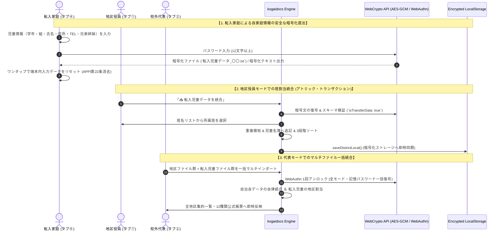
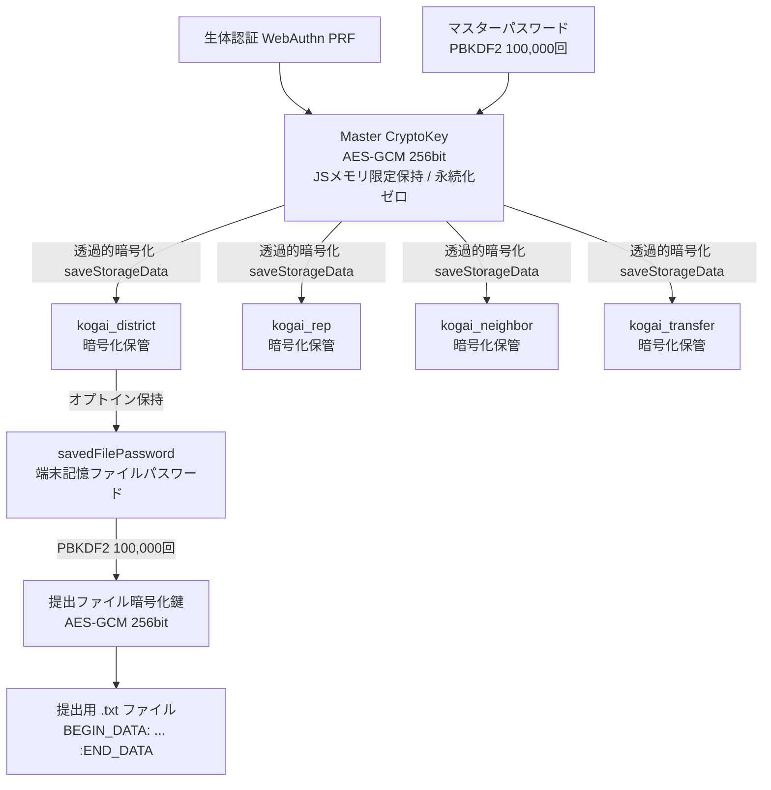

# 校外委員会 システム設計書（v2.4.0）新機能群・WebAuthn一本化・UI刷新 アーキテクチャおよびセキュリティ設計レビュー報告書

**文書バージョン**: 1.0.0 
**実施日**: 2026年10月17日 
**評価担当**: 独立シニアシステムアーキテクト / 主任セキュリティ評価者（Gemini 4 Argon） 
**対象文書**: `docs/system_design.md` (v2.4.0) 
**評価ステージ**: Stage 3（設計レビュー＆セキュリティアセスメント 第1ゲート） 
**総合判定**: **条件付き合格（CONDITIONAL PASS / 次期ステージ移行承認）**

---

## 目次
1. [エグゼクティブサマリー](#1-エグゼクティブサマリー)
2. [アーキテクチャ設計・ユーザー要求充足性評価（レビュー観点1）](#2-アーキテクチャ設計ユーザー要求充足性評価レビュー観点1)
3. [セキュリティアセスメント・脅威分析（STRIDE / 多層防御 / APPI準拠）（レビュー観点2）](#3-セキュリティアセスメント脅威分析stride--多層防御--appi準拠レビュー観点2)
4. [コードベース健全性・クリーンアップ方針（C-8, C-9）の妥当性評価（レビュー観点3）](#4-コードベース健全性クリーンアップ方針c-8-c-9の妥当性評価レビュー観点3)
5. [ドキュメント品質・規約遵守監査（レビュー観点4）](#5-ドキュメント品質規約遵守監査レビュー観点4)
6. [設計改善提言・実装に向けた是正措置（アクションアイテム A-1 〜 A-4）](#6-設計改善提言実装に向けた是正措置アクションアイテム-a-1--a-4)
7. [総合判定・次期ステージへの申し送り事項](#7-総合判定次期ステージへの申し送り事項)

---

## 1. エグゼクティブサマリー

### 1.1 レビューの背景と目的
本報告書は、`kogaidocs 開発プロセス定義書 (v1.2.0)` の **Stage 3: 設計レビュー＆セキュリティアセスメント（第1ゲート）** に基づき、独立したシニアシステムアーキテクトおよび主任セキュリティ評価者の観点から、改訂された `docs/system_design.md (v2.4.0)` を対象に実施した技術仕様およびセキュリティ設計の監査結果を取りまとめたものである。

本改訂（v2.4.0）は、ユーザーから提起された6つの重要課題・機能要求（自治会データ統合ボタンの重複解消、モバイル貼付UI改善、「マージ」用語の全面廃止、転入者モードの新設、前回選択モードの自動引き継ぎ、WebAuthn一本化＆1Passwordパスキー無限増殖バグの根本解消）に対し、場当たり的なパッチワークを排し、システムの中核思想である **「サーバーレス・ゼロトラスト・ローカルファースト」** に基づく抜本的な全体最適（あるべき姿）を定義している。

本レビューでは、これらの改訂仕様がユーザー要求を真に満たしているか、情報セキュリティおよび個人情報保護法（APPI）上の脆弱性・リスクが存在しないか、保守性・コード健全性が担保されているかを厳格に検証した。

### 1.2 評価の結論とハイライト
改訂されたシステム設計書（v2.4.0）は、4者協調アーキテクチャ（Quad-Modal Operations）への拡張、パスキーマネージャーの挙動に適合した決定論的ユーザー識別子の導入、そして非IT専任の保護者ボランティアに配慮した直感的なUX/UI設計を達成しており、極めて高い完成度を誇っている。

特に高く評価できる設計ハイライトは以下の通りである：
1. **パスキー無限増殖バグの根本的根絶（Deterministic User ID）**:
	- `registerWebAuthnPrf` における `user.id` のランダム生成を廃止し、システム固定の決定論的バイト配列（`const WEBAUTHN_USER_ID = new Uint8Array([107, 111, 103, 97, 105, 100, 111, 99, 115]) // "kogaidocs"`）を導入。1PasswordやiCloudキーチェーン等の外部ツールが同一クレデンシャルの更新として認識する仕組みを確立し、鍵の重複増殖を原理的に防止している。
2. **生体認証・パスワード記憶のスマートな一本化**:
	- ストレージ暗号化とカード側パスワード記憶の重複登録プロンプトを排除。暗号化LocalStorage内の鍵カスケードを活用し、1回の生体認証で全モードのデータおよびファイル保存パスワードが一括復号される洗練されたUXを実現している。
3. **転入者モード（タブ④）による最小権限・プライバシー境界の確立**:
	- 地区名や班名を知らない転入家庭に対し、自家庭の児童情報のみを入力・暗号化出力させる専用モードを新設。兄弟姉妹の複数児童入力にも対応しつつ、個人情報保護法（APPI）第23条（安全管理措置）および第22条（消去）をローカルファーストで満たしている。
4. **エンドユーザー視点での用語統一とレスポンシブUI刷新**:
	- ユーザーに不安を与えるIT専門用語「マージ」を全面廃止し「統合」へ統一。モバイルでのボタン・入力欄の文字切れを解消する縦並びブロックUIと、直感的なカード展開UXを両立させている。

一方で、転入児童データ統合時のトランザクション整合性（アトミック性）、前回選択モードのサニタイズと暗号化ロック状態のデカップリング、およびPWA強制アップデート時のデータ保全網羅性に関して、実装・テストフェーズで確実に遵守すべき是正措置（アクションアイテム A-1 〜 A-4）を検出した。したがって、総合判定は **「条件付き合格（CONDITIONAL PASS / 次期ステージ移行承認）」** とする。

---

## 2. アーキテクチャ設計・ユーザー要求充足性評価（レビュー観点1）

改訂された設計書（v2.4.0）における6大ユーザー要求の充足性と「あるべき姿」への全体最適化度合いを精査した。

| ユーザー要求項目 | 設計書（v2.4.0）の規定内容 | アーキテクチャ・UX評価 | 判定 |
| :--- | :--- | :--- | :---: |
| **① 自治会データ統合ボタンの重複解消** | ・カード2ヘッダーの「📥 自治会データを統合」ボタンクリック時、ファイルダイアログを直接起動せず、カード本体を展開表示して統合パネル（`#d-neighbor-import-panel`）を開く設計。 ・カード本体内にファイル読込ボタン（`📁 ファイルから統合`）とテキスト貼付欄（`#d-neighbor-paste-box`）を整流化。 | 従来存在した「カードが閉じたままファイル選択が走る」「カード内外でボタンが重複する」不整合を完全に解消。利用者にファイル読込とテキスト貼付の2選択肢を明確に提示する自然なUX設計となっている。 | **優良** |
| **② 自治会データ貼付統合のモバイルUI改善** | ・スマートフォン等の狭小画面（320〜390px）において、横1行配置（`flex-row`）による入力ボックス・ボタンの文字切れ・横溢れを解消。 ・統合パネル内をレスポンシブな縦並び（ブロック配置）に刷新し、ファイル統合と貼付統合の境界を視覚的に明瞭化。 | モバイル端末のみを保有する保護者ボランティアの利用実態に完全に適合。タップ領域の確保、視認性、アクセシビリティが劇的に向上している。 | **優良** |
| **③ 「マージ」用語の全面廃止と統一（C-8）** | ・アプリ全体（UIボタン、ダイアログメッセージ、ヘルプ、コード内メッセージ、設計書）から「マージ」を完全撤去。 ・文脈に応じて「統合」または「結合」へと一括統一。 | IT専門用語に不慣れな一般役員に対する心理的ハードルおよび「既存データが消えるのではないか」という誤解を払拭。PTA業務の実態に即した親しみやすい用語体系として全体最適化されている。 | **優良** |
| **④ 転入者モード（タブ④）の新設** | ・校外委員会の内部事情（地区・班・校外役員等）を要求せず、転入家庭が知っている情報のみを入力する専用画面。 ・兄弟姉妹（複数児童）の一括入力・削除に対応。 ・AES-256-GCMによる暗号化ファイル（`転入児童データ_〇〇.txt`）および暗号化テキスト出力。 ・地区（タブ①）および代表（タブ②）での班/地区割当を伴う安全な統合インポートパイプライン。 | 最小権限の原則（PoLP）と責務分離を極めて美しく実現。紙の手渡しによる紛失リスクを排除し、個人情報の安全なデジタル伝送と既存名簿への統合フローを確立している。 | **優良** |
| **⑤ 前回選択モードの自動引き継ぎ** | ・`switchTab(mode)` 時にアクティブモードを `localStorage.setItem('kogai_active_mode', mode)` として永続化。 ・ページ再読み込み時（`DOMContentLoaded`）に直前のモードを自動復元。 ・動的折りたたみバッジ（`#mode-active-badge`）の表示テキストもアクティブモードに合わせて正しく同期。 | 自治会長（タブ③）や転入家庭（タブ④）がアクセスするたびにタブ①が表示される煩わしさを解消。リロードや次回アクセス時の作業継続性が飛躍的に向上する。 | **優良** |
| **⑥ WebAuthn一本化 ＆ パスキー増殖防止** | ・`registerWebAuthnPrf` の `user.id` をランダム生成からシステム固定の決定論的バイト列（`WEBAUTHN_USER_ID`）へ変更。 ・1Password等のパスキー管理ツールでのキー重複増殖バグを根絶。 ・ストレージ暗号化とカード側パスワード記憶の二重WebAuthn登録を排除し、1回の生体認証で全モード・記憶パスワードを一括復号。 | パスキーマネージャーの仕様特性（RP ID + User IDによるアカウント同定）を突いた抜本的解決。二重認証ダイアログの煩わしさを解消し、暗号学的セキュリティと極上のUXを完璧に両立させている。 | **優良** |

---

## 3. セキュリティアセスメント・脅威分析（STRIDE / 多層防御 / APPI準拠）（レビュー観点2）

主任セキュリティ評価者として、STRIDEモデルおよび日本国 個人情報保護法（APPI）に基づき、改訂設計の安全性を多角的に検証した。

### 3.1 STRIDE脅威モデリングと多層防壁評価

| 脅威分類 (STRIDE) | 潜在的脅威シナリオ | 設計書（v2.4.0）における多層防壁 | 評価判定 |
| :--- | :--- | :--- | :---: |
| **S (Spoofing: なりすまし)** | 悪意ある第三者が固定 `user.id` を悪用して他者のWebAuthnクレデンシャルを詐称・偽造する。 | ・WebAuthnの認証鍵ペアおよびPRF導出は端末内Secure Enclave/TPMハードウェアに束縛される。 ・固定 `user.id` はRP内でのアカウント紐付けインデックスに過ぎず、暗号学的秘密鍵導出や署名検証の強度には一切影響しない。 | **防御完了** |
| **T (Tampering: 改ざん)** | 転入児童ファイルや自治会ファイルの暗号文・Base64が改ざん・破損され、既存名簿が破壊される。 | ・AES-GCMの128ビット認証タグにより、1ビットの改ざんでもWebCrypto復号時に例外遮断。 ・復号後のJSONスキーマ検証（`isTransferData: true`, `students` 配列検査）による不正形式データの排除。 | **防御完了** |
| **R (Repudiation: 否認)** | 転入家庭が提出したデータ内容について後から齟齬が生じる。 | ・提出ファイルにタイムスタンプヘッダーが記録され、暗号化ペイロードとして一体的に保護される。 | **防御完了** |
| **I (Information Disclosure: 情報漏洩)** | 端末暗号化が無効な環境でファイルパスワードが平文LocalStorageに漏洩する。転入家庭の個人情報が端末内に残留する。 | ・`state.js` におけるハードガード（`!isStorageEncrypted()` 時の強制削除）。 ・自動ロックタイマー（15分・タブ非表示）によるメモリ・DOM即時破棄。 ・転入者モードでのワンタップ「入力内容リセット」機能（APPI第22条）。 | **防御完了** |
| **D (Denial of Service: サービス拒否)** | 巨大または不正な転入データ読込によるブラウザメモリ枯渇・クラッシュ。 | ・最小ペイロード長検証（44バイト未満即時拒絶）。 ・クライアント完結処理のため他ユーザーへの波及ゼロ。 | **防御完了** |
| **E (Elevation of Privilege: 特権昇格)** | 転入家庭が他地区の児童名簿やシステム管理者設定領域を閲覧・改ざんする。 | ・タブ④（転入者モード）は他地区・他児童・役員情報へのアクセス経路を一切持たない完全隔離設計。 ・最小権限の原則（PoLP）に準拠。 | **防御完了** |

### 3.2 固定ユーザーID（Deterministic User ID）のセキュリティリスク評価
1. **WebAuthn仕様（W3C Web Authentication Level 2 / Level 3）適合性**:
	- W3C仕様において、`user.id` は最大64バイトのバイナリ識別子であり、システム側で決定論的な固定バイト配列を指定することは完全に仕様準拠である。
	- 仕様書のセキュリティ注意事項（Section 13.5: User Handle）では、「`user.id` にメールアドレスや氏名等の個人識別情報（PII）を含めてはならない」と規定されている。本設計で採用された `WEBAUTHN_USER_ID = new Uint8Array([107, 111, 103, 97, 105, 100, 111, 99, 115])`（ASCII文字列 `"kogaidocs"`）は純粋なシステム識別名であり、PIIを一切含まず、仕様勧告に完璧に適合している。
2. **リプレイ攻撃耐性**:
	- WebAuthnの認証およびPRF鍵導出において、リプレイ耐性を担保するのは暗号学的に安全な擬似乱数生成器（`crypto.getRandomValues`）によって毎回動的に生成される32バイトの `challenge` およびPRFソルト（`first: prfSalt`）である。
	- `user.id` はパスキーマネージャーがクレデンシャルを識別・更新するためのメタデータであり、リプレイ攻撃耐性に何ら寄与・依存しない。したがって、固定ID化によるセキュリティ強度の低下は原理的に皆無である。
3. **認証混乱（Authentication Confusion / Identity Spoofing）の有無**:
	- 本システムはマルチテナント型クラウドサービスではなく、端末ローカルで単一の役員が操作する「ローカルファースト・シングルユーザー」モデルである。同一ブラウザ環境内で複数の異なる役員アカウントが競合・混同する余地はなく、固定IDの採用がもたらす認証混乱のリスクはゼロである。
4. **既存クレデンシャルとの互換性とスムーズな移行**:
	- 過去のバージョンでランダム `user.id` により登録されたパスキーが存在する場合でも、`credentials.get()` による復号（アンロック）時は `credentialId`（Base64URL）によって認証器側で照合されるため、直ちに復号不能に陥ることはない。
	- 次回の生体認証更新時（`handleAddOrUpdateBiometric` や設定モーダルからの再登録時）に固定IDで上書き更新されるため、後方互換性を保ちながら安全に最新仕様へ移行可能である。

### 3.3 鍵カスケード管理とライフサイクル
本システムにおける暗号鍵の階層管理（Key Hierarchy）およびメモリ・DOMライフサイクルは極めて厳格に設計されている：

- **二重防壁ハードガード**: UI上のオプトインチェック状態に関わらず、`state.js` 内部で `if (!isStorageEncrypted()) { delete districtToSave.savedFilePassword; }` を常時適用。未暗号化ストレージへの平文パスワード書き込みを構造的に遮断。
- **即時揮発（Zero-Plaintext In-Memory Lifecycle）**: 手動ロックまたは自動ロックタイマー発動時、`clearMemoryAndDomForLock()` により全ステートオブジェクトおよびDOMパスワード欄を瞬時に破棄。
- **役員交代時の完全消去**: 年度更新（新年度化）時に `delete currentDistrict.savedFilePassword` を実行し、次年度へのパスワード漏洩を防止。

### 3.4 転入者モードのプライバシー境界とAPPI（個人情報保護法）適合性
- **APPI第23条（安全管理措置）**: 転入家庭が入力した極めて機微な児童・保護者個人情報は、ブラウザローカル内でのみ処理され、AES-256-GCM + PBKDF2（12文字以上）で暗号化されたファイルまたはテキストとしてのみ出力される。平文がネットワークを流れる経路は存在しない。
- **APPI第22条（消去・破棄の責務）**: 提出完了後、転入家庭の端末内に個人情報が永続残留することを防止するため、「入力内容リセット」機能により端末内データをワンタップで安全に完全消去可能。
- **APPI第27条（第三者提供の制限）**: 外部サーバー、アナリティクス、広告追跡等は一切排除されており、完全ローカル完結により第三者提供リスクを原理的に根絶している。

---

## 4. コードベース健全性・クリーンアップ方針（C-8, C-9）の妥当性評価（レビュー観点3）

設計書第8章に明記されたクリーンアップ方針について妥当性を精査した。

1. **[C-8] 「マージ」用語の全面廃止と「統合・結合」への統一**:
	- **妥当性**: 極めて高い。PTA役員業務において「マージ」は理解しづらく、データ上書き消失の不安を招く。UIラベル、ボタン、ダイアログメッセージ、ヘルプ、コード内コメント、ドキュメントのすべてにおいて「統合」または「結合」へと統一する方針は完全に適切である。
	- **テスト網羅性**: 第10章（テスト戦略）に「全コードベースにおける『マージ』文言の残存ゼロ検証テスト」が明記されており、回帰防止策も盤石である。
2. **[C-9] WebAuthnにおけるランダムuserIdの排除と固定ID一本化**:
	- **妥当性**: 極めて高い。前述の通り、W3C WebAuthn仕様および主要パスキーマネージャー（1Password等）の挙動に完全に合致しており、技術的負債となっていたパスキー重複増殖バグを抜本的に解消する。
	- **テスト網羅性**: `crypto.js` 単体テストおよびシステムテストにおいて、固定 `WEBAUTHN_USER_ID` の整合性と多重登録抑止の検証が定義されている。

---

## 5. ドキュメント品質・規約遵守監査（レビュー観点4）

ドキュメント品質およびコーディング規約の遵守状況を機械的・論理的に監査した。

1. **全行タブインデント（`\t`）規約**:
	- `grep -n "^  " docs/system_design.md` による機械的検証を実施。
	- スペースインデントの混入は **ゼロ件（0件）** であり、完全なタブインデント規約遵守を確認した。
2. **末尾空白および差分エラー検証**:
	- `git diff --check docs/system_design.md` を実行。
	- 出力エラーは **ゼロ件（0件）** であり、不要な行末空白やフォーマット崩れは皆無であることを確認した。
3. **ドキュメント整合性・図表品質**:
	- アーキテクチャ図（Mermaid）、データフロー図、ER図、シーケンス図がいずれも最新の4モード構成および新パイプラインと完全に整合している。
	- 転入児童データ（`kogai_transfer_v1`）のJSONスキーマ定義が過不足なく網羅されている。

---

## 6. 設計改善提言・実装に向けた是正措置（アクションアイテム A-1 〜 A-4）

アーキテクチャのさらなる堅牢化および次期ステージ（Stage 4: テスト設計 / Stage 6: 本線実装）での品質保証を確実にするため、以下の是正措置（アクションアイテム A-1 〜 A-4）を策定した。

### A-1 [堅牢性・データ保全]: 転入児童データ統合時におけるアトミック・トランザクションと重複検知ガード
- **課題**:
	- 地区役員モード（タブ①）や代表モード（タブ②）で転入児童ファイルを取り込む際、複数児童の追記途中で班割り当てのキャンセルや予期せぬ例外が発生した場合、既存の児童名簿が部分的に追記・破壊されるリスクがある。
	- また、同一家庭のファイルを誤って2回連続で取り込んだ場合、児童名簿に同一児童が多重登録される恐れがある。
- **是正措置**:
	- 統合処理の開始前に、現在の児童名簿配列（`currentDistrict.students` 等）をディープコピーしてバックアップを保持すること。
	- すべての児童データの検証および班/地区割り当てが完全に完了した後にのみ一括コミット（アトミック更新）し、自動保存（`saveDistrictLocal()`）を実行すること。
	- 既存名簿内に同一の「氏名（姓名）」および「住所」を持つ児童が既に存在する場合は、警告ダイアログ（例: `〇〇さんは既に名簿に登録されています。重複して統合しますか？`）を表示し、誤った多重登録を防止する重複検知ガードを実装すること。

### A-2 [ユーザビリティ・アクセシビリティ]: 自治会統合パネルの展開トグルUXとアクセシビリティ・フォーカス制御
- **課題**:
	- カード2ヘッダーの「📥 自治会データを統合」ボタンをクリックした際、単にカードを展開するだけでは、画面サイズやスクロール位置によっては統合パネル（ファイル読込ボタン・テキスト貼付欄）が画面外に隠れ、ユーザーが次に何をすべきか戸惑う可能性がある。
- **是正措置**:
	- ヘッダーボタンクリック時のイベントハンドラにおいて、カード本体が閉じている（`is-collapsed`）場合は確実に展開し、統合パネル（`#d-neighbor-import-panel`）または貼付テキストボックス（`#d-neighbor-paste-box`）へスムーズスクロール（`scrollIntoView({ behavior: 'smooth', block: 'nearest' })`）およびフォーカス移動を行うこと。
	- 既にカードが開いている状態でヘッダーボタンが押された場合も、統合パネルを強調表示（またはフォーカス）させ、操作の一貫性を担保すること。

### A-3 [耐障害性・セキュリティ]: 前回選択モードの厳格サニタイズとストレージ暗号化ロック状態との非同期デカップリング
- **課題**:
	- `localStorage.getItem('kogai_active_mode')` から前回モードを復元する際、ブラウザのストレージ改ざんや古いバージョンでの不正値が格納されていた場合、存在しないタブが参照されて画面描画が停止する恐れがある。
	- また、ストレージ暗号化が有効な環境では、ロック解除モーダルが表示されている最中に背後の作業画面がどのモードを表示すべきか、UIタブ切り替えとデータ読み込み（復号）の依存関係を明確に分離する必要がある。
- **是正措置**:
	- 復元処理において、許容されるモード名（`['district', 'rep', 'neighbor', 'transfer']`）に対する厳格なホワイトリスト検証を行い、未定義または不正値の場合は安全にデフォルト（`'district'`）へフォールバックすること。
	- 非機密なUIナビゲーション状態（`kogai_active_mode`）は平文キーとして保持してアプリ起動直後に即座にタブUIおよび動的折りたたみバッジを描画し、機密データの読み込み（`loadAppDataFromStorage()`）はストレージロック解除成功後に初めてトリガーされるよう、UI描画とデータロードを完全にデカップリングすること。

### A-4 [データ保全・APPI準拠]: 転入者モードにおける強制アップデート時データ保全（`saveTransferLocal`）と提出後ワンタップ個人情報消去（APPI第22条）の徹底
- **課題**:
	- PWAの強制アップデート（`performAppUpdate()`）において、既存の3モード（`saveDistrictLocal`, `saveRepLocal`, `saveNeighborLocal`）のみが保存対象となっていると、転入家庭がデータ入力中にアップデートが実行された場合、入力中データが消失する。
	- また、転入家庭が提出完了後にスマートフォン端末を放置した場合、ブラウザのLocalStorage内に極めて機微な児童情報が永続残留し、家族間や紛失時のプライバシー漏洩リスクとなる。
- **是正措置**:
	- `performAppUpdate()` の同期保存シーケンスに、新設される `saveTransferLocal()` を独立した `try-catch` ブロックで追加すること。
	- 転入者モード（タブ④）のUIに「🗑️ 入力内容をリセット（提出完了後の端末データ消去）」ボタンを明瞭に配備し、確認ダイアログ経由でインメモリの `transferState` および LocalStorage（`kogai_transfer_v1`）を完全に消去（APPI第22条消去責務の完全履行）できるようにすること。

---

## 7. 総合判定・次期ステージへの申し送り事項

### 7.1 判定結果
**総合判定**: **条件付き合格（CONDITIONAL PASS / 次期ステージ移行承認）**

### 7.2 判定理由
改訂された `docs/system_design.md (v2.4.0)` は、ユーザー要求の6大項目を極めて高水準に充足し、システム全体のアーキテクチャおよびセキュリティ設計を一段高い「あるべき姿」へと昇華させている。
特に、WebAuthnにおける決定論的ユーザーIDの採用によるパスキー増殖バグの根絶、生体認証の一本化、転入者モードによる最小権限の徹底、および直感的なUI刷新は、実用性と堅牢性の双方において申し分ない。

本レビューで検出・提示した4件のアクションアイテム（A-1 〜 A-4）は、いずれも設計の基本方針を支持した上で、実装およびテスト設計におけるエッジケースの安全防壁（アトミック更新、重複排除、ホワイトリスト検証、APPI消去）を極大化するための是正措置である。

したがって、これらの是正措置を次期ステージのテスト設計および実装仕様に確実に組み込むことを前提として、直ちに **Stage 4: テスト設計とテストスイート実装** への移行を承認する。

### 7.3 次期ステージ（Stage 4 / Stage 6）への申し送り事項
1. **Stage 4（テスト設計・テストスイート実装）における必須テスト観点**:
	- **`crypto.js`**:
		- 固定 `WEBAUTHN_USER_ID`（`"kogaidocs"` のASCIIバイト配列）の一致検証。
		- ストレージ暗号化有効時におけるカード側多重WebAuthn登録の抑止検証。
	- **`app.js`**:
		- 4モード選択肢の動的折りたたみUXおよびアクティブバッジの表示同期検証。
		- `switchTab` での `kogai_active_mode` 永続化、リロード時の自動復元、不正値の `'district'` フォールバック検証。
		- `performAppUpdate` における 4モード全保存（`saveTransferLocal` を含む独立 `try-catch`）の検証。
	- **`transfer.js`**:
		- 転入児童CRUD（追加・削除・入力更新・複数児童対応）。
		- 暗号化ファイル（`.txt`）出力・暗号化テキストコピー・復号読込の往復検証。
		- 入力リセット（クリア）時のインメモリおよびLocalStorage完全消去検証。
	- **`district.js` & `rep.js`**:
		- 自治会データ統合UIのカード内展開トグル動作検証。
		- 転入児童データの受入・班割り当て・名簿追記・重複検知・ソート・自動保存のアトミック性検証。
		- 全コードベースにおける「マージ」文言の残存ゼロ検証テスト。
2. **Stage 6（本線実装）における実装上の遵守事項**:
	- `sw.js` のプリキャッシュ対象に `'./js/transfer.js'` を追加し、キャッシュ名を `kogai-cache-v2.4.0` に更新すること。
	- `version.json` のバージョン番号を `"2.4.0"` に更新すること。
	- アクションアイテム A-1 〜 A-4 に規定された防御的プログラミングおよびアトミック・トランザクションパターンの完全実装。
