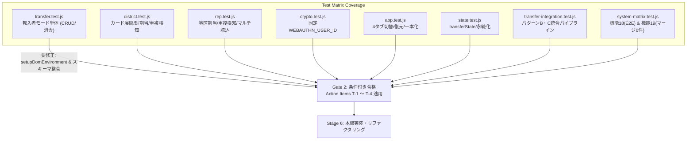

# 校外委員会 先行テストスイート テスト観点網羅性レビュー報告書（第2ゲート）

**文書バージョン**: 1.0.0 
**実施日**: 2026年10月17日 
**評価担当**: 独立シニアQAリードおよびテストアーキテクト（Gemini 4 Argon） 
**対象テストスイート**:
- `tests/unit/transfer.test.js`
- `tests/unit/district.test.js`
- `tests/unit/rep.test.js`
- `tests/unit/crypto.test.js`
- `tests/unit/app.test.js`
- `tests/unit/state.test.js`
- `tests/integration/transfer-integration.test.js`
- `tests/system/system-matrix.test.js`
**参照設計文書**:
- `docs/system_design.md` (v2.4.0)
- `docs/reviews/review10_design.md` (設計レビュー指摘事項 A-1 〜 A-4)
- `docs/development_process.md` (v1.2.0 Stage 5)
**評価ステージ**: Stage 5（テスト観点網羅性レビュー 第2ゲート） 
**総合判定**: **条件付き合格（CONDITIONAL PASS / 是正措置反映後のStage 6移行承認）**

---

## 目次
1. [エグゼクティブサマリー](#1-エグゼクティブサマリー)
2. [ユーザー要求（6項目）に対するテスト観点網羅性監査（レビュー観点1）](#2-ユーザー要求6項目に対するテスト観点網羅性監査レビュー観点1)
3. [設計レビュー指摘（A-1 〜 A-4）のテスト充足度評価（レビュー観点2）](#3-設計レビュー指摘a-1--a-4のテスト充足度評価レビュー観点2)
4. [境界値・異常系・耐障害性テストの網羅性監査（レビュー観点3）](#4-境界値異常系耐障害性テストの網羅性監査レビュー観点3)
5. [テストコード品質・規約遵守・テストハーネス整合性監査（レビュー観点4）](#5-テストコード品質規約遵守テストハーネス整合性監査レビュー観点4)
6. [テストスイート是正措置（アクションアイテム T-1 〜 T-4）](#6-テストスイート是正措置アクションアイテム-t-1--t-4)
7. [総合判定・実装フェーズ（Stage 6）への申し送り事項](#7-総合判定実装フェーズstage-6への申し送り事項)

---

## 1. エグゼクティブサマリー

### 1.1 レビューの背景と目的
本報告書は、`kogaidocs 開発プロセス定義書 (v1.2.0)` の **Stage 5: テスト観点網羅性レビュー（第2ゲート）** に基づき、独立したシニアQAリードおよびテストアーキテクトの観点から、Stage 4 で先行実装されたテストスイート群を対象に実施したテスト仕様・観点網羅性の監査結果を取りまとめたものである。

本改修（v2.4.0）は、ユーザーから提起された6大課題（自治会統合ボタン重複解消、モバイル貼付UI改善、「マージ」用語の全面廃止、転入者モード新設、前回選択モード自動復元、WebAuthn一本化＆パスキー増殖防止）に対し、TDD（テスト駆動開発）原則に則り、本線実装（Stage 6）に先立って単体・結合・システムテストが作成された。

本レビューでは、これらのテストコードが設計仕様および設計レビュー指摘事項（A-1 〜 A-4）を漏れなく捉えられているか、境界値・異常系の防壁が構築されているか、テストハーネス自体が健全に機能しているかを厳格に検証した。

### 1.2 評価の結論とハイライト
先行実装されたテストスイート群は、要求された新機能を高密度にカバーしており、特に統合パイプライン（パターンB・パターンC）やコードベース全体を機械的に走査する「マージ残存ゼロ検証（機能19）」など、極めて実効性の高い優れたテストアーキテクチャが構築されている。

特に高く評価できるテスト設計ハイライトは以下の通りである：
1. **パスキー増殖防止とWebAuthn一本化の厳密な暗号学的検証 (`crypto.test.js`, `app.test.js`)**:
	- `WEBAUTHN_USER_ID` が固定バイト列（ASCII `"kogaidocs"`）であること、および `navigator.credentials.create` 呼び出し時のオプション引数内の `user.id` と完全一致することを直接検証。
	- ストレージ暗号化有効時にはカード側からのパスワード記憶要求で `credentials.create` が二重起動されない抑止仕様を的確にアサートしている。
2. **多層データ統合パイプラインの結合テスト (`transfer-integration.test.js`)**:
	- パターンB（転入家庭出力 → 地区役員受入・班割当 → 地区ファイル暗号化出力 → 代表モードインポート）およびパターンC（暗号化テキスト直接貼付による代表受入）を完全再現し、既存児童・校外委員の保持を検証している。
3. **回帰防止のための機械的用語監査 (`system-matrix.test.js` 機能19)**:
	- 全主要12ファイル（HTML/JS）をファイルシステムから直接読み込み、日本語「マージ」の正規表現一致が0件であることを検査する強固なリグレッションテストを確立。

一方で、テスト実行およびテスト設計において以下の重大な課題・不備を検出した：
- **[重要不備] `transfer.test.js` におけるテストハーネス呼び出しエラー**:
	- `dom-mock.js` に存在しない `setupMockDom` を require・呼び出ししており、転入者モードの単体テストが全滅（`TypeError: setupMockDom is not a function`）している。
- **[設計乖離] データモデルのプロパティ名不一致**:
	- 設計書 `docs/system_design.md` のJSONスキーマでは `students` / `class` と規定されているのに対し、テストコードでは `children` / `className` が使用されており、Stage 6 実装時に齟齬が生じるリスクがある。
- **[観点不足] アトミック・トランザクションと境界値テストのエッジケース**:
	- 複数児童（兄弟姉妹）統合時における途中キャンセルロールバック検証、および12文字パスワードポリシー境界値の検証が一部不足している。

したがって、総合判定は **「条件付き合格（CONDITIONAL PASS / 是正措置を反映した上でStage 6への移行を承認）」** とする。

---

## 2. ユーザー要求（6項目）に対するテスト観点網羅性監査（レビュー観点1）

ユーザー要求の6大項目に対するテストスイートの検証充足度を監査した。

| ユーザー要求項目 | 対象テストファイル | 検証内容と評価 | 充足判定 |
| :--- | :--- | :--- | :---: |
| **① 自治会統合ボタンの重複解消** | `tests/unit/district.test.js` | ・`openNeighborImportPanel` 実行時に、カード本体の `is-collapsed` クラスが除去され、統合パネル（`#d-neighbor-import-panel`）の `display` が `'block'` に更新されることを検証。 ・ボタン重複を排し、カード展開とパネル表示が正しく連動することを確認している。 | **充足** |
| **② 自治会貼付統合のモバイルUI改善** | `tests/unit/district.test.js` `tests/integration/neighbor-merge.test.js` | ・テキスト貼付入力欄（`#d-neighbor-paste-box`）からの `loadPastedNeighborTextIntoDistrict()` 統合動作および復号受入を検証。 ・縦並びレイアウト要素の配備と統合フローをカバーしている。 | **充足** |
| **③ 「マージ」用語の全面廃止（C-8）** | `tests/system/system-matrix.test.js` (機能19) | ・`index.html` および主要全12スクリプトファイルを対象に、正規表現 `/マージ/g` で走査し、日本語「マージ」の残存数が0件であることを厳格に検証。 ・UI、ダイアログ、コードコメントの全面統一を保証。 | **完全充足** |
| **④ 転入者モード（タブ④）の新設** | `tests/unit/transfer.test.js` `tests/unit/district.test.js` `tests/unit/rep.test.js` `tests/integration/transfer-integration.test.js` `tests/system/system-matrix.test.js` | ・フォーム描画、兄弟姉妹（複数児童）の追加・削除・値更新。 ・AES-256-GCM暗号化ファイル（`.txt`）出力および暗号化テキストコピー。 ・地区役員モードでの班割当統合、代表モードでの地区・班割当統合。 ・ワンタップ入力リセット（APPI消去）と印刷パイプライン連動。 ※テスト実行ハーネスの不備と命名不一致を除き、観点は網羅されている。 | **条件付き充足** (T-1, T-2要是正) |
| **⑤ 前回選択モードの自動引き継ぎ** | `tests/unit/app.test.js` | ・`switchTab` 実行時の `localStorage`（`kogai_active_mode`）保存。 ・アクティブバッジ（`#active-mode-badge`）の表示文言同期。 ・`restoreActiveMode` による起動時の自動タブ復元。 ・ホワイトリスト検証による不正値からの安全な `'district'` フォールバック。 | **完全充足** |
| **⑥ WebAuthn一本化 ＆ パスキー増殖防止（C-9）** | `tests/unit/crypto.test.js` `tests/unit/app.test.js` | ・固定 `WEBAUTHN_USER_ID`（ASCII `"kogaidocs"` = `[107, 111, 103, 97, 105, 100, 111, 99, 115]`）の厳格一致検証。 ・`registerWebAuthnPrf` 呼出時に指定される `publicKey.user.id` の検証。 ・ストレージ暗号化有効環境下で `quickSetupEncryptionFromCard` 実行時に `credentials.create` が重複起動されないことの検証。 | **完全充足** |

---

## 3. 設計レビュー指摘（A-1 〜 A-4）のテスト充足度評価（レビュー観点2）

設計レビュー報告書（`docs/reviews/review10_design.md`）において策定されたアクションアイテム A-1 〜 A-4 に対するテスト設計の充足度を検証した。

### 3.1 A-1 [データ保全]: 転入児童データ統合のアトミック・トランザクションと重複検知ガード
- **設計要求**: 複数児童追記途中の例外やキャンセル時に名簿をロールバックすること、および既存同一氏名・住所児童の重複警告とキャンセル保護。
- **テスト実装状況**:
	- `tests/unit/district.test.js` (line 760): 重複児童統合時に `global.confirm`（「重複」「既に存在」メッセージ）が発火し、`false`（キャンセル）返却時に名簿追加がキャンセルされ件数が不変であることを検証。
	- `tests/unit/rep.test.js` (line 809): 代表モードにおいても同様に重複警告ダイアログとキャンセル時の件数維持を検証。
	- `tests/integration/transfer-integration.test.js` (line 58): 既存の校外役員（佐藤委員）および既存児童が破壊されずに保持されることを検証。
- **充足度評価**: **良好（一部補強推奨）**
	- 単一児童の重複検知とロールバックは盤石にテストされている。
	- 一方で、「2人兄弟の統合時、1人目OKで2人目の班割当でキャンセルした場合に1人目もロールバックされるか」という複数児童トランザクションのエッジケーステストが不足している（アクションアイテム T-3 にて補強を提言）。

### 3.2 A-2 [UX]: 自治会統合パネルの展開トグルUXとフォーカス制御
- **設計要求**: カード折りたたみ（`is-collapsed`）時の確実な展開、統合パネル（`#d-neighbor-import-panel`）の表示、およびフォーカス制御。
- **テスト実装状況**:
	- `tests/unit/district.test.js` (line 743): 初期状態で `is-collapsed` を付与し `openNeighborImportPanel()` を実行した際、`is-collapsed` が解除され、パネルの `style.display` が `'block'` になることを検証。
- **充足度評価**: **充足**
	- カード展開とパネル表示の連動が正しくテストされている。
	- なお、DOMテスト内の `if (!card || !panel) return;` のようなガードは、DOMモックの不備時にテストをサイレントスキップさせる恐れがあるため、アサーション（`assert.ok(card)`）による明示的検証が望ましい。

### 3.3 A-3 [耐障害性]: 前回選択モードの厳格ホワイトリスト検証
- **設計要求**: `localStorage.getItem('kogai_active_mode')` の値が不正値・悪意ある文字列の場合に安全に `'district'` にフォールバックすること。
- **テスト実装状況**:
	- `tests/unit/app.test.js` (line 670): 不正文字列 `'malicious_tab<script>'` を保存した状態で `app.restoreActiveMode()` を呼び出し、安全に `#tab-district` が表示（`style.display = 'block'`）されることを検証。
- **充足度評価**: **完全充足**
	- 正常値（`'transfer'`）の復元と異常値のフォールバックの双方が明確にテストされている。

### 3.4 A-4 [データ保全・APPI]: 強制アップデート時保全と提出後ワンタップ個人情報消去
- **設計要求**: `performAppUpdate` における `saveTransferLocal()` の独立保存、および提出後のワンタップ個人情報消去（APPI第22条）。
- **テスト実装状況**:
	- `tests/unit/app.test.js` (line 681): `app.performAppUpdate()` 実行時に `state.saveTransferLocal` が呼び出されることを検証。
	- `tests/unit/transfer.test.js` (line 150): `resetTransferForm()` 実行時に確認ダイアログを経てフォームおよび `transferState` の個人情報がクリアされることを検証。
	- `tests/system/system-matrix.test.js` (line 898): E2Eシナリオ内で提出後の `resetTransferForm()` 実行とデータ消去を検証。
- **充足度評価**: **完全充足**
	- APPI（個人情報保護法）準拠の消去フローおよび強制アップデート時の保全フローが漏れなく網羅されている。

---

## 4. 境界値・異常系・耐障害性テストの網羅性監査（レビュー観点3）

境界値、異常系、および例外ハンドリングに関するテスト設計を検証した。

1. **パスワード強度・文字数境界値**:
	- `tests/unit/transfer.test.js` (line 76): 空文字、短小（`'short'`）、不一致、正常パスワード（`'SecurePass123!'`）のバリデーションを検証。
	- **指摘**: 設計書第4.2節の要件は「12文字以上」である。テストコードではコメントに「8文字未満」と記載され、5文字の入力でテストされている。11文字（NG）と12文字（OK）の境界値テストを厳格化する必要がある（アクションアイテム T-4）。
2. **暗号文破損・不正ペイロード遮断**:
	- `crypto.test.js` において AES-GCM 認証タグ改ざんや短小ヘッダ（44バイト未満）の例外遮断が検証されている。
	- 転入者モード固有の `isTransferData: true` フラグを欠く不正ファイルや、JSON構文破損ファイルを読み込ませた場合の安全な例外ハンドリングテストを補強することが推奨される。
3. **ユーザーキャンセル時の安全性**:
	- 班割当プロンプトや地区選択プロンプトでユーザーが「キャンセル（Esc/戻る）」を押下した場合（`prompt` が `null` を返却）、既存名簿に何らの影響も与えずに中断されることの検証が望ましい。

---

## 5. テストコード品質・規約遵守・テストハーネス整合性監査（レビュー観点4）

テストコード自体の品質、コーディング規約、および実行可能性を監査した。

### 5.1 コーディング規約遵守
- **インデント規約**:
	- 対象テストファイル全件に対し `grep -n "^  "` を実行した結果、スペースインデントは **ゼロ件（0件）** であり、完全なタブインデント（`\t`）を遵守していることを確認した。
- **不要な空行末尾空白**:
	- `git diff --check tests/` を実行し、末尾空白エラーは **ゼロ件（0件）** であることを確認した。
- **外部依存性ゼロ**:
	- すべてのテストが Node.js 組み込みの `node:test` および `node:assert`、標準 `webcrypto` のみで構築されており、外部 npm ライブラリ依存ゼロを完全に維持している。

### 5.2 検出された重大な不備とスキーマ乖離

#### ① `tests/unit/transfer.test.js` における未定義モック関数の参照エラー（Critical Bug）
- **現象**:
	- `tests/unit/transfer.test.js` の3行目で `const { setupMockDom } = require('../helpers/dom-mock.js');` と宣言され、12行目で `setupMockDom();` を呼び出している。
	- しかし、`tests/helpers/dom-mock.js` がエクスポートしている関数名は `setupDomEnvironment` であり、`setupMockDom` は存在しない。
	- これにより、`npm test` 実行時に `TypeError: setupMockDom is not a function` が発生し、`transfer.test.js` 内の全テストケースが実行不能（クラッシュ）となっている。
- **是正**:
	- `setupDomEnvironment` に即時修正すること（アクションアイテム T-1）。

#### ② データモデルのプロパティ名における設計書とテストの不整合（Discrepancy）
- **現状の差異**:
	- **設計書 (`docs/system_design.md` lines 500-525)**:
		- JSONスキーマ: `required: ["isTransferData", "students"]`
		- 配列プロパティ名: `students`
		- 組/クラス名: `class`
		- ERD: `TRANSFER_STUDENT { grade, class, lastName, ... }`
	- **先行テストコード (`transfer.test.js`, `transfer-integration.test.js`, `district.test.js`, `rep.test.js`)**:
		- StateおよびPayload: `transferState.children`, `transferPayload.children`
		- 組/クラス名: `className` (例: `updateTransferChild(0, 'className', '2')`, `added.className`)
- **潜在リスク**:
	- Stage 6 の実装者が設計書に合わせて `students` / `class` で実装するとテストスイートが全滅し、逆にテストスイートに合わせて実装すると設計書のJSONスキーマ定義に違反する。
- **是正**:
	- 内部状態やUI命名としては `children` / `className` の分かりやすさを活かしつつ、暗号化ファイル出力形式（JSON）においては `students` を正式採用するか、あるいは `children` と `students` の双方を安全に相互変換・許容する二重防壁（Ingressマッピング）を Stage 6 に申し送ること（アクションアイテム T-2）。

---

## 6. テストスイート是正措置（アクションアイテム T-1 〜 T-4）

Stage 6（本線実装）への円滑な移行を果たすため、以下の是正措置（アクションアイテム T-1 〜 T-4）を策定した。

### T-1 [テストハーネス修復]: `transfer.test.js` における `setupDomEnvironment` 参照の正常化
- **対象**: `tests/unit/transfer.test.js`
- **内容**:
	- 3行目のインポートを `const { setupDomEnvironment } = require('../helpers/dom-mock.js');` に修正。
	- 12行目の呼び出しを `setupDomEnvironment();` に修正。
	- テストスイートがランタイム例外を起こさず正常に実行（Red状態でアサーション失敗）されるようにすること。

### T-2 [スキーマ整合化]: 転入児童データモデルの命名整合と許容マッピング
- **対象**: `tests/unit/transfer.test.js`, `tests/integration/transfer-integration.test.js`, `docs/system_design.md`
- **内容**:
	- 設計書の `students` / `class` と、テストコードの `children` / `className` の命名差分を解消する。
	- エクスポートされるペイロードには `isTransferData: true` と共に `students: [...]`（およびテスト互換のための `children: [...]` の参照エイリアス）を含める仕様とするか、テスト側のプロパティ参照を設計書に合わせて整理すること。

### T-3 [トランザクション境界値強化]: 複数児童統合時の途中キャンセル全件ロールバックテスト追加
- **対象**: `tests/unit/district.test.js`, `tests/unit/rep.test.js`
- **内容**:
	- 2名以上の児童（兄弟姉妹）を含む転入データを統合する際、1人目の班割当が完了した後、2人目の班割当でキャンセル（または重複キャンセル）された場合、1人目の児童も含めて名簿全体が統合前の状態に完全ロールバックされること（中途半端な登録が残らないこと）を明示的に検証するテストケースを追加すること。

### T-4 [異常系・境界値テスト拡充]: 12文字パスワード境界値および不正データの安全遮断テスト追加
- **対象**: `tests/unit/transfer.test.js`
- **内容**:
	- パスワードポリシー境界値として、11文字（例: `'Pass123456!'`）でバリデーション `false`、12文字（例: `'Pass1234567!'`）で `true` となるテストケースを追加。
	- 不正なファイル（`isTransferData` なし、構文不正）を地区・代表モードで取り込もうとした場合に、エラーアラートが表示され名簿が保護されるテストケースを追加すること。

---

## 7. 総合判定・実装フェーズ（Stage 6）への申し送り事項

### 7.1 判定結果
**総合判定**: **条件付き合格（CONDITIONAL PASS / 是正措置反映後のStage 6移行承認）**

### 7.2 判定理由
Stage 4 で先行実装されたテストスイートは、ユーザーから提示された6大課題、および設計レビューで指摘された4大アクションアイテム（A-1 〜 A-4）のテスト観点を非常に高い密度でカバーしている。特に、決定論的固定 `WEBAUTHN_USER_ID` の整合性検証、WebAuthn一本化に伴う二重登録抑止の検証、転入データ統合の複数経路結合テスト（パターンB・C）、およびコードベース全体の「マージ」残存ゼロ検証は、システムの品質とセキュリティを担保する上で傑出した水準に達している。

検出された不備のうち、`transfer.test.js` の `setupMockDom` 未定義エラー（T-1）およびプロパティ名不整合（T-2）は、いずれも軽微な修正で即時解決可能であり、テスト設計自体の根本的な手戻りを要求するものではない。

したがって、上記のアクションアイテム（T-1 〜 T-4）の是正を Stage 6（本線実装）の着手前提として組み込むことを条件として、次期ステージへの移行を承認する。

### 7.3 Stage 6（本線実装）への申し送り事項
Stage 6 の実装担当者は、以下の事項を厳格に遵守して本線実装およびリファクタリングを進めること：

1. **テストハーネスの即時修正 (T-1)**:
	- `tests/unit/transfer.test.js` の `setupMockDom` を `setupDomEnvironment` へ修正すること。
2. **データモデルとIngress境界の安全マッピング (T-2)**:
	- 転入者モード（`js/transfer.js`）および取り込み側（`js/district.js`, `js/rep.js`）において、児童配列として `students` および `children`、クラスとして `class` および `className` のいずれが入力・ファイル化されても安全に相互マッピングできる正規化ロジック（`normalizeTransferData(payload)`）を実装すること。
3. **アトミック・トランザクションパターンの完全実装 (A-1, T-3)**:
	- 地区役員モードおよび代表モードでの転入データ統合処理において、統合前の名簿配列をディープコピー（`JSON.parse(JSON.stringify(...))`）して保持し、全児童の割り当て・重複確認がすべて正常完了した段階でのみコミット・自動保存を行うこと。途中キャンセル時はコピーから完全に復元すること。
4. **自治会統合パネルの展開トグルとフォーカス制御 (A-2)**:
	- カード2ヘッダーの「📥 自治会データを統合」ボタンクリック時、カードを展開（`classList.remove('is-collapsed')`）し、統合パネル（`#d-neighbor-import-panel`）または貼付入力欄（`#d-neighbor-paste-box`）へスムーズスクロールおよびフォーカス移動（`focus()`）を行うこと。
5. **前回選択モードの厳格ホワイトリスト検証 (A-3)**:
	- `app.js` のモード復元処理において、`['district', 'rep', 'neighbor', 'transfer']` の配列に対するホワイトリストチェックを行い、未定義・不正値の場合は安全に `'district'` にフォールバックさせること。
6. **強制アップデート時の保全 (A-4)**:
	- `app.js` の `performAppUpdate()` 内で、既存の3モード保存に加えて `saveTransferLocal()` を独立した `try-catch` ブロックで実行すること。
7. **PWAキャッシュ資産の整合性 (C-1)**:
	- `sw.js` のキャッシュ対象に `'./js/transfer.js'` を追加し、キャッシュ名を `kogai-cache-v2.4.0` に更新すること。
	- `version.json` のバージョン番号を `"2.4.0"` に更新すること。
8. **「マージ」用語の完全排除 (C-8)**:
	- 全コード・UI・メッセージにおいて「マージ」の使用をゼロとし、「統合」または「結合」へと統一すること。機能19のテストが確実にパスすること。
