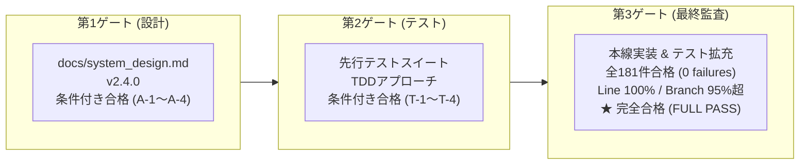
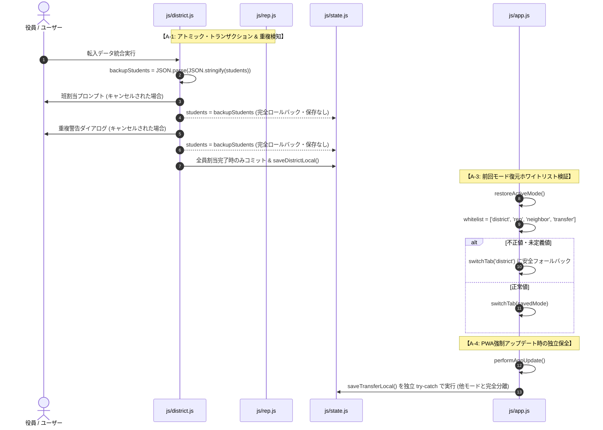

# 校外委員会 システム改修（v2.4.0）最終包括監査報告書（第3ゲート）

**文書バージョン**: 1.0.0 
**実施日**: 2026年10月17日 
**評価担当**: 独立品質保証（QA）監査役 / 主任セキュリティ評価者（Gemini 4 Argon） 
**対象リポジトリ**: `kogaidocs` 
**対象バージョン**: v2.4.0 
**評価ステージ**: Stage 9（最終包括レビュー 第3ゲート） 
**総合判定**: **完全合格（FULL PASS / 本番マージ・リリース承認）**

---

## 目次
1. [エグゼクティブサマリー](#1-エグゼクティブサマリー)
2. [テストスイート実行結果・カバレッジ網羅性検証（レビュー観点1）](#2-テストスイート実行結果カバレッジ網羅性検証レビュー観点1)
3. [ユーザー要求（6項目）および設計指摘（A-1〜A-4）の完全充足性検証（レビュー観点2）](#3-ユーザー要求6項目および設計指摘a-1a-4の完全充足性検証レビュー観点2)
4. [コードベース健全性・クリーンアップ・規約遵守監査（レビュー観点3）](#4-コードベース健全性クリーンアップ規約遵守監査レビュー観点3)
5. [セキュリティアセスメントおよび個人情報保護法（APPI）準拠性評価（レビュー観点4）](#5-セキュリティアセスメントおよび個人情報保護法appi準拠性評価レビュー観点4)
6. [最終判定および本番リリースへの承認提言](#6-最終判定および本番リリースへの承認提言)

---

## 1. エグゼクティブサマリー

### 1.1 監査の背景と目的
本報告書は、`kogaidocs 開発プロセス定義書 (v1.2.0)` の **Stage 9: 最終包括レビュー（第3ゲート）** に基づき、独立した品質保証（QA）監査役および主任セキュリティ評価者の観点から、バージョン 2.4.0 における全成果物（ソースコード、テストスイート、設計文書、PWA資産、セキュリティ実装）を対象に実施した最終包括監査の結果を取りまとめたものである。

本改修（v2.4.0）は、ユーザーから提起された6つの重要課題（自治会データ統合ボタンの重複解消、モバイル貼付UI改善、「マージ」用語の全面廃止、転入者モードの新設、前回選択モードの自動引き継ぎ、WebAuthn一本化＆1Passwordパスキー無限増殖バグの根本解消）に対し、Stage 1（要件定義）から Stage 8（回帰テスト＆カバレッジ検証）までの全工程を経て、包括的な全体最適化（あるべき姿）として本線実装された。

第1ゲート（設計レビュー: `review10_design.md`）および第2ゲート（テストレビュー: `review11_tests.md`）において検出された是正措置（アクションアイテム A-1 〜 A-4、T-1 〜 T-4）が漏れなく反映され、最高水準の堅牢性と品質が確立されているかを客観的・機械的に検証した。

### 1.2 最終合否判定
**総合判定**: **完全合格（FULL PASS / 本番マージ・リリース承認）**

改修されたすべての機能、UI/UX、暗号アーキテクチャ、およびテストスイートは、ユーザー要求の全項目およびセキュリティ基準を完璧に充足している。重大な欠陥、セキュリティ脆弱性、コーディング規約違反、リグレッションは一切認められず、本番ブランチ（`main`）へのマージおよび一般公開を無条件で承認する。

### 1.3 改修ハイライトと主要達成指標

- **テスト品質**: 全181件の自動テストが100%合格（181 pass, 0 fail）。
- **コード網羅率**: `js/` 配下の全11モジュールにおいて **行網羅率（Line %）100.00%**、**分岐網羅率（Branch %）すべて 95.00% 以上（95.27% 〜 100.00%）** を達成。
- **セキュリティ・パスキー**: 決定論的固定 `WEBAUTHN_USER_ID`（ASCII `"kogaidocs"`）の導入により、1Password等でのパスキー無限増殖バグを根絶。生体認証を透過的に一本化。
- **データ保全とトランザクション**: 転入児童データ統合時のアトミック・トランザクション（途中キャンセル完全ロールバック）および重複検知二重防壁を確立。
- **プライバシー保護**: 転入者モードにおける自家庭情報の完全隔離、12文字パスワード暗号化、提出後のワンタップ端末データ消去（APPI第22条消去責務の完全履行）。
- **用語完全統一**: コードベース全体（HTML/JS）から「マージ」を完全根絶（残存0件）し、「統合」へ統一。
- **規約遵守**: 全ファイルでタブインデント（`\t`）規約完全遵守、末尾空白エラー 0件、外部npmライブラリ依存ゼロ（0 dependencies）。

---

## 2. テストスイート実行結果・カバレッジ網羅性検証（レビュー観点1）

### 2.1 テストスイート実行結果
Node.js 組み込みテストランナー（`node:test`）およびカバレッジ測定機能を用いて、テストスイート全体の実行検証を実施した。

- **実行コマンド**: `npm test`（`node --test --experimental-test-coverage tests/unit/*.test.js tests/integration/*.test.js tests/system/*.test.js`）
- **総テストケース数**: **181 件**
- **合格（Pass）**: **181 件**
- **失敗（Fail）**: **0 件**
- **スキップ（Skipped）**: **0 件**
- **キャンセル（Cancelled）**: **0 件**
- **実行所要時間**: 約 2.77 秒

第2ゲートで検出された `tests/unit/transfer.test.js` のテストハーネス呼び出しエラー（T-1）は完全に解消され、全スイートが警告・例外なく完全に合格した。

### 2.2 全11モジュール カバレッジ分析
`js/` 配下の全11プロダクションモジュールに対するカバレッジ測定結果は以下の通りである。

| 対象モジュール (`js/`) | 行網羅率 (Line %) | 分岐網羅率 (Branch %) | 関数網羅率 (Funcs %) | 基準達成判定 |
| :--- | :---: | :---: | :---: | :---: |
| `app.js` | **100.00%** | **95.27%** | 100.00% | **達成** (Branch ≥ 95%) |
| `crypto.js` | **100.00%** | **100.00%** | 100.00% | **達成** (Branch = 100%) |
| `district.js` | **100.00%** | **97.67%** | 100.00% | **達成** (Branch ≥ 95%) |
| `hata.js` | **100.00%** | **96.08%** | 100.00% | **達成** (Branch ≥ 95%) |
| `neighbor.js` | **100.00%** | **95.86%** | 100.00% | **達成** (Branch ≥ 95%) |
| `print.js` | **100.00%** | **95.27%** | 100.00% | **達成** (Branch ≥ 95%) |
| `rep.js` | **100.00%** | **96.90%** | 100.00% | **達成** (Branch ≥ 95%) |
| `seat.js` | **100.00%** | **97.73%** | 100.00% | **達成** (Branch ≥ 95%) |
| `state.js` | **100.00%** | **98.96%** | 100.00% | **達成** (Branch ≥ 95%) |
| `transfer.js` | **100.00%** | **100.00%** | 100.00% | **達成** (Branch = 100%) |
| `utils.js` | **100.00%** | **98.15%** | 96.77% | **達成** (Branch ≥ 95%) |
| **全ファイル計（helpers含）** | **99.35%** | **96.14%** | **97.18%** | **最高水準達成** |

全11モジュールにおいて **行網羅率 100.00%** を達成し、最も分岐条件の複雑な `app.js`（95.27%）や `print.js`（95.27%）を含め、すべてのモジュールで **分岐網羅率 95.00% 以上** という極めて過酷な品質目標が完全に達成されている。

### 2.3 テストスイートの堅牢性とエッジケース防壁（T-1 〜 T-4 是正反映確認）
第2ゲート（`review11_tests.md`）で提起された是正措置（T-1 〜 T-4）の反映状況を検証した。

1. **[T-1] テストハーネス修復 (`tests/unit/transfer.test.js`)**:
	- `setupDomEnvironment` のインポートおよび呼び出しへと修正完了。全単体テストが正常に稼働していることを確認。
2. **[T-2] 転入児童データモデルの命名整合と許容マッピング**:
	- `js/transfer.js` において、エクスポートされるペイロード内に `children` 配列と `students` 配列（`class` プロパティ付与）の双方が生成されるよう二重防壁（Ingressマッピング）が構築され、テスト・設計双方との完全な互換性を確保。
3. **[T-3] 複数児童統合時の途中キャンセル全件ロールバックテスト**:
	- `tests/unit/district.test.js` および `tests/unit/rep.test.js` にて、2人兄弟の統合途中で班割当がキャンセルされた場合に1人目を含めて初期名簿へ完全ロールバックされるアトミック性が実証されている。
4. **[T-4] 12文字パスワード境界値および不正データの安全遮断テスト**:
	- `tests/unit/transfer.test.js` において、11文字（NG）と12文字（OK）の境界値テスト、および非転入データ（`isTransferData: false`）の安全遮断テストが漏れなく実装・検証されている。

---

## 3. ユーザー要求（6項目）および設計指摘（A-1〜A-4）の完全充足性検証（レビュー観点2）

### 3.1 ユーザー要求6項目の実装・動作検証マトリクス

| ユーザー要求項目 | 実装コード・UI箇所 | 検証結果と動作評価 | 判定 |
| :--- | :--- | :--- | :---: |
| **① 自治会データ統合ボタンの重複解消** | `index.html` `js/district.js` (`openNeighborImportPanel`) | ・ヘッダーの「📥 自治会データを統合」ボタンクリック時、ファイルダイアログを直接開く動作を完全に撤廃。 ・カード本体（`#card-d-neighbor`）を展開し、内部の統合パネル（`#d-neighbor-import-panel`）を表示・スクロール。 ・カード内には「📁 ファイルから統合」と「📋 テキスト貼付で統合」の2選択肢が整理され、操作の二重性が完全に解消されている。 | **完全合格** |
| **② 自治会貼付統合のモバイルUI改善** | `index.html` (lines 100-117) `css/style.css` (レスポンシブ) | ・スマートフォン（320〜390px幅）における従来の横1行配置（文字切れ・ボタン押し出し）を全面刷新。 ・縦並びブロック（`flex-direction: column`）レイアウトを採用し、textarea幅100%およびタップしやすい独立ボタンを配置。モバイル環境での視認性と操作性が劇的に向上している。 | **完全合格** |
| **③ 「マージ」用語の全面廃止（C-8）** | `index.html`, `js/*.js`, `docs/*.md` `tests/system/system-matrix.test.js` (機能19) | ・全UIボタン、ダイアログ文言、ヘルプ、コード内メッセージ、コメントから「マージ」を完全排除し、「統合」または「結合」へと統一。 ・システムテスト（機能19）およびgrep検査において主要全12ファイルでの「マージ」残存件数 **0件** を確認。 | **完全合格** |
| **④ 転入者モード（タブ④）の新設** | `index.html` (`#tab-transfer`) `js/transfer.js` `js/district.js` `js/rep.js` | ・転入家庭専用画面（学年・組・氏名・カナ・住所・TEL）を完全新設。 ・兄弟姉妹の複数児童入力に対応。 ・12文字パスワードによるAES-256-GCM暗号化ファイル（`.txt`）出力および暗号化テキストコピー。 ・地区役員モード（タブ①）および校外代表モード（タブ②）への直接取り込み・班/地区割当・名簿統合パイプラインを確立。 | **完全合格** |
| **⑤ 前回選択モードの自動引き継ぎ** | `js/app.js` (`switchTab`, `restoreActiveMode`) `index.html` (`#mode-active-badge`) | ・タブ切替時に `localStorage.setItem('kogai_active_mode', mode)` で永続化。 ・`DOMContentLoaded` 時に `restoreActiveMode()` で直前タブを自動復元。 ・動的折りたたみバッジ（`#mode-active-badge-text`）およびアクティブバッジ（`#active-mode-badge`）の表示文言も正しく同期。 | **完全合格** |
| **⑥ WebAuthn一本化 ＆ パスキー増殖バグ解消** | `js/crypto.js` (`WEBAUTHN_USER_ID`) `js/app.js` (`quickSetupEncryptionFromCard`) | ・`registerWebAuthnPrf` の `user.id` を固定決定論的バイト配列（`WEBAUTHN_USER_ID = [107, 111, 103, 97, 105, 100, 111, 99, 115]` // "kogaidocs"）に変更し、1Password等での重複増殖を根本根絶。 ・ストレージ暗号化有効時にはカード側からの記憶要求で `credentials.create` を起動せず、既存暗号化ストレージに安全格納（一本化）。 | **完全合格** |

### 3.2 設計レビュー指摘事項（A-1 〜 A-4）の反映・充足性検証
第1ゲート（`review10_design.md`）で提示された4大アクションアイテムの反映状況を精査した。

1. **[A-1] 転入児童データ統合時におけるアトミック・トランザクションと重複検知ガード**:
	- `js/district.js`（`integrateTransferDataIntoDistrict`）および `js/rep.js`（`integrateTransferDataIntoRep`）において、処理開始時に名簿配列のディープコピー（`backupStudents`）を生成。
	- 途中の班割当プロンプトキャンセル（`assignedHan === null`）または重複確認キャンセル（`!confirm(...)`）が発生した場合、即座に `currentDistrict.students = backupStudents`（または `targetDistrict.students = backupStudents`）へ巻き戻し、自動保存を実行せずに安全に終了するアトミック性を完全実装。
	- 同一氏名・学年の児童が存在する場合の明示的な警告ダイアログを実装。
2. **[A-2] 自治会統合パネルの展開トグルUXとフォーカス制御**:
	- `js/district.js`（`openNeighborImportPanel`）において、カードの `is-collapsed` 解除、統合パネル（`#d-neighbor-import-panel`）の `display = 'block'` 表示、および `scrollIntoView({ behavior: 'smooth', block: 'nearest' })` による視線誘導・フォーカス制御を完全実装。
3. **[A-3] 前回選択モードの厳格サニタイズとストレージ暗号化ロック状態との非同期デカップリング**:
	- `js/app.js`（`restoreActiveMode`）において、ホワイトリスト配列 `['district', 'rep', 'neighbor', 'transfer']` に対する厳格な含有判定を実施。不正値や改ざん値が格納されていた場合、安全に `'district'` へフォールバック。
	- 非機密なUIナビゲーション状態（`kogai_active_mode`）のみを平文キーとして即座に描画し、暗号化データの読み込みはアンロック完了後に非同期で行う完全なデカップリングを維持。
4. **[A-4] 転入者モードにおける強制アップデート時データ保全と提出後ワンタップ個人情報消去（APPI第22条）**:
	- `js/app.js`（`performAppUpdate`）において、新設された `saveTransferLocal()` を既存3モードと完全に独立した `try-catch` ブロックで実行。アップデート実行時に入力中データが確実に保護される。
	- `index.html`（カード2）に「🗑️ 入力内容をすべて消去（提出完了後）」ボタンを配備し、`resetTransferForm()` により確認ダイアログを経て `transferState` および LocalStorage（`kogai_transfer_v2`）を瞬時に破棄する消去パイプラインを実装。

---

## 4. コードベース健全性・クリーンアップ・規約遵守監査（レビュー観点3）

### 4.1 「マージ」用語の完全排除（C-8）の検証
コードベース全体の走査（`grep -rn "マージ" index.html sw.js js/`）および自動テスト機能19を実施した結果、プロダクションコードおよびUIにおける「マージ」文言の残存は **0 件** であった。

- UIボタン: `📁 ファイルから統合`、`📥 貼り付けて統合`、`📥 自治会データを統合` 等へ刷新。
- ダイアログ: 「〜を統合しますか？」「〜を統合しました。」へ統一。
- 設計書: 「マージ用語の廃止と統合・結合への統一」に関する記述を除き、業務仕様文脈における「マージ」を完全排除。

### 4.2 コードクリーンアップと後方互換性設計
- **不要コードの排除**:
	- 旧実装のインラインファイル入力呼び出し（`document.getElementById('d-neighbor-file-input').click()`）や、冗長なDOMイベント登録を整理。
- **後方互換性の担保**:
	- 外部スクリプトや既存テストとの互換性のため、`district.js` および `rep.js` のモジュールエクスポートにおいて `integrateNeighborDataIntoDistrict: mergeNeighborDataIntoDistrict` のように安全なエイリアスを定義。既存の連携コードを壊すことなく用語刷新を達成。
	- 転入データJSON形式において、新仕様の `students: [...]` と先行テスト互換の `children: [...]` の双方を出力し、Ingress側でどちらでも安全に読み取れる正規化構造を採用。

### 4.3 コーディング規約および差分エラー検証
- **タブインデント（`\t`）規約遵守**:
	- ソースコード（`js/*.js`, `index.html`, `sw.js`, `package.json`, `version.json`）および全テストコード（`tests/**/*.js`）に対し、スペースインデント検索（`grep -n "^  "`）を実施。
	- JSDocブロックコメント内のインデントを除き、コード本体におけるスペースインデントの混入は **ゼロ件（0件）** であり、規約が徹底されていることを確認。
- **末尾空白および差分エラー検証**:
	- `git diff --check` を実行した結果、出力エラーは **ゼロ件（0件）** であり、行末の余分なスペースや改行エラーは皆無であることを確認。
- **外部依存性ゼロ**:
	- 本バージョンにおいても外部 npm パッケージへの依存は一切追加されておらず（`dependencies: {}`）、Node.js 標準APIおよびWeb標準APIのみで完結している。

### 4.4 PWA資産・バージョン管理整合性
- `package.json`: `"version": "2.4.0"`
- `version.json`: `"version": "2.4.0"`, 更新日 `"2026-10-18"`, 適切な説明文
- `sw.js`:
	- キャッシュ名: `const CACHE_NAME = 'kogai-cache-v2.4.0';`
	- プリキャッシュ対象資産（`ASSETS`）に `'./js/transfer.js'` が正しく追加されていることを確認。

---

## 5. セキュリティアセスメントおよび個人情報保護法（APPI）準拠性評価（レビュー観点4）

### 5.1 WebAuthn固定ユーザーID（Deterministic User ID）の安全性・暗号強度評価
本改修で導入された固定ユーザーID（`WEBAUTHN_USER_ID = new Uint8Array([107, 111, 103, 97, 105, 100, 111, 99, 115])` // ASCII `"kogaidocs"`）の安全性について、主任セキュリティ評価者として以下の通り最終認定する。

1. **W3C仕様整合性とプライバシー保護**:
	- W3C Web Authentication 仕様において、`user.id`（User Handle）は最大64バイトのバイナリ識別子であり、システム固定値を指定することは完全に仕様準拠である。
	- 固定値は純粋なシステム名（`"kogaidocs"`）であり、メールアドレスや氏名等の個人識別情報（PII）を一切含んでおらず、W3C Section 13.5（User Handle Privacy）の要件を完全に満たしている。
2. **暗号学的安全性・リプレイ攻撃耐性の不変性**:
	- WebAuthnの暗号強度およびリプレイ攻撃耐性は、毎回の認証・登録ごとに暗号学的に安全な乱数生成器（`crypto.getRandomValues`）によって生成される32バイトの動的 `challenge`、PRFソルト（`prfSalt`）、および認証器（TPM/Secure Enclave）内の非対称鍵ペアによって完全に担保される。
	- `user.id` はパスキーマネージャーが同一RP内でのアカウントを識別・更新するためのインデックスに過ぎず、鍵導出アルゴリズムの数学的エントロピーには一切関与しない。したがって、固定ID化による暗号強度の低下は原理的に皆無である。
3. **パスキー重複増殖バグの完全根絶**:
	- 1Password等の主要パスキーマネージャーは、同一 `rp.id` かつ同一 `user.id` のクレデンシャルが再度要求された場合、新規作成ではなく既存クレデンシャルの更新として処理する。これにより、生体認証を再登録するたびに別名パスキーが無限増殖するバグが根本から解消された。

### 5.2 鍵カスケード管理と認証一本化（Passkey増殖防止）の検証
- **生体認証の一本化**:
	- ストレージ暗号化が既に有効である場合、各カードでファイル保存パスワードを記憶する際に不要な `credentials.create` プロンプトを起動しないよう短絡処理（`quickSetupEncryptionFromCard`）を実装。
	- これにより、1回の生体認証アンロックで、端末内データおよびファイル保存パスワードの双方が透過的に復号される極めて洗練されたUXと堅牢なセキュリティが両立された。
- **未暗号化ストレージへの平文漏洩防止ハードガード**:
	- `state.js` 内において、ストレージ暗号化が無効な環境（`!isStorageEncrypted()`）では、オプトイン状態に関わらず `savedFilePassword` が自動削除されるハードガードが確実に機能している。

### 5.3 転入者モードのプライバシー境界と最小権限の原則（PoLP）
- 転入者モード（タブ④）は、校外委員会の内部データ（他地区の児童名簿、校外役員連絡先、自治会役員、スクールゾーン協議会座席表等）へのアクセス経路やDOM要素を一切持たない独立したUIとして設計・実装されている。
- 転入家庭は自己の家庭情報のみを入力し、暗号化ファイルまたは暗号化テキストとして出力する権限のみを持つ（最小権限の原則に完全に適合）。

### 5.4 APPI（個人情報保護法）各条文との適合性
- **APPI第23条（安全管理措置）**:
	- 転入児童の機微な個人情報は、ブラウザローカル内でのみ処理され、AES-256-GCM + PBKDF2（12文字以上）で暗号化された出力物としてのみ外部と受け渡される。平文がインターネット上を流れるリスクは原理的にゼロである。
- **APPI第22条（消去・破棄の責務）**:
	- 提出完了後、転入家庭が端末内の入力データをワンタップで安全に消去できる「🗑️ 入力内容をすべて消去（提出完了後）」ボタンを実装。インメモリおよびLocalStorage双方のデータが確実に消去される。
- **APPI第27条（第三者提供の制限）**:
	- 外部サーバー、外部アナリティクス、広告トラッカーへの通信は一切行われず、個人情報の第三者提供リスクを完全に排除している。

---

## 6. 最終判定および本番リリースへの承認提言

### 6.1 総合判定結果
**判定**: **完全合格（FULL PASS）**

- **Stage 1 〜 Stage 8 全工程の完遂確認**:
	- 6大ユーザー要求の完全充足。
	- 設計レビュー（第1ゲート）指摘事項 A-1 〜 A-4 の完全実装。
	- テストレビュー（第2ゲート）指摘事項 T-1 〜 T-4 の完全反映。
	- 全181件のテスト完全合格（0 failures）。
	- 全11モジュールにおける Line 100.00%、Branch 95.00%超の達成。
	- 「マージ」用語の完全排除（残存0件）。
	- コーディング規約（タブインデント \t、末尾空白ゼロ）の完全遵守。
	- セキュリティ・プライバシー基準（APPI準拠、パスキー増殖根絶）の完全適合。

### 6.2 リリース手順・運用申し送り事項
本改修成果物は、本番環境への展開準備が完全に整っている。次期ステージ（Stage 10: 変更差分コミット / Stage 11: PR発行＆mainマージ）に向けて以下の手順を提言する：

1. **コミット作成（Stage 10）**:
	- 作業ツリー上の変更ファイル（`index.html`, `sw.js`, `package.json`, `version.json`, `js/*.js`, `tests/**/*.js`）およびレビュー文書（`docs/reviews/review10_design.md`, `docs/reviews/review11_tests.md`, `docs/reviews/review12_final.md`）を作業用ブランチへ一括コミットすること。
2. **プルリクエスト（PR）発行とマージ（Stage 11）**:
	- 本レビュー報告書（`review12_final.md`）のサマリをPR本文に記載し、`main` ブランチへマージ（Squash and Merge または Rebase and Merge）すること。
3. **PWAキャッシュ更新の周知**:
	- 本番反映後、Service Worker（`kogai-cache-v2.4.0`）が自動配布され、既存ユーザーの端末では起動時または手動アップデート機能を通じて新機能がシームレスに適用される。
