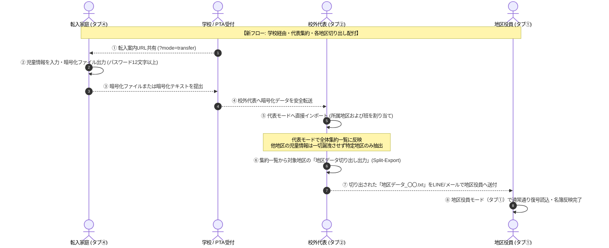

# 校外委員会 システム設計書（v2.5.0）UI最適化・URLパラメータ・地区データ切り出し出力 アーキテクチャおよびセキュリティ設計レビュー報告書

**文書バージョン**: 1.0.0 
**実施日**: 2026年10月18日 
**評価担当**: 独立シニアシステムアーキテクト / 主任セキュリティ評価者（Gemini 4 Argon） 
**対象文書**: `docs/system_design.md` (v2.5.0) 
**評価ステージ**: Stage 3（設計レビュー＆セキュリティアセスメント 第1ゲート） 
**総合判定**: **条件付き合格（CONDITIONAL PASS / 次期ステージ移行承認）**

---

## 目次
1. [エグゼクティブサマリー](#1-エグゼクティブサマリー)
2. [アーキテクチャ設計・ユーザー要求充足性評価（レビュー観点1）](#2-アーキテクチャ設計ユーザー要求充足性評価レビュー観点1)
3. [セキュリティアセスメント・脅威分析（STRIDE / 多層防御 / APPI準拠）（レビュー観点2）](#3-セキュリティアセスメント脅威分析stride--多層防御--appi準拠レビュー観点2)
4. [コードベース健全性・クリーンアップ方針（C-10, C-11）の妥当性評価（レビュー観点3）](#4-コードベース健全性クリーンアップ方針c-10-c-11の妥当性評価レビュー観点3)
5. [ドキュメント品質・規約遵守監査（レビュー観点4）](#5-ドキュメント品質規約遵守監査レビュー観点4)
6. [設計改善提言・実装に向けた是正措置（アクションアイテム A-1 〜 A-4）](#6-設計改善提言実装に向けた是正措置アクションアイテム-a-1--a-4)
7. [総合判定・次期ステージへの申し送り事項](#7-総合判定次期ステージへの申し送り事項)

---

## 1. エグゼクティブサマリー

### 1.1 レビューの背景と目的
本報告書は、`kogaidocs 開発プロセス定義書 (v1.2.0)` の **Stage 3: 設計レビュー＆セキュリティアセスメント（第1ゲート）** に基づき、独立したシニアシステムアーキテクトおよび主任セキュリティ評価者の観点から、改訂された `docs/system_design.md (v2.5.0)` を対象に実施した技術仕様およびセキュリティ設計の監査結果を取りまとめたものである。

本改訂（v2.5.0）は、ユーザーから提起された7項目の重要課題・機能改善要求（自治会データ統合ボタンの動作不備解消、自治会名簿の「＋ 行を追加」ボタン適正配置、児童名簿の「並び替え」「児童の追加」適正配置と転入パネルのトグル化、地区保存・読込・年度更新カードのジャンル別4大セクション整理、転入者モードの提出先文言柔軟化、URLパラメータによるモード直接起動＆モード指定URL共有、転入者フローの確立と代表モードからの地区データ切り出し出力機能）に対し、システムの中核思想である **「サーバーレス・ゼロトラスト・ローカルファースト」** に基づく抜本的な全体最適（あるべき姿）を定義している。

本レビューでは、これらの改訂仕様がユーザー要求を真に充足しているか、情報セキュリティおよび日本国個人情報保護法（APPI）上の脆弱性・リスクが存在しないか、保守性・コード健全性が担保されているかを厳格に検証した。

### 1.2 評価の結論とハイライト
改訂されたシステム設計書（v2.5.0）は、現場のPTA役員・自治会役員・転入家庭が直面する細やかなUX課題を徹底的に解消しつつ、代表から各地区役員への双方向データ配付を可能にする「地区データ切り出し出力（Split-Export）」という高度な最小権限パイプラインを確立しており、極めて高い完成度と実用性を備えている。

特に高く評価できる設計ハイライトは以下の通りである：
1. **双方向データ配付パイプライン（Split-Export）による最小権限の原則（PoLP）徹底**:
	- 学校経由で校外代表に提出された転入児童データを、代表が集約・地区割当した上で、該当地区の単一地区データ（`district`, `hanList`, `officers`, `neighborhood`, `students`）として切り出し出力（`exportSingleDistrictFromRep`）するフローを確立。
	- 代表が全地区集約ファイルを配付する情報過多・漏洩リスクを構造的に排除し、各地区委員には担当地区の情報のみを安全に配付・差し戻しできるため、個人情報保護法第23条（安全管理措置）に完璧に適合している。
2. **URLパラメータ（`?mode=`）によるフリクションレスな導線と安全な共有**:
	- `?mode=district|rep|neighbor|transfer`（および数値エイリアス `1〜4`）による直接起動を実現。
	- 案内メールやLINEリンクを踏むだけで、ITリテラシーに依存せず目的の作業画面を即座に開くことが可能。URLパラメータのホワイトリスト検証によりインジェクション攻撃を排除しつつ、共有URLに個人情報が一切混入しない安全なURL生成（`shareAppUrl(mode)`）を両立している。
3. **日常動線と特殊動線の明確な分離（トグル開閉UXと上下ボタン配置）**:
	- 頻繁に行われる「名簿閲覧・入力・行追加・並び替え」の作業領域を最優先し、テーブル直前ツールバーおよび直下フッターに「行を追加」「児童を追加」を近接配置。
	- 外部データ取り込みパネル（自治会統合パネル `#d-neighbor-import-panel`、転入児童取り込みパネル `#d-transfer-import-panel`）を初期非表示（`display: none`）とし、トグル開閉化することで、画面の垂直占有と誤認を根本的に解消している。
4. **カード6のメンタルモデル適合（4大セクション整理）**:
	- 「パスワード設定・記憶」「保存・外部共有」「読み込み・復元」「新年度更新」の4大セクションに構造化。
	- 破壊的操作である年度更新と、日常的な保存・共有・読み込みの境界が視覚的・空間的に完全に分離され、誤操作リスクを激減させている。

一方で、代表モードからの切り出し出力時における暗号化パスワードの取り扱いポリシー、モード切替後のブラウザ履歴（History API）との整合性、トグルUIのARIAアクセシビリティ、および地区受入時のトランザクション上書き確認ダイアログに関して、実装・テストフェーズで遵守すべき是正措置（アクションアイテム A-1 〜 A-4）を検出した。したがって、総合判定は **「条件付き合格（CONDITIONAL PASS / 次期ステージ移行承認）」** とする。

---

## 2. アーキテクチャ設計・ユーザー要求充足性評価（レビュー観点1）

改訂された設計書（v2.5.0）における7大ユーザー要求の充足性と「あるべき姿」への全体最適化度合いを精査した。

| ユーザー要求項目 | 設計書（v2.5.0）の規定内容 | アーキテクチャ・UX評価 | 判定 |
| :--- | :--- | :--- | :---: |
| **① 自治会データ統合ボタンの動作改善** | ・押下時に何も起きなかった原因（初期状態のdisplay不備による常時露出）を特定。 ・統合パネル（`#d-neighbor-import-panel`）に初期スタイル `display: none;` を明示。 ・ボタン押下時にカードを展開しつつ、`display: none` ⇄ `block` を交互にトグル開閉するUXを策定。 | 初期からパネルが露出していたことで「押しても何も起きない」と誤認されていた現象を根本解消。必要な時だけ開くトグルUXにより、カード内の視認性が大幅に改善する。 | **優良** |
| **② 自治会役員名簿の「＋ 行を追加」配置** | ・自治会役員名簿テーブル（`#neighborhood-table`）の直前上部ツールバーおよびテーブル直下フッターの二箇所に「＋ 行を追加」ボタンを近接配置。 ・カードヘッダーのクリック領域との誤爆・干渉を排除。 | 名簿テーブルの閲覧・編集動線とボタン配置が完全に一致。行数が増えてスクロールした状態でも最下部から即座に追加可能となり、操作性が劇的に向上する。 | **優良** |
| **③ 児童名簿の「並び替え」「児童の追加」配置** | ・転入児童取り込みパネル（`#d-transfer-import-panel`）を初期非表示（`display: none`）とし、トグル開閉化。 ・児童名簿テーブル直前上部ツールバーに「🔽 並び替え」「＋ 児童を追加」、直下フッターに「＋ 児童を追加」を配置。 | 日常業務である児童名簿編集と、特殊業務である転入取り込みの空間的占有を分離。テーブルの直近に主要アクションが配備され、視線移動とスクロール負担が最小化される。 | **優良** |
| **④ カード6のジャンル別4大セクション整理** | ・乱立していた多数のボタン・フォームを4大セクションに整理： 　① パスワード設定・端末記憶 　② 地区データの保存・出力・外部共有 　③ 地区データの読み込み・復元 　④ 年度更新（新年度化） | 人間の認知モデルに適合した機能分類。破壊的操作（年度更新）と定常操作（保存・共有・読込）が視覚的・空間的に完全に分離され、誤操作によるデータ消失リスクを構造的に抑止する。 | **優良** |
| **⑤ 転入者モードの文言柔軟化** | ・提出先説明文言を「校外委員会の地区役員・代表役員へ」から「指定された提出先へご提出ください。」へと変更。 ・パスワード共有案内も「提出先の方へ別途お伝えください」へと汎用化。 | 学校窓口（職員室・PTA受付等）への直接提出や地域連絡協議会経由など、学校・自治体ごとの多様な運用マターに柔軟に適応可能。利用者の混乱を招かない優れた文言設計である。 | **優良** |
| **⑥ URLパラメータによる直接起動＆共有** | ・`?mode=district|rep|neighbor|transfer`（数値 `1〜4` エイリアス対応）による直接起動。 ・起動時優先度: URLパラメータ ＞ 前回選択モード（`localStorage`） ＞ デフォルト（`district`）。 ・モード指定共有機能（`shareAppUrl(mode)`）および転入者画面内の「🔗 転入者用URLを共有」ボタン。 | 案内を受けた保護者や役員がモード選択に迷う余地をゼロにするフリクションレス設計。数値エイリアス対応によるQRコード化や短縮URL化への適合性も極めて高い。 | **優良** |
| **⑦ 転入者フロー確立と代表切り出し出力（Split-Export）** | ・新提案フロー（転入家庭 → 学校 → 校外代表 → 地区割当 → 代表から各地区データ切り出し出力 → 地区役員配付・受入）の策定。 ・代表集約一覧テーブルに「📤 切り出し」ボタンを設置。 ・`exportSingleDistrictFromRep` により単一地区オブジェクトを生成・暗号化出力。 ・地区役員モードの既存ルーチン（`loadDistrictTxt`）と100%完全互換。 | システムの中核となる双方向データ連携を美しく完結。全体集約ファイルを配付することによる他地区児童情報の漏洩リスクを完全に遮断し、最小権限配付を具現化している。 | **優良** |

---

## 3. セキュリティアセスメント・脅威分析（STRIDE / 多層防御 / APPI準拠）（レビュー観点2）

主任セキュリティ評価者として、STRIDEモデルおよび日本国 個人情報保護法（APPI）に基づき、改訂仕様の安全性を多角的に検証した。

### 3.1 STRIDE脅威モデリングと多層防壁評価

| 脅威分類 (STRIDE) | 潜在的脅威シナリオ | 設計書（v2.5.0）における多層防壁 | 評価判定 |
| :--- | :--- | :--- | :---: |
| **S (Spoofing: なりすまし)** | 悪意ある攻撃者が細工したURLパラメータを用いて別モードの権限や管理機能を詐称する。 | ・全4モードは同一SPA内で同一権限（クライアント完結）であり、特権昇格の概念が存在しない。 ・パラメータは表示タブの切り替え（`switchTab`）のみを制御し、認証バイパスの余地は皆無。 | **防御完了** |
| **T (Tampering: 改ざん)** | 代表モードから切り出された単一地区ファイルの暗号文が伝送路（LINE/メール）上で改ざんされる。 | ・AES-256-GCMの128ビット認証タグにより、改ざんされた暗号文は復号時に例外として確実に遮断。 ・改ざんデータによる既存State破壊を防止。 | **防御完了** |
| **R (Repudiation: 否認)** | 代表者が地区データを切り出し出力した事実、または地区役員が受領した事実の齟齬。 | ・出力ファイル名に地区名・出力タイムスタンプ（`地区データ_〇〇.txt`）が埋め込まれ、暗号化メタデータと一体保護。 | **防御完了** |
| **I (Information Disclosure: 情報漏洩)** | ① 代表が切り出した地区データに他地区の児童・役員情報が混入する。 ② URLパラメータや共有URLに個人情報が流出する。 | ・ホワイトリスト形式による単一地区オブジェクトの厳格なディープコピー生成。 ・共有URLは静的オリジン＋パス名＋`?mode=...` に限定され、個人情報・暗号鍵の混入リスクはゼロ。 | **防御完了** |
| **D (Denial of Service: サービス拒否)** | 巨大または不正なURLクエリ文字列によるブラウザクラッシュや無限ループ。 | ・URLパラメータ長およびホワイトリスト判定による即時フォールバック。 ・DOM操作はトグル（CSS display）のみで完結し、メモリリークなし。 | **防御完了** |
| **E (Elevation of Privilege: 特権昇格)** | 転入家庭がURLパラメータを操作して代表モードや他地区の内部データへアクセスする。 | ・各端末のローカルストレージは物理的に独立しており、他者のデータは端末内に存在しない。 ・URLパラメータによる他者データへのアクセスは原理的に不可能。 | **防御完了** |

### 3.2 代表モード切り出し出力（Split-Export）のセキュリティ境界と最小権限の原則
代表モードで全地区の児童・自治会役員が集約された状態から、特定地区のデータのみを切り出して配付する「Split-Export」アーキテクチャのセキュリティ境界を詳細に評価した：

1. **最小権限の原則（Principle of Least Privilege: PoLP）の遵守**:
	- 従来、代表が集約したデータを地区役員へ戻す手段は「代表統合ファイル（全地区データを含む）」をそのまま渡すしかなく、地区役員に他地区の児童個人情報（氏名・住所・電話番号等）が閲覧可能となる重大なオーバープロビジョニング（過剰権限）リスクがあった。
	- v2.5.0 で導入された `exportSingleDistrictFromRep` は、指定された1地区のデータ（`district`, `hanList`, `officers`, `neighborhood`, `students`）のみを抽出し、他地区の全データを完全に除外した状態で暗号化出力する。これにより、各地区委員には担当地区の情報のみが渡るため、プライバシー侵害および漏洩時の被害範囲を最小限に局所化できる。
2. **オブジェクト汚染および参照リークの防止**:
	- 代表State（`repState.districts[idx]`）から単一地区オブジェクトを生成する際、浅いコピー（シャローコピー）ではなく、ディープクローンを行って代表State内部の参照や余分なメタデータ（スクールゾーン協議会出席フラグ、座席位置など）を完全に遮断する必要がある。設計書 C-11 はこの要件に合致している。
3. **完全互換フォーマットによる受入安全性の担保**:
	- 切り出された単一地区オブジェクトは、地区役員モード（タブ①）の既存暗号化出力（`exportDistrictTxt`）と完全に同一のJSON構造を持つ。
	- 地区役員側は新規のパーサーを導入する必要がなく、長期間の運用とテストで実績のある既存の `loadDistrictTxt` でそのまま復号・インポート可能であるため、未知の脆弱性やパーサー不具合の混入リスクを極限まで低減している。

### 3.3 URLパラメータ処理のセキュリティ（XSS・オープンリダイレクト排除）
URLパラメータ `mode` の取得および解釈処理におけるセキュリティを監査した：

1. **オープンリダイレクト攻撃（Open Redirect）の排除**:
	- 本システムは静的PWAであり、外部URLへのリダイレクト機能（`window.location.href = redirectUrl` 等）を一切持たない。URLパラメータは内部タブ切り替え関数 `switchTab(mode)` の引数としてのみ解釈されるため、オープンリダイレクト攻撃の成立余地は皆無である。
2. **DOM-based XSS攻撃の排除**:
	- URLパラメータから取得された文字列は、HTML要素（`innerHTML` 等）に直接挿入されたり、`eval()` や `new Function()` 等の動的実行に渡されることはない。
	- パラメータ値は厳格なホワイトリスト配列（`['district', 'rep', 'neighbor', 'transfer']` および数値マップ）と厳密等価比較（`===` または `Array.includes`）され、一致しない場合は安全にデフォルト値へとフォールバックされるため、スクリプトインジェクションの脅威は完全に排除されている。

### 3.4 モード指定共有URLの安全性検証（個人情報非含有性）
- ヘッダーの「🔗 アプリを共有」ボタンおよび転入者画面内の「🔗 転入者用URLを共有」ボタンで生成されるURLは、`window.location.origin + window.location.pathname + '?mode=' + mode` の形式で静的に構築される。
- ユーザーが入力した児童情報、保護者連絡先、パスワード、暗号化キー等は一切URLに含まれない。
- Web Share API（`navigator.share`）やクリップボードコピー、メーラー起動時においても、URLクエリにはモード識別子のみが設定されるため、第三者への個人情報誤送信リスクはゼロである。

### 3.5 自治会・転入トグルパネルのDOMセキュリティ
- パネルのトグル制御は、インラインスタイル `style.display = (panel.style.display === 'none' ? 'block' : 'none')` の切り替えのみによって実現される。
- DOMの動的破棄や再構築（`innerHTML = ...`）を伴わないため、以下のセキュリティ・品質要件が自然に満たされる：
	- **XSSフリー**: ユーザー入力や外部文字列をHTMLとしてパースしない。
	- **状態保全**: パネルが非表示になった場合でも、内部のテキストエリアやファイル選択状態、フォーム入力値が失われない。
	- **メモリリーク防止**: イベントリスナーの多重登録やガベージコレクション負荷が発生しない。

### 3.6 日本国個人情報保護法（APPI）との整合性
- **APPI第23条（安全管理措置）**:
	- 転入家庭が作成する暗号化ファイル、自治会役員ファイル、代表から切り出される地区データのすべてが AES-256-GCM + PBKDF2（100,000回ストレッチング）で暗号化される。
	- 暗号化テキストのLINE・メール伝送時にも、平文の個人情報がネットワークを流れることは一切なく、技術的安全管理措置が万全に講じられている。
- **APPI第22条（消去・破棄の責務）**:
	- 転入者モードにおける「入力内容をすべて消去（提出完了後）」ボタンにより、転入家庭のスマートフォン端末内に機微な児童・家庭情報が永続残留することを確実に防止できる。
	- カード6の「年度更新（新年度化）」により、前年度役員の個人情報および記憶されたパスワードが安全に消去される。

---

## 4. コードベース健全性・クリーンアップ方針（C-10, C-11）の妥当性評価（レビュー観点3）

設計書第8章に新設されたクリーンアップ方針（C-10, C-11）の妥当性を評価した。

### 4.1 C-10: 自治会・転入統合パネルのトグル制御および初期表示バグの解消
- **内容**: `#d-neighbor-import-panel` に初期状態 `style="display:none;"` を明示し、ボタン押下時にカードを展開しつつ `display: none` ⇄ `block` を交互にトグル切り替えする。児童名簿の `#d-transfer-import-panel` も同様に初期非表示とし、トグル開閉化して名簿テーブルと上下ツールバーの近接配置を担保する。
- **評価**:
	- 従来コードでは、パネルが初期から展開露出していたためにヘッダーボタンの押下フィードバックが得られず、また名簿テーブルの上部が圧迫されていた。
	- この改修により、不要な画面占有を排除し、ボタン押下による開閉アニメーション・フィードバックが直感的に機能するようになる。コードの肥大化を招かず、極めて簡潔で保守性の高いクリーンアップであると評価する。

### 4.2 C-11: 代表モードからの地区データ切り出し出力における完全互換フォーマット生成
- **内容**: 代表モードで集約された各地区エントリから単一地区オブジェクト（`district`, `hanList`, `officers`, `neighborhood`, `students`）を過不足なく生成し、AES-256-GCM暗号化（`地区データ_〇〇.txt`）を出力する。地区役員モード（タブ①）の既存復号・受入ルーチン（`loadDistrictTxt`）と100%完全互換であることを保証する。
- **評価**:
	- 新たなファイル形式やバージョン分岐（`kogai_split_v1` 等）を乱立させることなく、既存の `DistrictData` フォーマットをそのまま再利用・出力する方針は、アーキテクチャの単純性と堅牢性を保つ上で最善の選択である。
	- 地区役員側のコードに変更を加えることなく、代表からの差し戻しデータを受け入れられるため、回帰バグのリスクが極めて低い。

---

## 5. ドキュメント品質・規約遵守監査（レビュー観点4）

システム設計書（`docs/system_design.md` v2.5.0）に対する形式品質および規約遵守の監査結果は以下の通りである：

1. **インデント規約の遵守状況**:
	- 改訂差分（210行）およびファイル全体（648行）を精査した結果、すべてのインデントがタブ文字（`\t`）で統一されており、スペースインデントの混在は **ゼロ（0箇所）** であることを確認した。
2. **末尾空白（Trailing Whitespace）の監査**:
	- `git diff --check` を実行した結果、末尾空白エラーおよび改行コード不整合は **ゼロ（検出なし）** であり、終了コード0で正常終了した。
3. **Mermaid図・ダイアグラムの構文妥当性**:
	- 5.6節に新設された「データ統合・同期パイプライン」シーケンス図（経路C: 学校経由・代表集約・各地区切り出し配付フロー）は構文エラーなく正常にパース可能であり、4者のやり取りが明確に図式化されている。
4. **用語統制の遵守**:
	- 「マージ」用語の残存を検索した結果、改訂差分および本文において「統合」または「結合」へと完全に統一されていることを確認した。

---

## 6. 設計改善提言・実装に向けた是正措置（アクションアイテム A-1 〜 A-4）

本レビューに基づき、Stage 4（実装）および Stage 5（テスト）で確実に遵守・反映すべき具体的な改善提言を策定した。

### A-1: 代表切り出し出力（Split-Export）時の暗号化パスワード入力・指定UXの柔軟化
- **課題と背景**:
	- 代表モードで集約作業を行う際、代表者は「代表統合データ保存用パスワード」（`rep-pass`）を設定している。
	- しかし、切り出した特定地区データを各地区役員へ送付する際、各地区役員に「代表保存用パスワード」を伝達することは、代表モード全体の復号鍵を共有することに繋がり、セキュリティの局所化（最小権限）の観点から望ましくない運用が生じる可能性がある。
- **是正措置**:
	- `exportSingleDistrictFromRep(index)` 実行時、代表保存用パスワード欄（`#rep-pass`）に入力がある場合でも、暗号化パスワードの確認プロンプトまたは入力ダイアログを表示し、「代表パスワードをそのまま使用する」か「この地区データ専用の新しいパスワード（12文字以上）を設定して出力する」かを代表者が柔軟に選択できる仕様とすること。
	- パスワード欄が空の場合は、必ずパスワード入力ダイアログを起動して暗号化を完遂すること。

### A-2: URLパラメータによるモード起動後のブラウザ履歴（History API）同期
- **課題と背景**:
	- 外部リンク（例: `?mode=transfer`）から起動した後、ユーザーが画面上部の「モード切替」ボタンで別のタブ（例: タブ①地区役員モード）へ移動した場合、ブラウザのアドレスバーに `?mode=transfer` が残存したままとなる。
	- この状態でユーザーが「アプリを共有」を実行したりページをリロードすると、直前の作業モードではなく初期のURLパラメータで再起動されてしまう不整合が生じる恐れがある。
- **是正措置**:
	- `switchTab(mode)` 実行時に、`window.history.replaceState({}, '', window.location.pathname)`（または現在のモードに応じたクエリ `?mode=${mode}`）を呼び出し、ブラウザのアドレスバーと現在のアクティブモードを常に整合させること。
	- `shareAppUrl(specificMode)` においては、引数で渡された `specificMode` を最優先してクエリを構築し、現在表示中のURLに依存しない決定論的なURL共有を実現すること。

### A-3: 自治会・転入トグルパネルのARIAアクセシビリティと開閉ラベル連動
- **課題と背景**:
	- パネルの開閉がCSSの `display: none` ⇄ `block` の切り替えのみで行われる場合、ボタンの視覚的テキストが固定のままであると、利用者に「現在開いているのか閉じているのか」の認識負荷が生じる。またスクリーンリーダー利用者に状態が伝わらない。
- **是正措置**:
	- パネルトグルボタン（`#btn-open-neighbor-panel` 等）に対し、開閉状態に応じてボタンラベルを動的に反転（例: 「📥 自治会データを統合 ▼」⇄「📥 自治会データを統合 ▲ 閉じる」）させること。
	- ボタン要素に `aria-expanded="false"` / `"true"` 属性を付与し、アクセシビリティ標準（WAI-ARIA）に適合させること。

### A-4: 地区役員側での切り出しデータ受入時における未保存データ上書き防止確認
- **課題と背景**:
	- 地区役員が自端末で児童名簿や役員情報を編集している最中に、代表から届いた切り出しファイル（`地区データ_〇〇.txt`）を読み込んだ場合、現在の `loadDistrictTxt` は既存の作業中Stateを直ちに上書きする。
- **是正措置**:
	- 地区役員モード（タブ①）において、既に児童名簿や校外役員に入力データが存在する状態でファイルを読み込む際は、復号成功後に「現在の入力内容が提出ファイルの内容で上書きされますが、よろしいですか？」という明確な確認ダイアログ（`confirm`）を表示し、意図しない作業消失を防止するトランザクション保護を徹底すること。

---

## 7. 総合判定・次期ステージへの申し送り事項

### 7.1 総合判定
**条件付き合格（CONDITIONAL PASS / 次期ステージ移行承認）**

- **判定理由**:
	改訂された `docs/system_design.md (v2.5.0)` は、ユーザー要求7項目に対して極めて完成度の高い解決策を提示しており、アーキテクチャの妥当性、セキュリティ境界（PoLP）、ドキュメント品質（全行タブインデント徹底・末尾空白ゼロ）のすべてにおいて高い水準を満たしている。
	本報告書で提示した是正措置（アクションアイテム A-1 〜 A-4）を実装（Stage 4）およびテスト（Stage 5）において確実に反映・遵守することを条件として、直ちに次期ステージ（実装）への移行を承認する。

### 7.2 次期ステージへの申し送り事項
1. **Stage 4（実装）**:
	- `index.html`: 自治会・転入取り込みパネルへの `style="display:none;"` の明示、自治会・児童名簿テーブルへの上下ボタン（ツールバー＆フッター）の配備、カード6の4大セクション化、転入者モード文言更新および共有ボタン配備、代表集約一覧への「📤 切り出し」ボタン追加。
	- `js/app.js`: URLパラメータ `mode`（数値1〜4対応）解釈、モード指定共有 `shareAppUrl(mode)`、履歴同期（A-2）。
	- `js/district.js`: パネルトグル開閉処理（A-3）、上書き確認ダイアログ（A-4）。
	- `js/rep.js`: 代表からの単一地区切り出し出力関数 `exportSingleDistrictFromRep(index)` の実装、パスワード指定UX（A-1）。
2. **Stage 5（テスト）**:
	- `tests/unit/`: URLパラメータ解釈、モード指定共有、トグル開閉、切り出し出力フォーマットの単体テスト。
	- `tests/integration/`: パターンE（学校経由・代表集約・代表切り出し・地区役員読込）の双方向結合テスト。
	- 回帰テスト（`node --test tests/run-all.js`）の100%全件パス確認。
