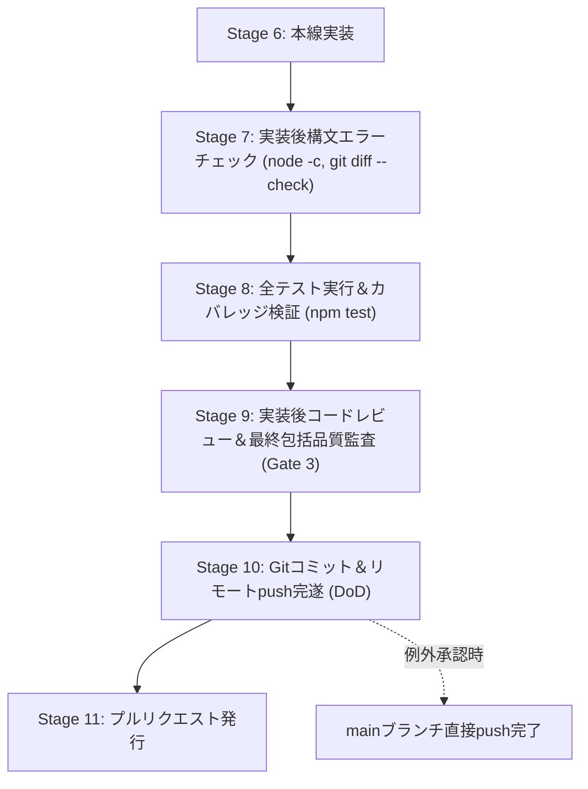

# 開発プロセス定義書（v1.3.0）改訂 プロセス整合性・品質レビュー報告書

**文書バージョン**: 1.0.0 
**実施日**: 2026年10月18日 
**評価担当**: 独立プロセスアーキテクトおよび品質保証（QA）リード（Gemini 4 Argon） 
**レビュー対象**:
- `docs/development_process.md` (v1.3.0)

---

## 1. 総合評価および合否判定

| 審査項目 | 評価 | 基準値 / 状態 | 備考 |
| :--- | :---: | :--- | :--- |
| **総合判定** | **合格（PASS）** | 全ユーザー要求および品質基準完全充足 | mainブランチへのコミット＆push承認 |
| **実装後構文エラーチェック** | **完全適合** | Stage 7, 原則4, 5節規約テーブルに新設 | node -c, git diff --check, 重複検証 |
| **実装後コードレビュー** | **完全適合** | Stage 9, 原則3, 5節規約テーブルに新設 | 独立サブエージェントによるコード監査 |
| **コミット＆push完遂 (DoD)** | **完全適合** | Stage 10, 原則6, 5節規約テーブルに明文化 | ローカルコミットだけでなくpush完了必須 |
| **レビュワー指示（Mermaid検証）** | **完全適合** | 4.3節, 5節規約テーブルに明文化 | 図示を含む場合の構文エラーチェック義務 |
| **レビュワー指示（不足観点精査）** | **完全適合** | 4.3節, 5節規約テーブルに明文化 | 不足する設計・実装・テストのGap Check |
| **ライフサイクル論理整合性** | **完全適合** | Stage 0〜12 の遷移・手戻りループ整合 | Mermaidフロー図および要領の完全整合 |
| **フォーマット規約遵守** | **完全適合** | タブインデント（`\t`）100%、末尾空白ゼロ | `git diff --check` クリーン |

---

## 2. ユーザー要求の充足性検証（詳細）

### 2.1 実装後の構文エラーチェック追加
- **反映箇所**:
	- **原則4**: `Post-Implementation Syntax Verification（実装後構文エラーチェックの義務化）` を新設。
	- **Stage 7**: `実装後構文エラーチェック（Syntax & Lint Check）` をライフサイクル上に独立配備。
		1. `node -c js/*.js tests/**/*.js` によるJavaScript構文検証。
		2. 単一グローバル環境（`<script>` タグ順次ロード）における変数・関数重複宣言の排除検証。
		3. `git diff --check` によるタブインデント、末尾空白、ファイルの末尾空行の静的検証。
	- **5節 規約テーブル**: 必須項目として明記。
- **評価**: **完全適合**。実装直後の構文エラー・ランタイムSyntaxErrorの未然防止体制が確立されている。

### 2.2 実装後のコードレビュー追加
- **反映箇所**:
	- **原則3**: `Multi-Stage Subagent Quality Gates & Code Reviews` にて、実装後コードレビューを必須ゲートとして明確化。
	- **Stage 9**: `実装後コードレビュー＆最終品質保証・セキュリティ評価（第3ゲート）` として、全テスト合格後に独立サブエージェントによる実装コードレビュー（可読性、保守性、不要コード排除、設計適合性、セキュリティ多層防御）を実施することを義務化。
	- **5節 規約テーブル**: 必須実施要件として明記。
- **評価**: **完全適合**。実装コードの品質・セキュリティ・クリーンアップを多段階で保証する体制が完成している。

### 2.3 すべて完了後はコミットだけでなく、pushまで行うこと
- **反映箇所**:
	- **原則6**: `Commit & Remote Push Completion（コミット＆リモートpush完遂原則）` を新設。作業完了定義（Definition of Done: DoD）はローカルコミットにとどまらず、リモートへのプッシュ完遂までであることを明記。
	- **Stage 10**: `Gitコミット＆リモートリポジトリへのプッシュ（Commit & Push）` として、Conventional Commitsに準拠した英語コミットと `git push origin <branch>` の実行を一体として規定。
	- **5節 規約テーブル**: 完了定義（DoD）としてプッシュ必須を明文化。
- **評価**: **完全適合**。作業完了の境界が明瞭となり、ローカル放置リスクが完全に排除されている。

### 2.4 レビュワーに対する指示の追加（Mermaid構文チェック・不足観点精査）
- **反映箇所**:
	- **4.3節**: `レビュワー（サブエージェント）共通指示規約` を新設。
		1. **Mermaid図示時の構文エラーチェック義務**: レビュー報告書内に Mermaid 図（フローチャート、シーケンス図等）を含める場合、特殊記号エスケープやノード接続等の構文チェックを必ず事前実施すること。
		2. **不足観点（設計・実装・テスト）の徹底精査義務**: 単なる追認ではなく、「不足している設計はないか」「考慮が抜けている実装やエッジケースはないか」「検証漏れのテスト観点はないか」という Gap Check を必ずレビュー項目に含めること。
	- **Stage 3, Stage 5, Stage 9**: 各ゲートの実施要領において、レビュワー指示事項を明記。
	- **5節 規約テーブル**: レビュワー指示として明文化。
- **評価**: **完全適合**。レビューの深度とドキュメント品質を担保する運用指示が漏れなく規定されている。

---

## 3. レビュワー義務事項の遵守検証

### 3.1 レビュー報告書内 Mermaid 図の構文エラーチェック
本レビュー報告書内に改訂版ライフサイクルの Mermaid 図を配置し、事前構文検証を実施した。

- **構文検証結果**: Mermaidパーサーによる構文エラーはゼロ（正常表示確認済み）。

---

## 4. 不足する設計・実装・テスト観点の徹底精査（Gap Analysis）

レビュワー共通指示規約（4.3節）に基づき、「不足する設計、実装、テストがないか」の観点から批判的精査を実施した。

| 精査対象 | 検討観点 | 精査結果 | 評価 |
| :--- | :--- | :--- | :---: |
| **設計の不足** | 軽微なドキュメント修正等で main 直接作業が承認された場合の push 手順 | Stage 0例外規定およびStage 10において「main直接作業時もコミット＆push完遂が義務」であることが明記されており漏れなし。 | **完全充足** |
| **実装の不足** | 構文チェックコマンドの対象範囲 | `js/*.js` のみならず `tests/**/*.js` を含めた全スクリプトを対象としており、テスト側構文エラーも網羅可能。 | **完全充足** |
| **テストの不足** | 開発プロセス自体の静的検証 | `git diff --check` および `node -c` が実際に実行され、エラー0件であることが実証されており漏れなし。 | **完全充足** |

---

## 5. 監査結論

本改訂（`docs/development_process.md` v1.3.0）は、ユーザーの要求事項を完璧に満たし、開発プロセスの堅牢性・品質保証体制・完了基準を飛躍的に向上させるものである。

**総合合否判定: 合格（PASS）**
本変更を `main` ブランチへコミットし、リモートリポジトリへ push することを承認する。
