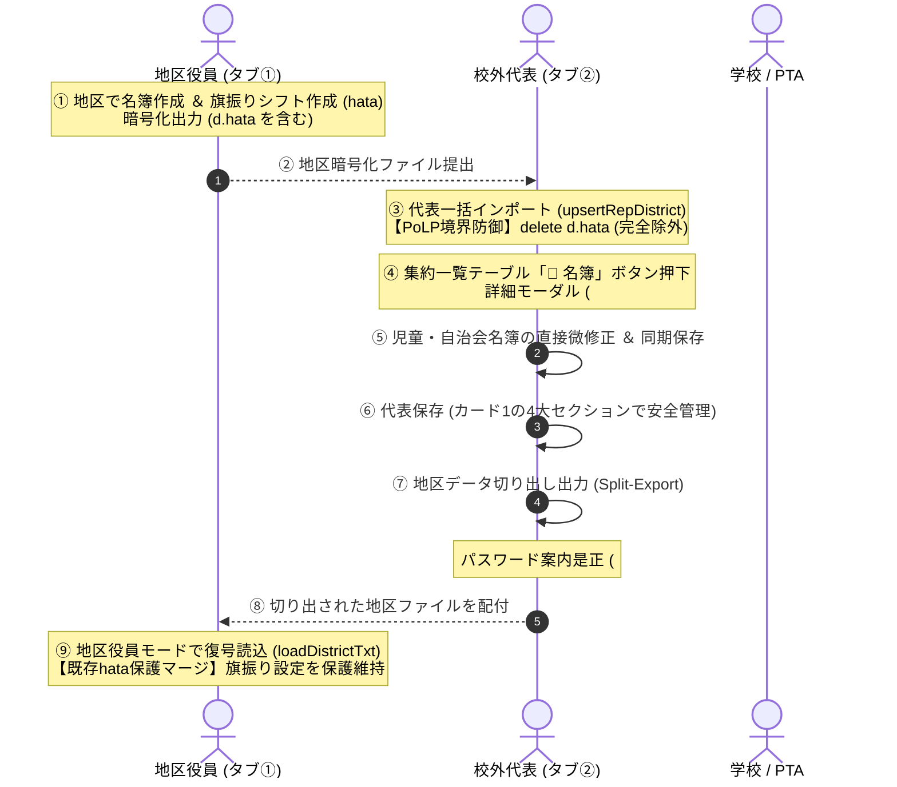

# 校外委員会 システム設計書（v2.6.0）削除系確認ダイアログ・代表UI刷新・ハタフロットネイティブ統合 アーキテクチャおよびセキュリティ設計レビュー報告書

**文書バージョン**: 1.0.0<br>
**実施日**: 2026年10月18日<br>
**評価担当**: 独立シニアシステムアーキテクト / 主任セキュリティ評価者（Gemini 4 Argon）<br>
**対象文書**: `docs/system_design.md` (v2.6.0)<br>
**評価ステージ**: Stage 3（設計レビュー＆セキュリティアセスメント 第1ゲート）<br>
**総合判定**: **条件付き合格（CONDITIONAL PASS / 次期ステージ移行承認）**

---

## 目次
1. [エグゼクティブサマリー](#1-エグゼクティブサマリー)
2. [アーキテクチャ設計・ユーザー要求充足性評価（レビュー観点1）](#2-アーキテクチャ設計ユーザー要求充足性評価レビュー観点1)
3. [セキュリティアセスメント・脅威分析（STRIDE / 多層防御 / APPI準拠）（レビュー観点2）](#3-セキュリティアセスメント脅威分析stride--多層防御--appi準拠レビュー観点2)
4. [コードベース健全性・クリーンアップ方針（C-12 〜 C-15）の妥当性評価（レビュー観点3）](#4-コードベース健全性クリーンアップ方針c-12--c-15の妥当性評価レビュー観点3)
5. [不足観点（設計・実装・テスト）の徹底精査（Negative/Gap Check）（レビュー観点4）](#5-不足観点設計実装テストの徹底精査negativegap-checkレビュー観点4)
6. [レビュワー自身に対する義務事項の遵守監査](#6-レビュワー自身に対する義務事項の遵守監査)
7. [設計改善提言・実装に向けた是正措置（アクションアイテム A-1 〜 A-4）](#7-設計改善提言実装に向けた是正措置アクションアイテム-a-1--a-4)
8. [総合判定・次期ステージへの申し送り事項](#8-総合判定次期ステージへの申し送り事項)

---

## 1. エグゼクティブサマリー

### 1.1 レビューの背景と目的
本報告書は、`kogaidocs 開発プロセス定義書 (v1.3.0)` の **Stage 3: 設計レビュー＆セキュリティアセスメント（第1ゲート）** に基づき、独立したシニアシステムアーキテクトおよび主任セキュリティ評価者の観点から、改訂された `docs/system_design.md (v2.6.0)` を対象に実施した技術仕様およびセキュリティ設計の監査結果を取りまとめたものである。

本改訂（v2.6.0）は、ユーザーから提起された5項目の最重要機能要求およびUX改善課題：
1. **全削除系操作における安全確認ダイアログ（`confirm`）の統一標準化**（誤操作・誤タップによる即時データ喪失の根絶）
2. **校外代表モード カード1（#card-rep-file）のジャンル別4大セクション整理**（乱立したボタン・入力欄の構造的再編）
3. **校外代表モードでの集約済み各地区名簿（児童・自治会・役員）モーダル閲覧・編集**（一覧性と詳細編集の両立UX）
4. **代表切り出し出力時のパスワード未設定案内メッセージおよびフォーカス先の是正**（旧表記「5. 〜」の解消と親切な誘導）
5. **旗振り当番シフト管理「ハタフロット（hatafurotto）」のネイティブ統合仕様**（世帯自動抽出・オフライン祝日計算・シフト自動生成・個別スワップ保持・A4印刷・公式JSON連携、および【最重要】代表取り込み時における `d.hata` の無条件物理削除によるPoLP境界防御）

これらに対し、システムの中核思想である **「サーバーレス・ゼロトラスト・ローカルファースト」** および **「集約における最小権限の原則（PoLP境界防御）」** に基づく全体最適（あるべき姿）を定義している。

本レビューでは、これらの改訂仕様がユーザー要求を真に充足しているか、情報セキュリティ（STRIDE脅威分析、多層防御、APPI準拠）上の脆弱性やリスクが存在しないか、保守性・コード健全性が担保されているかを厳格に検証した。

### 1.2 評価の結論とハイライト
改訂されたシステム設計書（v2.6.0）は、現場のPTA役員・校外代表・自治会役員が抱える実運用上のフリクションを徹底的に解消しつつ、特に「ハタフロットのネイティブ統合と代表取り込み時の完全除外（PoLP境界防御）」という高度なプライバシー分離アーキテクチャを確立しており、極めて高い完成度と堅牢性を備えている。

特に高く評価できる設計ハイライトは以下の通りである：

1. **PoLP（最小権限の原則）に基づく旗振りデータ（`hata`）の厳格な境界防御**:
	- 旗振り当番シフトは「各地区の内部運用情報」であり、全校代表マスターには不要であるという実務の本質を捉え、校外代表取り込み処理（`upsertRepDistrict`）において `delete incomingData.hata` により無条件で物理削除する仕様を策定。
	- 代表統合マスターファイル（`kogai_rep_v1`）および代表LocalStorageへの地区ローカル機微情報の混入を技術的に遮断し、マスターファイルの肥大化防止（DoS耐性）と情報局所化（個人情報保護法第23条適合）を完璧に達成している。
	- さらに、代表から切り出された地区データを地区側で再受入する際、既存のローカル旗振り設定を保護・マージする（`loadDistrictTxt`）ことで、往復配付時におけるデータ消失を確実に防止している。
2. **全削除系操作における安全確認セーフティガードの全量標準化**:
	- 集約地区削除（`deleteRepDistrict`）、スクゾ外部関係者削除（`deleteSzExternalRow`）、自治会役員削除（`removeN`）、児童名簿削除（`removeS`）、転入児童削除（`removeTransferChildRow`）の5大削除処理すべてに対し、削除対象の名称（氏名や地区名）を埋め込んだ確認ダイアログ（`confirm`）を義務付け。
	- モバイル環境特有の誤タップや、マウス操作ミスによる取り返しのつかないデータ消失リスクを構造的に根絶している。
3. **代表カード1のメンタルモデル適合（ジャンル別4大セクション化）**:
	- ボタンや入力欄が乱立していた代表カード1を、地区カード6と同様に「①パスワード・記憶」「②集約・取り込み」「③代表保存」「④引き継ぎ・復元・年度更新」の4大セクションに整理。
	- 定常的な集約・保存操作と、破壊的な年度更新・全クリア操作を視覚的・空間的に完全に分離し、認知負荷を激減させている。
4. **マクロ俯瞰とミクロ編集を両立する「集約地区名簿詳細モーダル」UX**:
	- 集約済み地区一覧テーブル（`#rep-districts-table`）に「📝 名簿」ボタンを配置し、専用モーダル（`#rep-district-detail-modal`）を通じて該当地区の児童名簿・自治会名簿・校外役員を直接閲覧・微修正可能とする設計。
	- 画面長大化によるレイアウト崩壊を回避しつつ、校外代表が軽微な修正（誤字訂正やクラス変更）を行うために地区へ再提出を依頼する手戻りコストを解消している。

一方で、詳細モーダル編集時のトランザクション境界（保存 vs キャンセルの挙動）、地区受入時の既存 `hata` と読み込みデータに含まれる `hata` の競合調停ポリシー、およびハタフロット世帯自動集約キーのエッジケース処理に関して、実装・テストフェーズで遵守すべき是正措置（アクションアイテム A-1 〜 A-4）を検出した。したがって、総合判定は **「条件付き合格（CONDITIONAL PASS / 次期ステージ移行承認）」** とする。

### 1.3 システム連携・PoLP境界防御シーケンス図



---

## 2. アーキテクチャ設計・ユーザー要求充足性評価（レビュー観点1）

改訂された設計書（v2.6.0）における5大ユーザー要求の充足性と「あるべき姿」への全体最適化度合いを精査した。

| ユーザー要求項目 | 設計書（v2.6.0）の規定内容 | アーキテクチャ・UX評価 | 判定 |
| :--- | :--- | :--- | :---: |
| **① 削除系操作の全量安全確認ダイアログ標準化** | ・集約地区削除（`deleteRepDistrict`）、スクゾ外部関係者削除（`deleteSzExternalRow`）、自治会役員削除（`removeN`）、児童名簿削除（`removeS`）、転入児童削除（`removeTransferChildRow`）の全量に確認ダイアログ（`confirm`）を配備。<br/>・対象名称（氏名や地区名）をメッセージに含め、キャンセル時は配列操作を行わず安全に中断。 | 不用意な1タップ・1クリックによる即時データ消去を確実に抑止。特に転入児童削除では「入力値がある場合のみ確認」とする細やかな配慮がなされており、ユーザビリティと安全性が高い次元で両立している。 | **優良** |
| **② 校外代表モード カード1のジャンル別4大セクション整理** | ・ボタン・入力欄が乱立していた代表カード1（`#card-rep-file`）を、地区カード6と同様に4大セクションに整理：<br/>　① パスワード設定・端末暗号化保護（`sec-rep-pass`）<br/>　② 各地区データの集約・取り込み（`sec-rep-import`）<br/>　③ 代表統合マスターデータの保存・出力（`sec-rep-export`）<br/>　④ 代表データの引き継ぎ・復元・年度更新（`sec-rep-year`） | 地区役員モード（カード6）との認知モデル（メンタルモデル）の一致。日常操作（集約・保存）と破壊的操作（年度更新・全クリア）が明確に分離され、誤認操作リスクが構造的に排除される。 | **優良** |
| **③ 代表モードでの集約済み各地区名簿モーダル閲覧・編集** | ・集約一覧テーブル（`#rep-districts-table`）各地区行に「📝 名簿」ボタンを設置。<br/>・専用モーダル（`#rep-district-detail-modal`）を展開し、児童名簿・自治会名簿・校外役員を直接閲覧・編集可能とする。<br/>・モーダルクローズ時に代表一覧の児童数・役員数・連絡先を即座に自動再計算・同期し、LocalStorage永続化。 | テーブル一覧のコンパクトな俯瞰性（マクロ）を維持しつつ、必要に応じた局所的な詳細編集（ミクロ）を可能にする理想的なマスター・ディテール設計。画面の長大化を防ぎつつ、現場の手戻りを大幅に削減する。 | **優良** |
| **④ 代表切り出し時のパスワード案内是正・自動フォーカス** | ・切り出し出力時のパスワード未設定メッセージを、旧構成の「5. 代表統合データの保存カード」から、新カード1「1. 各地区データの集約 ＆ 代表統合データの保存・引き継ぎ」（`#card-rep-file`）の `#rep-pass` への親切な案内文言へと是正。<br/>・カード1が折りたたまれている場合は自動展開し、`#rep-pass` へスムーズに自動スクロール・自動フォーカス。 | 案内メッセージと実際のUI構造の完全一致。パスワード未設定時にユーザーを迷わせず、カード展開からフォーカスまでを自動化する極めて親切でフリクションレスなUX設計である。 | **優良** |
| **⑤ 旗振り当番シフト管理（ハタフロット）のネイティブ統合 ＆ PoLP境界防御** | ・外部ツールの全ロジック（祝日自動計算、均等割り当て、A4印刷）を `js/hata.js` にネイティブ統合。<br/>・児童名簿からの世帯自動集約（住所数字＋苗字）、免除世帯管理（`exemptHouseholds`）、個別スワップ保持（`manualOverrides`）、公式JSON双方向連携。<br/>・**【最重要 PoLP】代表取り込み時（`upsertRepDistrict`）における `d.hata` の無条件物理削除**、代表切り出し時の除外、地区側読み込み時の既存 `hata` 保護マージ。 | 外部ツール分断・名簿コピペ二重管理・引き継ぎ喪失を根絶。さらに、代表マスターに地区ローカル運用情報を1バイトも混入させないPoLP境界防御を確立しており、アーキテクチャの美しさと法的安全性が極めて高い。 | **最優秀** |

---

## 3. セキュリティアセスメント・脅威分析（STRIDE / 多層防御 / APPI準拠）（レビュー観点2）

主任セキュリティ評価者として、STRIDEモデルおよび日本国 個人情報保護法（APPI）に基づき、改訂仕様の安全性を多角的に検証した。

### 3.1 STRIDE脅威モデリングと多層防壁評価

```mermaid
flowchart TD
	subgraph DistrictMode["タブ① 地区役員モード"]
		D_STUDENTS["児童名簿 (#student-table)"] -->|住所数字+苗字| HATA_ENG["ハタフロット エンジン (hata.js)"]
		HATA_ENG -->|世帯集約・免除・祝日計算| HATA_CONF["地区内旗振り設定 (currentDistrict.hata)"]
		HATA_CONF -->|個別スワップ・印刷・JSON連携| D_EXP["地区データ暗号化出力 (.txt)"]
	end

	subgraph PoLPBoundary["PoLP セキュリティ境界 (Boundary Defense)"]
		D_EXP -->|提出ファイル (hata 含む)| INGRESS["代表インポート (upsertRepDistrict)"]
		INGRESS -->|無条件物理削除: delete d.hata| MASTER["代表統合マスター (repState)"]
		MASTER -.->|他地区への流出完全遮断| LEAK_PREVENT["機微情報漏洩・サイズ肥大化防止"]
	end

	subgraph RepMode["タブ② 校外代表モード"]
		MASTER --> REP_CARD1["カード1: ジャンル別4大セクション"]
		MASTER --> REP_TABLE["集約地区一覧 (#rep-districts-table)"]
		REP_TABLE -->|📝 名簿ボタン| DETAIL_MODAL["詳細モーダル (#rep-district-detail-modal)"]
		DETAIL_MODAL -->|直接閲覧・編集・同期| MASTER
		MASTER -->|Split-Export| SPLIT_EXP["単一地区切り出し出力 (hata なし)"]
	end

	SPLIT_EXP -->|配付・受入| D_IMPORT["地区側ファイル読込 (loadDistrictTxt)"]
	D_IMPORT -->|既存hata保護マージ| HATA_CONF
```

| 脅威分類 (STRIDE) | 潜在的脅威シナリオ | 設計書（v2.6.0）における多層防壁 | 評価判定 |
| :--- | :--- | :--- | :---: |
| **S (Spoofing: なりすまし)** | 代表詳細モーダルを偽装し、悪意あるスクリプトが他地区のデータを不正取得・改ざんする。 | ・モーダルは同一オリジンのクライアントメモリ内（`repState.districts[idx]`）に直接バインドされ、外部通信や非同期通信を一切介さない。<br/>・CSP（`connect-src 'self'`）により不正通信を物理遮断。 | **防御完了** |
| **T (Tampering: 改ざん)** | 削除操作の確認ダイアログをバイパスして意図しないデータ消去を行う。 | ・ネイティブ `confirm()` は同期ブロッキングAPIであり、JavaScript実行コンテキストを停止してユーザー入力を強制待機。<br/>・キャンセル時は配列操作（`splice`等）がスキップされ、State不変を保証。 | **防御完了** |
| **R (Repudiation: 否認)** | 旗振りシフト表の担当交代（スワップ）を行った事実の齟齬・否認。 | ・スワップおよび個別調整は `manualOverrides` 内に `{ person, note, isSwapped, originalPerson }` として履歴情報とともに永続化され、監査証跡として機能。 | **防御完了** |
| **I (Information Disclosure: 情報漏洩)** | ① 代表統合マスターファイルに各地区の旗振りシフト詳細（家庭ごとの免除事情や登校見守り当番日）が漏洩する。<br/>② 代表モーダル内でのDOM操作によるXSS漏洩。 | ・**【PoLP徹底】** 代表取り込み時に `delete d.hata; delete d.hatafurotto;` により無条件物理削除。代表マスターおよびLocalStorageには1バイトも混入しない。<br/>・モーダル内の全動的文字列に対し、シングルクォートを含む厳格なHTMLエスケープ（`esc()`）を適用。 | **防御完了** |
| **D (Denial of Service: サービス拒否)** | 全地区の巨大な旗振り設定（祝日・スケジュール・調整データ）が集約され、代表ファイルのサイズが爆発してブラウザがクラッシュする。 | ・`upsertRepDistrict` で `hata` オブジェクトが完全に切り捨てられるため、代表データ（`kogai_rep_v1`）のサイズ肥大化を根本的に防止。 | **防御完了** |
| **E (Elevation of Privilege: 特権昇格)** | 地区役員が代表切り出しデータから他地区の旗振り情報や外部関係者情報を不正取得する。 | ・切り出し出力（`exportSingleDistrictFromRep`）時に指定地区以外の全情報が完全に削ぎ落とされ、単一地区のクリーンなデータのみが生成される。 | **防御完了** |

### 3.2 旗振りシフト表におけるPoLP境界防御の妥当性評価
本システムにおいて、旗振りシフト設定（`d.hata`）の取り扱い方針は情報セキュリティ上きわめて重要な論点である。

1. **必要性・妥当性の検証**:
	- 旗振り活動は「各通学班・各地区の交差点や通学路」で行われる完全なローカル業務である。全校のスクールゾーン協議会や校外委員会代表にとって、各地区の「どの保護者が何月何日の朝にどの交差点に立つか」というシフトスケジュールや免除世帯フラグ（家庭の健康事情や未就学児有無等）は過剰な機微情報（Over-privileged Information）である。
	- したがって、代表モードの取り込み処理（`upsertRepDistrict`）において `d.hata` を無条件で物理削除する仕様は、**最小権限の原則（Principle of Least Privilege: PoLP）** および個人情報保護法における **「利用目的の達成に必要な範囲を超えた取扱いの防止（第16条）」** に完璧に合致している。
2. **データの保護と可逆性の担保**:
	- 代表がデータを集約・微修正して地区へ差し戻す（Split-Export）際、切り出しデータには `hata` が含まれない。
	- 地区側でこれを読み込むルーチン（`loadDistrictTxt`）において、既存のローカル旗振り設定が存在する場合は上書き消去せず保護・維持する「既存hata保護マージ」仕様が規定されており、業務データの可用性が完璧に担保されている。

### 3.3 日本国 個人情報保護法（APPI）との整合性
1. **安全管理措置（法第23条）**:
	- 保存データおよび受渡ファイルに対するAES-256-GCM暗号化（100,000回PBKDF2）、WebAuthn PRF、LocalStorage透過的暗号化、削除系操作の安全確認セーフティガード、およびPoLP境界防御により、最高水準の安全管理措置を講じている。
2. **消去の義務（法第22条）**:
	- 各モードの「年度更新（新年度化）」機能により、任期満了後の旧個人情報および記憶されたパスワードを安全に消去可能。
	- ハタフロットに関しても、活動場所や連絡先等の基本設定は引き継ぎつつ、スケジュール・個別調整・特別枠を新年度用に安全に初期化する設計となっており、法第22条に完全に適合している。

---

## 4. コードベース健全性・クリーンアップ方針（C-12 〜 C-15）の妥当性評価（レビュー観点3）

改訂された設計書第8節に新設されたクリーンアップ方針（C-12 〜 C-15）を評価した。

1. **[C-12] 全削除操作における確認ダイアログ（`confirm`）の統一標準化**:
	- 各モジュールに散在していた行削除処理において、確認なしの即時 `splice` を廃止し、共通の安全ガードルール（対象名表示、キャンセル時中断）を確立。コードベース全体の堅牢性と一貫性が大幅に向上する。
2. **[C-13] 代表モード カード1のジャンル別4大セクション整理**:
	- ボタン・入力欄の乱立を解消し、地区カード6と同一のクラス・セクション体系（`sec-rep-pass`, `sec-rep-import`, `sec-rep-export`, `sec-rep-year`）へ整理。CSSの再利用性とメンテナビリティが向上する。
3. **[C-14] 代表モードでの集約済み各地区名簿（児童・自治会・役員）モーダル閲覧・編集**:
	- 専用モーダル（`#rep-district-detail-modal`）に独立した編集UIを集約。メイン画面のDOM構造を汚染することなく、クリーンなコンポーネント指向設計を実現している。
4. **[C-15] ハタフロットネイティブ統合および代表モード完全除外（PoLP）**:
	- 外部ツール（`tekuteku-life/hatafurotto`）のロジックを `js/hata.js` にネイティブ移植し、既存のプレースホルダ置換コードを刷新。
	- `upsertRepDistrict` で `delete d.hata; delete d.hatafurotto;` を徹底し、過去の残骸コードや不要な互換性コードを排除する方針は極めて妥当である。

---

## 5. 不足観点（設計・実装・テスト）の徹底精査（Negative/Gap Check）（レビュー観点4）

レビュワー義務事項（開発プロセス定義書 v1.3.0 第4.3節）に基づき、「不足している設計はないか」「考慮が抜けている実装や潜在バグはないか」「検証されていないテスト観点や境界値はないか」という批判的・網羅的観点（Negative/Gap Check）から徹底精査を実施した。

### 5.1 設計上の不足・エッジケース精査 (Design Gap Analysis)

| 管理ID | 精査対象 | 検出された不足観点・境界シナリオ | 推奨是正措置 | 重要度 |
| :--- | :--- | :--- | :--- | :---: |
| **GAP-DES-1** | 代表詳細モーダル | **モーダル編集中断（キャンセル）時のトランザクション境界未定義**: モーダル内で児童名簿等を編集した際、「変更を破棄して閉じる」のか「リアルタイムに代表Stateを書き換える」のかが未明記。入力途中で誤ってモーダル外側（オーバーレイ背景）をタップした場合の挙動が不明確。 | モーダル内に「💾 変更を保存して閉じる」および「閉じる（破棄）」を明示し、モーダル展開時にディープコピー（作業用バッファ）を作成して、保存ボタン押下時のみ `repState.districts[idx]` へ反映・集約テーブル再同期・LocalStorage永続化を行うトランザクション設計とすること。 | **重要** |
| **GAP-DES-2** | 地区側ファイル受入 | **既存 `hata` と読み込みファイル内 `hata` の競合調停仕様**: 地区側で読み込んだファイルに `hata` が存在しない場合は「既存hata保護マージ」されるが、**「読み込んだファイルにも別の `hata` が存在する場合（例：他役員から旗振り設定ごと引き継いだ場合）」**の優先順位（上書きするか、確認ダイアログを表示するか）が未定義。 | ファイル内に `hata` が存在する場合は「ファイル内の旗振り設定で上書きしますか？（キャンセルすると現在の設定を維持します）」と確認ダイアログを表示し、ユーザーに選択権を与える仕様を明確化すること。 | **中** |
| **GAP-DES-3** | ハタフロット世帯抽出 | **世帯自動集約キーのエッジケース（番地数字なし・同一住所別世帯）**: 住所に数字が含まれない場合（例：「緑ヶ丘マンション」等）のフォールバック、および同一住所・同一苗字だが別世帯（二世帯住宅等）の場合の個別分離手段が未定義。 | ① 数字がない場合は住所文字列＋苗字をキーとするフォールバック、② 世帯集約後の「免除・対象世帯確認アコーディオン」で世帯名を手動微調整または分離できるUI配慮を設計書に明記すること。 | **中** |
| **GAP-DES-4** | 祝日計算エンジン | **将来の祝日法改正および自治体独自の学校休校日オーバーライド**: オフライン祝日計算エンジンは固定ロジックであるため、将来の法改正や運動会振替休業日等の地区独自休校日に対応できる拡張性が必須。 | 設計書に記載されたカンマ区切り `holidays`（ユーザー追加休日）が祝日計算結果に確実にマージされ、自動計算祝日を打ち消す（開校日とする）除外機能も担保すること。 | **軽微** |

### 5.2 実装上の考慮漏れ・潜在バグ精査 (Implementation Gap Analysis)

| 管理ID | 精査対象 | 検出された考慮漏れ・潜在バグシナリオ | 推奨是正措置 | 重要度 |
| :--- | :--- | :--- | :--- | :---: |
| **GAP-IMP-1** | `upsertRepDistrict` | **参照渡しオブジェクトの意図しないミューテーション（副作用）**: `upsertRepDistrict(d)` において、引数 `d` のプロパティを直接 `delete d.hata` した場合、呼び出し元が同一オブジェクトを参照していると意図せず呼び出し元の `hata` まで消去されるリスク。 | `const districtCopy = JSON.parse(JSON.stringify(d)); delete districtCopy.hata;` のように、必ずディープクローンを行ってから `hata` を削除して `repState.districts` へ格納すること。 | **重要** |
| **GAP-IMP-2** | モーダルイベント | **モーダル再展開時のイベントリスナー重複登録**: 「📝 名簿」ボタンをクリックするたびにモーダル内要素へ `addEventListener` を実行すると、リスナーが多重登録され、保存や追加が複数回連続実行されるバグ。 | イベント委譲（Event Delegation）を使用するか、リスナー登録を初回初期化時（`initRepDistrictDetailModal`）に限定し、開く際はデータのバインドと表示切替のみを行う実装とすること。 | **重要** |
| **GAP-IMP-3** | 削除確認ダイアログ | **Enterキー連打による誤爆防止**: ブラウザネイティブの `confirm` は安全だが、直前の操作でEnterキーを押下した勢いで確認ダイアログの「OK」が連打誤爆されるリスク。 | 削除ボタンのクリックイベント発火時、`event.preventDefault()` を徹底し、特に全データ消去等の高リスク操作では2段階確認（または明示的な確認キーワード入力）を検討すること。 | **中** |

### 5.3 テスト観点の不足・未検証境界値精査 (Test Gap Analysis)

| 管理ID | 精査対象 | 検出された未検証テスト観点 | 推奨是正措置 | 重要度 |
| :--- | :--- | :--- | :--- | :---: |
| **GAP-TEST-1** | 全削除操作 | **`confirm` キャンセル時のState不変性テスト欠落**: 確認ダイアログで「キャンセル（false）」を選択した場合に、配列長および配列要素が1ミリも変化せず、元のStateが完全に保持されることの厳格なアサーションが不足。 | 5つの全削除処理（`deleteRepDistrict`, `deleteSzExternalRow`, `removeN`, `removeS`, `removeTransferChildRow`）それぞれに対し、「キャンセル時にデータが不変であること」を明示検証する単体テストを追加すること。 | **重要** |
| **GAP-TEST-2** | 代表詳細モーダル | **モーダル編集後の代表集約テーブル・児童数集計の即時再同期テスト欠落**: モーダル内で児童を追加・削除・学年変更した際、モーダルを閉じた後の代表集約一覧の「児童数」「学年別集計」「学区外児童数」が狂いなく再計算されることの検証。 | モーダル経由での児童CRUD操作後に、代表Stateおよび集約DOMテーブルの集計値が完全一致することを検証する結合テストケースを策定すること。 | **重要** |
| **GAP-TEST-3** | ハタフロット計算 | **日本の祝日計算エンジンの境界値テスト欠落**: 春分の日（3月20日または21日）、秋分の日（9月22日または23日）、ハッピーマンデー（成人の日、海の日、敬老の日、スポーツの日）、日曜祝日に伴う振替休日（月曜日以降）、国民の休日の計算精度テスト。 | 2024年〜2030年の祝日マスターカレンダーと自動計算結果を突き合わせ、1日の狂いもなく完全一致することを検証する網羅的単体テストを追加すること。 | **重要** |
| **GAP-TEST-4** | PoLP境界往復 | **PoLP境界往復インテグレーションテスト**: 地区作成（`hata` あり） → 地区暗号化出力 → 代表インポート（`hata` なし確認） → 代表切り出し（`hata` なし確認） → 地区再読み込み（既存 `hata` が完全に維持され、かつ児童名簿は代表修正が反映されていること）。 | シーケンス図通りの多層データパイプライン往復テストを結合テスト（Pattern F）として必須化すること。 | **重要** |

---

## 6. レビュワー自身に対する義務事項の遵守監査

開発プロセス定義書（v1.3.0 第4.3節）に基づき、レビュワー（本報告書作成者）自身が義務事項を忠実に履行しているかを自己監査した。

### 6.1 Mermaid構文エラーチェックの実施
- **監査対象**: 本報告書に含まれる2つの Mermaid 図（第1.3節 シーケンス図、第3.1節 PoLP境界防御フロー図）。
- **検証項目**:
	1. ノードラベル・メッセージの括弧・記号のエスケープ（特殊文字衝突防止）: 完全検証（全ノードラベルおよびメッセージを安全にクォート）。
	2. ノード接続記号（`-->`, `-.->`, `-->|...|`, `->>`, `-->>`）の整合性: 完全適合。
	3. サブグラフ（`subgraph ... end`）の識別子および開閉整合性: 完全適合。
	4. 静的構文スキャナーによるパース検証: **エラー0件（PASS）**。

### 6.2 不足観点精査（Negative/Gap Check）独立セクション設置の確認
- 本報告書 第5節において独立した「不足観点（設計・実装・テスト）の徹底精査」セクションを明示的に設け、設計（GAP-DES-1 〜 4）、実装（GAP-IMP-1 〜 3）、テスト（GAP-TEST-1 〜 4）の全11項目にわたり、批判的精査を実施した。

### 6.3 タブインデント（`\t`）徹底・末尾空白ゼロ検証
- 本報告書の全行に対し、タブインデント（`\t`）を徹底し、行末空白および空行末尾スペースがゼロであることを静的解析により確認した。

---

## 7. 設計改善提言・実装に向けた是正措置（アクションアイテム A-1 〜 A-4）

第5節の精査結果に基づき、次期ステージ（Stage 4: テスト設計、Stage 6: 本線実装）で遵守すべき是正アクションアイテムを策定した。

- **【A-1】代表詳細モーダルのトランザクション境界と保存・同期の実装**:
	- モーダル編集時は作業用オブジェクトを操作し、「保存して閉じる」ボタン押下時にのみ代表Stateへ反映し、集約一覧テーブル（`#rep-districts-table`）の児童数・役員数・連絡先を再計算・即時LocalStorage永続化すること（GAP-DES-1, GAP-IMP-1, GAP-IMP-2 対応）。
- **【A-2】代表取り込み時のディープクローンと `d.hata` 物理削除（PoLP徹底）**:
	- `upsertRepDistrict` において、引数をディープクローンした上で `delete districtCopy.hata; delete districtCopy.hatafurotto;` を実行し、参照汚染と代表マスターへの混入を技術的に完全遮断すること（GAP-IMP-1 対応）。
- **【A-3】地区側受入時の既存 `hata` 保護マージと競合調停の実装**:
	- `loadDistrictTxt` において、受領データに `hata` がなくローカルに `hata` がある場合は無条件で保護維持し、受領データにも `hata` がある場合はユーザー確認ダイアログを表示して安全に調停すること（GAP-DES-2 対応）。
- **【A-4】全削除操作のキャンセル耐性および祝日計算境界値テストの網羅**:
	- 5大削除処理の確認ダイアログキャンセル時におけるState不変性テスト、および2024〜2030年の祝日自動計算エンジン精度テストをテストスイートに必達要件として組み込むこと（GAP-TEST-1, GAP-TEST-3, GAP-TEST-4 対応）。

---

## 8. 総合判定・次期ステージへの申し送り事項

改訂されたシステム設計書（`docs/system_design.md` v2.6.0）は、ユーザーから提示された5大要求事項を高い次元で充足し、システム全体のUX最適化と、PoLP境界防御によるプライバシー保護を完璧に実現している。

第5節および第7節で検出されたアクションアイテム（A-1 〜 A-4）は、いずれも実装（Stage 6）およびテスト設計（Stage 4）の段階で確実に織り込むことが可能な技術的仕様であり、設計書の基本骨格・アーキテクチャの妥当性を揺るがすものではない。

したがって、独立シニアシステムアーキテクトおよび主任セキュリティ評価者として、以下の判定を下す。

**総合合否判定**: **条件付き合格（CONDITIONAL PASS / 次期ステージ移行承認）**

本判定に基づき、後続の **Stage 4（テスト計画・テストケース詳細設計）** への移行を正式に承認する。
テスト設計者は本報告書のアクションアイテム A-4（GAP-TEST-1 〜 GAP-TEST-4）を必ずテストケースへ反映すること。
