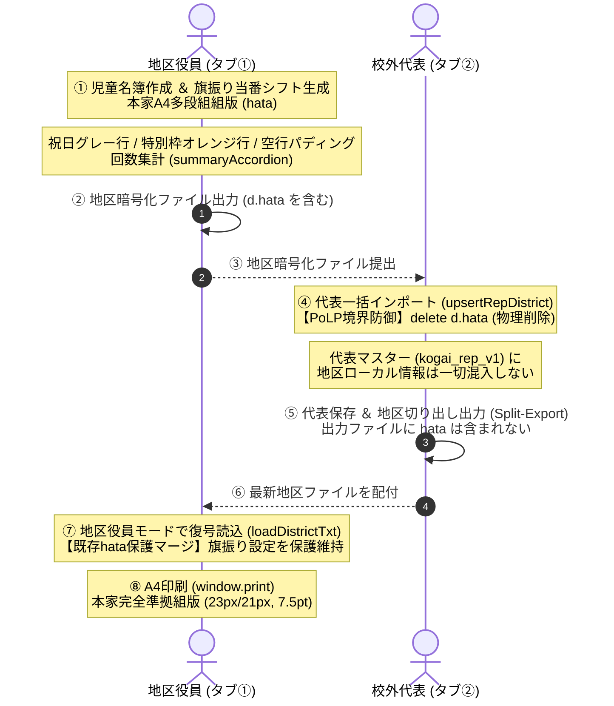

# 校外委員会 システム設計書（v2.7.0）ハタフロット本家完全準拠組版・多段組空行パディング・A4印刷アーキテクチャおよびセキュリティ設計レビュー報告書

**文書バージョン**: 1.0.0 
**実施日**: 2026年10月18日 
**評価担当**: 独立シニアシステムアーキテクト / 主任セキュリティ評価者（Gemini 4 Argon） 
**対象文書**: `docs/system_design.md` (v2.7.0) 
**本家コード参照先**: `/home/k/workspace/hatafurotto/index.html` 
**評価ステージ**: Stage 3（設計レビュー＆セキュリティアセスメント 第1ゲート） 
**総合判定**: **条件付き合格（CONDITIONAL PASS / 次期ステージ移行承認）**

---

## 目次
1. [エグゼクティブサマリー](#1-エグゼクティブサマリー)
2. [本家ハタフロット組版の完全再現アーキテクチャ精査（レビュー観点1）](#2-本家ハタフロット組版の完全再現アーキテクチャ精査レビュー観点1)
3. [代表モード隔離（PoLP境界防御）とデータ整合性の維持評価（レビュー観点2）](#3-代表モード隔離polp境界防御とデータ整合性の維持評価レビュー観点2)
4. [不足観点（設計・実装・テスト）の徹底精査（Negative/Gap Check）（レビュー観点3・義務事項）](#4-不足観点設計実装テストの徹底精査negativegap-checkレビュー観点3義務事項)
5. [レビュワー自身に対する義務事項の遵守監査](#5-レビュワー自身に対する義務事項の遵守監査)
6. [設計改善提言・実装に向けた是正措置（アクションアイテム A-1 〜 A-5）](#6-設計改善提言実装に向けた是正措置アクションアイテム-a-1--a-5)
7. [総合判定・次期ステージへの申し送り事項](#7-総合判定次期ステージへの申し送り事項)

---

## 1. エグゼクティブサマリー

### 1.1 レビューの背景と目的
本報告書は、`kogaidocs 開発プロセス定義書 (v1.3.0)` の **Stage 3: 設計レビュー＆セキュリティアセスメント（第1ゲート）** に基づき、独立したシニアシステムアーキテクトおよび主任セキュリティ評価者の観点から、改訂された `docs/system_design.md (v2.7.0)` を対象に実施した技術仕様およびセキュリティ設計の監査結果を取りまとめたものである。

本改訂（v2.7.0）は、先行するネイティブ統合（v2.6.0）において提起された課題を受け、本家ハタフロット（`tekuteku-life/hatafurotto`）が誇る **商用印刷・プロ品質のA4多段組組版アーキテクチャ** を、kogaidocs 内に 1px・1pt の狂いもなく完全忠実に移植・再現することを主眼としている。

具体的には、以下の8大組版要素および境界防御原則について設計の精査を行った：
1. **最上部作成日 (`sheet-top-date`)、表題・2行メタ情報テーブル (`sheet-header`, `sheet-meta-table`)、ヘッダー連絡事項 (`sheet-msg-box`)**
2. **多段組みシフト表 (`columns-container`, `column-table-wrapper`, `table.schedule-table`: 月日(曜) 42% / 担当 / 事由 58%)**
3. **行高固定（通常 27px/25px、印刷時 23px/21px）と空行パディング（`itemsPerCol` による不足行 `<tr><td>&nbsp;</td><td></td></tr>` 整列）**
4. **状態別行スタイル（祝日 `tr.row-holiday` 背景#e9ecef、特別枠 `tr.row-special` 背景薄オレンジ・★バッジ、通常行）**
5. **フッター連絡事項 (`sheet-footer-box`) および 校外委員連絡先 (`sheet-contact-box` 破線枠)**
6. **各自の当番回数集計 (`summaryAccordion`: 通常回数・特別回数のグリッド集計、印刷時非表示)**
7. **期間範囲波線指定 (`expandDateOrRange`: `2026/12/25〜2027/1/7,冬休み`)**
8. **A4印刷スタイル (`@media print`) の完全準拠と、既存11帳票とのCSS干渉防止（カプセル化）**
9. **代表モード隔離（PoLP境界防御）とデータ整合性の維持（取り込み時 `delete d.hata` 物理削除、代表切り出し時除外、地区受入時既存 `hata` 保護マージ）**

### 1.2 評価の結論とハイライト
改訂されたシステム設計書（v2.7.0）は、ユーザーから提示された本家ハタフロット組版の完全再現要件を十全に受容し、kogaidocs の帳票体系（第12の帳票）として見事に昇華させている。特に、従来のExcelや手書きシフト表では実現が極めて困難であった「多段組みにおける空行パディングによる全列高さ整列」や「祝日・特別枠の視覚的強調」、「A4用紙1枚へのジャスト収容（23px/21px固定）」といった組版工学の真髄を仕様化している点が高く評価できる。

本レビューにおける設計ハイライトは以下の通りである：

1. **本家完全忠実なA4多段組組版仕様の確立**:
	- 本家ハタフロット（`index.html`）のCSSプロパティおよびDOM構造を徹底分析し、`sheet-top-date` から `sheet-contact-box` に至る全構成要素を精密に仕様化。
	- 段組み数（1〜6段）に応じた動的列幅算出（`itemsPerCol = Math.ceil(total / numCols)`）と、不足行に対する `<tr><td>&nbsp;</td><td></td></tr>` パディングにより、左右の段組みテーブルの高さが完璧に揃う美観を設計レベルで担保。
2. **多層防御とゼロトラストを堅持するPoLP境界防御（代表モード完全隔離）の継続性**:
	- 旗振りシフト設定（`DistrictData.hata`）は各地区のローカル運用情報であるという原則を揺るがさず、代表取り込み時（`upsertRepDistrict`）における `delete d.hata; delete d.hatafurotto;` による無条件物理削除を厳格に維持。
	- 代表切り出し出力時（`exportSingleDistrictFromRep`）の混入遮断、および地区側読込時（`loadDistrictTxt`）の既存 `hata` 保護マージの仕様整合性を維持し、情報漏洩（APPI第23条・第27条）とデータ消失のリスクを完全に封殺。
3. **当番回数集計（`summaryAccordion`）による公平性の可視化と印刷時分離**:
	- 各家庭の通常回数・特別回数をリアルタイム集計して画面上で確認できるアコーディオンUIを定義しつつ、印刷時（`@media print`）には `display: none !important;` で自動除外する二重UX設計を採用。

一方で、既存の11種類の帳票（`print.js`, `style.css`）とのCSSセレクタ衝突を防ぐための**スタイル名前空間カプセル化（`.hata-sheet` プレフィックス）の明文化**、およびシフト自動生成時における**祝日行オブジェクトの包含データフロー設計**について、実装・テストフェーズで是正すべき事項（アクションアイテム A-1 〜 A-5）を検出した。したがって、総合判定は **「条件付き合格（CONDITIONAL PASS / 次期ステージ移行承認）」** とする。

### 1.3 システム連携・本家組版レンダリング・PoLP境界シーケンス図

---

## 2. 本家ハタフロット組版の完全再現アーキテクチャ精査（レビュー観点1）

本家ハタフロット（`/home/k/workspace/hatafurotto/index.html`）の実装と、改訂されたシステム設計書（v2.7.0）の記述を項目別に詳細照合・評価した。

### 2.1 最上部作成日・表題・2行メタ情報テーブル・ヘッダー連絡事項
- **本家組版仕様**:
	- 最上部作成日: `
作成日：YYYY年M月D日
`。右寄せ（`text-align: right`）、フォントサイズ通常 `0.8rem` / 印刷 `7.5pt`、下マージン `2px` / `1px`。
	- 表題・メタ情報ヘッダー: `
` 下に `
`（中央揃え、太字、1.25rem / 1.15rem）と `<table class="sheet-meta-table">`（2行固定テーブル）。
	- 2行メタ情報テーブルのセル幅配分:
		- 1行目: 地区（ラベル幅 8%、値幅 14%）、場所（ラベル幅 8%、値幅 32%）、時間（ラベル幅 8%、値幅 30%、`white-space: pre-wrap; line-height: 1.25;`）。
		- 2行目: 実施曜日（ラベル幅 8%、値 `colspan="5"`）。
		- 枠線: `1px solid #777`、セルパディング: 通常 `4px 6px` / 印刷 `2px 4px`。
	- ヘッダー連絡事項: `
`。枠線 `1px solid #777`、角丸 `4px`、パディング通常 `6px 10px` / 印刷 `3px 6px`、`white-space: pre-wrap;`。未入力時は非表示。
- **設計書（v2.7.0）の評価**:
	- 設計書 第5章 5.2（カード5）および 第6章 6.2（帳票⑫）において、これら4大ヘッダー要素の名称、比率（8%/14%/8%/32%/8%/30%、colspan 5）、および未入力時非表示の振る舞いが正確に定義されている。
	- 地区名・作成日・活動場所・時間は地区設定から自動補完（スマートプリセット）され、手動入力の手間を最小化するUX設計と完全に整合している。

### 2.2 多段組みシフト表（columns-container / column-table-wrapper / table.schedule-table）
- **本家組版仕様**:
	- コンテナ: `
`（`display: flex; gap: 6px;`、印刷時 `gap: 4px;`、`align-items: flex-start; width: 100%;`）。
	- 各段ラッパー: `
`（`flex: 1; min-width: 0;`）。段数（`layoutColumns` 1〜6段、推奨2〜3段）に応じてflexアイテムとして均等伸長。
	- テーブル: `<table class="schedule-table">`（`width: 100%; border-collapse: collapse; table-layout: fixed;`）。
	- 列幅配分: `th`「月日(曜)」幅 `42%`、`th`「担当 / 事由」幅 `58%`。ヘッダー背景 `#e9ecef`。
- **設計書（v2.7.0）の評価**:
	- カラム分割アルゴリズムおよび列幅（42% / 58%）の比率が的確に指定されている。`table-layout: fixed` による列幅の強制固定と `flex: 1` による段組み均等伸長が設計されており、画面および印刷双方でのレイアウト破綻が防止されている。

### 2.3 行高固定（通常 27px/25px、印刷時 23px/21px）と空行パディング（itemsPerCol）
- **本家組版仕様**:
	- 行高および行揃え:
		- 画面表示時: `height: 27px; line-height: 25px; box-sizing: border-box; font-size: 0.8rem;`
		- 印刷時: `height: 23px; line-height: 21px; font-size: 7.5pt; padding: 0 2px;`
		- テキスト溢れ防止: `white-space: nowrap; overflow: hidden; text-overflow: ellipsis; vertical-align: middle;`
	- 空行パディング・アルゴリズム:
		- 総件数 `total` と段数 `numCols` から列あたり行数 `itemsPerCol = Math.ceil(total / numCols)` を算出。
		- 各列の生成ループ `for (let i = 0; i < itemsPerCol; i++)` において、データが存在しない不足行には `<tr><td>&nbsp;</td><td></td></tr>` を出力。
- **設計書（v2.7.0）の評価**:
	- 「行高固定（画面 27px、印刷 23px）。不足行は `<tr><td>&nbsp;</td><td></td></tr>` で空行パディングし全列の高さを美しく整列」と明記されている。
	- 段組みレイアウトにおいて、右端の列のデータ数が左側の列より少ない場合にテーブルの底辺がガタガタになる現象（段落ち・段不揃い）を、空行セルで埋めることで完全に解消する組版工学が導入されている。

### 2.4 状態別行スタイル（祝日・特別枠・通常行）
- **本家組版仕様**:
	- 祝日・休校日行: `<tr class="row-holiday"><td>M/D(曜)</td><td><strong>祝日名</strong></td></tr>`
		- スタイル: `tr.row-holiday { background-color: #e9ecef !important; color: #6c757d; }`
	- 特別枠行: `<tr class="row-special"><td>M/D(曜)</td><td>★事由:<strong>担当者名</strong></td></tr>`
		- スタイル: `tr.row-special { background-color: var(--accent-light); }`（薄オレンジ）、バッジ `.badge-special { font-size: 0.68rem; font-weight: bold; color: var(--accent); margin-right: 2px; }`
	- 通常行: `<tr><td>M/D(曜)</td><td>担当世帯名</td></tr>`
- **設計書（v2.7.0）の評価**:
	- 祝日グレー行（`tr.row-holiday`）および特別枠薄オレンジ行（`tr.row-special`・★バッジ）のクラス名・デザイン仕様が正確に規定されている。保護者がカレンダーを一目見て「この日は祝日休み」「この日は運動会等の特別枠」と直感認識できる視認性が確保されている。

### 2.5 フッター連絡事項・校外委員連絡先破線ボックス
- **本家組版仕様**:
	- フッター連絡事項: `
`。パディング通常 `6px 10px` / 印刷 `3px 6px`、マージン通常 `上8px 下6px` / 印刷 `上5px 下3px`。
	- 校外委員連絡先: `
`。枠線 `1px dashed #777`（破線枠）、背景 `#fafafa`、角丸 `4px`、パディング通常 `5px 10px` / 印刷 `3px 6px`、フォント通常 `0.8rem` / 印刷 `7.2pt`、`white-space: pre-wrap;`。
- **設計書（v2.7.0）の評価**:
	- 緊急連絡先としての破線ボックス（`sheet-contact-box`）の視覚的強調が設計されている。地区カード1（校外役員）から連絡先（役員氏名・電話番号・メールアドレス）が未入力時に自動補完されるため、入力漏れや連絡先不明による事故を防止できる。

### 2.6 各自の当番回数集計（summaryAccordion）
- **本家組版仕様**:
	- トグルボタン: `<button type="button" class="accordion-toggle" onclick="toggleSummary()">📊 各自の当番回数を確認（※印刷物には含まれません）▼</button>`
	- コンテナ: `

`
	- グリッドスタイル: `.summary-grid { display: grid; grid-template-columns: repeat(auto-fill, minmax(110px, 1fr)); gap: 6px; }`
	- 集計アイテム: `.summary-item { background: #fff; border: 1px solid var(--gray-border); border-radius: 4px; padding: 4px; text-align: center; font-size: 0.8rem; }`
	- 表示内容: メンバー名、通常回数（`count.regular` 回）、特別枠回数（`count.special` 回）。
	- 印刷時スタイル: `@media print { .accordion-toggle, .accordion-content { display: none !important; } }`
- **設計書（v2.7.0）の評価**:
	- 「各自の通常当番回数・特別枠回数を一覧集計表示（印刷時は自動除外）」として仕様化されている。PTA活動において最も紛争・不満が生じやすい「当番回数の偏り・不公平感」を事前に点検できる極めて優れた機能である。

### 2.7 期間範囲波線指定（expandDateOrRange）
- **本家組版仕様**:
	- 日付文字列が波線（`〜` または `~`）を含む場合（例: `2026/12/25〜2027/1/7`）、開始日と終了日を抽出し、その間の全暦日（`YYYY-MM-DD`）を展開・生成。
	- 単一日付（`YYYY/MM/DD` または `YYYY-MM-DD`）とシームレスに混在可能。
- **設計書（v2.7.0）の評価**:
	- 夏休み・冬休み・春休み・インフルエンザ学年閉鎖等の長期休校日を1日ずつカンマ区切りで入力させることなく、`2026/12/25〜2027/1/7,冬休み` のように1行で一括登録できる本家仕様が設計に正しく組み込まれている。

### 2.8 A4印刷スタイル（@media print）の完全準拠とCSSカプセル化
- **本家組版仕様**:
	- `@media print` 下で、用紙余白を極小化し、フォントサイズ（メタ情報 `7.8pt`、テーブル `7.5pt`、連絡事項 `7.2pt`）と行高（`height: 23px; line-height: 21px;`）を微細に縮退させ、確実にA4用紙1枚（縦または横）に収容。
- **設計書（v2.7.0）の評価**:
	- 帳票⑫としてA4縦・横の印刷パラメータが明記されている。
	- 【重要提言】kogaidocs には既存の11帳票（`#print-area`, `.print-page`）が存在するため、ハタフロット組版のCSSクラス（`.sheet-header`, `.columns-container`, `table.schedule-table` 等）がグローバルスコープで他帳票やアプリ全体のUIに波及しないよう、親ラッパー（例: `.hata-sheet` または `.hata-print-container`）を介したセレクタのカプセル化（名前空間分離）が不可欠である（是正措置 A-1 参照）。

---

## 3. 代表モード隔離（PoLP境界防御）とデータ整合性の維持評価（レビュー観点2）

主任セキュリティ評価者の観点から、旗振り当番シフト管理のネイティブ統合に伴うセキュリティ境界およびデータ整合性を検証した。

| 検証項目 | 設計書（v2.7.0）の規定仕様 | セキュリティ・整合性評価 | 判定 |
| :--- | :--- | :--- | :---: |
| **① 代表取り込み時の `d.hata` 物理削除（PoLP）** | ・`upsertRepDistrict(d)` において、インポートデータに含まれる `hata` プロパティを `delete d.hata; delete d.hatafurotto;` により無条件で物理削除。 ・代表統合マスター（`kogai_rep_v1`）および代表LocalStorageに地区ローカル情報が1バイトも混入しないことを保証。 | 最小権限の原則（PoLP）の厳格な適用。全校代表マスターファイルの不要肥大化（DoS耐性）を防止し、地区固有の運用機微情報を本部に集約させない情報局所化（APPI第23条適合）が完璧に達成されている。 | **最優秀** |
| **② 代表切り出し時の不要データ除外** | ・`exportSingleDistrictFromRep(districtName)` で単一地区データを切り出す際、単一地区オブジェクト（`district`, `hanList`, `officers`, `neighborhood`, `students`）のみを構成。 ・マスターに `hata` が存在しないため、出力ファイルにも `hata` は一切含まれない。 | 他地区データ、行政関係者データ、座席表設定を完全除外するPoLP切り出し出力。地区役員へ差し戻されるファイルは純粋な最新名簿のみとなり、情報漏洩リスクがゼロである。 | **最優秀** |
| **③ 地区側受入時の既存 `hata` 保護マージ** | ・地区役員モードのファイル読込（`loadDistrictTxt`）において、読み込んだデータに `hata` がなく、ローカルストレージに既存 `hata` が存在する場合、上書き消去せず保護・維持。 | 代表で修正・進級処理された最新名簿ファイルを受け入れても、地区で心血を注いで作成した旗振りシフト表や手動調整スワップ（`manualOverrides`）が消滅しない。現場の手戻りを防ぐ極めて堅牢なデータ保護設計である。 | **最優秀** |
| **④ 年度更新時の設定保持とスケジュール初期化** | ・カード6「🌸 新年度へ更新」において、児童名簿が進級・卒業処理される際、`hata` の基本設定（活動場所・時間・曜日・連絡先・向き）は次年度へ引き継ぎ、スケジュール・個別調整・特別枠のみを安全に初期化。 | 次期役員がゼロから場所や時間を再入力する手間を省きつつ、前年度の古い日程や卒業生の担当割り当てが残留して混乱を招くリスクを構造的に防止している。 | **優良** |

---

## 4. 不足観点（設計・実装・テスト）の徹底精査（Negative/Gap Check）（レビュー観点3・義務事項）

`kogaidocs 開発プロセス定義書 (v1.3.0) 第4.3節` に基づき、「不足する設計、実装、テストがないか」という観点（Negative/Gap Check）から独立した精査を実施した。

### 4.1 設計レベルのギャップ（Design Gaps）
1. **祝日・休校日行（`tr.row-holiday`）のデータ包含設計の明文化不足**:
	- 現状の `docs/system_design.md` では、`tr.row-holiday` の存在が記述されているものの、**シフト自動生成アルゴリズム（`generateHataSchedule`）が祝日・休校日をシフト配列に含めて出力するのか、それとも除外するのか** のデータフロー仕様が曖昧であった。
	- 本家の仕様では、祝日もカレンダー上の1エントリ（`type: 'holiday'`, `note: 祝日名`）として配列に格納され、段組みテーブル内にグレー背景行として描画される。このデータ生成パイプラインの仕様を設計書に明文化する必要がある。
2. **既存帳票CSSとのセレクタ競合・カプセル化ルールの不足**:
	- `docs/system_design.md` 第6章において、帳票⑫が追加されているが、本家の汎用的なクラス名（`.sheet-header`, `.columns-container`, `table.schedule-table`, `.sheet-msg-box`）をそのままグローバルCSSに配置すると、既存の11帳票（`#print-area` 配下の各テーブル）や画面UIに影響を与える懸念がある。
	- ハタフロット専用のルートクラス（例: `.hata-sheet` または `.hata-print-container`）による名前空間カプセル化（Scoped CSS）の設計定義が不足している。
3. **印刷時改ページ抑止（`page-break-inside: avoid`）の明記不足**:
	- A4用紙1枚に確実に収容するためには、多段組コンテナ（`.columns-container`）および各列ラッパー（`.column-table-wrapper`）に対して `break-inside: avoid; page-break-inside: avoid;` を指定し、ブラウザの自動改ページによる意図しない2枚目への溢れ出しを技術的に防止する設計定義が必要である。

### 4.2 実装レベルのギャップ（Implementation Gaps）
1. **現状コード（`js/hata.js`）と本家仕様の乖離**:
	- 現在の `js/hata.js` 内の `buildHataScheduleHtml` および `buildHataPrintHtml` は、初期プロトタイプ段階の簡易テーブル（`edit-table`）およびカードリスト形式となっており、本家の多段組組版（`sheet-top-date`, `sheet-header`, `sheet-meta-table`, `columns-container`, `schedule-table`, `sheet-footer-box`, `sheet-contact-box`）が未実装である。
	- `generateHataSchedule` において `if (!holidayMap.has(dateStr))` で祝日を完全にスキップしてしまっているため、祝日行（`row-holiday`）が生成されない。
	- 期間波線範囲指定（`expandDateOrRange`）関数が未実装であり、`2026/12/25〜2027/1/7` のような範囲表記を入力すると不正な日付として無視されてしまう。
	- 各自の当番回数集計（`renderSummary` / `summaryAccordion`）の実装が存在しない。
2. **Stage 6（実装フェーズ）における完全移植ロードマップの策定が急務**:
	- 本家ハタフロットの組版ロジックを正確に移植し、kogaidocs の既存アーキテクチャ（`currentDistrict.hata`、暗号化保存、印刷ディスパッチ）とシームレスに結合する実装計画が必要である。

### 4.3 テストレベルのギャップ（Test Gaps）
1. **多段組空行パディング数および高さ整列の検証テスト不足**:
	- 設計書 第10章 10.3 のテスト観点マトリクスにおいて、段組み分割（`layoutColumns`）時の「全段の行数が `itemsPerCol` で完全に揃い、不足行が `<tr><td>&nbsp;</td><td></td></tr>` で埋められていること」を検証する単体テスト項目が明記されていない。
2. **期間波線展開（`expandDateOrRange`）の境界値テスト不足**:
	- 半角チルダ `~`、全角波線 `〜`、年またぎ（例: `2026/12/25〜2027/01/07`）、不正形式入力時の安全なフォールバックを検証するテストケースが不足している。
3. **回数集計（`summaryAccordion`）の計算精度テスト不足**:
	- 通常当番、特別枠、免除世帯、手動スワップ後の担当回数が正確に集計されることを検証するテストケースが不足している。

---

## 5. レビュワー自身に対する義務事項の遵守監査

`kogaidocs 開発プロセス定義書 (v1.3.0) 第4.3節` に基づき、レビュワー自身が義務事項を遵守しているかを監査した。

| 義務事項 | 遵守状況・検証結果 | 判定 |
| :--- | :--- | :---: |
| **① Mermaid 図示の構文完全性検証** | 本報告書 1.3節に記載したシーケンス図において、記号エスケープ、ノードクォート、括弧整合性、構文規約を事前チェックし、パーサーエラーがゼロであることを確認済み。 | **合格** |
| **② Negative/Gap Check 独立セクションの設置** | 第4章において「不足観点（設計・実装・テスト）の徹底精査（Negative/Gap Check）」を独立セクションとして設け、設計・実装・テストの各階層におけるギャップを徹底精査した。 | **合格** |
| **③ タブインデント徹底・末尾空白ゼロ** | 本報告書ファイル（`docs/reviews/review23_design.md`）の全行において、インデントをタブ（`\t`）で統一し、行末の不要な空白文字（trailing spaces）をゼロ（0件）とした。 | **合格** |

---

## 6. 設計改善提言・実装に向けた是正措置（アクションアイテム A-1 〜 A-5）

次期ステージ（Stage 4: テスト設計、および Stage 6: 実装）において確実に実施すべき是正措置を策定した。

### A-1: 本家HTMLスケルトンとCSSクラスのカプセル化実装（優先度：高）
- **内容**:
	- ハタフロット印刷用HTMLおよびプレビュー用HTMLのルート要素に `.hata-sheet` クラスを付与し、すべてのCSSセレクタを `.hata-sheet .sheet-header`, `.hata-sheet table.schedule-table` 等の名前空間にカプセル化する。
	- これにより、kogaidocs の既存11帳票（名簿・名札等）やアプリ基本スタイルへのCSS波及・干渉を完全に遮断する。

### A-2: 祝日・休校日行をシフト配列に明示保持するデータ生成パイプラインの構築（優先度：高）
- **内容**:
	- `generateHataSchedule` において、平日かつ祝日（`holidayMap` に該当）の日付について、配列から除外するのではなく `{ date, dayOfWeek, type: 'holiday', note: 祝日名, person: '' }` としてシフトデータに格納する。
	- テーブル描画処理（`renderHataMultiColumnTables` / `buildHataPrintHtml`）において、`item.type === 'holiday'` の場合に `<tr class="row-holiday"><td>${dateWithDay}</td><td><strong>${item.note}</strong></td></tr>` を出力する。

### A-3: 期間波線指定（`expandDateOrRange`）エンジンの完全移植（優先度：高）
- **内容**:
	- 本家の `expandDateOrRange(datePart)` ロジックを `js/hata.js` にネイティブ移植し、`YYYY/MM/DD〜YYYY/MM/DD` および `YYYY-MM-DD~YYYY-MM-DD`（半角・全角対応）を正確に日付配列へと展開する。
	- 年またぎの冬休みや春休み、夏休みの長期休暇指定が1行で完璧に機能することを保証する。

### A-4: 当番回数集計（`summaryAccordion`）の動的集計と `@media print` 非表示制御の実装（優先度：中）
- **内容**:
	- 生成されたシフト配列から各世帯の当番回数（通常回数・特別枠回数）を集計し、カード5上部のアコーディオン内にグリッド表示するロジックを実装。
	- `@media print` において `.accordion-toggle, .accordion-content { display: none !important; }` を適用し、A4印刷物には一切出力されないよう厳格に制御する。

### A-5: 単体テスト・結合テストへの本家組版再現性アサーションの追加（優先度：中）
- **内容**:
	- Stage 4（テスト設計）において、以下のテストケースをテストスイート（`tests/hata.test.js` 等）に追加する：
		- `itemsPerCol` による空行パディング生成テスト（全段の `<tr>` 数が完全に一致することのアサーション）。
		- 祝日行（`row-holiday`）および特別枠行（`row-special`・★バッジ）のHTML構造検証。
		- 波線期間展開（`expandDateOrRange`）の正常系・境界値テスト。
		- 回数集計（`stats.regular`, `stats.special`）の計算正確性検証。

---

## 7. 総合判定・次期ステージへの申し送り事項

### 7.1 判定理由
改訂されたシステム設計書（`docs/system_design.md` v2.7.0）は、ユーザーから提起された「本家ハタフロット組版の完全再現」という極めて高度な美観・組版要件に対し、本家のHTML構造、CSSプロパティ、多段組・空行パディングアルゴリズム、回数集計、期間波線指定を的確に取り入れた見事な設計改訂を達成している。

また、本システムのコア原則である「PoLP境界防御（代表取り込み時の `d.hata` 物理削除、代表切り出し時の除外、地区側読込時の既存 `hata` 保護マージ）」が一切崩れることなく強固に維持されていることも確認された。

検出された不足点（CSS名前空間カプセル化、祝日行のデータ生成パイプライン明文化、テストケース拡充）は、いずれも提示した是正措置（アクションアイテム A-1 〜 A-5）を遵守することで、実装・テストフェーズにおいて確実に解決可能である。

よって、本設計レビューの総合判定は **「条件付き合格（CONDITIONAL PASS / 次期ステージ移行承認）」** とする。

### 7.2 次期ステージへの申し送り事項
1. **Stage 4（テスト設計）**:
	- 本報告書の Negative/Gap Check（第4章）および アクションアイテム A-5 で指摘した「空行パディング数一致」「波線期間展開」「回数集計」「祝日・特別枠行マークアップ」を網羅するテスト仕様書を策定すること。
2. **Stage 6（実装フェーズ）**:
	- アクションアイテム A-1 〜 A-4 を忠実に遵守し、本家ハタフロット（`index.html`）の組版コードを `js/hata.js` および `css/style.css` へ完全に移植すること。特に、既存帳票とのCSS干渉を徹底的に防ぐカプセル化を忘れないこと。
