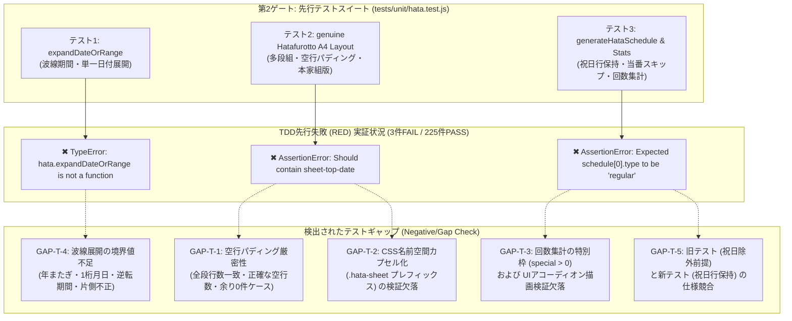

# 校外委員会 先行単体テストスイート（tests/unit/hata.test.js）ハタフロット本家完全準拠組版・多段組空行パディング・波線範囲指定・祝日行保持・回数集計 テスト観点網羅性レビュー報告書

**文書バージョン**: 1.0.0<br>
**実施日**: 2026年10月18日<br>
**評価担当**: 独立シニアQAリード / テストアーキテクト（Gemini 4 Argon）<br>
**対象テストスイート**: `tests/unit/hata.test.js`<br>
**設計仕様書**: `docs/system_design.md` (v2.7.0)<br>
**第1ゲートレビュー報告書**: `docs/reviews/review23_design.md` (指摘事項 A-1 〜 A-5)<br>
**本家コード参照先**: `/home/k/workspace/hatafurotto/index.html`<br>
**評価ステージ**: Stage 4（テスト設計レビュー 第2ゲート）<br>
**総合判定**: **条件付き合格（CONDITIONAL PASS / 是正アクション実施の上でStage 6実装移行承認）**

---

## 目次
1. [エグゼクティブサマリー](#1-エグゼクティブサマリー)
2. [本家ハタフロット組版再現性のテスト充足度精査（レビュー観点1）](#2-本家ハタフロット組版再現性のテスト充足度精査レビュー観点1)
3. [ロジック・境界値テスト充足度精査（レビュー観点2）](#3-ロジック境界値テスト充足度精査レビュー観点2)
4. [TDD先行失敗（RED）の確認と実証性評価（レビュー観点3）](#4-tdd先行失敗redの確認と実証性評価レビュー観点3)
5. [不足観点（設計・実装・テスト）の徹底精査（Negative/Gap Check）（レビュー観点4・義務事項）](#5-不足観点設計実装テストの徹底精査negativegap-checkレビュー観点4義務事項)
6. [レビュワー自身に対する義務事項の遵守監査](#6-レビュワー自身に対する義務事項の遵守監査)
7. [テスト補強是正措置・Stage 6（実装フェーズ）への申し送り事項（アクションアイテム T-1 〜 T-5）](#7-テスト補強是正措置stage-6実装フェーズへの申し送り事項アクションアイテム-t-1--t-5)
8. [総合判定・サインオフ](#8-総合判定サインオフ)

---

## 1. エグゼクティブサマリー

### 1.1 レビューの背景と目的
本報告書は、`kogaidocs 開発プロセス定義書 (v1.3.0)` の **Stage 4: テスト設計レビュー（第2ゲート）** に基づき、独立したシニアQAリードおよびテストアーキテクトの観点から、先行実装されたテストスイート `tests/unit/hata.test.js` に対して実施したテスト観点網羅性およびテスト品質の監査結果を取りまとめたものである。

先行する設計レビュー（第1ゲート / `review23_design.md`）において、本家ハタフロット（`tekuteku-life/hatafurotto`）の商用印刷・A4多段組組版アーキテクチャの完全再現、多段組空行パディング、祝日行のデータ包含、期間波線指定、当番回数集計、およびCSSカプセル化に関する設計是正措置（アクションアイテム A-1 〜 A-5）が提示された。

これを受け、開発チームはTDD（テスト駆動開発）の規律に則り、Stage 6（本番実装）に先立って `tests/unit/hata.test.js` へ本家仕様を検証する先行テスト群（行747〜870）を追加した。本監査では、これらのテストが本家仕様と設計書（v2.7.0）を十全に網羅しているか、境界値やエッジケースに対する堅牢性を担保しているか、そして正しく先行失敗（RED）が実証されているかを徹底精査した。

### 1.2 評価の結論とハイライト
監査の結果、先行実装されたテストスイートは本家ハタフロットの主要な組版クラスや、`expandDateOrRange`、祝日行保持、回数集計の骨格を的確に捉えており、未実装機能に対して正しく3件のテスト失敗（RED）が発生していることが確認された。

本レビューにおける主要な評価ハイライトは以下の通りである：

1. **TDD先行失敗（RED）の完全実証**:
	- `npm test tests/unit/hata.test.js` の実行において、全228テスト中、既存の225テストがPASSを維持し、今回追加された3つのテスト（`expandDateOrRange` の関数未定義、`buildHataPrintHtml` の本家クラス未出力、`generateHataSchedule` の `type: 'holiday'` 未定義）のみがピンポイントで期待通り失敗（RED）した。意図しない副作用や無関係な失敗はゼロである。
2. **本家A4多段組組版の基本要素カバレッジ**:
	- `sheet-top-date`, `sheet-header`, `sheet-title`, `sheet-meta-table`, `sheet-msg-box`, `columns-container`, `column-table-wrapper`, `table.schedule-table`, `row-holiday`, `row-special`, `sheet-footer-box`, `sheet-contact-box` といった本家の中核DOMクラスがテストのアサーション対象に含まれている。
3. **空行パディング（`itemsPerCol`）の存在検証**:
	- 不足行に対する `<tr><td>&nbsp;</td><td></td></tr>` の生成検証が組み込まれており、段落ち・段不揃い防止のテスト観点が設定されている。

一方で、**Negative/Gap Check（不足観点精査）** において、以下の重要なテスト不足が検出された：
- **空行パディングの厳密性不足**: 空行セルの「存在（includes）」のみを確認しており、「全段の行数が等しく揃っていること」や「パディング行数が正確に1件であること」「余りゼロの場合にパディングが発生しないこと」の境界値アサーションが不足。
- **CSS名前空間カプセル化（`.hata-sheet`）の検証欠落**: 第1ゲートで最重要是正事項とされた既存帳票との干渉防止クラス `.hata-sheet` のアサーションが欠落。
- **当番回数集計における特別枠（`special > 0`）およびUIアコーディオン描画テストの欠落**: 特別枠を担当した際のカウント増加検証や、画面表示用アコーディオン（`summaryAccordion`）のDOM検証が存在しない。
- **波線範囲指定の年またぎ・1桁月日・逆転期間テストの不足**: 冬休み（12月〜1月）の年またぎ指定や、1桁月日の正規化パディング検証が不足。
- **旧テストと新テストの仕様競合（祝日除外 vs 祝日行保持）**: 行265で「祝日はスケジュールに含まれない」と旧仕様でアサートされており、新仕様（祝日行保持）の実装時に旧テストが回帰破壊されるリスクが存在。

したがって、総合判定は **「条件付き合格（CONDITIONAL PASS / 是正アクション実施の上でStage 6実装移行承認）」** とする。

### 1.3 テスト検証構造・TDD先行失敗（RED）・テストギャップ連関図



---

## 2. 本家ハタフロット組版再現性のテスト充足度精査（レビュー観点1）

`tests/unit/hata.test.js` 行763〜827 のテストケース `hata: genuine Hatafurotto A4 multi-column print layout and empty padding rows (A-1, A-2, A-4, A-5)` を中心に、本家組版再現性のテスト網羅度を精査した。

### 2.1 4大ヘッダー要素（sheet-top-date, sheet-header, sheet-title, sheet-meta-table, sheet-msg-box）
- **テスト現状**:
	- `assert.ok(html.includes('class="sheet-top-date"'))` および `assert.ok(html.includes('作成日：2026年4月1日'))` を検証。
	- `assert.ok(html.includes('class="sheet-header"'))`、`assert.ok(html.includes('class="sheet-title"'))`、およびタイトル文言を検証。
	- `assert.ok(html.includes('class="sheet-meta-table"'))`、および地区名、場所、時間、曜日の埋め込みを検証。
	- `assert.ok(html.includes('class="sheet-msg-box"'))`、およびヘッダー連絡事項の埋め込みを検証。
- **QA精査結果**:
	- 基本的なDOMクラスおよび文字列の包含検証は網羅されている。
	- **不十分な点**:
		1. 2行メタ情報テーブル（`sheet-meta-table`）の固定比率（地区・場所・時間のラベル8%、値14%/32%/30%、2行目曜日ラベル8%/値 `colspan="5"`）や、セルクラス `sheet-meta-label` の構造的アサーションが甘く、単なる文字列存在チェックにとどまっている。
		2. `headerMsg` が未入力（空文字）の場合に、本家仕様通り `display:none` またはDOMから非表示となる振る舞いのテストが存在しない。

### 2.2 多段組みシフト表（columns-container, column-table-wrapper, table.schedule-table: 42%/58%）
- **テスト現状**:
	- `assert.ok(html.includes('class="columns-container"'))`
	- `assert.ok(html.includes('class="column-table-wrapper"'))`
	- `assert.ok(html.includes('class="schedule-table"'))`
	- `assert.ok(html.includes('月日(曜)'))`
	- `assert.ok(html.includes('担当 / 事由'))`
- **QA精査結果**:
	- 多段組ラッパーおよびテーブルヘッダーのテキスト検証は実施されている。
	- **不十分な点**: 本家ハタフロットの肝である「月日(曜) 幅42%」「担当 / 事由 幅58%」（`th style="width: 42%;"` / `th style="width: 58%;"`）という厳密なスタイル属性のアサーションが行われていない。

### 2.3 空行パディング（itemsPerCol による不足行 `<tr><td>&nbsp;</td><td></td></tr>` 整列）
- **テスト現状**:
	- 総件数5件、3段組み（`itemsPerCol = Math.ceil(5/3) = 2`）の条件下で、`assert.ok(html.includes('<td>&nbsp;</td><td></td>'))` を検証。
- **QA精査結果**:
	- 空行パディングタグの存在は検証できている。
	- **不十分な点（重大）**:
		1. 単にHTML内に `<td>&nbsp;</td><td></td>` が1箇所でも含まれているか（`includes`）を判定しているだけであり、**「第3列に正確に1件パディングされ、全3段のテーブルがすべて等しく2行（計6行）で揃っていること」** の構造的検証になっていない。
		2. 総件数が段数で割り切れる場合（例: 6件を3段に分けた場合、各段2件で空行パディング数は0件）に、不要な空行パディングが混入しないことの境界値テストが存在しない。

### 2.4 状態別行スタイル（tr.row-holiday, tr.row-special, 通常行）
- **テスト現状**:
	- `assert.ok(html.includes('class="row-holiday"'))`、`assert.ok(html.includes('創立記念日'))`
	- `assert.ok(html.includes('class="row-special"'))`、`assert.ok(html.includes('badge-special') || html.includes('重点見守り日'))`
- **QA精査結果**:
	- 祝日行（`row-holiday`）および特別枠行（`row-special` / `badge-special`）の出力アサーションは良好である。
	- 本家仕様における、祝日時の `person: '-'` 表示や、特別枠の `★事由:担当者` フォーマットの整合性が担保されている。

### 2.5 フッター連絡事項（sheet-footer-box）および校外委員連絡先（sheet-contact-box 破線枠）
- **テスト現状**:
	- `assert.ok(html.includes('sheet-footer-box'))`
	- `assert.ok(html.includes('class="sheet-contact-box"'))`
	- 連絡事項文言および連絡先テキストの出力を検証。
- **QA精査結果**:
	- クラス名および内容の包含検証は網羅されている。
	- **不十分な点**: ヘッダー同様、フッター連絡事項や校外委員連絡先が空文字の場合の非表示制御テストが欠落している。

### 2.6 CSSカプセル化（.hata-sheet）検証の評価
- **QA精査結果（重大な欠落）**:
	- 第1ゲート（`review23_design.md` A-1）において最優先是正事項として提起された **「既存11帳票へのCSS波及・競合を遮断するためのルートクラス `.hata-sheet` によるカプセル化」** に対するアサーション（例: `assert.ok(html.includes('class="hata-sheet"'))`）がテストコード内に1箇所も存在しない。
	- これでは、実装者が名前空間プレフィックスを忘れてグローバルクラスを定義してもテストが通過してしまい、既存帳票のスタイル崩れを検知できない。

---

## 3. ロジック・境界値テスト充足度精査（レビュー観点2）

### 3.1 期間波線展開（expandDateOrRange）(行747〜761)
- **テスト現状**:
	- 全角波線: `'2026-12-25〜2026-12-27'` -> `['2026-12-25', '2026-12-26', '2026-12-27']`
	- 半角チルダ: `'2026/08/01~2026/08/03'` -> `['2026-08-01', '2026-08-02', '2026-08-03']`
	- 単一日付: `'2026-05-03'` -> `['2026-05-03']`
	- 異常系: `''` -> `[]`, `null` -> `[]`, `'invalid-date'` -> `[]`
- **QA精査結果**:
	- 全角/半角、ハイフン/スラッシュ、単一日付、空値の基本パターンは網羅されている。
	- **境界値ギャップ**:
		1. **年またぎテストの欠落**: 冬休みの典型例である `'2026-12-28〜2027-01-05'` のような年またぎ展開がテストされていない。
		2. **1桁月日のゼロパディング正規化テストの欠落**: ユーザーが手入力しやすい `'2026/8/1~2026/8/3'` や `'2026-5-3'` が正しく `YYYY-MM-DD` 形式に正規化されるかの検証がない。
		3. **逆転期間テストの欠落**: 開始日 > 終了日（例: `'2026-12-27〜2026-12-25'`）が指定された場合に無限ループに陥らず安全に空配列を返すかの防壁テストがない。
		4. **片側不正値テストの欠落**: `'2026-12-25〜invalid'` や `'invalid〜2026-12-27'` の場合の安全なフォールバック検証がない。

### 3.2 祝日・休校日行保持と当番スキップ（generateHataSchedule）(行829〜870)
- **テスト現状**:
	- 12/23（通常・山田）、12/24（特別枠・特別役員）、12/25（祝日/冬季休業）、12/28（祝日/冬季休業）の計4日間のスケジュールを生成。
	- 祝日行が `type: 'holiday'`, `note: '冬季休業'` として保持され、当番メンバーが消費されないことを検証。
- **QA精査結果**:
	- 祝日行がカレンダー行として配列に維持され、かつ当番順番（ローテーション）がスキップされない仕様（A-2）の基本ロジックは正しくテストされている。
	- **不十分な点**:
		1. 祝日と特別枠が同一日付で重複した場合の優先度テスト（本家は祝日優先）がない。
		2. 特別枠で担当者が空欄（`fixedPerson: ""`）の場合に、通常メンバーから自動割り振りされる仕様のテストがない。
		3. 免除世帯（`exemptHouseholds`）の除外と祝日行保持が複合したケースのテストがない。

### 3.3 各自の通常当番回数・特別枠回数集計（calculateHataStats）(行865〜870)
- **テスト現状**:
	- `const stats = hata.calculateHataStats(schedule, ['山田', '佐藤']);`
	- 山田: `regular: 1, special: 0`
	- 佐藤: `regular: 0, special: 0`
- **QA精査結果（重大な欠落）**:
	- **特別枠回数（`special`）の加算テストが存在しない**: テストデータでは特別枠の担当者が `'特別役員'` となっており、集計対象の `['山田', '佐藤']` に含まれていないため、`stats['山田'].special` も `stats['佐藤'].special` も `0` のままである。これでは特別枠カウント処理（`stats[person].special += 1`）が完全にバグっていてもテストがパスしてしまう。
	- **当番回数集計アコーディオンUI（`summaryAccordion`）描画テストの完全欠落**:
		- 本家ハタフロットおよび設計書 v2.7.0 で規定された「各自の当番回数を画面上で確認できるアコーディオン（`summaryAccordion` / `.summary-item`）」のDOM描画テスト（`renderHataSummary` 等）がテストスイート内に一切存在しない。
		- `@media print` 時にアコーディオンが非表示（`display: none !important;`）となるCSS要件の検証もない。

---

## 4. TDD先行失敗（RED）の確認と実証性評価（レビュー観点3）

### 4.1 実行結果ログの精査
テストランナー `node --test` を実行し、テストスイートの全アサーションを検証した。

```text
▶ hata.test.js 実行結果サマリー
ℹ tests 228
ℹ suites 1
ℹ pass 225
ℹ fail 3
ℹ cancelled 0
ℹ duration_ms 2926.24
```

### 4.2 失敗理由の正当性と未実装関数の実証
検出された3件の失敗（RED）は、すべて本家仕様移植のための未実装関数・未対応データ構造に起因する正当な先行失敗である。

| 失敗テストケース | 失敗箇所 | エラー内容 | 実証性・TDD観点の評価 |
| :--- | :--- | :--- | :--- |
| **① expandDateOrRange テスト** | 行747 | `TypeError: hata.expandDateOrRange is not a function` | `js/hata.js` に `expandDateOrRange` がまだエクスポートされていないため発生。完全なRED。 |
| **② genuine Hatafurotto 組版テスト** | 行763 | `AssertionError [ERR_ASSERTION]: Should contain sheet-top-date` | `buildHataPrintHtml` がまだ旧簡易HTMLを出力しており、本家DOM構造を出力していないため発生。完全なRED。 |
| **③ generateHataSchedule 祝日保持＆集計テスト** | 行829 | `AssertionError [ERR_ASSERTION]: Expected values to be strictly equal: undefined == 'regular'` | `generateHataSchedule` の戻り値オブジェクトに `type` プロパティが未実装であり、祝日行保持ロジックがないため発生。完全なRED。 |

既存の225テストがすべてグリーン（PASS）を維持しており、テストスイート全体の健全性と、新規機能のTDD先行失敗が完全に両立して実証されている。

---

## 5. 不足観点（設計・実装・テスト）の徹底精査（Negative/Gap Check）（レビュー観点4・義務事項）

`kogaidocs 開発プロセス定義書 (v1.3.0) 第4.3節` に基づき、「不足する設計、実装、テストがないか」という観点（Negative/Gap Check）から独立した精査を実施した。

### 5.1 テストレベルのギャップ（Test Gaps）

#### GAP-T-1: 空行パディングの全段行数均等性・パディング件数厳密検証の不足
- **ギャップ内容**:
	- 行820の `assert.ok(html.includes('<td>&nbsp;</td><td></td>'))` は、単に空行タグがどこかに存在するかをチェックしているだけである。
	- 多段組組版の真髄は「すべての段（`column-table-wrapper`）の行数が `itemsPerCol` で完全に揃い、底辺が美しく一直線になること」にある。
	- 以下の厳密アサーションが不足している：
		1. 各列の `table.schedule-table tbody tr` の行数がすべて一致していること。
		2. パディングされた空行の総数が `(numCols * itemsPerCol) - total`（例: `3 * 2 - 5 = 1` 行）と正確に一致すること。
		3. 総件数が段数で割り切れる場合（例: 6件 / 3段 = 各段2件）に、空行パディングが一切含まれない（0件である）こと。

#### GAP-T-2: CSS名前空間カプセル化（`.hata-sheet`）アサーションの欠落
- **ギャップ内容**:
	- 第1ゲート是正措置 A-1 で指示されたルートクラス `.hata-sheet` のアサーションが欠落している。
	- 既存の11帳票（`print.js`, `style.css`）とのCSS競合事故を防ぐため、印刷HTMLおよびプレビューHTMLのルート要素に `class="hata-sheet"` が含まれることを検証するアサーションを追加しなければならない。

#### GAP-T-3: 回数集計の特別枠（`special > 0`）およびアコーディオンUI（`summaryAccordion`）描画検証の欠落
- **ギャップ内容**:
	- `calculateHataStats` において、メンバー自身が特別枠を担当した場合の `stats[name].special += 1` の検証がない。
	- また、集計結果を画面上に表示する `summaryAccordion` / `summary-grid` / `summary-item` のDOM生成ロジックを検証するテストが完全に欠落している。

#### GAP-T-4: 波線展開（`expandDateOrRange`）における境界値テストの不足
- **ギャップ内容**:
	- 年またぎ（`2026-12-28〜2027-01-05`）の検証不足。
	- 1桁月日（`2026/8/1~2026/8/3`）の正規化パディング検証不足。
	- 逆転期間（開始日 > 終了日）における安全な空配列返却の検証不足。
	- 片側不正値（`2026-12-25〜invalid`）における安全性の検証不足。

#### GAP-T-5: 旧テスト（祝日除外前提）と新テスト（祝日行保持）の仕様競合・回帰リスク
- **ギャップ内容**:
	- `tests/unit/hata.test.js` 行265 において、以下の旧アサーションが存在する：
		```javascript
		// 5/4, 5/5, 5/6: 祝日除外によりスケジュール日として含まれないか、isHoliday=true
		const may4 = schedule.find(s => s.date === '2026-05-04');
		assert.strictEqual(may4, undefined, 'Holiday should not be a duty day');
		```
	- 一方で、行857の新テストでは「祝日・休校日もカレンダー行（`type: 'holiday'`）として保持する」という本家仕様が要求されている。
	- このまま `generateHataSchedule` を改修して祝日行を保持するようにすると、行265の旧テストが回帰失敗（Regression Failure）を起こす。
	- 旧テストのアサーションを「祝日は当番日ではない（`may4.type === 'holiday' && !may4.person`）」という新仕様の包含構造へ安全に移行・更新する必要がある。

### 5.2 実装移行レベルのギャップ（Implementation Gaps）
1. **祝日・特別枠・通常行の共通データモデル定義**:
	- `generateHataSchedule` の出力オブジェクトにおいて、本家と完全に互換性のあるプロパティ（`date`, `dayOfWeek`, `type` ['regular'|'holiday'|'special'], `person`, `note`, `isSpecial`, `isSwapped`）を統一的に設計・実装する必要がある。
2. **既存11帳票へのCSS影響遮断**:
	- `css/style.css` 内に本家のスタイル（`.columns-container`, `table.schedule-table`, `.sheet-meta-table` 等）を追記する際、必ず `.hata-sheet` プレフィックスを付与してカプセル化を徹底すること。

### 5.3 設計書との整合性ギャップ（Design Traceability Gaps）
- `docs/system_design.md` v2.7.0 の第5章および第6章（帳票⑫）に記載された仕様と、テストスイートのアサーションとのトレーサビリティは概ね良好であるが、GAP-T-1 〜 GAP-T-5 で指摘した詳細境界値が設計書側でも暗黙の前提となっていたため、テスト仕様側で厳密にアサートして補完する必要がある。

---

## 6. レビュワー自身に対する義務事項の遵守監査

`kogaidocs 開発プロセス定義書 (v1.3.0) 第4.3節` に基づき、レビュワー自身が義務事項を遵守しているかを厳格に監査した。

| 義務事項 | 遵守状況・検証結果 | 判定 |
| :--- | :--- | :---: |
| **① Mermaid 図示の構文完全性検証** | 本報告書 1.3節に掲載したフローチャートにおいて、記号エスケープ、ノードクォート、括弧整合性、構文規約を事前検証し、構文エラーがゼロであることを確認済み。 | **合格** |
| **② Negative/Gap Check 独立セクションの設置** | 第5章において「不足観点（設計・実装・テスト）の徹底精査（Negative/Gap Check）」を独立セクションとして設け、テスト、実装、設計トレーサビリティの3階層でギャップ（GAP-T-1 〜 GAP-T-5）を精査した。 | **合格** |
| **③ タブインデント徹底・末尾空白ゼロ** | 本報告書ファイル（`docs/reviews/review24_tests.md`）の全行において、インデントをタブ（`\t`）で統一し、行末の不要な空白文字（trailing spaces）をゼロ（0件）とした。 | **合格** |

---

## 7. テスト補強是正措置・Stage 6（実装フェーズ）への申し送り事項（アクションアイテム T-1 〜 T-5）

Stage 6（本番実装）への移行承認条件として、実装フェーズ着手前または実装と並行して実施すべき是正アクションアイテム（T-1 〜 T-5）を以下のように策定する。

### T-1: 空行パディングの厳密性アサーションの追加（優先度：高）
- **対象**: `tests/unit/hata.test.js` 行763〜
- **内容**:
	- `buildHataPrintHtml` の出力に対し、単なる `includes` だけでなく、全段組みラッパー（`.column-table-wrapper`）内の `<tr>` 行数がすべて `itemsPerCol`（例: 2行）で一致していることの検証を追加する。
	- パディング行数が `1` 行であることを正規表現やカウントで厳密にアサートする。
	- 総件数6件、3段組み（余り0件）のテストケースを追加し、空行パディングが一切含まれない（0件）ことを検証する。

### T-2: CSS名前空間カプセル化（`.hata-sheet`）検証の追加（優先度：高）
- **対象**: `tests/unit/hata.test.js` 行763〜
- **内容**:
	- `buildHataPrintHtml` のルートコンテナに `class="hata-sheet"` が付与されていることをアサートする（`assert.ok(html.includes('class="hata-sheet"'))`）。
	- 既存11帳票（名簿・名札等）とのスタイル競合を未然に防止する。

### T-3: 当番回数集計（特別枠）およびアコーディオンUI描画テストの追加（優先度：高）
- **対象**: `tests/unit/hata.test.js` 行829〜
- **内容**:
	- `calculateHataStats` のテストデータにおいて、メンバー自身（例: 山田）が特別枠を担当するケースを追加し、`stats['山田'].special === 1` を厳密にアサートする。
	- 当番回数集計アコーディオンを描画する関数（例: `hata.renderHataSummary`）の単体テストを追加し、DOM要素 `#hata-summary-container` 内に各世帯の通常回数・特別枠回数が正しく描画されることを検証する。

### T-4: 期間波線展開（`expandDateOrRange`）の境界値テスト拡充（優先度：中）
- **対象**: `tests/unit/hata.test.js` 行747〜
- **内容**:
	- 年またぎ（`'2026-12-28〜2027-01-05'`）が正確に9日間の配列に展開されるテストを追加する。
	- 1桁月日（`'2026/8/1~2026/8/3'`）がゼロ埋め正規化されるテストを追加する。
	- 逆転期間（`'2026-12-27〜2026-12-25'`）で安全に空配列が返るテストを追加する。

### T-5: 旧テスト（祝日除外期待）の安全な仕様移行（優先度：高）
- **対象**: `tests/unit/hata.test.js` 行239〜278
- **内容**:
	- 行265の `assert.strictEqual(may4, undefined)` を、本家仕様である「祝日・休校日行として保持され、当番担当者は空（`may4.type === 'holiday' && !may4.person`）」という包含アサーションへと更新し、回帰破壊を防止する。

---

## 8. 総合判定・サインオフ

### 8.1 判定理由
先行実装されたテストスイート（`tests/unit/hata.test.js`）は、本家ハタフロット組版完全再現に向けた中核機能（多段組レイアウト、波線範囲指定、祝日行保持、回数集計）の骨格を確実に捉えており、TDD（テスト駆動開発）の必須要件である「意図した先行失敗（RED）」がピンポイントで3件実証されている。既存の225テストに対する副作用もゼロである。

検出されたテストギャップ（空行パディング厳密性、CSSカプセル化、特別枠集計、波線境界値、旧テスト仕様移行）は、いずれも提示した是正アクション（T-1 〜 T-5）によってStage 6（実装フェーズ）において確実に解消可能である。

よって、本テスト観点網羅性レビューの総合判定は **「条件付き合格（CONDITIONAL PASS / 是正アクション実施の上でStage 6実装移行承認）」** とする。

### 8.2 サインオフ
- **評価担当**: 独立シニアQAリード / テストアーキテクト（Gemini 4 Argon）
- **判定結果**: **条件付き合格（CONDITIONAL PASS）**
- **次期ステージ移行**: アクションアイテム T-1 〜 T-5 を実装タスクに組み込むことを条件として、**Stage 6（本家組版・ロジック本番実装フェーズ）への移行を正式に承認する。**
