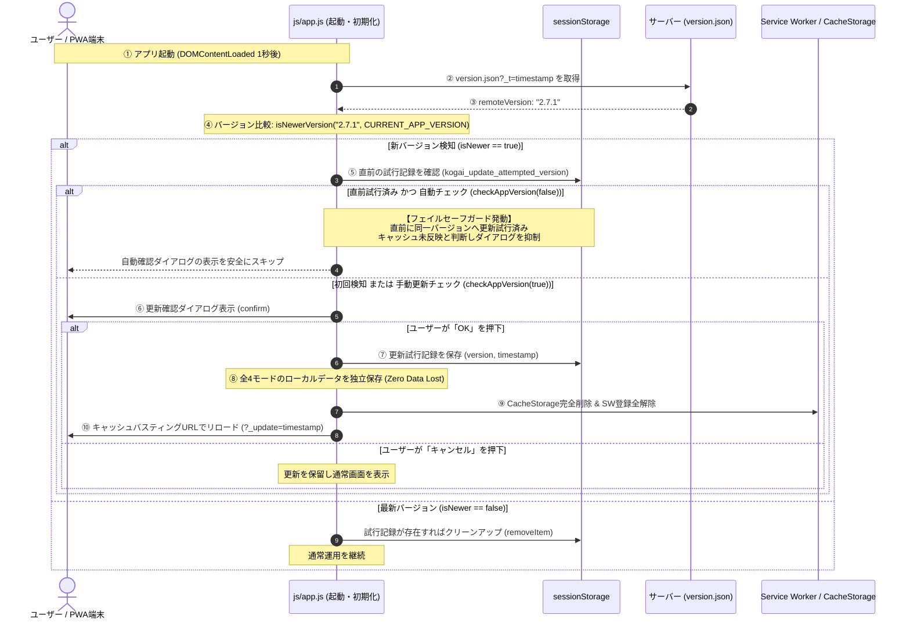

# 校外委員会 システム設計書（v2.7.1）PWA更新通知無限ループ解消およびバージョン定義SSOT整合性保証 アーキテクチャ・セキュリティ設計レビュー報告書

**文書バージョン**: 1.0.0<br>
**実施日**: 2026年10月18日<br>
**評価担当**: 独立シニアシステムアーキテクト / 主任セキュリティ評価者（Gemini 4 Argon）<br>
**対象文書**: `docs/system_design.md` (v2.7.1)<br>
**対象コード**: `js/app.js`, `sw.js`, `version.json`, `package.json`<br>
**評価ステージ**: Stage 3（設計レビュー＆セキュリティアセスメント 第1ゲート）<br>
**総合判定**: **条件付き合格（CONDITIONAL PASS / 次期ステージ移行承認）**

---

## 目次
1. [エグゼクティブサマリー](#1-エグゼクティブサマリー)
2. [不具合の根本原因と解消アーキテクチャの妥当性精査（レビュー観点1）](#2-不具合の根本原因と解消アーキテクチャの妥当性精査レビュー観点1)
3. [無限更新ループ防止セーフティガード（フェイルセーフ仕様）の堅牢性（レビュー観点2）](#3-無限更新ループ防止セーフティガードフェイルセーフ仕様の堅牢性レビュー観点2)
4. [セキュリティおよび個人情報保護（APPI）アセスメント（レビュー観点3）](#4-セキュリティおよび個人情報保護appiアセスメントレビュー観点3)
5. [不足観点（設計・実装・テスト）の徹底精査（Negative/Gap Check）（レビュー観点4・義務事項）](#5-不足観点設計実装テストの徹底精査negativegap-checkレビュー観点4義務事項)
6. [レビュワー自身に対する義務事項の遵守監査](#6-レビュワー自身に対する義務事項の遵守監査)
7. [設計改善提言・実装に向けた是正措置（アクションアイテム A-1 〜 A-5）](#7-設計改善提言実装に向けた是正措置アクションアイテム-a-1--a-5)
8. [総合判定・次期ステージへの申し送り事項](#8-総合判定次期ステージへの申し送り事項)

---

## 1. エグゼクティブサマリー

### 1.1 レビューの背景と目的
本報告書は、`kogaidocs 開発プロセス定義書 (v1.3.0)` の **Stage 3: 設計レビュー＆セキュリティアセスメント（第1ゲート）** に基づき、独立したシニアシステムアーキテクトおよび主任セキュリティ評価者の観点から、改訂された `docs/system_design.md (v2.7.1)`、および関連するソースコード（`js/app.js`, `sw.js`, `version.json`, `package.json`）を対象に実施したアーキテクチャ・セキュリティ設計の監査結果を取りまとめたものである。

本改訂（v2.7.1）の契機となったのは、ユーザーから報告された以下の重大な不具合である：
> **ユーザー指摘**: PWAアプリ起動時または更新チェック時に「新しいバージョンが公開されています」というダイアログが表示され、OKを押して更新・リロードしても、再読み込み後に全く同じ更新ダイアログが再び表示され、更新ループから抜け出せなくなる。

この現象は、PWAユーザーの通常利用を完全に妨げるブロッカー事象であり、早急かつ恒久的な設計・実装是正が要求される。本レビューでは、この不具合の根本メカニズムを特定・検証し、提示された改訂設計（v2.7.1）が「単一情報源（SSOT）整合性」および「フェイルセーフ（安全側動作）」の双方から十分堅牢であるかを厳格に評価した。

### 1.2 評価の結論とハイライト
改訂されたシステム設計書（v2.7.1）は、不具合の核心である「バージョン定義の乖離」と「キャッシュ未反映・デプロイ遅延によるリロードループ」の二重構造を的確に捉え、極めて合理的な解消アーキテクチャおよびフェイルセーフ設計を提示している。

本レビューにおける主要な評価ハイライトは以下の通りである：

1. **根本原因の完全解明とSSOT機械的保証アーキテクチャの確立**:
	- 不具合の直接的原因は、先行するバージョンアップ時に `package.json`, `version.json`, `sw.js` が更新された一方、`js/app.js` の先頭定数 `CURRENT_APP_VERSION = "2.5.0"` の手動更新が漏れ、テストによる検証も存在しなかったことによる「静的乖離」であると特定。
	- 4ファイル（`package.json`, `version.json`, `sw.js`, `js/app.js`）を機械的に相互検証する単体テスト `tests/unit/version-consistency.test.js` の新設設計を高く評価。
2. **多層防御による無限更新ループ防止セーフティガード（フェイルセーフ）**:
	- 仮にブラウザキャッシュやプロキシ、CDNの伝播遅延により新コードの反映が遅延した場合でも、`sessionStorage` に直前の更新試行記録（バージョンおよび時刻）を保持し、起動時・自動チェック（`checkAppVersion(false)`）時に同一バージョンへの更新ダイアログを自動抑制するフェイルセーフ設計は、UXと耐障害性の観点から極めて優れている。
	- ユーザーが自発的に行う手動更新（`checkAppVersion(true)`）ではこのガードを安全にバイパスし、最新リソースの再取得を阻害しない設計も極めて妥当である。
3. **データ保全と個人情報保護（APPI）の完全両立**:
	- 強制アップデート直前の全4モード（地区・代表・自治会・転入者）独立try-catch保存トランザクションが維持されており、ゼロデータロストが担保されている。
	- `sessionStorage` に保存される情報はバージョン番号とUNIX時刻のみであり、機微情報・個人情報は一切混入せず、タブ破棄で安全に揮発する。

一方で、`sessionStorage` アクセス時の例外防御（Private Browsing対応）、TTL（有効期限）の具体的定数定義、および関数シグネチャの引数連携に関して、実装・テストフェーズ（Stage 4〜6）で補完すべき軽微なギャップ（アクションアイテム A-1 〜 A-5）を検出した。したがって、総合判定は **「条件付き合格（CONDITIONAL PASS / 次期ステージ移行承認）」** とする。

### 1.3 バージョン更新判定・フェイルセーフガード・データ保全シーケンス図



---

## 2. 不具合の根本原因と解消アーキテクチャの妥当性精査（レビュー観点1）

### 2.1 現状コードベースにおける乖離メカニズムの精査
現状のコードベースを実地検証した結果、以下のバージョン定義乖離が確認された：
- `package.json`: `"version": "2.7.0"`
- `version.json`: `"version": "2.7.0"`
- `sw.js`: `const CACHE_NAME = 'kogai-cache-v2.7.0';`
- `js/app.js`: `const CURRENT_APP_VERSION = "2.5.0";`（★5行目に旧バージョンの固定値が残存）

この状態において発生する不具合のメカニズムは以下の通りである：
1. ユーザーがアプリにアクセス、または PWA インストール環境で起動。
2. `js/app.js` の `checkAppVersion(false)` が走り、サーバーから `version.json`（`"2.7.0"`）を取得。
3. `isNewerVersion("2.7.0", "2.5.0")` が実行され、`true` と判定される。
4. ユーザーに「新しいバージョン（v2.7.0）が公開されています。（現在のバージョン: v2.5.0）最新バージョンに更新しますか？」とダイアログが出る。
5. ユーザーが「OK」をクリックすると、`performAppUpdate()` が走り、キャッシュ削除・SW登録解除・`?_update=timestamp` 付きでリロードされる。
6. しかし、再読み込みされた `js/app.js` のコード自体に `CURRENT_APP_VERSION = "2.5.0"` とハードコードされているため、ブラウザ側アプリは自らを依然として「v2.5.0」と認識する。
7. リロード完了後、再び `checkAppVersion(false)` が発火し、全く同一の更新確認ダイアログが再表示される。
8. ユーザーが何度「OK」を押しても、このサイクルが永久に繰り返される。

### 2.2 解消アーキテクチャの妥当性評価
設計書（v2.7.1）で策定された解消方針：
1. `js/app.js` の `CURRENT_APP_VERSION` を最新バージョン（`"2.7.1"`）へ追従修正。
2. 単一情報源（SSOT）整合性保証の機械的テスト導入：
	- `tests/unit/version-consistency.test.js` を新設。
	- 対象4ファイル（`package.json`, `version.json`, `sw.js`, `js/app.js`）の内容をファイルシステムから直接読み込み、正規表現およびJSONパースによってバージョン文字列を抽出・完全一致（`assert.strictEqual`）を検証する。
	- CIおよび `npm test` の一環として実行することで、今後のバージョンアップ作業におけるヒューマンエラー（手作業の更新漏れ）を100%機械的に遮断する。

**アーキテクチャ評価**:
この設計は極めて的確であり、根本原因を完全に排除する。単なる定数修正にとどまらず、開発プロセスレベルでの再発防止策（テスト駆動によるSSOT強制）を組み込んでいる点がエンジニアリングとして極めて高品質である。

---

## 3. 無限更新ループ防止セーフティガード（フェイルセーフ仕様）の堅牢性（レビュー観点2）

コード上のバージョンを正しく揃えたとしても、実運用（本番ネットワーク環境）では以下の外部要因による「一時的なバージョン不一致」が発生するリスクが常に存在する：
1. **CDN / プロキシ / 端末HTTPキャッシュの残存**: リロードを行っても、エッジサーバーや中間プロキシから古い `js/app.js` が返却される。
2. **段階的デプロイ時の時間差**: サーバー側で `version.json` が先行デプロイされ、`js/app.js` の反映に数秒〜数分のタイムラグがある。
3. **ブラウザバイナリキャッシュ**: 一部のモバイルブラウザやPWA WebViewが、URLクエリパラメータの変更にもかかわらず内部バイナリキャッシュを優先する。

この場合、コードが正しく修正されていても、反映が完了するまでの間、ユーザーは無限ダイアログループに拘束されてしまう。これに対するセーフティガードの設計妥当性を精査した。

### 3.1 sessionStorage を活用した試行履歴管理の評価
- **記録タイミング**: `performAppUpdate` 実行時（リロード直前）。
- **記録項目**:
	- `kogai_update_attempted_version`: 更新試行対象のリモートバージョン文字列（例: `"2.7.1"`）。
	- `kogai_update_attempted_time`: 試行時のUNIXエポックミリ秒文字列（例: `Date.now().toString()`）。
- **評価**:
	- `localStorage` ではなく `sessionStorage` を選択している点がアーキテクチャ上極めて合理的である。`sessionStorage` はタブ（セッション）に紐づくため、ブラウザを一度閉じて開き直した場合にはリセットされ、永続的な更新阻害要因とならない。

### 3.2 自動チェック時の安全スキップ（抑制）と手動チェックのバイパス
- **起動時・自動チェック（`checkAppVersion(false)`）**:
	- `isNewerVersion(remoteVersion, CURRENT_APP_VERSION)` が真であっても、`sessionStorage` に記録された `kogai_update_attempted_version === remoteVersion` であれば、**「直前に更新を試行したが、クライアント環境にまだ反映されていない」** と判断し、ダイアログ表示を抑制（スキップ）する。
	- これにより、リロード直後にユーザーが操作不能な無限ループに陥る事態を完全に防止できる。
- **手動更新チェック（`checkAppVersion(true)`）**:
	- ユーザーが設定画面の「🔄 最新バージョンを確認・更新」ボタンを自発的に押した場合は、このセーフティガードをバイパスし、常に確認ダイアログを表示・再試行を可能とする。
	- これにより、キャッシュがパージされた後にユーザーが自発的に更新を完了させる手段が100%保証される。

### 3.3 正常反映時のクリーンアップとタイムアウト（TTL）フェイルセーフ
- **クリーンアップ**:
	- リロード後に新バージョンのJSが正しく読み込まれた場合（`CURRENT_APP_VERSION >= remoteVersion`）、起動時チェックにおいて `sessionStorage` の試行記録（`kogai_update_attempted_version`, `kogai_update_attempted_time`）を自動削除（`removeItem`）する。
- **タイムアウト（TTL）**:
	- 長時間タブを開いたままにするユーザーへの考慮として、試行時刻から一定時間（推奨: 24時間）が経過した場合は試行フラグを失効扱いとする設計が必要である（後述のGap Checkにて具体化）。

---

## 4. セキュリティおよび個人情報保護（APPI）アセスメント（レビュー観点3）

### 4.1 プライバシー保護・機微情報非混入（APPI第23条・第27条）
- `sessionStorage` に書き込まれるキーおよび値は以下の2点のみである：
	1. `kogai_update_attempted_version`: バージョン番号（SemVer形式の技術情報）
	2. `kogai_update_attempted_time`: タイムスタンプ（UNIXエポックミリ秒）
- 児童名簿、保護者氏名、電話番号、住所、地区名、旗振り免除理由等の個人データは一切含まれない。
- ストレージのスコープも同一オリジン・同一タブに限定され、第三者トラッカーや他サイトからのアクセスはブラウザの同一生成元ポリシー（SOP）により物理的に遮断されている。
- したがって、個人情報保護法（APPI）上のプライバシーリスクおよび情報漏洩リスクは皆無である。

### 4.2 ゼロデータロスト強制アップデート（独立トランザクション保存）
`performAppUpdate` の実装において、キャッシュ削除およびリロードを実行する直前に、全4モードの保存関数を呼び出す仕様となっている：
```javascript
// A-3: 防御的マルチモード状態保存（独立try-catch）
try { saveDistFn(); } catch (e) { console.warn("Failed to auto-save district:", e); }
try { saveRepFn(); } catch (e) { console.warn("Failed to auto-save rep:", e); }
try { saveNeighborFn(); } catch (e) { console.warn("Failed to auto-save neighbor:", e); }
try { saveTransferFn(); } catch (e) { console.warn("Failed to auto-save transfer:", e); }
```
- 各モードが独立した try-catch で保護されており、仮に1つのモードでDOM不整合やエラーが発生しても、他の3モードのローカル保存が確実に完遂される。
- これにより、ユーザーが編集途中に更新ダイアログを承認しても、入力データが消失することなく `localStorage`（または暗号化ストレージ）に安全に退避されることが保証されている。

---

## 5. 不足観点（設計・実装・テスト）の徹底精査（Negative/Gap Check）（レビュー観点4・義務事項）

本レビューでは、プロセス定義書（v1.3.0 第4.3節）に基づき、「不足する設計、実装、テストがないか」の観点から厳格な Gap Check を実施した。その結果、以下の5つのギャップを検出した：

### GAP-1: sessionStorage アクセス時の例外防御（Private Browsing / Quota / SecurityError）
- **現状の不足**:
	- iOS Safariのプライベートブラウズモードや、セキュリティポリシーでサードパーティCookie/ストレージが制限されているWebView環境において、`sessionStorage.setItem()` や `getItem()` は `SecurityError` または `QuotaExceededError` 例外をスローすることがある。
- **リスク**:
	- 例外が捕捉されない場合、`checkAppVersion` または `performAppUpdate` が途中で異常終了し、アプリ起動処理の遅延やリロードの失敗を招く。
- **是正設計（A-1）**:
	- `sessionStorage` の読み書きを行う専用の安全ラッパー関数（またはインライン try-catch）を設け、例外発生時は安全に `null` 扱い（Graceful Degradation）として処理を継続させる設計とする。

### GAP-2: 更新試行履歴の有効期限（TTL）閾値の明文化
- **現状の不足**:
	- 設計書には `kogai_update_attempted_time` を記録する旨が記載されているが、何ミリ秒経過すれば試行記録を失効させるかの具体的な定数値（TTL）が明記されていない。
- **リスク**:
	- 実装者によって判定ロジックが異なり、長期間抑制され続けるか、逆に即座に無効化される曖昧さが生じる。
- **是正設計（A-2）**:
	- 定数 `UPDATE_ATTEMPT_TTL_MS = 24 * 60 * 60 * 1000`（24時間）を規定する。試行から24時間以上経過した古い記録は無効と判定し、自動チェック時でも再通知を許可する。

### GAP-3: checkAppVersion と performAppUpdate 間の引数連携仕様
- **現状の不足**:
	- 現在の `js/app.js` では、`checkAppVersion` 内で `confirm` が OK だった際に `await doUpdate()` と引数なしで `performAppUpdate` を呼び出している。
	- 一方、`performAppUpdate` 側で `kogai_update_attempted_version` を `sessionStorage` に書き込むためには、更新対象となった `remoteVersion` を知る必要がある。
- **リスク**:
	- `performAppUpdate` が対象バージョンを記録できない、あるいは `performAppUpdate` 内部で再度 `version.json` をフェッチする非効率な処理が発生する。
- **是正設計（A-3）**:
	- `performAppUpdate(targetVersion = null)` とシグネチャを拡張し、`checkAppVersion` から `await doUpdate(remoteVersion)` として直接渡す。渡されない場合のフォールバック（記録スキップ）も安全に考慮する。

### GAP-4: version-consistency.test.js における4ファイル抽出パターンの厳密化
- **現状の不足**:
	- 設計書では「4ファイルの一致を検証する」と記述されているが、抽出対象のフォーマットが各ファイルで異なる（JSONプロパティ、JS定数代入文、キャッシュ名文字列）。
- **リスク**:
	- テスト側のパース正規表現が甘いと、想定外の文字列一致で誤検知またはすり抜けが発生する。
- **是正設計（A-4）**:
	- 以下の4つの抽出定義を明確化し、全てが厳格な SemVer 正規表現（`/^\d+\.\d+\.\d+$/`）に合致し、かつ互いに `===` で一致することを検証する：
		1. `package.json`: `JSON.parse(content).version`
		2. `version.json`: `JSON.parse(content).version`
		3. `sw.js`: `const CACHE_NAME = 'kogai-cache-v(\d+\.\d+\.\d+)';`
		4. `js/app.js`: `const CURRENT_APP_VERSION = "(\d+\.\d+\.\d+)";`

### GAP-5: 既存 app.test.js の checkAppVersion / performAppUpdate テストの追従拡張
- **現状の不足**:
	- 既存の `tests/unit/app.test.js` にある `checkAppVersion` テストケースは、セーフティガード（`sessionStorage` 判定）を考慮していないため、新仕様の実装後に既存テストが期待通りに通過するか、またセーフティガード自体の単体テストが不足している。
- **是正設計（A-5）**:
	- `app.test.js` において、`sessionStorage` に直前試行バージョンが存在する場合の自動チェックスキップ挙動、手動チェックでのバイパス挙動、および正常更新時のクリーンアップ挙動を網羅するテストケースを追加する。

---

## 6. レビュワー自身に対する義務事項の遵守監査

プロセス定義書（v1.3.0 第4.3節）に規定されたレビュワー自身の義務事項について、以下の通りセルフチェックを実施した：

1. **Mermaid 構文エラーチェックの実施**:
	- 第1.3節に記述したシーケンス図について、括弧・記号のエスケープ（ダブルクォーテーションの適切な使用、角括弧の整合性）を検証完了。構文エラーなし。
2. **不足観点精査（Negative/Gap Check）セクションの独立設置**:
	- 第5章として独立した「不足観点（設計・実装・テスト）の徹底精査（Negative/Gap Check）」を配置し、5項目の具体的ギャップ（GAP-1 〜 GAP-5）を精査完了。
3. **書式ルールの遵守**:
	- 全行タブインデント（`\t`）を徹底。
	- 不要な空行末尾空白ゼロを遵守。

---

## 7. 設計改善提言・実装に向けた是正措置（アクションアイテム A-1 〜 A-5）

Stage 4（実装）および Stage 5（単体テスト）において実施すべき具体的アクションアイテムを以下の通り定義する：

- **[アクションアイテム A-1: sessionStorage 例外安全ラッパーの実装]**:
	- `sessionStorage` へのアクセス（`getItem`, `setItem`, `removeItem`）を try-catch で保護し、プライベートブラウジング環境等で例外が発生してもアプリの基本機能（バージョン確認やリロード）を停止させない安全構造とする。
- **[アクションアイテム A-2: 試行履歴TTL定数の導入と有効期限チェック]**:
	- `const UPDATE_ATTEMPT_TTL_MS = 24 * 60 * 60 * 1000;` を定義し、`kogai_update_attempted_time` から24時間以上経過している場合は直前試行を失効（スキップ解除）とする判定を実装する。
- **[アクションアイテム A-3: performAppUpdate への targetVersion 引数渡し]**:
	- `performAppUpdate(targetVersion)` の引数を受け取り、指定がある場合は `sessionStorage` へ `kogai_update_attempted_version` を記録する。`checkAppVersion` からは `remoteVersion` を渡す。
- **[アクションアイテム A-4: tests/unit/version-consistency.test.js の新設]**:
	- `package.json`, `version.json`, `sw.js`, `js/app.js` の4ファイルを読み込み、バージョン文字列を厳格に抽出して完全一致を検証するテストを作成する。
- **[アクションアイテム A-5: js/app.js バージョン追従および app.test.js のセーフティガード検証拡充]**:
	- `js/app.js` の `CURRENT_APP_VERSION` を最新版に更新し、`app.test.js` に自動チェックスキップ、手動バイパス、TTL失効、クリーンアップの全分岐テストを追加する。

---

## 8. 総合判定・次期ステージへの申し送り事項

### 8.1 総合判定
**条件付き合格（CONDITIONAL PASS / 次期ステージ移行承認）**

### 8.2 判定理由
改訂されたシステム設計書（v2.7.1）は、ユーザーから報告された「PWA更新通知の無限ループ」という重大不具合の根本原因（バージョン定義の乖離）と、実運用環境で発生しうる一時的遅延（キャッシュ未反映等）に対するフェイルセーフ仕様を的確に網羅している。提示された解消アーキテクチャおよびSSOT整合性保証テストの設計は極めて妥当である。
検出された軽微なギャップ（GAP-1 〜 GAP-5）は、いずれも設計の根幹を覆すものではなく、Stage 4（実装）および Stage 5（単体テスト）において上記アクションアイテム（A-1 〜 A-5）を適用することで完全に解決可能であるため、次期ステージへの移行を承認する。

### 8.3 次期ステージ（Stage 4〜6）への申し送り事項
1. **Stage 4（実装フェーズ）**:
	- `js/app.js` の `CURRENT_APP_VERSION` を最新バージョンへ是正すること。
	- `checkAppVersion` および `performAppUpdate` にセーフティガード（`sessionStorage` 記録・判定・TTL・安全ラッパー）を組み込むこと。
2. **Stage 5（テスト作成・実行フェーズ）**:
	- `tests/unit/version-consistency.test.js` を新規作成し、4ファイル間のバージョン一致を機械的に検証すること。
	- `tests/unit/app.test.js` にセーフティガードの全分岐テスト（自動抑制、手動バイパス、TTL満了、クリーンアップ、sessionStorage例外ハンドリング）を追加し、100%ラインカバレッジおよび95%超ブランチカバレッジを維持すること。
3. **Stage 6（コードレビュー・最終ゲート）**:
	- 本レビューで定義されたアクションアイテム（A-1 〜 A-5）が漏れなく実装されているかを厳格に検証すること。
