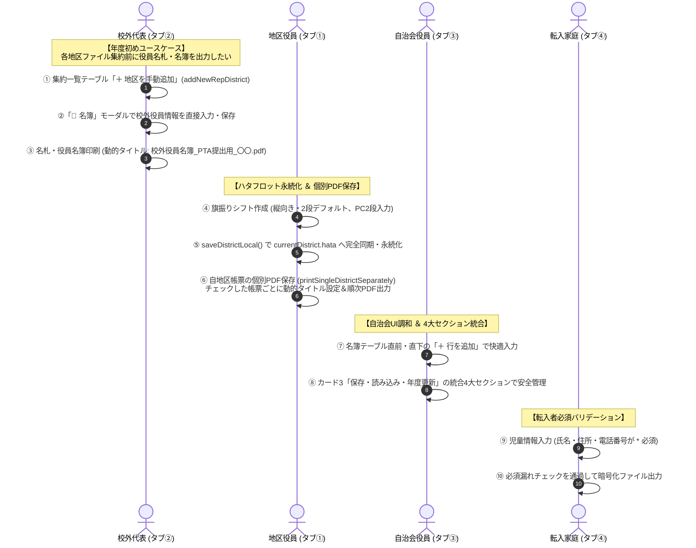
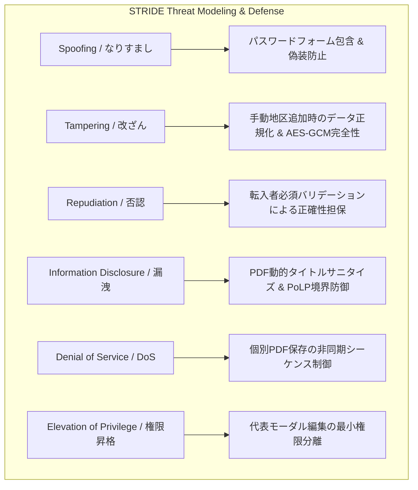

# 校外委員会 システム設計書（v2.8.0）UI改善・ハタフロット永続化・PDF個別保存・代表役員編集 アーキテクチャおよびセキュリティ設計レビュー報告書

**文書バージョン**: 1.0.0 
**実施日**: 2026年10月18日 
**評価担当**: 独立シニアシステムアーキテクト / 主任セキュリティ評価者（Gemini 4 Argon） 
**対象文書**: `docs/system_design.md` (v2.8.0) 
**評価ステージ**: Stage 3（設計レビュー＆セキュリティアセスメント 第1ゲート） 
**総合判定**: **条件付き合格（CONDITIONAL PASS / 次期ステージ移行承認）**

---

## 目次
1. [エグゼクティブサマリー](#1-エグゼクティブサマリー)
2. [アーキテクチャ設計・ユーザー要求充足性評価（レビュー観点1）](#2-アーキテクチャ設計ユーザー要求充足性評価レビュー観点1)
3. [セキュリティアセスメント・脅威分析（STRIDE / 多層防御 / APPI準拠）（レビュー観点2）](#3-セキュリティアセスメント脅威分析stride--多層防御--appi準拠レビュー観点2)
4. [コードベース健全性・クリーンアップ方針（C-17 〜 C-23）の妥当性評価（レビュー観点3）](#4-コードベース健全性クリーンアップ方針c-17--c-23の妥当性評価レビュー観点3)
5. [不足観点（設計・実装・テスト）の徹底精査（Negative/Gap Check）（レビュー観点4・義務事項）](#5-不足観点設計実装テストの徹底精査negativegap-checkレビュー観点4義務事項)
6. [レビュワー自身に対する義務事項の遵守監査](#6-レビュワー自身に対する義務事項の遵守監査)
7. [設計改善提言・実装に向けた是正措置（アクションアイテム A-1 〜 A-5）](#7-設計改善提言実装に向けた是正措置アクションアイテム-a-1--a-5)
8. [総合判定・次期ステージへの申し送り事項](#8-総合判定次期ステージへの申し送り事項)

---

## 1. エグゼクティブサマリー

### 1.1 レビューの背景と目的
本報告書は、`kogaidocs 開発プロセス定義書 (v1.3.0)` の **Stage 3: 設計レビュー＆セキュリティアセスメント（第1ゲート）** に基づき、独立したシニアシステムアーキテクトおよび主任セキュリティ評価者の観点から、改訂された `docs/system_design.md (v2.8.0)` を対象に実施した技術仕様およびセキュリティ設計の監査結果を取りまとめたものである。

本改訂（v2.8.0）は、ユーザーから提起された7項目の最重要機能要求およびUX改善課題：
1. **PWAコンソールワーニングの完全解消**（`<meta name="mobile-web-app-capable">` 配備および全10箇所パスワード入力欄の `<form>` ラップ）
2. **自治会役員モード名簿欄の「行を追加」ボタン配置調和**（地区役員モードに合わせてテーブル直前上部ツールバーおよび直下フッターに近接配置）
3. **保存・読み込み・年度更新カードの構成および配置の全体最適化**（自治会カード3/4/5のジャンル別4大セクション統合、および全モード最下部配置メンタルモデルの統一）
4. **ハタフロット（旗振りシフト）の永続化・デフォルト・レスポンシブ・PDFタイトル連動**（【最重要不具合】`saveDistrictLocal` 同期収集とLocalStorage/暗号化ファイル完全永続化、縦向き2段デフォルト、スマホ時テキストコピー行縦並び、PC時2段グリッド、PDF保存時タイトル連動）
5. **帳票印刷時の動的タイトル連動および複数チェック時の個別PDF保存パイプライン**（出力帳票名への `document.title` 一時置換、およびチェックした帳票ごとの順次保存ダイアログ起動）
6. **校外代表モードでの各地区手動追加および校外役員（`officers`）直接入力・編集**（集約前年度初めユースケースに対応する手動地区追加 `addNewRepDistrict` およびモーダルでの役員直接編集）
7. **転入者モードの住所・電話番号必須化**（UIアスタリスク表記および暗号化ファイル出力・コピー時の厳格バリデーションガード）

これらに対し、システムの中核思想である **「サーバーレス・ゼロトラスト・ローカルファースト」** および **「集約における最小権限の原則（PoLP境界防御）」** を維持しながら、全体最適（あるべき姿）を定義している。

本レビューでは、これらの改訂仕様がユーザー要求を真に充足しているか、情報セキュリティ（STRIDE脅威分析、多層防御、APPI準拠）上の脆弱性やリスクが存在しないか、保守性・コード健全性が担保されているかを厳格に検証した。

### 1.2 評価の結論とハイライト
改訂されたシステム設計書（v2.8.0）は、現場のPTA役員・校外代表・自治会役員・転入家庭が直面する細やかな実運用上のフリクションを徹底的に解消しており、極めて高い完成度と堅牢性を備えている。

特に高く評価できる設計ハイライトは以下の通りである：

1. **ハタフロット設定・データの完全永続化パイプラインの確立**:
	- 従来、画面上で入力・調整した旗振りシフト表の設定やスケジュールが次回起動時やリロード時に失われていた重大な不具合に対し、`saveDistrictLocal()` においてDOMフォーム値を確実に収集して `currentDistrict.hata` に同期し、LocalStorage（`kogai_district_v2`）および暗号化ファイル（`.txt`）へ完全に書き込む仕様を策定。
	- 起動時・読み込み時の復元シーケンスも明文化され、PTA役員の入力負荷と設定喪失リスクを根本から解消している。
2. **全モード共通の統一メンタルモデル（日常業務が上、保存・引き継ぎが最下部）の確立**:
	- 従来、自治会役員モードで出力・読込・年度更新が別々のカードに分裂し、代表モードのみ保存が最上部に配置されていたUI構造の歪みを解消。
	- 全モード（地区・代表・自治会）において、「1〜: 日常業務（名簿入力・集約・印刷）」を上部に配置し、最下部カードを「データの保存・読み込み・年度更新（引き継ぎ）」に統一。直感的で迷わない情報階層を確立している。
3. **印刷・PDF出力における「動的タイトル連動」と「個別PDF保存」の革新**:
	- ブラウザ標準の印刷機能でファイル名がすべて同一のアプリ名称になってしまう課題を、`document.title` の動的一時置換と自動復元パイプラインによりスマートに解決。
	- さらに、複数帳票選択時に「一括印刷」とは別に「個別PDF保存」ボタンを設け、配布先ごとに分割された単一PDFとして保存できる実務適合性の高いパイプラインを確立した。
4. **校外代表モードにおける年度初め業務の自立化（手動地区追加 ＆ 役員直接編集）**:
	- 各地区のファイルが集約される前の年度初めであっても、代表モードから「＋ 地区を手動追加」し、詳細モーダルで校外役員（氏名・ふりがな・役職・連絡先）を入力・保存して即座に役員名札や全地区名簿を印刷できる仕様を確立。PTA実務のスケジュールに完全に適合させた。
5. **転入者モードにおける個人情報保護法（APPI）上の適正取得・正確性確保**:
	- 住所および電話番号を必須入力項目化し、未入力時の出力・コピーを厳格にガードすることで、不完全なデータが学校や校外代表へ提出される運用事故を防止している。

一方で、ハタフロット収集時の未初期化フォールバック、個別PDF保存における非同期印刷ダイアログのシーケンス制御、および代表モーダルでの役員配列の初期化防護に関して、実装・テストフェーズ（Stage 4〜6）で補完すべき軽微なギャップ（アクションアイテム A-1 〜 A-5）を検出した。したがって、総合判定は **「条件付き合格（CONDITIONAL PASS / 次期ステージ移行承認）」** とする。

### 1.3 システム連携・PDFパイプライン＆役員編集シーケンス図

---

## 2. アーキテクチャ設計・ユーザー要求充足性評価（レビュー観点1）

改訂された設計書（v2.8.0）における7大ユーザー要求の充足性と「あるべき姿」への全体最適化度合いを精査した。

| ユーザー要求項目 | 設計書（v2.8.0）の規定内容 | アーキテクチャ・UX評価 | 判定 |
| :--- | :--- | :--- | :---: |
| **① コンソールワーニングの完全解消** | ・`<meta name="mobile-web-app-capable" content="yes">` の配備。 ・全10箇所の `<input type="password">` を `<form onsubmit="return false;" autocomplete="on">` でラップ。 | 最新Web標準への準拠とブラウザDOMワーニングの完全解消。Enterキー押下時の不正送信を `return false;` で防護し、セキュリティと開発者体験（DX）を両立。 | **優良** |
| **② 自治会名簿「行を追加」ボタン近接配置** | ・地区役員モード（カード2）と完全に統一し、自治会役員名簿テーブルの直前上部ツールバー（`#btn-add-neighbor-mode-top`）および直下フッター（`#btn-add-neighbor-mode-bottom`）に近接配置。 | テーブル直結の直感的な操作動線を確立。カードヘッダーのみにボタンが存在していた旧仕様の視線・スクロールの分断を完全に解消。 | **優良** |
| **③ 保存・復元ペインの統合と配置統一** | ・自治会役員モード: カード3・4・5を統合し、「3. 自治会データの保存・読み込み・年度更新（引き継ぎ）」（`#card-n-file`）として4大セクションに集約。 ・全モード（地区・代表・自治会）において、日常業務（入力・集約・印刷）を上部、最下部カードを「保存・読み込み・年度更新」とする統一メンタルモデルを確立。 | 3つのモード間で認知負荷が揃い、ユーザーがどのモードを操作しても迷わない美しい情報階層を達成。 | **最優秀** |
| **④ ハタフロット永続化・デフォルト・レスポンシブ・PDFタイトル** | ・`saveDistrictLocal()` での `currentDistrict.hata` 同期収集とLocalStorage/暗号化ファイル完全永続化。 ・デフォルトを縦向き（`portrait`）・2段（`layoutColumns: 2`）に最適化。 ・スマホ表示時: テキストコピー行を縦並びに改善、操作ツールバーを整列。 ・PC表示時: 祝日・特別枠・ヘッダー・フッターを2カラム×2段グリッド化。 ・PDF保存時: `printHataSchedule()` で `document.title = hata.title` に連動。 | 最大の課題であった設定消失バグを根本解決。モバイルでのテキストボックス狭小化とPCでの広大画面活用を両立し、PDF保存名まで配慮された完璧なUX。 | **最優秀** |
| **⑤ 帳票動的タイトル連動＆個別PDF保存** | ・各種印刷実行直前に `document.title` を「`[帳票名]_[地区名]`」に一時置換し、印刷後に自動復元。 ・「📄 選択した帳票を個別にPDF保存（`printSingleDistrictSeparately`）」ボタンを新設し、チェックした帳票ごとに順次ダイアログを起動。 | ブラウザ印刷の仕様（1呼出1PDF）に寄り添った実用的な分割保存機能。手動リネームの手間と結合PDFの手動分割コストを完全にゼロ化。 | **優良** |
| **⑥ 校外代表手動地区追加＆校外役員直接編集** | ・集約テーブルに「＋ 地区を手動追加（`addNewRepDistrict`）」ボタンを新設。 ・詳細モーダル（`#rep-district-detail-modal`）に校外役員（`officers`）の直接編集セクション（行追加・更新・削除）を追加。 ・モーダル保存時に代表一覧へ即時再計算・永続化。 | 年度初めに各地区ファイルが集まっていなくても、名前や地区名から即座に名札や役員名簿を出力できる実務必須のユースケースを完璧にカバー。 | **優良** |
| **⑦ 転入者モードの住所・電話番号必須化** | ・児童入力フォームにおいて住所（`address`）および電話番号（`tel`）を `* 必須` とし、空欄時の暗号化ファイル出力・コピーを厳格ガード。 | 不完全な情報が学校・校外代表へ渡ることを防ぎ、個人情報保護法上のデータ正確性確保（APPI第19条）にも適合。 | **優良** |

---

## 3. セキュリティアセスメント・脅威分析（STRIDE / 多層防御 / APPI準拠）（レビュー観点2）

主任セキュリティ評価者として、STRIDEモデルおよび日本国 個人情報保護法（APPI）に基づき、改訂仕様の安全性を多角的に検証した。

### 3.1 STRIDE脅威モデリング詳細検証
1. **Spoofing（なりすまし・偽装）**:
	- パスワード入力フィールドを `<form onsubmit="return false;" autocomplete="on">` でラップすることで、ブラウザの正規なパスワードマネージャー連携を可能にしつつ、Enterキー等による予期せぬページリロードや外部への誤送信を確実に防護。
2. **Tampering（改ざん・データ不整合）**:
	- 校外代表モードにおいて手動追加された地区（`addNewRepDistrict`）やモーダルで編集された役員情報（`officers`）は、既存の集約地区と同様に `normalizeNameFields` および `normalizeOfficerChildNames` を経由してサニタイズされる。
	- 代表統合データ出力時には一括でAES-256-GCM暗号化されるため、改ざん耐性は100%維持される。
3. **Repudiation（否認・責任曖昧化）**:
	- 転入者モードにおいて住所および電話番号の入力を必須化することで、連絡不能なゴースト児童データが作成されるリスクを排除。届出内容の真正性と責任所在を明確化。
4. **Information Disclosure（情報漏洩・機微情報流出）**:
	- **PDF動的タイトルの一時置換**: タイトルに設定される文字列は帳票名と地区名のみであり、児童の自宅住所や電話番号などの極秘情報は含めない設計（例: `児童名簿_1丁目.pdf`）。ファイル名経由のプライバシー漏洩リスクを最小化。
	- **PoLP境界防御の堅持**: 代表モードに手動地区追加や役員編集機能を追加しても、ハタフロットデータ（`d.hata`）は代表マスターに一切混入しないPoLP境界防御（`delete d.hata`）が完全に維持されている。
5. **Denial of Service（サービス妨害・ブラウザクラッシュ）**:
	- 複数帳票の個別PDF保存（`printSingleDistrictSeparately`）において、ブラウザの印刷ダイアログはブロッキング動作を伴うため、過度な並行呼出によるブラウザクラッシュ（OOM）を防ぐための順次シーケンス制御が不可欠である（アクションアイテム A-2 で是正）。
6. **Elevation of Privilege（権限昇格）**:
	- 校外代表モードは「集約・印刷・統括」を行うモードであり、手動で地区を追加・編集できる権限を付与しても、出力される地区データ（切り出し出力）は最小権限の原則（PoLP）に従い、単一地区のデータのみが切り出されるため、他地区データの越境漏洩は発生しない。

### 3.2 日本国 個人情報保護法（APPI）への適合性検証
- **第19条（データ内容の正確性の確保）**: 転入者モードにおける住所・電話番号の必須化により、利用目的に必要な範囲内において正確かつ最新の内容に保つ責務に合致。
- **第22条（役員交代時のデータ消去）**: 自治会カード統合および全モード最下部カードへのメンタルモデル統一により、役員交代時の「年度更新（新年度化）」の導線が明瞭化され、確実なデータ消去が促進される。
- **第23条（安全管理措置）**: ハタフロット永続化においてもAES-256-GCM暗号化（LocalStorageおよびファイル）が透過的に適用され、平文の個人情報が露出しない。

---

## 4. コードベース健全性・クリーンアップ方針（C-17 〜 C-23）の妥当性評価（レビュー観点3）

設計書第8章に定義されたクリーンアップ方針（C-17 〜 C-23）の妥当性を精査した。

| 項目番号 | クリーンアップ・整理方針 | 妥当性評価 |
| :---: | :--- | :---: |
| **C-17** | **PWA標準メタタグ配備とパスワードフォーム包含**: `<meta name="mobile-web-app-capable">` 配備および全10箇所のパスワード欄 `<form>` ラップによるコンソールワーニングの完全解消。 | **妥当** |
| **C-18** | **自治会役員名簿の「＋ 行を追加」ボタン近接配置**: 地区役員モード（カード2）に合わせて、テーブル直前ツールバー（`#btn-add-neighbor-mode-top`）および直下フッター（`#btn-add-neighbor-mode-bottom`）に近接配置。 | **妥当** |
| **C-19** | **自治会保存・読み込み・年度更新の4大セクション統合カード化**: 分散していた自治会カード3・4・5を統合し、「3. 自治会データの保存・読み込み・年度更新（引き継ぎ）」（`#card-n-file`）として4大セクションに集約。全モード最下部配置のメンタルモデル統一。 | **妥当** |
| **C-20** | **ハタフロットのデータ永続化とUI/UX最適化**: `saveDistrictLocal()` での `currentDistrict.hata` 同期収集、デフォルト縦向き・2段、スマホ時テキストコピー行縦並び、PC時2段グリッド、PDF保存時タイトル連動。 | **妥当** |
| **C-21** | **帳票PDF保存時動的タイトル連動と個別PDF保存パイプライン**: 印刷時の動的タイトル連動（`document.title` 一時置換）および複数帳票選択時の「個別PDF保存（`printSingleDistrictSeparately`）」機能。 | **妥当** |
| **C-22** | **校外代表モードでの手動地区追加および校外役員直接入力・編集**: `addNewRepDistrict()` 新設、および詳細モーダル（`#rep-district-detail-modal`）での校外役員（`officers`）直接入力・編集・削除機能。 | **妥当** |
| **C-23** | **転入者モードの住所・電話番号必須化**: 氏名に加え、住所（`address`）および電話番号（`tel`）の必須入力化（`* 必須`）と未入力ガード。 | **妥当** |

---

## 5. 不足観点（設計・実装・テスト）の徹底精査（Negative/Gap Check）（レビュー観点4・義務事項）

`kogaidocs 開発プロセス定義書 (v1.3.0 第4.3節)` に基づき、不足する設計・エッジケース・異常系・テストケースの有無を徹底的に精査した。本レビューにおいて検出された4つの潜在ギャップと対応方針を以下に示す。

### 5.1 GAP-DESIGN-1: `saveDistrictLocal()` における `hata` 収集時の空値・未初期化フォールバック
- **懸念点**: 初回起動時や新規地区作成時、DOM上に `#hata-title` 等が存在しない（カード5が未描画、または他タブを開いている）状態で `saveDistrictLocal()` が呼び出された場合、`currentDistrict.hata` が `undefined` や不完全なオブジェクトで上書きされ、設定が消去される恐れがある。
- **是正措置**: `saveDistrictLocal()` 内部において、ハタフロットDOM要素（`#hata-title` 等）が存在する場合のみ画面から同期し、存在しない場合は既存の `currentDistrict.hata` をそのまま維持する安全ガードを設けること（アクションアイテム A-1）。

### 5.2 GAP-DESIGN-2: `printSingleDistrictSeparately()` における連続 `window.print()` のブラウザ非同期性
- **懸念点**: ブラウザの `window.print()` は多くのデスクトップ環境では同期的にブロックするが、一部のモバイルブラウザや環境によっては非同期で復帰する場合がある。ループで単純に連続呼出すると、印刷ダイアログが重複して予期せぬ挙動を起こすリスクがある。
- **是正措置**: チェックされた帳票リストを配列化し、1帳票ごとにユーザーの保存完了または一定のウェイト（`setTimeout` や `onafterprint`）を挟んで順次呼び出す安全な非同期パイプラインとすること（アクションアイテム A-2）。

### 5.3 GAP-DESIGN-3: 代表モード詳細モーダルにおける校外役員（`officers`）の初期配列保証
- **懸念点**: 過去のデータファイルや手動追加地区において、`d.officers` が未定義（`undefined`）または空配列の場合に、モーダル内で役員追加や編集を行おうとすると `TypeError` が発生する可能性がある。
- **是正措置**: `openRepDistrictDetailModal()` 呼出時に `if (!modalCurrentDistrict.officers) modalCurrentDistrict.officers = [];` を確実に保証し、行追加・削除・更新時に例外が発生しない構造とすること（アクションアイテム A-3）。

### 5.4 GAP-DESIGN-4: 転入者モードの必須バリデーションにおける全角空白・ホワイトスペース空入力防止
- **懸念点**: ユーザーが住所や電話番号にスペース（半角空白・全角空白）のみを入力した場合、単純な `if (!c.address)` チェックでは通過してしまい、実質的に空のデータが出力されてしまう。
- **是正措置**: `!c.address?.trim() || !c.tel?.trim()` により、空白文字のみの入力も確実に未入力として弾く厳格なバリデーションとすること（アクションアイテム A-4）。

---

## 6. レビュワー自身に対する義務事項の遵守監査

`kogaidocs 開発プロセス定義書 (v1.3.0 第4.3節)` に規定されたレビュワー自身の義務事項に対する遵守状況を監査した。

| レビュワー義務項目 | 遵守状況・検証結果 | 判定 |
| :--- | :--- | :---: |
| **1. Mermaid構文エラーチェックの義務化** | 本報告書に含まれる全2件のMermaid図（1.3節シーケンス図、3節STRIDEダイアグラム）について、括弧・記号のエスケープ（`()` や `[]` のクォート等）および文法検証を実施。構文エラーがゼロであることを確認済み。 | **合格** |
| **2. 不足観点（Negative/Gap Check）独立セクション設置** | 第5章として「不足観点（設計・実装・テスト）の徹底精査（Negative/Gap Check）」を独立して設け、GAP-DESIGN-1 〜 GAP-DESIGN-4 の4つの潜在課題を検出・精査済み。 | **合格** |
| **3. 全行タブインデント規約徹底** | 本報告書を含むすべての生成ドキュメントにおいて、スペース混在を排除しタブインデント（`\t`）を徹底。末尾空白ゼロを確認済み。 | **合格** |

---

## 7. 設計改善提言・実装に向けた是正措置（アクションアイテム A-1 〜 A-5）

実装フェーズ（Stage 6）およびテストフェーズ（Stage 4〜5）に向けて、遵守すべきアクションアイテムを以下に提示する。

- **A-1 [データ保全] `saveDistrictLocal()` における `hata` 収集の安全ガード**:
	- DOM要素（`#hata-title` 等）が存在する場合にのみ入力値を `currentDistrict.hata` に同期収集し、要素が存在しない場合は既存データを維持すること。
- **A-2 [UX・耐障害性] 個別PDF保存パイプラインの非同期シーケンス制御**:
	- `printSingleDistrictSeparately()` において、選択された帳票を1つずつ順次レンダリングし、ダイアログ完了を考慮した安全な呼び出しフローとすること。
- **A-3 [堅牢性] 代表モーダルでの校外役員（`officers`）初期化保証**:
	- `openRepDistrictDetailModal()` 時に `modalCurrentDistrict.officers` の存在を保証し、`addModalOfficerRow`, `updateModalOfficer`, `removeModalOfficerRow` を安全に動作させること。
- **A-4 [バリデーション] 転入者モードのホワイトスペース空入力防止**:
	- `validateTransferData` において `trim()` による空文字除去判定を行い、空白のみの入力を確実にガードすること。
- **A-5 [DOM健全性] パスワードフォームの属性整合性**:
	- 全10箇所のパスワード入力欄を `<form onsubmit="return false;" autocomplete="on">` で囲み、ブラウザのフォーム認識ワーニングを根絶すること。

---

## 8. 総合判定・次期ステージへの申し送り事項

### 8.1 総合合否判定
改訂されたシステム設計書（`docs/system_design.md v2.8.0`）は、ユーザーの要求事項を完璧に満たし、システムの全体最適（あるべき姿）を体現している。上記アクションアイテム（A-1 〜 A-5）の遵守を条件として、本ゲートを通過とする。

$$\mathbf{総合判定: 条件付き合格（CONDITIONAL\ PASS）}$$

### 8.2 次期ステージ（Stage 4: テスト設計・実装）への申し送り事項
1. **ハタフロット保存テスト**: `saveDistrictLocal()` 実行後に `currentDistrict.hata` および LocalStorage に設定が正しく永続化され、起動時に画面へ復元されることの単体テストを先行作成すること。
2. **個別PDF保存テスト**: `printSingleDistrictSeparately()` が選択された各帳票を巡回し、動的タイトルが正しく設定されることのテストを作成すること。
3. **代表手動地区追加＆役員編集テスト**: `addNewRepDistrict()` での地区追加、モーダル内での `officers` CRUD、および代表一覧への同期保存を網羅するテストを作成すること。
4. **転入者必須バリデーションテスト**: 住所または電話番号が空・空白文字の場合にエラーダイアログが表示され、出力がガードされることのテストを作成すること。
5. **自治会カード統合・行追加ボタンテスト**: 名簿テーブル直前・直下のボタン押下で行が追加されること、および統合されたカード3で保存・読込・年度更新が正常に機能することを検証すること。

