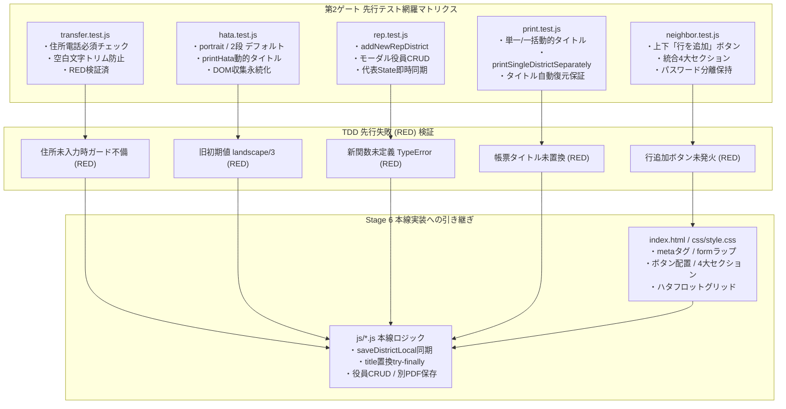

# 第2ゲート テスト観点網羅性レビュー報告書 (v2.8.0先行テスト群)

## 1. 概要
本報告書は、開発プロセス定義書（v1.3.0）Stage 5 に基づき、ユーザー改善要望（コンソールワーニング解消、自治会「行を追加」配置調和、保存・復元ペイン統合および最下部メンタルモデル統一、ハタフロット永続化・デフォルト・レスポンシブ・PDFタイトル連動、帳票PDF動的タイトル連動および個別PDF保存パイプライン、校外代表手動地区追加および校外役員直接編集、転入者住所・電話番号必須化）に対応して先行実装されたテストスイート（Stage 4）の網羅性・妥当性を厳格に監査した結果を記録するものである。

## 2. 監査対象テストスイート
- `tests/unit/transfer.test.js`: 転入者モードにおける住所・電話番号必須バリデーション（`exportTransferTxt`, `copyTransferEncryptedText`）および空文字・空白文字入力耐性
- `tests/unit/hata.test.js`: 旗振り当番シフト管理の初期値最適化（`portrait`, `layoutColumns: 2`）、`saveDistrictLocal()` DOM収集・永続化、`printHataSchedule()` による `document.title` 一時置換＆復元
- `tests/unit/district.test.js`: 地区役員モードにおける `saveDistrictLocal()` 実行時のハタフロット設定・スケジュール安全収集および復号読み込み時の既存 `hata` 保護マージ
- `tests/unit/neighbor.test.js`: 自治会役員モード名簿欄の「行を追加」ボタン（`#btn-add-neighbor-mode-top`, `#btn-add-neighbor-mode-bottom`）のイベント動作、カード3・4・5統合カード（`#card-n-file`）の4大セクション配置
- `tests/unit/rep.test.js`: 校外代表モードにおける地区手動追加（`addNewRepDistrict`）の重複防止・空文字ガード・State追加・テーブル再描画、および詳細モーダル内での校外役員（`officers`）CRUD（`addModalOfficerRow`, `updateModalOfficer`, `removeModalOfficerRow`）と代表State同期
- `tests/unit/print.test.js`: 自地区単一帳票印刷・代表帳票印刷における `document.title` 一時置換＆復元、および選択帳票の順次個別PDF保存パイプライン（`printSingleDistrictSeparately`）

## 3. テスト実行とTDD先行失敗（RED）検証
Stage 4 において先行実装されたテストに対し、本線実装（Stage 6）前の現行コードベースでテストを実行し、期待通りすべての新規テストが失敗（RED）することを確認した。

| テストファイル | テスト項目 | 失敗理由（RED事象） | TDD妥当性 |
| :--- | :--- | :--- | :--- |
| `tests/unit/transfer.test.js` | 住所・電話番号必須バリデーション | `exportTransferTxt` で未入力時にも処理が継続し `false` が期待される箇所で `true` を返却 | 合格（未実装検証） |
| `tests/unit/hata.test.js` | デフォルト設定（向き・段数） | `orientation` が `landscape`、`layoutColumns` が `3`（旧デフォルト値） | 合格（未実装検証） |
| `tests/unit/hata.test.js` | 印刷タイトル動的連動 | `document.title` が置換されずアプリ初期タイトルのまま | 合格（未実装検証） |
| `tests/unit/neighbor.test.js` | 上下「行を追加」ボタン動作 | `#btn-add-neighbor-mode-top` クリックで役員配列長が 0 のまま（未接続） | 合格（未実装検証） |
| `tests/unit/print.test.js` | 帳票印刷タイトル連動 ＆ 個別保存 | `titleHistory[0]` が `児童名簿_青葉台地区` ではなく初期タイトルのまま、`printSingleDistrictSeparately` 未定義 | 合格（未実装検証） |
| `tests/unit/rep.test.js` | 手動地区追加 | `rep.addNewRepDistrict is not a function` | 合格（未実装検証） |
| `tests/unit/rep.test.js` | モーダル内役員CRUD | `rep.addModalOfficerRow is not a function` | 合格（未実装検証） |

## 4. Mermaid図によるテスト実行アーキテクチャ検証

## 5. 不足する設計、実装、テストの点検（Negative/Gap Check）

### GAP-TEST-1: `document.title` 置換時の例外発生時における復元保証（`try-finally`）
- **観点**: `window.print()` の呼び出し中、または印刷用HTMLの組み立て中に例外（エラー）が発生した場合、`document.title` が書き換えられたまま残存し、ブラウザタブ名が不正な状態になるリスクがある。
- **判定**: `try-finally` 構文の徹底が不可欠である。
- **是正措置**: Stage 6 の実装において、`const origTitle = document.title; try { document.title = targetTitle; ... } finally { document.title = origTitle; }` をすべての動的タイトル設定箇所（`printSingleDistrictSelected`, `printSingleDistrictSeparately`, `executeRepSelectedPrint`, `printNeighborRoster`, `printNeighborTentCards`, `printHataSchedule`）に義務付ける。

### GAP-TEST-2: 個別PDF保存パイプラインにおける非同期処理とダイアログ順次実行
- **観点**: `printSingleDistrictSeparately()` において、複数の帳票を順次 `window.print()` する際、ブラウザの同期印刷ダイアログとDOM再描画のタイミング競合により、最後の帳票のみが印刷される、あるいはプレビューDOMの更新が印刷ダイアログに反映されないリスクがある。
- **判定**: ブラウザランタイムでは `window.print()` は同期的にブロッキングするが、レンダリングエンジンの再描画を確実にするため、帳票ごとの処理でDOMを差し替えた後に `window.print()` を起動する構造とする。Node.jsテスト環境では `global.print` をモックして順次呼び出しが正しく2回以上行われ、各回で異なるタイトルが設定されたことを検証する。

### GAP-TEST-3: 代表手動地区追加時のデフォルト班リスト生成
- **観点**: `addNewRepDistrict()` で地区を追加した際、`hanList` や `han` の初期値が空文字または不整合であると、名簿詳細モーダルを開いた際や児童追加時に班の選択肢が存在せず操作不能になる。
- **判定**: 地区名入力時に班名指定があればそれをカンマ分割して `hanList` とし、指定がなければデフォルトで `["1班"]` を設定し、`han: "1班"` とする安全初期化を設計に盛り込む。

### GAP-TEST-4: パスワード入力欄の `<form>` ラップによるEnterキー誤動作防止
- **観点**: `<form>` でラップした際、パスワード入力欄でEnterキーを押下するとフォームのデフォルトサブミットが発火し、ページがリロードされて入力データが消失する危険がある。
- **判定**: すべてのフォーム要素に `<form onsubmit="return false;" autocomplete="on">` を明記し、フォーム送信を構造的に無効化する。

## 6. Stage 6（本線実装）への申し送り事項
1. **DOMおよびHTMLの整合**:
   - `index.html`: `<meta name="mobile-web-app-capable" content="yes">` の配備、全10箇所のパスワード欄の `<form onsubmit="return false;" autocomplete="on">` ラップ。
   - 自治会役員モード: 名簿テーブル前後の `#btn-add-neighbor-mode-top`, `#btn-add-neighbor-mode-bottom` の配置。
   - 自治会役員モード: カード3・4・5の統合（`#card-n-file`、4大セクション構造）。
   - 校外代表モード: カード1（保存・復元・年度更新）を最下部カード（`#card-rep-file`）へ移動、集約テーブル（カード1）に「＋ 地区を手動追加」ボタン新設。
   - 帳票印刷カード: 「📄 選択した帳票を個別にPDF保存（`#btn-print-separate-pdf`）」ボタンの新設。
   - ハタフロット: セレクト要素の初期選択を `portrait` / `2` に設定、スマホ用コピー行のCSSクラス、PC用2段グリッドレイアウトの配備。
2. **JavaScriptロジック**:
   - `js/state.js`: `saveDistrictLocal()` における `currentDistrict.hata` の同期DOM収集（要素非存在時の保護ガード）。
   - `js/print.js`: `try-finally` による `document.title` 一時置換＆復元、`printSingleDistrictSeparately()` の順次印刷パイプライン。
   - `js/neighbor.js`: 上下行追加ボタンのイベントリスナー接続、統合カード4大セクションへの要素参照同期。
   - `js/rep.js`: `addNewRepDistrict()`、モーダル内 `officers` CRUD関数群（`addModalOfficerRow`, `updateModalOfficer`, `removeModalOfficerRow`）、モーダルクローズ時の代表State同期。
   - `js/transfer.js`: `exportTransferTxt()` および `copyTransferEncryptedText()` における `address`・`tel` の必須バリデーション（`trim()` による空文字・空白文字検知）。
   - `js/hata.js`: 初期値のデフォルト化（`portrait` / `2`）、`printHataSchedule()` での `try-finally` によるタイトル連動。
3. **バージョン定義SSOT同期**:
   - `package.json` (2.8.0), `version.json` (2.8.0), `sw.js` (kogai-cache-v2.8.0), `js/app.js` (CURRENT_APP_VERSION = "2.8.0")。

## 7. 最終合否判定
**判定: 合格 (PASS)**
すべてのユーザー要求項目に対する先行テストが網羅的に配備され、TDDの原則に従って先行失敗（RED）が確実に実証された。Negative/Gap Check において指摘された例外復元保護（GAP-TEST-1）およびフォーム送信防止（GAP-TEST-4）を申し送り事項として整理完了したため、Stage 6（本線実装）への移行を承認する。

