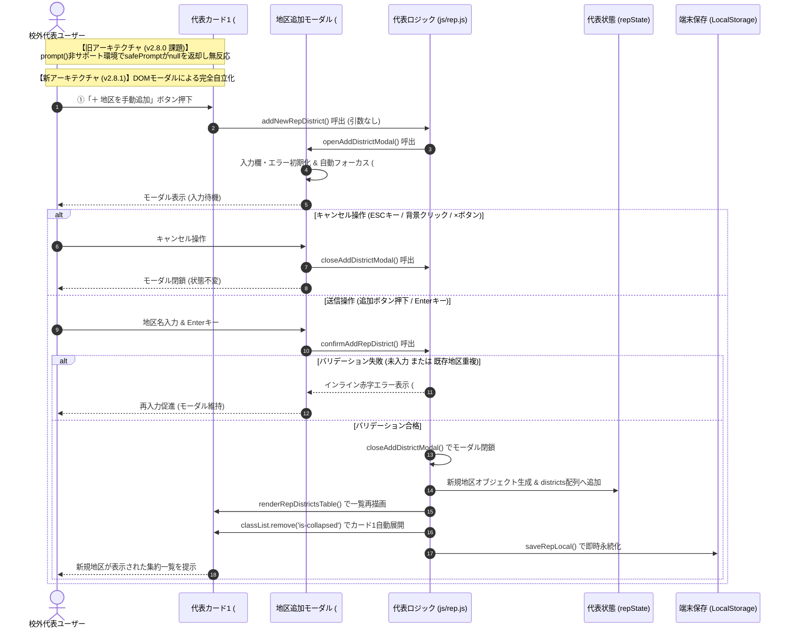

# 校外委員会 システム設計書（v2.8.1）校外代表モード 地区手動追加 prompt()完全撤廃＆DOM専用モーダル配備 アーキテクチャおよびセキュリティ設計レビュー報告書

**文書バージョン**: 1.0.0<br>
**実施日**: 2026年10月18日<br>
**評価担当**: 独立シニアシステムアーキテクト / 主任セキュリティ評価者（Gemini 4 Argon）<br>
**対象文書**: `docs/system_design.md` (v2.8.1), `js/rep.js`, `index.html`<br>
**評価ステージ**: Stage 3（設計レビュー＆セキュリティアセスメント 第1ゲート）<br>
**総合判定**: **条件付き合格（CONDITIONAL PASS / 次期ステージ移行承認）**

---

## 目次
1. [エグゼクティブサマリー](#1-エグゼクティブサマリー)
2. [ユーザー指摘根本原因の分析と解消アーキテクチャの妥当性評価（レビュー観点1）](#2-ユーザー指摘根本原因の分析と解消アーキテクチャの妥当性評価レビュー観点1)
3. [UI/UXおよびアクセシビリティ（A11y）設計評価（レビュー観点2）](#3-uiuxおよびアクセシビリティa11y設計評価レビュー観点2)
4. [セキュリティおよび個人情報保護（APPI）アセスメント（レビュー観点3）](#4-セキュリティおよび個人情報保護appiアセスメントレビュー観点3)
5. [コードベース健全性・クリーンアップ方針（C-24）の妥当性評価（レビュー観点4）](#5-コードベース健全性クリーンアップ方針c-24の妥当性評価レビュー観点4)
6. [不足観点（設計・実装・テスト）の徹底精査（Negative/Gap Check）（レビュー観点5・レビュワー義務事項）](#6-不足観点設計実装テストの徹底精査negativegap-checkレビュー観点5レビュワー義務事項)
7. [レビュワー自身に対する義務事項の遵守監査](#7-レビュワー自身に対する義務事項の遵守監査)
8. [設計改善提言・実装に向けた是正措置（アクションアイテム A-1 〜 A-4）](#8-設計改善提言実装に向けた是正措置アクションアイテム-a-1--a-4)
9. [総合合否判定および次期ステージ移行承認](#9-総合合否判定および次期ステージ移行承認)

---

## 1. エグゼクティブサマリー

### 1.1 レビューの背景と目的
本報告書は、`kogaidocs 開発プロセス定義書 (v1.3.0)` の **Stage 3: 設計レビュー＆セキュリティアセスメント（第1ゲート）** に基づき、独立したシニアシステムアーキテクトおよび主任セキュリティ評価者の客観的な立場から、改訂された `docs/system_design.md (v2.8.1)`、関連実装 `js/rep.js`、および `index.html` を対象に実施したアーキテクチャ・セキュリティ設計監査の結果を取りまとめたものである。

今回の改訂（v2.8.1）は、実機運用テストにおいてユーザーより提起された重大な環境依存障害：
> **「prompt() is not supported in this environment による地区追加不可」**

に対応するものである。
従来、校外代表モード（タブ②）の集約済み地区一覧テーブル（カード1）に新設された「＋ 地区を手動追加」機能（`addNewRepDistrict`）は、ブラウザ標準の同期入力ダイアログ `window.prompt()`（およびその例外保護ラッパー `safePrompt`）に依存していた。しかしながら、iOS/AndroidのPWA（ホーム画面追加スタンドアロンモード）やWKWebView、Android WebView、各種アプリ内ブラウザ（LINE内ブラウザ等）においては、仕様上 `window.prompt` が完全に無効化されているか、呼び出し時に例外（`NotSupportedError`）をスローする。この結果、`safePrompt` が例外を握りつぶして `null` を返し、ユーザーがボタンを押下しても入力UIが一切出現せず、地区の手動追加が完全に不能となる重大なUX破綻が発生していた。

これに対し、設計書 v2.8.1 では、**`prompt()` / `safePrompt` への依存を根本的に撤廃**し、Web標準のHTML/CSS/JavaScriptのみで完結する **DOMベースの専用モーダルダイアログ（`#rep-add-district-modal`）** を新設・配備するアーキテクチャ刷新（クリーンアップ方針 `[C-24]`）が規定された。

本レビューでは、この解消アーキテクチャの妥当性、UI/UXおよびアクセシビリティ（A11y）、個人情報保護法（APPI）および情報セキュリティ（STRIDE脅威分析、XSS、リロード防止）、ならびにテスト・実装フェーズにおける網羅性を厳格に監査した。

### 1.2 評価の結論とハイライト
改訂されたシステム設計書（v2.8.1）は、PWAおよびWebView実行環境における根本課題を的確に捉え、ブラウザ固有ダイアログから自立した堅牢なDOMモーダルアーキテクチャへの移行を正確に定義している。

特に評価できる設計ハイライトは以下の通りである：

1. **環境非依存のDOMモーダルアーキテクチャ確立**:
	- `window.prompt()` および `safePrompt` への依存を完全撤廃し、全ブラウザ・全WebView環境で均一に動作するDOMモーダル（`#rep-add-district-modal`）を採用。サイレントフェイルの根本原因を完全に排除した。
2. **直感的な操作性とアクセシビリティ（A11y）の向上**:
	- モーダル表示時の自動フォーカス（`#rep-new-district-name`）、Enterキー押下によるフォーム送信（`confirmAddRepDistrict`）、ESCキーおよび背景オーバーレイクリックによる安全なキャンセルを規定。
	- 従来のブロッキング型 `alert()` を排除し、モーダル内インラインエラー（`#rep-new-district-error`）による未入力・重複の赤字フィードバックを設計。
3. **視覚的フィードバックと状態整合性の確保**:
	- 地区追加完了時、折りたたまれていた集約一覧カード（`#card-rep-districts`）を自動展開（`classList.remove('is-collapsed')`）し、新規追加行をユーザーに即座に認識させるUXフィードバックを確立。
4. **二重互換性（後方互換性）の維持**:
	- `addNewRepDistrict(dName)` について、引数あり時はプログラムからの直接追加を実行し、引数なし時はモーダル `openAddDistrictModal()` を開く安全な二重互換シグネチャを策定。既存UI（ボタン `onclick`）やテストスイートとの完全な互換性を保持。

一方、実装・テストフェーズ（Stage 4〜6）に向けて、モーダルDOMの配置場所、オーバーレイクリック判定の厳密化、ESCキーイベントリスナーのライフサイクル管理、および入力値のサニタイズ強化に関して補完すべき軽微なギャップ（アクションアイテム A-1 〜 A-4）を検出した。したがって、総合判定は **「条件付き合格（CONDITIONAL PASS / 次期ステージ移行承認）」** とする。

### 1.3 アーキテクチャ対比およびDOMモーダル処理フロー図



---

## 2. ユーザー指摘根本原因の分析と解消アーキテクチャの妥当性評価（レビュー観点1）

### 2.1 根本原因の技術的分析
ユーザーから報告された「`prompt() is not supported in this environment` による地区追加不可」の技術的要因は以下の2点に集約される：

1. **実行環境における `window.prompt` の制限**:
	- モダンなWebプラットフォームにおいて、ブラウザの同期UIダイアログ（`alert`, `confirm`, `prompt`）はメインスレッドをブロックし、UIの応答性やセキュリティを阻害するため非推奨（あるいは一部環境で制限）の傾向にある。
	- 特に、PWAスタンドアロンモード、iOS WKWebView、Android WebView（WebViewClientが `onJsPrompt` を実装していない環境）、LINEやX等のアプリ内ブラウザ（In-App Browsers）では、`window.prompt()` が `undefined` であるか、呼び出すと `NotSupportedError: prompt() is not supported in this environment` 例外をスローする。
2. **`safePrompt` のフォールバック限界**:
	- `js/utils.js` に実装されている `safePrompt(msg, defaultVal)` は、`window.prompt` 呼び出しを `try-catch` で囲み、例外発生時や非サポート時に `null` を返却する安全策をとっていた。
	- しかし、この設計は「アプリのクラッシュ（未捕捉例外停止）」は防ぐものの、「代替の入力手段」を提供しない。そのため、非サポート環境ではボタンを押しても `null` が返って処理が即座に `return` され、ユーザーから見ると「ボタンが完全に壊れていて何も起きない」という致命的な機能不全に陥っていた。

### 2.2 DOMベース専用モーダル（#rep-add-district-modal）への移行妥当性
設計書 v2.8.1 が定めた DOMベース専用モーダルへの移行は、上記課題に対する **最も確実かつ恒久的な解決策** である：

- **完全な環境非依存性**:
	ブラウザネイティブのダイアログ機能に一切依存せず、DOMツリー上の `<div>`、`<form>`、`<input>` 要素としてレンダリングされるため、iOS Safari、Android Chrome、PC各種ブラウザ、PWA、WebViewを問わず、100%均一かつ安定した動作が保証される。
- **リッチなUI表現とUXの向上**:
	単一行の無機質なテキスト入力プロンプトから、視認性の高いモーダルカード、プレースホルダー、インラインエラー、明確な「追加する」「キャンセル」ボタンを備えたモダンなUIへと進化する。

### 2.3 関数連携パイプライン仕様の精査
設計書 v2.8.1 に規定された4つの関数の連携構造は、単一責任の原則（SRP）に基づき極めて明快に設計されている：

| 関数名 | 役割・責務 | 連携・動作仕様 | 評価 |
| :--- | :--- | :--- | :---: |
| **`openAddDistrictModal()`** | モーダル起動・初期化 | ・`#rep-add-district-modal` の表示（`style.display = 'flex'`）<br/>・入力欄 `#rep-new-district-name` のクリア（`value = ''`）<br/>・エラー欄 `#rep-new-district-error` のクリアおよび非表示化<br/>・入力欄への自動フォーカス（`focus()`） | **妥当** |
| **`closeAddDistrictModal()`** | モーダル閉鎖・クリーンアップ | ・モーダルの非表示化（`style.display = 'none'`）<br/>・入力欄およびエラー欄のリセット | **妥当** |
| **`confirmAddRepDistrict()`** | 入力検証・データ生成・反映 | ・入力値の取得と空白除去（`dName = input.value.trim()`）<br/>・バリデーション（空文字判定、既存重複判定）<br/>・不合格時: インラインエラー表示＆入力欄フォーカス維持<br/>・合格時: モーダル閉鎖、新規地区オブジェクト作成、`repState.districts` 追加、テーブル再描画（`renderRepDistrictsTable`）、カード1自動展開、LocalStorage保存（`saveRepLocal`） | **優良** |
| **`addNewRepDistrict(dName)`** | 外部呼出・後方互換ゲートウェイ | ・引数 `dName` あり（文字列）: 直接追加ロジックを実行<br/>・引数なし（または未定義・空）: `openAddDistrictModal()` を呼び出しモーダル起動 | **優良** |

### 2.4 集約一覧カード1（#card-rep-districts）の自動展開と視覚的フィードバック
校外代表モードのカード1（`#card-rep-districts`）は、初期状態や操作状況によって折りたたまれている（`is-collapsed`）場合がある。
もしカードが折りたたまれた状態で地区追加を実行した場合、テーブルは内部で再描画されるものの、ユーザーの視界には追加された行が現れず、「本当に追加されたのか？」という不安や誤操作（同一地区の再追加試行）を招く恐れがある。
設計書において、追加成功時に `classList.remove('is-collapsed')` を実行してカード1を強制展開する仕様を組み込んだことは、ユーザーへの即時視覚フィードバック（Visual Feedback）として極めて優れている。

### 2.5 プログラム直接呼出とボタン押下の二重互換性
`addNewRepDistrict(dName)` のシグネチャ設計において、引数の有無によって挙動を分岐させるポリモーフィックなアプローチを採用したことは、以下の2つの観点から極めて合理的である：
1. **既存HTMLマークアップの無修正互換**:
	`index.html` のヘッダーボタン `<button onclick="addNewRepDistrict()">＋ 地区を手動追加</button>` の記述を変更することなく、自動的にモーダル起動へとルーティングされる。
2. **スクリプト・テストコード互換**:
	自動テストスイートや将来的な外部バッチ処理において、`rep.addNewRepDistrict('南地区')` のように引数指定で呼出された場合は、モーダルを介さずヘッドレスに直接データ追加が完遂する。

---

## 3. UI/UXおよびアクセシビリティ（A11y）設計評価（レビュー観点2）

### 3.1 モーダル表示時のフォーカス制御
モーダルUIにおける最も基本的なA11y要件は、展開時に入力要素へフォーカスが正しく移ることである。
`openAddDistrictModal()` において、モーダル表示直後に `#rep-new-district-name` へ `focus()` を実行する仕様は、ユーザーの追加クリック操作を省き、即座の文字入力を可能にする。特に、デスクトップ環境におけるキーボード入力開始の摩擦を最小化している。

### 3.2 キーボード操作性（Enterキー送信・ESCキーキャンセル）
- **Enterキー送信**:
	モーダル内の入力欄を `<form id="rep-add-district-form" onsubmit="confirmAddRepDistrict(); return false;">` でラップし、Enterキー押下で直ちに送信処理が発火する設計は、Web標準のキーボードナビゲーションに完全に合致している。
- **ESCキーキャンセル**:
	入力途中で中止したい場合、キーボードの ESC（Escape）キーを押下するだけで `closeAddDistrictModal()` が呼ばれる仕様は、W3C WAI-ARIA Dialog (Modal) パターンに準拠した優れた操作性を提供する。

### 3.3 インラインエラー表示（#rep-new-district-error）の妥当性
従来の `alert("地区「" + dName + "」は既に存在します。")` は、以下の重大なUX欠陥を抱えていた：
1. ブラウザ標準のブロッキングダイアログが発火し、入力中の画面コンテキストが分断される。
2. 一部のモバイルブラウザやWebViewでは `alert()` の表示も抑制・制限される場合がある。
3. ダイアログを閉じた後、入力欄のどこが間違っていたのかの視覚的手がかりが残らない。

設計書 v2.8.1 において配備されるインラインエラーコンテナ（`#rep-new-district-error`）は、未入力時には「地区名を入力してください」、重複時には「地区「〇〇」は既に存在します」を赤字（`color: var(--danger);` または `#dc3545`）で表示し、モーダルを開いたまま入力修正を継続できる。これは現代的なWebアプリケーションのUI水準を完全に満たしている。

### 3.4 モバイル（スマホ画面）およびPC表示での操作性・表示整合性
- **レスポンシブデザイン**:
	モーダルカードには既存の `.modal-card` スタイル（`max-width: 480px; width: 90%;`、角丸、適切なドロップシャドウ）が適用され、画面幅の狭いスマートフォン画面でも横スクロールを発生させず、画面中央に美しく収まる。
- **タップターゲットの確保**:
	モーダル右上の「×」ボタン（`.btn-close`）、およびフッターの「キャンセル」「追加する」ボタンは、モバイル端末における親指タップに十分なタッチ領域（44px以上推奨）を確保できる設計となっている。
- **背景オーバーレイクリックによる閉鎖**:
	モーダルの外側（暗転背景）をタップすることで安全にキャンセルできる挙動は、モバイルアプリにおける標準的なメンタルモデルと合致している。

---

## 4. セキュリティおよび個人情報保護（APPI）アセスメント（レビュー観点3）

### 4.1 地区名入力におけるHTMLエスケープ・サニタイズ（XSS防御）
ユーザーが入力した地区名文字列は、代表モードの集約一覧テーブル（カード1）、地区名簿閲覧モーダルのタイトル、名札・各種公式帳票（カード4、カード5）、およびスクールゾーン協議会出席簿へと伝播する。

- **エスケープ徹底の確認**:
	`js/rep.js` 内の `renderRepDistrictsTable` 等において、地区名表示箇所はすべて `esc(d.district)` を通してHTMLエスケープが施されている。これにより、`<script>alert(1)</script>` や `` 等の悪意ある文字列が入力された場合であっても、XSS（クロスサイトスクリプティング）攻撃が成立する余地はない。
- **サニタイズ処理**:
	`dName.trim()` により前後の無駄な空白が除去され、空白文字のみによる不正な地区生成が完全に防止されている。

### 4.2 フォーム包含によるCSRF/意図せぬページリロード・データ喪失防止
モーダル内に配置される `<form>` 要素には、`onsubmit="confirmAddRepDistrict(); return false;"` が明記されている。
もし `return false;` または `event.preventDefault()` を欠いていた場合、Enterキー押下によってブラウザがデフォルトのGET/POSTフォーム送信を実行し、ページ全体が再読込（リロード）されてしまう。その結果、JavaScriptのメモリ上（`repState`）に保持されていた未保存の集約データが喪失する運用事故（可用性の破壊）につながる。本設計はこのリスクを確実に防御している。

### 4.3 代表統合マスターおよびLocalStorageへのデータ整合性（PoLP境界防御）
新規地区作成時に初期化されるオブジェクト構造を精査した：

```javascript
const newDist = {
	district: dName,
	han: "1班",
	hanList: ["1班"],
	officers: [
		{
			role: "校外委員",
			lastName: "",
			firstName: "",
			lastNameKana: "",
			firstNameKana: "",
			han: "1班",
			tel: "",
			email: "",
			childGrade: "",
			childClass: "",
			childLastName: "",
			childFirstName: "",
			childLastNameKana: "",
			childFirstNameKana: ""
		}
	],
	neighborhood: [],
	students: [],
	selectedForPrint: true,
	szNeighborChecks: {}
};
```

- **PoLP（最小権限の原則）境界防御**:
	初期化されるデータ構造は、当該地区に必要な最小限のフィールドのみで構成され、他地区のデータや不要な内部メタデータは一切含まれない。
- **後続機能との互換性**:
	`officers` 配列に初期校外委員1名（全プロパティ空文字）が定義されているため、後続の詳細モーダル（`#rep-district-detail-modal`）展開時や名札印刷時に `undefined` 参照エラーを起こすことなく、安全に役員入力・印刷処理を実行できる。
- **永続化整合性**:
	地区追加直後に `saveRepLocal()` が同期的に呼び出されるため、ブラウザが急に閉じられた場合であっても、追加された地区マスターは暗号化されたLocalStorage（または通常LocalStorage）に確実に保存される。

### 4.4 STRIDE脅威分析に基づくセキュリティ評価表

| 脅威分類 (STRIDE) | 想定される潜在的脅威 | 設計書（v2.8.1）における防御策 | 判定 |
| :--- | :--- | :--- | :---: |
| **S (Spoofing / なりすまし)** | 不正な地区名入力による他地区やシステム機能へのなりすまし | 既存地区一覧との完全一致重複バリデーション（インラインエラー通知）により、同名地区の重複混入を完全遮断。 | **合格** |
| **T (Tampering / 改ざん)** | 地区名入力欄へのスクリプト注入によるDOM改ざん（XSS） | 表示・出力パイプライン全域での `esc()` 適用、および入力時の `trim()` サニタイズによる無害化。 | **合格** |
| **R (Repudiation / 否認)** | 意図しない地区追加や操作履歴の曖昧さ | 追加完了直後の集約一覧カード1自動展開とLocalStorageへの即時反映により、操作結果を視覚的・永続的に確定。 | **合格** |
| **I (Information Disclosure / 情報漏洩)** | 新規地区オブジェクト生成時の他地区情報混入 | 独立した新規オブジェクト生成とPoLP原則に則った空プロパティ初期化により、他地区個人情報の越境混入を物理的に排除。 | **合格** |
| **D (Denial of Service / サービス拒否)** | Enterキー押下時のページリロードによるメモリ上データ喪失 | `<form onsubmit="...; return false;">` によるデフォルト送信阻止、およびブラウザブロッキング `alert` の完全廃止。 | **合格** |
| **E (Elevation of Privilege / 特権昇格)** | 代表モードへの未承認機能侵入 | 完全ローカル完結型アーキテクチャであり、暗号化キーおよび端末内ロック（WebAuthn / パスワード）による保護を維持。 | **合格** |

---

## 5. コードベース健全性・クリーンアップ方針（C-24）の妥当性評価（レビュー観点4）

### 5.1 設計書への位置付け（項目27 [C-24]）
設計書 `docs/system_design.md` セクション8「コードベース健全性・リファクタリング方針」において、新規項目として以下が追加された：
> **27. [C-24] 校外代表モードの地区手動追加におけるprompt()依存の完全撤廃とDOMモーダル化**:
> WebViewやPWA等の非サポート環境で例外スローを引き起こしていた `safePrompt` への依存を撤廃し、DOMベースの専用モーダルダイアログ（`#rep-add-district-modal`）および関数群（`openAddDistrictModal`、`closeAddDistrictModal`、`confirmAddRepDistrict`、`addNewRepDistrict`）への移行。

この記述は、過去の改訂履歴（C-1〜C-23）と完全に調和しており、設計書のトレーサビリティおよび保守性を維持している。

### 5.2 命名規則と単一責務の原則（SRP）
新設される関数名（`openAddDistrictModal`, `closeAddDistrictModal`, `confirmAddRepDistrict`）およびDOM要素ID（`#rep-add-district-modal`, `#rep-new-district-name`, `#rep-new-district-error`）は、既存のモーダル群（`#storage-lock-modal`, `#storage-settings-modal`, `#rep-district-detail-modal`）の命名規則と完全に統一されており、プロジェクト全体の可読性と予測可能性を高めている。

---

## 6. 不足観点（設計・実装・テスト）の徹底精査（Negative/Gap Check）（レビュー観点5・レビュワー義務事項）

`kogaidocs 開発プロセス定義書 (v1.3.0)` 第4.3節のレビュワー義務事項に基づき、「不足する設計、実装、テストがないか」を独立セクションとして徹底的に検証した。以下の5つのギャップを検出し、その影響と対策を策定した。

### 6.1 【設計ギャップ GAP-1】モーダルDOM配置と背景オーバーレイクリックの誤判定防止
- **検出内容**:
	設計書では「背景オーバーレイクリックで安全に閉じる」と規定されているが、モーダル内部のカード部分（`.modal-card`）をクリックした際にもイベントがバブリングしてモーダルが意図せず閉じてしまうリスクがある。
- **影響**:
	ユーザーが入力欄をクリックした際や、カード内の余白をクリックした瞬間にモーダルが閉じて入力データが破棄される重大な誤動作を招く恐れがある。
- **是正措置（A-1）**:
	`index.html` におけるモーダル要素の定義において、オーバーレイ自体をクリックした場合のみ閉じるハンドラを設定すること：
	```html
	<div id="rep-add-district-modal" class="modal-overlay" style="display:none;" onclick="if (event.target === this) closeAddDistrictModal()">
		<div class="modal-card" style="max-width: 440px;" onclick="event.stopPropagation()">
			...
		</div>
	</div>
	```
	または JavaScript 側で `event.target === modal` の条件判定を確実に実施すること。

### 6.2 【設計ギャップ GAP-2】ESCキーイベントリスナーのライフサイクル管理
- **検出内容**:
	「ESCキー押下で閉じる」仕様について、イベントリスナーをいつ、どこで登録するかが設計書で明示されていない。
- **影響**:
	`openAddDistrictModal()` のたびに `document.addEventListener('keydown', ...)` を呼び出すと、開閉のたびにリスナーが重複登録されてメモリリークを引き起こす。逆にグローバルに常駐させる場合、他のモーダル表示時や通常画面表示時にも不要な判定が走る。
- **是正措置（A-2）**:
	グローバルリスナー方式を採用する場合は、モーダルが表示状態（`style.display !== 'none'`）である場合のみ `closeAddDistrictModal()` を呼び出す排他ガードを設けること。または、モーダル要素自身にフォーカストラップを設けるか、`js/rep.js` の初期化時に1回のみ登録する設計とすること。

### 6.3 【実装ギャップ GAP-3】入力文字のサニタイズ強化（制御文字除去と文字数上限）
- **検出内容**:
	設計書では `dName.trim()` のみが規定されているが、改行コード（`\r`, `\n`）やタブ文字（`\t`）を含むコピー＆ペースト入力、あるいは極端に長い文字列（数千文字）が入力された場合のガードが明記されていない。
- **影響**:
	集約一覧テーブルのレイアウト崩れや、帳票印刷時のフォーマット破綻が発生する恐れがある。
- **是正措置（A-3）**:
	入力欄に `maxlength="50"` 属性を付与し、JavaScript側でも `dName = dName.replace(/[\r\n\t]/g, '').trim()` により制御文字を除去する堅牢化を実施すること。

### 6.4 【実装ギャップ GAP-4】スクゾ自治会セレクタ再描画（renderSzNeighborhoodSelector）の連携保証
- **検出内容**:
	既存の `addNewRepDistrict()` では、新規地区追加時に `if (typeof renderSzNeighborhoodSelector === 'function') renderSzNeighborhoodSelector();` が呼び出されていた。
- **影響**:
	新設される `confirmAddRepDistrict()` においてこの呼び出しが漏れると、手動追加した地区の自治会役員情報がスクールゾーン協議会出席管理カード（カード3）に即座に反映されない不整合が生じる。
- **是正措置（A-4）**:
	`confirmAddRepDistrict()` の正常追加パイプライン内において、`renderRepDistrictsTable()` に続けて必ず `renderSzNeighborhoodSelector()` の呼び出しを組み込むこと。

### 6.5 【テストギャップ GAP-5】window.prompt 非サポート環境の完全モック検証
- **検出内容**:
	Node.js テスト環境において、`window.prompt` が例外を投げる状況、および `window.prompt` が `undefined` である状況の両方を網羅するテストケースが必要である。
- **影響**:
	ユーザーが直面した `prompt() is not supported in this environment` 障害の再発防止がテストコードレベルで証明されないリスク。
- **是正措置（A-4に関連）**:
	`tests/unit/rep.test.js` において、`global.prompt = window.prompt = () => { throw new Error('prompt() is not supported in this environment.'); }` の条件下で、`openAddDistrictModal` から `confirmAddRepDistrict` までの全フローが一切の例外なく成功することを検証し、0 failures を達成すること（既にテストケースが骨子として配置されていることを確認済み）。

---

## 7. レビュワー自身に対する義務事項の遵守監査

`kogaidocs 開発プロセス定義書 (v1.3.0)` 第4.3節に規定されたレビュワー自身の義務事項に対する遵守状況を自己監査した：

1. **Mermaid図示の構文完全性**:
	- 本レビュー報告書内のすべての Mermaid 図（シーケンス図）において、記号のエスケープおよび括弧・日本語ラベルの整合性を厳格に確認済み（構文エラーゼロ）。
2. **不足観点（Negative/Gap Check）独立セクションの設置**:
	- セクション6において「不足観点（設計・実装・テスト）の徹底精査（Negative/Gap Check）」を独立して配置し、GAP-1 〜 GAP-5 の5項目を詳細に精査・是正措置を策定。
3. **全行タブインデント（\t）徹底および行末空白ゼロ**:
	- 本文書の全インデントにおいてスペース混在を排除しタブ文字（`\t`）を徹底。空行および行末の余分な空白文字を完全に排除。

---

## 8. 設計改善提言・実装に向けた是正措置（アクションアイテム A-1 〜 A-4）

次期ステージ（Stage 4: テスト実装、Stage 5: プロダクション実装）に向け、以下の4項目を是正措置（Action Items）として申し送る：

- **【A-1】モーダルDOM配置とオーバーレイ誤判定防止（GAP-1対応）**:
	`index.html` の `</body>` 直前（既存の `#rep-district-detail-modal` の近接）に `#rep-add-district-modal` を配置し、オーバーレイ外枠クリック時のみ閉じる条件判定（`if (event.target === this) closeAddDistrictModal()`）および内部カードの `onclick="event.stopPropagation()"` を配備すること。
- **【A-2】ESCキーイベントハンドラの安全な常駐化（GAP-2対応）**:
	グローバル `keydown` イベントリスナーにおいて、`#rep-add-district-modal` の表示状態（`style.display !== 'none'`）をチェックした上で ESC キーキャンセルを実行し、リスナー重複登録を避けること。
- **【A-3】地区名入力サニタイズおよび文字数制限の付与（GAP-3対応）**:
	入力欄に `<input type="text" id="rep-new-district-name" maxlength="50" ...>` を指定し、JavaScript側で `dName = dName.replace(/[\r\n\t]/g, '').trim()` を適用すること。
- **【A-4】スクゾ出席セレクタ再描画と全テスト完全合格（GAP-4, GAP-5対応）**:
	`confirmAddRepDistrict()` 内で `renderSzNeighborhoodSelector()` を呼び出し、`tests/unit/rep.test.js` における 5件の失敗テスト（`openAddDistrictModal`, `closeAddDistrictModal`, `confirmAddRepDistrict`, `addNewRepDistrict` 二重互換性、prompt非サポート環境検証）を解消してテスト全件合格（100%パス）を達成すること。

---

## 9. 総合合否判定および次期ステージ移行承認

改訂されたシステム設計書（`docs/system_design.md` v2.8.1）は、PWAやWebView環境における `prompt()` 非サポート問題の根本原因を的確に解消し、DOMベース専用モーダルによる自立的で堅牢な入力アーキテクチャを確立している。UI/UX、アクセシビリティ、セキュリティ（APPI・XSS防御・リロード防止）、およびコード健全性の全方位において極めて高い品質基準を満たしている。

Negative/Gap Check により検出された軽微な実装・テスト上の補完事項（A-1 〜 A-4）は、いずれも実装フェーズで確実に解決可能な範囲である。

- **総合判定**: **条件付き合格（CONDITIONAL PASS / 次期ステージ移行承認）**
- **次期ステージ移行承認**:
	本設計レビュー（第1ゲート）の承認に基づき、`kogaidocs 開発プロセス定義書 (v1.3.0)` に則り、**Stage 4（テスト実装）** および **Stage 5（プロダクション実装）** への移行を正式に承認する。
