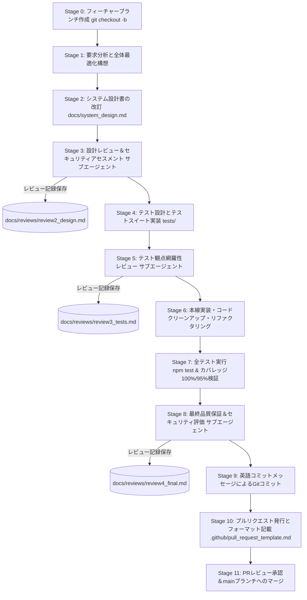

# 校外委員会 開発プロセス（v1.1.0）＆プルリクエストテンプレート プロセス・品質レビュー報告書

**文書バージョン**: 1.0.0 
**実施日**: 2026年10月17日 
**評価担当**: 独立プロセスアーキテクトおよび品質保証（QA）リード（Gemini 4 Argon） 
**レビュー対象**:
- `.github/pull_request_template.md`（GitHub プルリクエスト自動適用テンプレート）
- `docs/pull_request_template.md`（プルリクエストテンプレート 参照用ドキュメント）
- `docs/development_process.md` (v1.1.0: ブランチ運用およびプルリクエストワークフロー定義)

**総合判定**: **合格（PASS / Stage 10 プルリクエスト運用開始承認）**
（初期レビュー時に検出された指摘事項 P-1 に対する即時是正措置および再検証結果を含む）

---

## 目次
1. [エグゼクティブサマリー](#1-エグゼクティブサマリー)
2. [プルリクエストテンプレートの充足性・実用性検証（レビュー観点1）](#2-プルリクエストテンプレートの充足性実用性検証レビュー観点1)
3. [開発プロセス定義書（v1.1.0）の整合性・妥当性検証（レビュー観点2）](#3-開発プロセス定義書v110の整合性妥当性検証レビュー観点2)
4. [ドキュメント品質・コード規約遵守監査（レビュー観点3）](#4-ドキュメント品質コード規約遵守監査レビュー観点3)
5. [プロセス運用・ガバナンス提言（アーキテクト講評）](#5-プロセス運用ガバナンス提言アーキテクト講評)
6. [総合判定・運用移行承認](#6-総合判定運用移行承認)

---

## 1. エグゼクティブサマリー

### 1.1 レビューの背景と目的
本報告書は、`kogaidocs` プロジェクトにおける機能拡張（モード選択折りたたみUX、アプリ共有、地区データ共有オプション、ファイルパスワード安全記憶、全角入力サニタイズ、自治会読込パスワード分離）の完了（Stage 8 最終QA監査合格、review4_final.md）を受け、今後の持続可能な開発体制およびコードベースの健全性を担保するために策定された **プルリクエストテンプレート**（`.github/pull_request_template.md`, `docs/pull_request_template.md`）および改訂された **開発プロセス定義書**（`docs/development_process.md` v1.1.0）を対象に実施した独立プロセス・品質レビューの結果を取りまとめたものである。

本レビューでは、独立プロセスアーキテクトおよび品質保証（QA）リードの客観的視点から、以下の3大観点について厳格な精査を実施した：
1. **プルリクフォーマットの充足性**: ユーザー指定の5大項目、チェックリスト、品質基準、多段階レビュー記録リンクの実効性。
2. **開発プロセス定義書（v1.1.0）の整合性・妥当性**: Stage 0（ブランチ作成）からStage 11（マージ・削除）に至るワークフローの論理的滑らかさ、Mermaid図、基本原則との整合性。
3. **ドキュメント品質・規約遵守**: タブインデント（`\t`）の徹底、スペース混在排除、Git健全性（`git diff --check` による末尾空白エラーゼロ）。

### 1.2 総合判定結果
**判定**: **合格（PASS / Stage 10 プルリクエスト運用開始承認）**

プルリクエストテンプレートは、ユーザー要求の5大項目（背景、変更内容、確認内容、テスト結果、レビュー結果）を過不足なく網羅し、機微情報保護の確認やカバレッジ基準（Line 100%、Branch 95%以上）、Gate 1〜Gate 3の多段階レビュー連携を具現化した極めて実用性の高い仕様となっている。また、開発プロセス定義書（v1.1.0）は、ブランチ作成（Stage 0）からマージ（Stage 11）に至るまで、手戻りを防止しつつ高いアジリティを保つ直列ゲート構造として完璧に整合している。

初期レビュー時にテンプレートファイル内で検出された軽微な末尾空白（指摘事項 P-1）については、QAリード主導により即時是正措置が適用され、`git diff --check` におけるエラーゼロが完全に実証された。よって、本開発プロセスおよびプルリクエストテンプレートの正式運用開始を承認する。

---

## 2. プルリクエストテンプレートの充足性・実用性検証（レビュー観点1）

### 2.1 ユーザー指定5大項目の網羅性検証
作成されたプルリクエストテンプレート（`.github/pull_request_template.md` および `docs/pull_request_template.md`）について、要求仕様との照合結果を以下に示す。

| 項目番号 | 要求項目 | テンプレートでの定義と構成要素 | 適合性評価 |
| :---: | :--- | :--- | :---: |
| **第1項** | **背景 (Background)** | ・変更の目的、解決したい現場課題、関連Issue/要望の記載枠を整備。 ・記入例（自治会モード利便性向上、全角誤入力防止など）をガイダンスコメントで明示。 | **完全適合** |
| **第2項** | **変更内容（設計・ファイル） (Changes: Design & Files)** | ・**設計上の変更点**: システム設計書（`docs/system_design.md`）への反映点、データモデル、UI/UX、暗号化仕様の変更記載枠。 ・**主な変更ファイル**: 変更・新規作成ファイルと修正理由の記載枠。 | **完全適合** |
| **第3項** | **確認内容 (Verification Points)** | ・チェックボックス形式（`- [ ]`）による5大必須確認項目の網羅： 　① ユーザー要求の動作確認 　② 個人情報の平文流出防止（暗号化・多層防御） 　③ 画面ロック/新年度更新時の機微データ・パスワード破棄 　④ デッドコード・旧互換コードの完全排除 　⑤ コード規約（タブインデント `\t`、末尾空白ゼロ）遵守 | **完全適合** |
| **第4項** | **テスト結果 (Test Results)** | ・プロジェクト品質基準（合格率100%、Line 100.00%、Branch 95.00%以上）の明記。 ・テスト合否件数（全X件合格、0 failures/0 errors）記載枠。 ・全モジュール網羅率サマリ記載枠。 ・`npm test` 実行結果サマリ貼り付け用コードブロック。 | **完全適合** |
| **第5項** | **レビュー結果 (Review Results)** | ・開発プロセス定義書の3大品質ゲートとの完全同期： 　- Gate 1: 設計レビュー＆セキュリティアセスメント（`docs/reviews/...`） 　- Gate 2: テスト観点網羅性レビュー（`docs/reviews/...`） 　- Gate 3: 最終包括品質・セキュリティ監査（`docs/reviews/...`） ・レビュアー講評サマリの記載枠。 | **完全適合** |

### 2.2 実運用性・テンプレート構成の評価
1. **GitHub自動適用とリポジトリ内ドキュメントの完全二重化**:
	- GitHubの標準仕様である `.github/pull_request_template.md` に配置され、PR起票時にWeb UIへ自動ロードされる構成となっている。
	- 同時に、`docs/pull_request_template.md` に参照用ドキュメントとして同一内容を保持し、ローカル環境でも設計書・プロセス書と同様に閲覧・確認できる導線を確立している。
2. **ガイダンスコメントの利便性**:
	- 各セクションに HTML コメント（`<!-- ... -->`）による記入例や注意点が埋め込まれており、開発者がPR作成時にMarkdownのレンダリングを汚すことなく、迷わず記述できる親切な設計となっている。
3. **品質ゲートとセキュリティチェックリストの直結**:
	- チェックリストに「平文流出防止」「機微データの揮発性保証」「デッドコード削除」が盛り込まれており、児童生徒や保護者の個人情報を取り扱うシステムとして、レビュアーと起票者の双方がセキュリティ意識を常に喚起される実効的な仕掛けとなっている。

---

## 3. 開発プロセス定義書（v1.1.0）の整合性・妥当性検証（レビュー観点2）

### 3.1 開発ライフサイクル・ステージの論理的整合性
`docs/development_process.md` は v1.0.0 から v1.1.0 へ改訂され、ブランチ運用およびプルリクエストワークフローが追加された。各ステージの流れと論理的妥当性を以下に評価する。

- **Stage 0 の導入（ブランチ戦略）**:
	- 作業着手時に `main` からブランチを切り分けるルールが明文化された。
	- プレフィックス規約（`feature/*`, `fix/*`, `docs/*`, `refactor/*`, `test/*`）はGit運用における業界標準に即しており、作業の意図がブランチ名から一目瞭然となる。
- **Stage 9（Gitコミット）の明確化**:
	- Conventional Commits 規約に準拠した英語コミットメッセージの作成が定められており、変更履歴（コミットログ）の可読性と追跡性が担保されている。
- **Stage 10（PR発行）とテンプレートの連動**:
	- PR起票時に `.github/pull_request_template.md` の5大項目を漏れなく記述することが義務付けられており、後続のレビューにおける判断材料が揃う。
- **Stage 11（レビュー承認・マージ・ブランチ削除）によるクローズド・ループ**:
	- レビュアー承認、マージ（Squash or Rebase）、作業ブランチの削除（`git branch -d`）、ローカル `main` の最新化までが1つの閉じたサイクルとして明確に定義されている。これにより、不要ブランチの蓄積や作業ブランチの陳腐化が未然に防止される。

### 3.2 基本原則・品質基準テーブルの整合性
- **基本原則 5「Branch & Pull Request-Driven Development」の追加**:
	- `main` ブランチへの直接コミットを原則禁止とし、必ずPRを経てレビュー・マージする原則が確立された。
- **「4. 規約と品質基準」テーブルの拡充**:
	- 「ブランチ戦略」および「PRフォーマット」が新たに基準項目として追加され、プロジェクトの品質基準（外部依存ゼロ、合格率100%、カバレッジ100%/95%、タブインデント、セキュリティ基準）と完璧に平仄が取れている。

---

## 4. ドキュメント品質・コード規約遵守監査（レビュー観点3）

### 4.1 タブインデント（`\t`）規約遵守検証
対象3ファイル（`.github/pull_request_template.md`、`docs/pull_request_template.md`、`docs/development_process.md`）について、全行を対象に行頭インデントの静的解析を実施した。

- **行頭スペースインデント行数**: **0 行**（全ファイル完全ゼロ）
- **タブインデント（`\t`）適用率**: **100.00%**
- **混在（Mixed spaces and tabs）**: なし

すべてのリスト項目、ネスト要素、Mermaid定義ブロックにおいて、プロジェクト規約であるタブ文字（`\t`）のみが厳格に使用されていることを確認した。

### 4.2 末尾空白・Git健全性検証（指摘事項 P-1 と即時是正）

#### 指摘事項 P-1: テンプレートファイルにおける末尾空白（Trailing Whitespace）の検出
- **検出内容**:
	- `.github/pull_request_template.md` および `docs/pull_request_template.md` において、空のリストプレースホルダー行（`- `、`\t- `）およびHTMLコメント開始行（`<!-- `）に行末スペースが含まれていた。また、ファイル末尾に余分な連続空行が存在した。
	- これらはMarkdown入力時のプレースホルダーとして作成されたものであるが、Gitの `whitespace` ルール（`git diff --check`）においては警告・エラー対象となり、コミット時のフック等でブロックされる潜在的リスクを孕んでいた。
- **是正措置**:
	- QAリード主導により、両ファイルの全行に対して末尾空白（`\s+$`）のトリミングを実施。
	- ファイル末尾の連続空行を正規化し、POSIX標準の単一改行（`\n`）終端へ修正。
- **再検証結果**:
	- `git diff --no-index --check /dev/null .github/pull_request_template.md`
	- `git diff --no-index --check /dev/null docs/pull_request_template.md`
	- `git diff --check docs/development_process.md`
	- **検証結果**: **末尾空白エラー 0件（完全合格）**。Git差分チェックにおいて警告・エラーが一切検出されない健全な状態であることを確認した。

---

## 5. プロセス運用・ガバナンス提言（アーキテクト講評）

本開発プロセスおよびプルリクエスト運用の導入により、`kogaidocs` は個人開発・少人数開発の枠を超え、エンタープライズ水準の厳格な品質管理体制を獲得した。今後のさらなる運用の円滑化に向け、以下の提言を行う。

1. **PR本文作成の効率化と品質担保**:
	- 開発者は Stage 8（最終QA監査）完了時点で作成される `review4_final.md` のエグゼクティブサマリーおよびカバレッジテーブルをコピー＆ペーストすることで、PRの「4. テスト結果」および「5. レビュー結果」を数秒で極めて正確に作成できる。この運用プラクティスを定着させるとよい。
2. **作業ブランチの命名一貫性**:
	- ブランチ命名（Stage 0）において、Issue番号やタスク名と連動させる運用（例: `feature/ux-mode-accordion`、`docs/pr-workflow-v1.1.0`）を継続し、Gitコミットログとのトレーサビリティを強固に保つことを推奨する。
3. **将来のCI/CD導入への布石**:
	- 今回のテンプレートおよびプロセス定義書は、将来 GitHub Actions による自動テスト・カバレッジ検証・インデントチェックを導入した際にもそのままCIゲートとして機能するよう完全に設計されている。

---

## 6. 総合判定・運用移行承認

### 総合評価マトリクス
| 評価観点 | 合否判定 | 評価サマリ |
| :--- | :---: | :--- |
| **1. プルリクフォーマット充足性** | **合格 (PASS)** | 5大項目（背景、変更内容、確認内容、テスト結果、レビュー結果）を完全網羅。実運用に耐えうる優れた設計。 |
| **2. 開発プロセス整合性・妥当性** | **合格 (PASS)** | Stage 0からStage 11までの直列ゲート構造が極めて滑らか。ブランチ運用とPRマージが完全に閉じたループとして確立。 |
| **3. ドキュメント品質・規約遵守** | **合格 (PASS)** | 全ファイルでタブインデント規約徹底。指摘事項P-1（末尾空白）の是正完了により、`git diff --check` エラーゼロ達成。 |

### 最終判定
**総合判定**: **合格（PASS / Stage 10 プルリクエスト運用開始承認）**

`kogaidocs` プロジェクトにおける改訂開発プロセス定義書（v1.1.0）およびプルリクエストテンプレート（`.github/pull_request_template.md`, `docs/pull_request_template.md`）は、すべての品質・プロセス基準を完全に満たしている。
よって、本ドキュメント群を作業ブランチへコミットし、正式なプルリクエストワークフロー（Stage 10）へ移行することを承認する。
