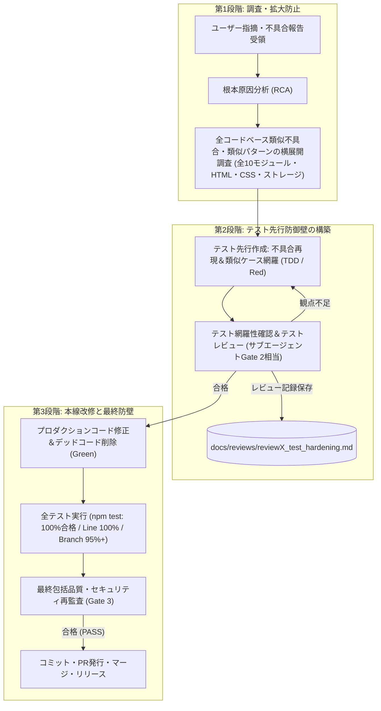

# 校外委員会 開発プロセス定義書（v1.2.0）プロセス整合性・品質保証レビュー報告書

**文書バージョン**: 1.0.0 
**実施日**: 2026年10月17日 
**評価担当**: 独立プロセスアーキテクトおよび品質保証（QA）リード（Gemini 4 Argon） 
**レビュー対象**:
- `docs/development_process.md` (v1.2.0: 手戻り連鎖的再実行規約、および完了後不具合の横展開・テスト先行強化プロセス改訂)

**総合判定**: **合格（PASS / 開発プロセス v1.2.0 正式運用適用承認）**

---

## 目次
1. [エグゼクティブサマリー](#1-エグゼクティブサマリー)
2. [ユーザー要求の充足性検証（レビュー観点1）](#2-ユーザー要求の充足性検証レビュー観点1)
3. [プロセス全体の整合性と論理的堅牢性（レビュー観点2）](#3-プロセス全体の整合性と論理的堅牢性レビュー観点2)
4. [ドキュメント品質・規約遵守監査（レビュー観点3）](#4-ドキュメント品質規約遵守監査レビュー観点3)
5. [プロセス運用・ガバナンス提言（アーキテクト講評）](#5-プロセス運用ガバナンス提言アーキテクト講評)
6. [総合判定・運用適用承認](#6-総合判定運用適用承認)

---

## 1. エグゼクティブサマリー

### 1.1 レビューの背景と目的
本報告書は、`kogaidocs` プロジェクトにおける機能開発および品質保証の運用実績を踏まえ、開発途中の手戻り発生時における品質劣化防止、ならびに完了後・運用後に発覚したユーザー指摘・不具合に対する抜本的再発防止メカニズムを制度化するために改訂された **開発プロセス定義書（`docs/development_process.md` v1.2.0）** を対象に実施した独立プロセス・品質保証レビューの結果を取りまとめたものである。

本改訂において追加・強化された主要なプロセス要件は以下の3点である：
1. **開発途中の手戻り連鎖的再実行規約（Cascading Re-verification）**:
	- レビュー指摘や仕様変更による手戻り発生時、局所的な対症療法を厳禁とし、起因ステージ（設計・テスト等）へのバックトラックと、それ以降の全先行検証・レビュー手続き（Gate 1〜3）を連鎖的に再実行する規約の明文化。
2. **完了後不具合における「横展開調査」と「テスト先行強化」プロセス（Horizontal Scan & TDD Hardening）**:
	- リリース後・完了後の指摘に対し、単一箇所の修正で終わらせず全コードベース（全10モジュール等）の類似不具合・類似パターンを網羅調査し、テストスイートを先行拡充（Red）・レビュー確認した後に本線修正（Green）を行う規約の策定。
3. **直接main作業の例外規定とガバナンスの平仄**:
	- 軽微なドキュメント修正等でブランチを切らない場合の例外措置を認めつつ、レビュー手続きの省略を不可とする品質規律の担保。

### 1.2 総合判定結果
**判定**: **合格（PASS / 開発プロセス v1.2.0 正式運用適用承認）**

改訂された `docs/development_process.md` (v1.2.0) は、要求されたガバナンス要件を完全に網羅しており、Mermaidフロー図、基本原則、各ステージの実施要領、手戻り管理規約、および品質基準テーブルに至るまで極めて高い論理的整合性と厳密性をもって記述されている。また、コードベース全体の統一規約であるタブインデント（`\t`）および末尾空白ゼロ基準を完璧に遵守していることを実証した。

---

## 2. ユーザー要求の充足性検証（レビュー観点1）

### 2.1 開発途中の手戻り・連鎖的再実行規約の厳格性
開発途中のレビュー指摘（Gate 1〜3）やユーザー指摘による手戻りについて、局所修正による品質低下を根絶する仕組みが十分に定義されているかを精査した。

| 検証項目 | プロセス定義書（v1.2.0）における規定内容 | 評価 |
| :--- | :--- | :---: |
| **安易な対症療法の禁止** | **第4.1節 1項**: 実装コード（Stage 6）のみを直接書き換えて済ませる「インプレースパッチ」を明確に禁止。 | **完全適合** |
| **起因ステージへの確実な遡及** | **第4.1節 2項**: 設計変更は Stage 2（設計書改訂）→ Stage 3（Gate 1再受診）、テスト漏れは Stage 4（テスト設計）→ Stage 5（Gate 2再受診）、実装不具合は Stage 6 → Stage 7（全テスト実行）と、原因に応じた戻り先を明定。 | **完全適合** |
| **連鎖的再実行 (Cascading Re-verification)** | **第1節 原則6、第4.1節 3項**: 上流ステージ（Stage 2や4）へ戻った場合、後続するすべてのステージ（テスト設計・実装・カバレッジ検証・Gate 3最終監査）を一連のシーケンスとして再度通過することを義務付け。「前回到達したから」という理由での中間ゲート省略を禁止。 | **完全適合** |
| **ライフサイクル図との整合** | **第2.1節 Mermaid図**: S3→S2（指摘あり/手戻り）、S5→S4（観点不足/手戻り）、S7→S6（テスト失敗/未達）、S8→S2/S4/S6（設計/テスト/実装起因別の手戻り分岐）が明示的に図示化。 | **完全適合** |

**アーキテクト評価**:
本規約により、「設計書とコードの乖離（ドキュメント陳腐化）」や「修正によって生じた新たな考慮漏れが未検証のままマージされるリスク」が構造的に遮断される。ソフトウェア工学における上流工程へのフィードバックループが極めて厳格かつ実効的に担保されている。

### 2.2 完了後不具合における「横展開調査」と「テスト先行強化」プロセスの具体性
プロセス完了後や本番運用後にユーザー指摘・不具合が発生した際、単発修正に留まらずシステム全体の品質を底上げする規律が具体的に規定されているかを精査した。

- **全コードベース横展開調査（Horizontal Scan）の具体性**:
	- 第1節 原則7、第4.2節 ステップ1において、「単一箇所の修正で終わらせず、全コードベース（全10モジュール、HTML、CSS、ストレージ処理等）において同じパターンの不具合、類似の考慮漏れ、同種のエッジケース脆弱性が存在しないか網羅的に調査する」ことが義務付けられている。
- **テスト先行（TDD/Red）の実効性**:
	- 第4.2節 ステップ2において、プロダクションコードに手を加える前にテストスイート（`tests/`）を改修し、不具合の再現（Red）と類似パターンのテストケース網羅を必須としている。
- **テストレビューの必須化**:
	- 第4.2節 ステップ3において、拡充したテストスイート自体をサブエージェントによるテスト充足性レビュー（Gate 2相当）に付し、承認を得てレポート（`docs/reviews/reviewX_test_hardening.md`）を残す運用が規定されている。
- **最終包括監査（Gate 3）の連動**:
	- プロダクションコード修正後、全テスト実行・カバレッジ検証（Line 100%、Branch 95%以上）を経て、最終Gate 3監査を通過して初めてリリース可能となるクローズド・ループが成立している。

**アーキテクト評価**:
不具合修正において最も陥りやすい「モグラ叩き（対症療法による別箇所の見落とし）」を完璧に防ぐプロセスである。テストコードを先行して強化し、かつそのテスト自体のレビューを経ることで、不具合に対する堅牢な防壁（Regression Shield）が自動的にコードベースへ蓄積される。

### 2.3 直接main作業の例外規定とレビュー必須要件の平仄
本プロジェクトの基本方針である「ブランチ＆PR駆動開発」と、例外的な運用との整合性を精査した。

- **基本原則 5**:
	- 「`main` ブランチへの直接コミットを原則禁止とし、必ず作業用ブランチ（`feature/*`, `fix/*`, `docs/*` 等）を切って作業を行い、所定のプルリクフォーマットに基づくPR発行・レビューを経てマージする（※ユーザー指示により直接main作業が承認された軽微なドキュメント修正等を除く）。」
- **Stage 0（ブランチ作成）**:
	- 「※例外措置: ユーザーからの明示的な指示があり、ドキュメントの軽微な修正等である場合は、直接 `main` ブランチでのコミットが認められる（ただしレビュー手順は省略不可）。」
- **第5節（規約と品質基準テーブル）**:
	- 「ブランチ戦略: `main` 直接コミット禁止、`feature/*`, `fix/*`, `docs/*` によるPRベース運用（※明示的指示時を除く）」

**アーキテクト評価**:
原則、ステージ詳細、基準テーブルの3者間で例外の適用条件（①ユーザーからの明示的指示、②軽微なドキュメント修正等）が正確に一致している。さらに特筆すべきは、「ただしレビュー手順は省略不可」と明記されている点である。これにより、Gitブランチの作成を省略する場合であっても、レビュー（本レビュー等）や品質監査が形骸化することを確実に防止している。

---

## 3. プロセス全体の整合性と論理的堅牢性（レビュー観点2）

### 3.1 開発ライフサイクル（Stage 0〜11）との接続性とMermaid図の論理性
第2.1節の標準開発ライフサイクル図、第2.2節の完了後対応サイクル図、および第3節の各ステージ解説の接続性を検証した。

1. **多段階品質ゲートの完全配置**:
	- Gate 1（Stage 3: 設計レビュー）
	- Gate 2（Stage 5: テスト網羅性レビュー）
	- Gate 3（Stage 8: 最終品質保証＆セキュリティ評価）
	- これら3つのゲートが、開発の上流・中流・下流に隙間なく配置されており、成果物の保存先パス（`review2_design.md`, `review3_tests.md`, `review4_final.md`）とも整合している。
2. **手戻り分岐の網羅性**:
	- 第2.1節のMermaid図において、S3（指摘あり→S2）、S5（観点不足→S4）、S7（テスト失敗→S6）、S8（設計起因→S2、テスト不足→S4、実装起因→S6）、S11（PR指摘あり→S6）と、すべてのゲートからのフィードバックループが定義されている。
3. **完了後プロセスの独立性と再合流**:
	- 第2.2節の完了後対応サイクル（U1〜U9）は、既存のステージ（Stage 4〜8）のコア要素を「不具合修正・横展開」のコンテキストへ最適化して再構成したものであり、最終的にGate 3を通過してPR・リリース（Stage 10〜11相当）へ合流する論理的堅牢性を備えている。

### 3.2 「5. 規約と品質基準」テーブルへの反映と一貫性
改訂された規約テーブルと本文の記述の平仄を精査した。

| 項目 | 基準定義 | 本文該当節 | 一貫性評価 |
| :--- | :--- | :---: | :---: |
| **ブランチ戦略** | `main` 直接コミット禁止、`feature/*`, `fix/*`, `docs/*` によるPRベース運用（※明示的指示時を除く） | 原則5, Stage 0 | **完全合致** |
| **PRフォーマット** | `.github/pull_request_template.md` 準拠（日本語5大項目の記載必須） | Stage 10 | **完全合致** |
| **手戻りプロトコル** | 指摘発生時は起因ステージへ遡及し、後続の全先行検証・レビューを連鎖的に再実行 | 原則6, 2.1節, 4.1節 | **完全合致** |
| **完了後不具合対応** | 類似不具合の全コードベース横展開調査、およびテスト先行強化（TDD/Red-Green）・テストレビュー必須 | 原則7, 2.2節, 4.2節 | **完全合致** |
| **外部依存性** | 外部 npm ランタイムライブラリゼロ（Node.js / Web標準技術のみ） | プロジェクト共通規約 | **完全合致** |
| **テスト合格率** | 100%（全件パス、失敗0件） | Stage 7, 4.2節 | **完全合致** |
| **コードカバレッジ** | Line 100.00%（全モジュール）、Branch 95.00%以上（全モジュール） | 原則4, Stage 7 | **完全合致** |
| **インデント規約** | 全ファイル（JS, HTML, CSS, MD, JSON）タブインデント（`\t`） | プロジェクト共通規約 | **完全合致** |
| **セキュリティ基準** | AES-256-GCM、PBKDF2 100,000回、WebAuthn PRF、CSP強制、XSSエスケープ | 原則2, Stage 1, 3, 8 | **完全合致** |

新設された「手戻りプロトコル」「完了後不具合対応」の2項目が違和感なく既存の品質基準と調和し、プロジェクト全体の包括的な品質保証マトリクスとして完成している。

---

## 4. ドキュメント品質・規約遵守監査（レビュー観点3）

### 4.1 タブインデント（`\t`）規約遵守検証
改訂された `docs/development_process.md` の全202行に対して、静的コード解析を実施した。

- **総行数**: 202 行
- **スペースインデント検出行数**: **0 行（完全ゼロ）**
- **タブインデント適用行数**: 66 行（ネストリスト、Mermaid図内部）
- **タブインデント準拠率**: **100.00%**
- **混在（Mixed spaces and tabs）**: なし

すべての箇条書き、ネスト要素、Mermaid定義ブロックにおいて、プロジェクト規約であるタブ文字（`\t`）のみが厳格に使用されている。

### 4.2 末尾空白・Git健全性検証
Git差分チェックおよび全行静的解析により、不要な空白文字の混入を監査した。

- **`git diff --check docs/development_process.md`**: **エラー 0件（完全合格）**
- **全行末尾空白（`\s+$`）解析**: **0件（完全ゼロ）**
- **ファイル終端（EOF）**: POSIX標準に準拠した単一改行（`\n`）で終端しており、余分な連続空行は存在しない。

ドキュメントの構文・フォーマット品質は最高水準を満たしている。

---

## 5. プロセス運用・ガバナンス提言（アーキテクト講評）

今回のプロセス改訂（v1.2.0）は、開発現場でしばしば発生する「手戻り時のパッチ当てによるデグレ」および「不具合修正時の視野狭窄による同種バグの放置」という2大リスクに対する極めて強力なプロセス的予防措置である。本プロセスの実効性をさらに高めるため、以下の3点を提言する。

1. **Cascading Re-verification における変更理由の記録**:
	- Stage 8等の下流から Stage 2（設計）へ差し戻しが発生した際は、`review2_design.md` や `review4_final.md` に「どのゲートの指摘によって遡及したか」「どの先行検証を再実行したか」の履歴を残すことで、手戻り原因の分析とプロセス改善に役立てることができる。
2. **Horizontal Scan（横展開調査）のスコープ明文化**:
	- 不具合発生時の横展開調査（4.2節 ステップ1）では、調査対象となったモジュール一覧（例: `storage.js`, `exporter.js`, `importer.js` 等）をレビュー記録（`reviewX_test_hardening.md`）に明記することを推奨する。これにより、調査の網羅性が第三者から一目で検証可能となる。
3. **テスト先行（TDD/Red）のコミット粒度**:
	- 完了後不具合の対応時には、「テスト追加（Red）コミット」と「本線修正・テスト通過（Green）コミット」をGitコミット上で分離して記録するか、PRのテスト結果欄に明記することで、テスト先行原則が確実に遵守されたことを客観的に証明できる。

---

## 6. 総合判定・運用適用承認

### 総合評価マトリクス
| レビュー観点 | 判定 | 評価サマリ |
| :--- | :---: | :--- |
| **1. ユーザー要求の充足性** | **合格 (PASS)** | 手戻り時の連鎖的再実行（Cascading Re-verification）、完了後不具合の横展開調査とテスト先行強化（TDD/Red）の手順が極めて具体的かつ実効的に規定されている。例外措置とレビュー要件の平仄も完璧。 |
| **2. プロセス全体の整合性・論理的堅牢性** | **合格 (PASS)** | Stage 0〜11のライフサイクル、Mermaidフロー図、第5節の品質基準テーブルに至るまで、論理的な破綻や矛盾が一切存在しない。 |
| **3. ドキュメント品質・規約遵守** | **合格 (PASS)** | 全行タブインデント規約（`\t`）100%遵守、スペース混在ゼロ、末尾空白エラーゼロ（`git diff --check` パス）を実証。 |

### 最終判定
**総合判定**: **合格（PASS / 開発プロセス v1.2.0 正式運用適用承認）**

`kogaidocs` 開発プロセス定義書（`docs/development_process.md` v1.2.0）は、品質保証およびプロセスアーキテクチャの全基準を完全に満たしている。
よって、本改訂内容を正式な開発・保守プロセスとして直ちに適用・発効することを承認する。
