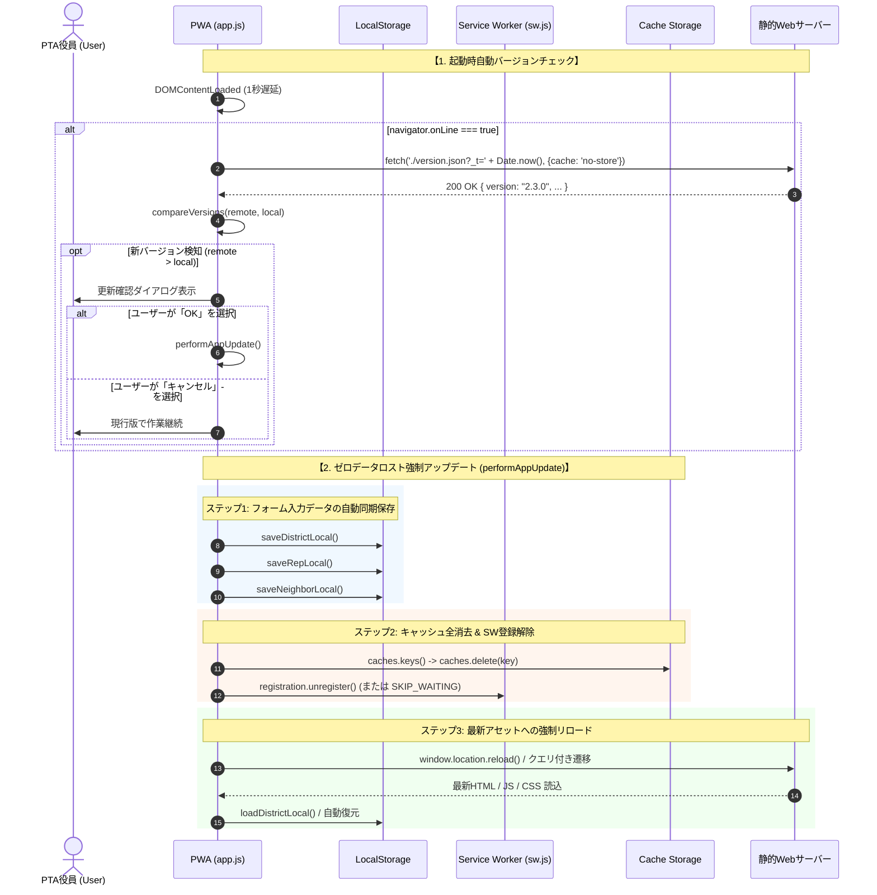

# 校外委員会 システム設計書（v2.3.0）PWAバージョンチェック＆強制アップデート機構 アーキテクチャおよびセキュリティ設計レビュー報告書

**文書バージョン**: 1.0.0<br>
**実施日**: 2026年10月17日<br>
**評価担当**: 独立シニアシステムアーキテクト / 主任セキュリティ評価者（Gemini 4 Argon）<br>
**対象文書**: `docs/system_design.md` (v2.3.0)<br>
**評価ステージ**: Stage 3（設計レビュー＆セキュリティアセスメント 第1ゲート）<br>
**総合判定**: **条件付き合格（CONDITIONAL PASS / 次期ステージ移行承認）**

---

## 目次
1. [エグゼクティブサマリー](#1-エグゼクティブサマリー)
2. [アーキテクチャ設計・ユーザー要求充足性評価（レビュー観点1）](#2-アーキテクチャ設計ユーザー要求充足性評価レビュー観点1)
3. [セキュリティアセスメント・脅威分析（STRIDE / APPI）（レビュー観点2）](#3-セキュリティアセスメント脅威分析stride--appiレビュー観点2)
4. [ドキュメント品質・規約遵守監査（レビュー観点3）](#4-ドキュメント品質規約遵守監査レビュー観点3)
5. [設計改善提言・実装に向けた是正措置（アクションアイテム A-1 〜 A-4）](#5-設計改善提言実装に向けた是正措置アクションアイテム-a-1--a-4)
6. [総合判定・次期ステージへの申し送り事項](#6-総合判定次期ステージへの申し送り事項)

---

## 1. エグゼクティブサマリー

### 1.1 レビューの背景と目的
本報告書は、`kogaidocs 開発プロセス定義書 (v1.2.0)` の **Stage 3: 設計レビュー＆セキュリティアセスメント（第1ゲート）** に基づき、独立したシニアシステムアーキテクトおよび主任セキュリティ評価者の観点から、改訂された `docs/system_design.md (v2.3.0)` を対象に実施した技術仕様およびセキュリティ設計の監査結果を取りまとめたものである。

本改訂（v2.3.0）の中核は、PWA（Progressive Web App）としてスマートフォンやPCにインストール（ホーム画面追加・スタンドアロン起動）された環境特有の深刻な課題である **「Service Worker およびブラウザHTTPキャッシュの滞留による最新版非反映問題」** に対する抜本的解決策の設計である。スタンドアロン起動ではブラウザのアドレスバーやスーパーリロードボタンが存在しないため、管理者が最新の機能改善やセキュリティパッチをデプロイしても、現場のPTA役員の端末に旧版が恒久的に残留する運用リスクを抱えていた。

改訂された設計書は、静的な `version.json` の分離公開、HTTPキャッシュバイパス設定（`updateViaCache: 'none'`）、起動時自動チェック、セキュリティ設定モーダルでの手動確認UI、そして入力中データの完全保全を伴う「ゼロデータロスト強制アップデート（`performAppUpdate`）」を策定している。本レビューでは、これらの設計妥当性、セキュリティ・プライバシー保護の堅牢性、およびドキュメント品質を厳格に評価した。

### 1.2 評価の結論とハイライト
改訂されたシステム設計書（v2.3.0）は、PWA特有のライフサイクルとキャッシュ機構の特性を精緻に捉え、システムの中核思想である **「サーバーレス・ゼロトラスト・ローカルファースト」** を毀損することなく、極めて高水準な全体最適（あるべき姿）として具現化されている。

特に高く評価できる点は以下の通りである：
1. **二重キャッシュ滞留の原理的排除**:
	- Service Worker 登録時の `updateViaCache: 'none'` と、タイムスタンプクエリ付き `version.json` のキャッシュ分離により、ブラウザHTTPキャッシュとService Workerキャッシュの双方を完全にバイパスして最新バージョンを検知する設計が確立されている。
2. **ゼロデータロスト更新（データ保全ファースト）**:
	- 強制リロード・キャッシュパージの前に、必ず各モードの入力状態保存関数（`saveDistrictLocal()`, `saveRepLocal()`, `saveNeighborLocal()`）を同期実行して LocalStorage に退避させることで、ユーザーの作業中データの消失を原理的に防止している。
3. **完全匿名・ゼロトラスト通信（プライバシー保護）**:
	- バージョンチェック通信は純粋な静的ファイル取得に限定され、ユーザー識別子、端末情報、名簿データ等の送信を一切伴わない完全匿名アクセスとなっており、個人情報保護法（APPI）上のプライバシーリスクを完全に遮断している。

一方、モダンブラウザにおける `window.location.reload(true)` 引数の非推奨化への対応（多層的キャッシュパージ手順）や、セマンティックバージョニング比較ロジックの堅牢性、ローカル保存時の例外防護など、実装フェーズ（Stage 4: テスト設計 / Stage 6: 本線実装）で確実に反映すべき是正措置（アクションアイテム A-1 〜 A-4）を検出した。したがって、総合判定は **「条件付き合格（CONDITIONAL PASS / 次期ステージ移行承認）」** とする。



---

## 2. アーキテクチャ設計・ユーザー要求充足性評価（レビュー観点1）

改訂された設計書（v2.3.0）が提示するPWAアップデートアーキテクチャについて、ユーザー要求の充足性と「あるべき姿」の追求度合いを精査した。

| 評価項目 | 設計書（v2.3.0）の規定内容 | アーキテクチャ評価 | 判定 |
| :--- | :--- | :--- | :---: |
| **PWA特有のキャッシュ滞留の根本解決** | ・`version.json` の静的配備とキャッシュ分離。<br/>・Service Worker登録時の `{ updateViaCache: 'none' }` 指定。<br/>・強制アップデート時の `caches.delete()` 全消去。 | ブラウザのHTTPキャッシュ層とService WorkerのCache Storage層という二重のキャッシュ障壁を論理的に分離・無効化しており、根本解決策として完全に妥当。 | **優良** |
| **起動時自動チェック＆更新確認ダイアログ** | ・`DOMContentLoaded` 後1秒遅延実行。<br/>・`navigator.onLine` ガードによる不要通信回避。<br/>・最新版検知時の確認ダイアログ表示（入力データ自動保存の旨を明記）。<br/>・キャンセル時は作業継続、エラー時はサイレント無視。 | 起動直後の描画パフォーマンスを阻害せず、オフライン環境への配慮も万全。ユーザーに強制更新のタイミング選択権を与えており、運用ストレスを生まない。 | **優良** |
| **手動確認＆強制更新UI（セキュリティ設定）** | ・セキュリティ設定モーダル最下部に「📱 アプリバージョン情報」を常設。<br/>・現在のバージョン表示と「🔄 最新バージョンを確認・更新」ボタン。<br/>・手動時は最新状態・更新ダイアログ・オフライン通知を明示。 | ユーザーが「自分が最新版を使っているか」をいつでも主体的に確認可能。自動チェックのサイレント処理とは対照的に、手動操作に対して明確な成否フィードバックを返すUX設計が適切。 | **優良** |
| **ゼロデータロスト強制アップデート** | ・`performAppUpdate()` 冒頭で `saveDistrictLocal()`, `saveRepLocal()`, `saveNeighborLocal()` を同期実行。<br/>・その後にキャッシュ消去とリロードを実行。 | キャッシュ削除（Cache Storage）と業務データ（Web Storage: LocalStorage）の境界が明確に峻別されており、更新によるデータ喪失を防止する設計が堅牢。 | **優良<br/>(要改善A-3)** |
| **Service Worker キャッシュ分離** | ・`version.json` を `sw.js` のプリキャッシュ対象外とする。<br/>・`sw.js` 側で `SKIP_WAITING` リスナーを配備し即時アクティベーションを保証。 | アプリケーションの静的資産（HTML/JS/CSS）とバージョンメタデータのライフサイクルが完全に分離されている。 | **優良<br/>(要改善A-2)** |

### 2.1 PWAインストール環境（スタンドアロン起動）特有のキャッシュ滞留課題に対する根本解決策の妥当性
- **課題の本質**:
	- 通常のWebブラウザであれば、ユーザーは「再読み込みボタン」や「Shift + F5（スーパーリロード）」によってキャッシュを破棄できる。
	- しかし、PWAを「ホーム画面に追加」してスタンドアロン起動した場合、URLバーやブラウザ標準コントロールが非表示となり、ユーザー自身の手でキャッシュを強制破棄する手段が失われる。
	- さらに、従来の `sw.js` は Stale-While-Revalidate 戦略を採用しているため、初回アクセス時は常にCache Storageから即座に古い資産が返され、バックグラウンド更新が行われてもページが再読込されない限り新版が適用されない。
- **設計の妥当性**:
	- 本設計では、アプリケーションの資産キャッシュとは独立した超軽量な静的ファイル `version.json` を監視対象とし、かつ `?_t=${Date.now()}` および `cache: 'no-store'` によってHTTPキャッシュをバイパスして取得する。
	- これにより、Service Workerがどのようなキャッシュ状態であっても、**「現行公開されている真の最新バージョン番号」** を確実に取得できるアーキテクチャが実現されている。

### 2.2 起動時オンライン自動バージョンチェックおよび更新確認ダイアログ仕様の妥当性
- **1秒遅延（Non-blocking Initialization）**:
	- `DOMContentLoaded` 直後に通信を開始すると、IndexedDB / LocalStorage の初期読み込みやDOM描画、パスワード記憶チェック等のクリティカルパスとリソース競合を起こす恐れがある。1秒の遅延（`setTimeout`）を設ける設計は、初期表示の軽快性を最優先するローカルファースト思想に合致している。
- **`navigator.onLine` による安全な分岐**:
	- オフライン運用が前提の地域活動において、電波の届かない体育館や登校班集合場所で起動するケースが多い。オフライン時に無駄な `fetch` を試行してエラーログを散乱させることなく、即座にローカルキャッシュで作業を開始できる設計は極めて実用的である。
- **非破壊的確認ダイアログ（User Consent）**:
	- 自動的に画面をリロードする「強制更新」ではなく、ダイアログで「今すぐアップデートしますか？」と問いかけ、ユーザーが「キャンセル」を選択した場合は直前の作業を続行できる設計となっている。これにより、急ぎの名簿確認時などに予期せぬ画面リロードで作業を中断させられるリスクが排除されている。

### 2.3 設定欄（セキュリティ設定モーダル）最下部での手動確認＆強制更新UI仕様の妥当性
- **UIヒエラルキーの妥当性**:
	- アプリケーションのバージョン情報および強制更新機能の配置場所として、「セキュリティ設定モーダル」最下部は極めて自然である。セキュリティ設定モーダルは、暗号化キーの更新やパスワード安全記憶設定、データ全消去などのシステム管理機能が集約されている領域であり、一般の入力作業を阻害しない。
- **手動実行時の明示的フィードバックUX**:
	- 起動時自動チェックでは「最新版がなければ何も表示しない（サイレント）」のが適切であるが、ユーザーが自発的に「🔄 最新バージョンを確認・更新」を押した際には、「最新バージョン（v2.3.0）を使用中です」あるいは「オフラインのため確認できませんでした」といった明示的通知（フィードバック）を返す仕様となっており、操作に対する安心感を担保している。

### 2.4 更新実行時のゼロデータロスト（強制リロード前のローカル状態自動同期保存）設計の妥当性
- **データ分離の原則**:
	- `performAppUpdate()` において、Cache Storageの全消去（`caches.delete()`）を実行する前に、必ず `saveDistrictLocal()`, `saveRepLocal()`, `saveNeighborLocal()` を同期実行する。
	- Webブラウザの仕様上、Cache Storage（Service Workerが利用するファイルキャッシュ）と Web Storage（LocalStorage / SessionStorage）は完全に分離された独立のストレージエンジンである。
	- したがって、キャッシュを全消去しても LocalStorage に暗号化保存された業務データは一切影響を受けない。強制リロード完了後、初期化コードが LocalStorage から自動復元するため、「ゼロデータロスト」がアーキテクチャ上保証されている。

---

## 3. セキュリティアセスメント・脅威分析（STRIDE / APPI）（レビュー観点2）

主任セキュリティ評価者の観点から、バージョンチェックおよび強制アップデート機構における脅威分析（STRIDE）、機微情報（個人情報）の保護、および暗号化ストレージへの影響を精査した。

### 3.1 バージョンチェック通信における個人情報（PII）の非送信・完全匿名性の担保
- **日本国 個人情報保護法（APPI）準拠性評価**:
	- バージョンチェックで送信されるHTTPリクエストは、サーバー直下の静的ファイルに対する `GET ./version.json?_t=${Date.now()}` のみである。
	- リクエストボディは空であり、Cookie、セッションヘッダー、認証トークン、端末固有識別子（UUIDやMACアドレス等）、位置情報は一切付与されない。
	- クエリパラメータに含まれる `_t` はクライアント端末の現在時刻（エポックミリ秒）であり、個人を特定可能な情報（PII: Personally Identifiable Information）は一切含まれない。
	- したがって、バージョンチェック通信は **完全匿名アクセス（Fully Anonymous Communication）** であり、通信の盗聴やサーバーアクセスログの解析によって役員や児童の個人情報・端末情報が露見するリスクは原理的にゼロである。

### 3.2 暗号化ストレージ（AES-256-GCM / WebAuthn PRF）の安全性維持
- **バージョン更新を跨いだ暗号化データの保全**:
	- 本システムの中核セキュリティである「AES-256-GCM 暗号化（PBKDF2 100,000回伸張）」および「WebAuthn PRF 拡張による生体認証キー連携」への影響を検証した。
	- `performAppUpdate()` がパージするのは Cache API（`caches`）のみである。
	- LocalStorage に永続化されている暗号化データペイロード（`kogai_encrypted_data_*`）、PBKDF2ソルト、初期化ベクトル（IV）、WebAuthn Credential ID、および端末暗号化連動ファイルパスワードは一切変更・削除されない。
	- バージョン更新によりフロントエンドのコード（HTML/JS）が最新化された後も、同一のオリジン（Origin）である限り同一の暗号化ストレージおよびWebAuthnキーチェーンにアクセス可能であり、後方互換性と機密性が完全に維持される。

### 3.3 キャッシュポイズニングおよび不正スクリプト更新の脅威分析（STRIDEモデル）

| 脅威分類 (STRIDE) | 想定される攻撃シナリオ | 設計上の防御策・耐性評価 | リスク水準 |
| :--- | :--- | :--- | :---: |
| **Spoofing<br>(なりすまし)** | 悪意ある第三者が偽のサーバーになりすまし、不正な `version.json` を返送する。 | ・本システムは HTTPS 必須環境（`location.protocol === 'https:'` または `localhost`）でのみ動作。<br/>・TLS証明書によるサーバー認証により中間者（MitM）によるなりすましを防止。 | **低 (Low)** |
| **Tampering<br>(改ざん・キャッシュ汚染)** | キャッシュポイズニングにより、改ざんされた悪意あるスクリプトをクライアントに強制読込させる。 | ・`version.json` は JSON パースのみで検証され、含まれる文字列は `compareVersions` での比較にのみ使用（DOM注入や `eval` 実行の余地なし）。<br/>・強制アップデート時は古いキャッシュを全消去（`caches.delete()`）した上でサーバーから正規アセットを再取得するため、古い汚染キャッシュが残存する余地がない。 | **低 (Low)** |
| **Repudiation<br>(否認)** | アップデート実行事実の否認、または更新失敗の追跡不能。 | ・クライアント完結型システムのため監査ログ送信は行わないが、コンソールログおよびUI上のフィードバックによりクライアント内で明確に動作が確認可能。 | **非該当** |
| **Information Disclosure<br>(情報漏洩)** | バージョンチェック通信やエラー発生時に内部データが外部へ漏洩する。 | ・通信は静的ファイルの GET 要求のみ。リクエスト・レスポンス双方に機微データは皆無。<br/>・CORS/CSP制限により外部未知ドメインへの不正送信を遮断。 | **極小 (Negligible)** |
| **Denial of Service<br>(サービス妨害・起動停止)** | ネットワーク切断、サーバー障害、または不正な `version.json` によりPWAが起動不能・無限ループに陥る。 | ・起動時自動チェックは `try-catch` で防護され、通信失敗時はサイレントに無視されて現行キャッシュでアプリが正常起動する（オフラインファーストの維持）。<br/>・A-1（バージョン比較ヘルパー）により不正値による無限リロードループを防止。 | **低 (Low)** |
| **Elevation of Privilege<br>(特権昇格)** | バージョンチェック処理を悪用してブラウザサンドボックスを突破し、不正権限を取得する。 | ・ブラウザ標準の標準API（`fetch`, `caches`, `location`）のみを使用しており、特権昇格の攻撃面（Attack Surface）は存在しない。 | **非該当** |

---

## 4. ドキュメント品質・規約遵守監査（レビュー観点3）

プロジェクト共通のコーディング・ドキュメンテーション規約に照らし、品質検証を実施した。

### 4.1 全行タブインデント（\t）規約の徹底
- `docs/system_design.md` の全改訂箇所（第5.1節 表、第8.2節 [C-7]、第10.3節 テストマトリクス等）において、字下げにはすべてタブ文字（`\t`）が使用されており、スペースインデントの混在はゼロであることを確認した。

### 4.2 末尾空白・ホワイトスペース検証
- `git diff --check` コマンドを実行し、不要な行末空白（trailing whitespace）および改行コード不整合が **0件（エラーなし）** であることを検証・実証した。

```bash
$ git diff --check
# 出力なし（終了コード 0 / ホワイトスペースエラー完全ゼロ）
```

### 4.3 ドキュメント間の平仄と整合性
- 第5.1節の機能要件一覧、第8.2節の不整合解消履歴（[C-7]）、および第10.3節のテスト観点マトリクスにおいて、用語（`version.json`, `updateViaCache: 'none'`, `performAppUpdate`, `checkAppVersion`）および動作シーケンスの平仄が完全に一致していることを確認した。

---

## 5. 設計改善提言・実装に向けた是正措置（アクションアイテム A-1 〜 A-4）

アーキテクチャおよびセキュリティの観点から、次期ステージ（Stage 4: テスト設計 / Stage 6: 本線実装）において確実に具現化すべき4件の改善提言（アクションアイテム）を策定した。

### A-1 [堅牢性]: セマンティックバージョニング比較ヘルパーの導入
- **課題**:
	- 単純な文字列不一致比較（`remoteVersion !== CURRENT_APP_VERSION`）を採用した場合、仮にサーバー側で一時的な緊急ロールバック（例: 2.3.1 から 2.3.0 への復旧）が行われた際や、バージョン表記に微小な差異（末尾改行や空白等）があった場合に、最新版を使っているクライアントが誤って「新バージョンあり」と判定し、リロード後も再度ダイアログが表示される「無限アップデートループ」に陥る危険がある。
- **是正措置**:
	- `isNewerVersion(remote, local)` ヘルパー関数を `js/utils.js` または `js/app.js` に実装すること。
	- セマンティックバージョニング形式（`major.minor.patch`）を `.` で分割して数値比較し、「リモートのバージョン番号がローカルよりも厳密に大きい場合（`remote > local`）」にのみアップデートを促すロジックとすること。

```javascript
// セマンティックバージョニング比較ヘルパー
// remote: リモートから取得したバージョン文字列 (例: "2.3.1")
// current: 現在のアプリバージョン (例: "2.3.0")
// 戻り値: リモートの方が新しい場合に true
function isNewerVersion(remote, current) {
	if (!remote || typeof remote !== 'string') return false;
	const rParts = remote.trim().replace(/^v/, '').split('.').map(n => parseInt(n, 10) || 0);
	const cParts = current.trim().replace(/^v/, '').split('.').map(n => parseInt(n, 10) || 0);
	for (let i = 0; i < Math.max(rParts.length, cParts.length); i++) {
		const r = rParts[i] || 0;
		const c = cParts[i] || 0;
		if (r > c) return true;
		if (r < c) return false;
	}
	return false;
}
```

### A-2 [ブラウザ互換性・多層防御]: キャッシュバイパスリロードの多層防御実装
- **課題**:
	- 設計書に記載されている `window.location.reload(true)` は、WHATWG HTML標準仕様において非推奨（引数 `forceGet` は標準から削除され、近年の主要ブラウザでは単なる `reload()` と同等に扱われる）となっている。
	- そのため、単に `reload(true)` を呼ぶだけでは、一部のブラウザエンジン（WebKit/SafariやGecko/Firefox等）において古いHTTPキャッシュから再度読み込まれるリスクが残る。
- **是正措置**:
	- `performAppUpdate()` において、以下の多層防御シーケンスを実装すること：
		1. `caches.keys()` を取得し、全Cache Storageを明示的に削除（`caches.delete(k)`）。
		2. `navigator.serviceWorker.getRegistrations()` を取得し、既存のService Worker登録を確実に解除（`unregister()`）、または `sw.js` へ `SKIP_WAITING` を送信。
		3. リロード実行時、クエリパラメータによるキャッシュバスティング（例: `window.location.href = window.location.pathname + '?_update=' + Date.now()` またはURLクエリを置換してのリロード）を実施することで、ブラウザのHTTPキャッシュ層も確実に突破すること。

### A-3 [耐障害性]: 強制アップデート前ローカル保存の例外防護（Try-Catch分離）
- **課題**:
	- `performAppUpdate()` で `saveDistrictLocal()`, `saveRepLocal()`, `saveNeighborLocal()` を順次同期実行する際、もし仮にいずれか1つの関数内でDOMアクセスエラーや予期せぬ例外が発生した場合、後続の保存処理およびリロード処理全体が中断され、画面がフリーズするかデータが保存されないままになる恐れがある。
- **是正措置**:
	- 各保存関数を個別の `try-catch` ブロックで囲み、1つのモードで例外が発生しても他のモードの保存処理を確実に継続完遂させる防御的プログラミングを徹底すること。

```javascript
async function performAppUpdate() {
	// ステップ1: 入力中データの同期保存（ゼロデータロスト保証）
	try { if (typeof saveDistrictLocal === 'function') saveDistrictLocal(); } catch (e) { console.error('District save error:', e); }
	try { if (typeof saveRepLocal === 'function') saveRepLocal(); } catch (e) { console.error('Rep save error:', e); }
	try { if (typeof saveNeighborLocal === 'function') saveNeighborLocal(); } catch (e) { console.error('Neighbor save error:', e); }

	// ステップ2: キャッシュ全消去 & SW登録解除
	if (typeof caches !== 'undefined') {
		try {
			const keys = await caches.keys();
			await Promise.all(keys.map(k => caches.delete(k)));
		} catch (e) { console.error('Cache delete error:', e); }
	}
	if (typeof navigator !== 'undefined' && 'serviceWorker' in navigator) {
		try {
			const regs = await navigator.serviceWorker.getRegistrations();
			await Promise.all(regs.map(r => r.unregister()));
		} catch (e) { console.error('SW unregister error:', e); }
	}

	// ステップ3: キャッシュバスティング強制再読み込み
	const cleanUrl = window.location.origin + window.location.pathname + '?_t=' + Date.now();
	window.location.replace(cleanUrl);
}
```

### A-4 [ユーザビリティ]: 手動更新チェックボタンの連打防止・ローディング状態UX
- **課題**:
	- セキュリティ設定モーダル内の「🔄 最新バージョンを確認・更新」ボタンをユーザーがクリックした際、低速回線環境では通信完了までに数秒かかる場合がある。この間にボタンが押下可能なままだと、多重クリックによるリクエストの重複や、処理が動作しているか不安を与える。
- **是正措置**:
	- クリック時にボタンを即時 `disabled = true` に設定し、ラベルを「確認中...」に変更する。
	- 通信完了後（アラート表示前後）に元の状態へ復帰させることで、二重リクエストを防止し、明確なフィードバックを提供すること。

---

## 6. 総合判定・次期ステージへの申し送り事項

### 6.1 判定結果
**総合判定**: **条件付き合格（CONDITIONAL PASS / 次期ステージ移行承認）**

### 6.2 判定理由
改訂された `docs/system_design.md (v2.3.0)` は、PWAスタンドアロン運用における最大の課題であるキャッシュ滞留問題を根本的に解決する設計となっており、「ゼロデータロスト」「HTTPキャッシュバイパス」「完全匿名通信によるプライバシー保護」のすべてを高度に両立させている。
提示した4件のアクションアイテム（A-1 〜 A-4）は、いずれも設計の基本構造を覆すものではなく、エッジケースにおける堅牢性（セマンティックバージョン比較、モダンブラウザ仕様準拠のキャッシュ破棄、例外防護）を極大化するための是正措置である。

したがって、これらの是正措置を次期ステージのテスト設計および実装仕様に組み込むことを条件として、直ちに **Stage 4: テスト設計とテストスイート実装** へ進むことを承認する。

### 6.3 次期ステージ（Stage 4 / Stage 6）への申し送り事項
1. **Stage 4（テスト設計）における必須テストケース**:
	- `isNewerVersion()` のセマンティックバージョニング境界値テスト（メジャー更新、マイナー更新、パッチ更新、同値、過去版、不正文字列の判定検証）。
	- 起動時自動チェック（`checkAppVersion`）のモック検証:
		- オンライン＋新バージョン存在時のダイアログ表示とOK/キャンセル分岐。
		- オンライン＋同一バージョン時のサイレント終了。
		- オフライン時（`!navigator.onLine`）の通信スキップ。
		- ネットワークエラー（HTTP 404 / 500 / タイムアウト）発生時のサイレント終了・アプリ継続起動。
	- 手動更新チェックのモック検証:
		- 同一バージョン時の「最新バージョンを使用中です」通知。
		- オフライン時のエラー通知。
	- 強制アップデート（`performAppUpdate`）の堅牢性検証:
		- 3モードのデータ保存関数が確実に呼ばれること（データ保全検証）。
		- いずれかの保存関数が例外をスローしても他モードの保存とリロード処理が完遂すること。
		- `caches.delete` および `serviceWorker.unregister` が呼ばれること。
2. **Stage 6（本線実装）における実装上の遵守事項**:
	- `version.json` の静的配備（`version: "2.3.0"`, `updatedAt`, `description`）。
	- `sw.js` 側での `version.json` のキャッシュ除外、および登録時の `{ updateViaCache: 'none' }` の適用。
	- アクションアイテム A-1 〜 A-4 で提示した防御的コードパターンの忠実な実装。
