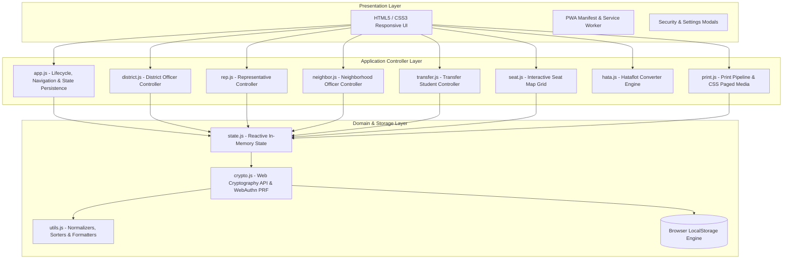
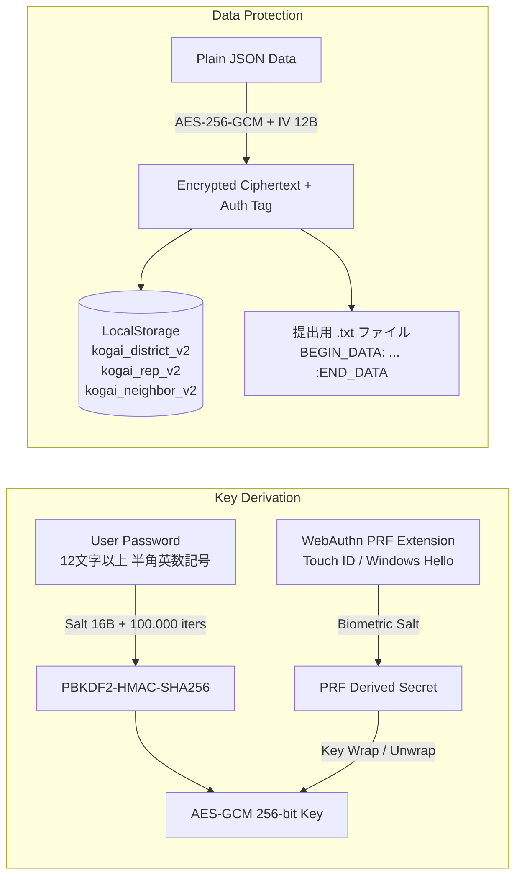
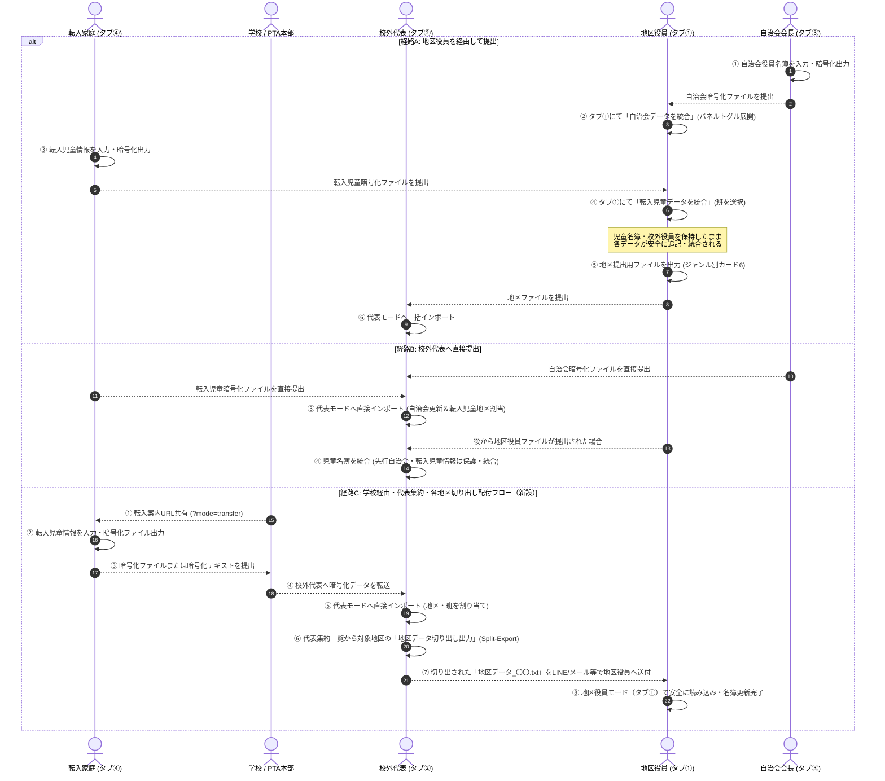
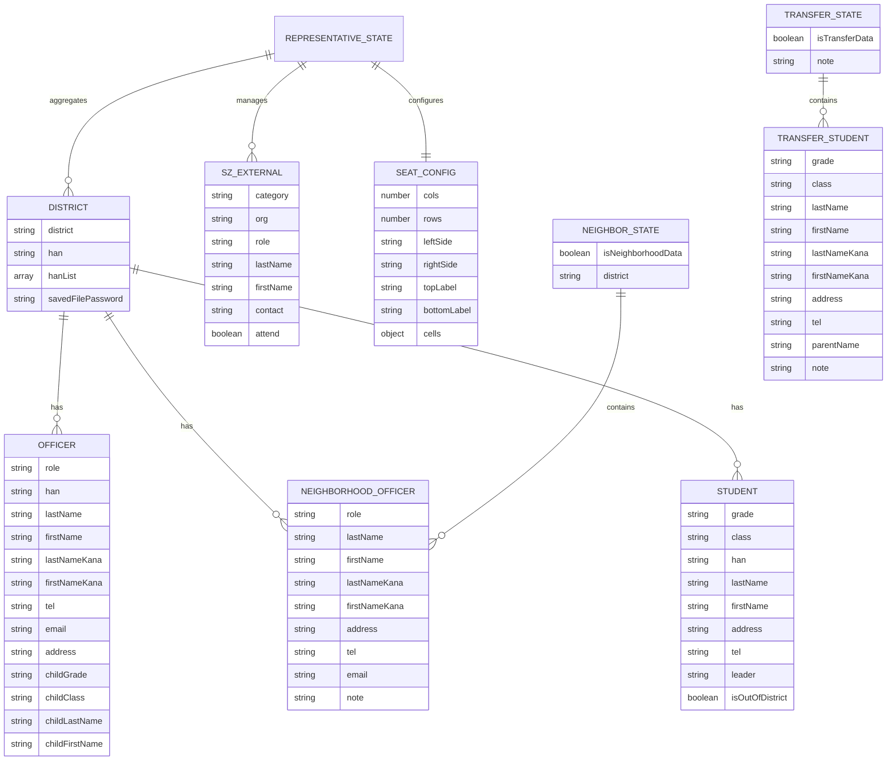

# 校外委員会 名簿・帳票・スクールゾーン協議会管理システム システム設計書
**文書バージョン**: 2.5.1<br>
**策定日**: 2026年10月<br>
**改訂日**: 2026年10月18日 (v2.5.1: prompt非サポート環境防護 safePrompt導入、代表地区切り出しパスワードフォールバックUX改善)<br>
**対象システム**: kogaidocs (PTA Off-Campus Committee & School Zone Management System)

---

## 目次
1. [システム概要・背景・課題意識](#1-システム概要背景課題意識)
2. [設計思想・基本方針（あるべき姿）](#2-設計思想基本方針あるべき姿)
3. [システムアーキテクチャ](#3-システムアーキテクチャ)
4. [セキュリティ・暗号化仕様](#4-セキュリティ暗号化仕様)
5. [機能要件・ユースケース仕様](#5-機能要件ユースケース仕様)
6. [印刷・帳票出力パイプライン](#6-印刷帳票出力パイプライン)
7. [データモデル・エンティティ仕様](#7-データモデルエンティティ仕様)
8. [不要コードの削除およびクリーンアップ方針](#8-不要コードの削除およびクリーンアップ方針)
9. [運用・保守・法的準拠（個人情報保護法対応）](#9-運用保守法的準拠個人情報保護法対応)
10. [品質保証・テスト戦略](#10-品質保証テスト戦略)

---

## 1. システム概要・背景・課題意識

### 1.1 業務背景
小学校PTAにおける「校外委員会（地区委員会）」は、児童の登下校時の安全確保、通学班（集団登校班）の編成・管理、旗振り当番（登校見守り活動）の割り当て、および地域自治会・町内会・警察署・区役所・学校関係者が一堂に会する「スクールゾーン対策協議会（スクゾ）」の運営支援を担っている。

### 1.2 従来の課題意識とリスク
1. **極めて機微な個人情報の散逸リスク**
	- 児童氏名、ふりがな、学年、クラス、通学班、自宅住所、保護者電話番号、保護者メールアドレスなど、児童および家庭のプライバシーに関わる最重要情報が多数取り扱われる。
	- 従来はExcelやスプレッドシート、紙の印刷物、メールへの平文添付などによって地区役員間および代表役員間で受け渡されており、誤送信や端末紛失による漏洩事故リスクが高かった。
2. **毎年交代する非IT専任役員による運用負荷**
	- PTA役員は1年任期で交代する保護者ボランティアであり、複雑なITリテラシーや専用ソフトウェアのインストールを求める運用は破綻を招く。
	- スマートフォンのみを保有する保護者も多く、モバイル端末での快適な入力・閲覧が必須である。
3. **自治会・町内会との情報連携の分断**
	- 自治会役員（会長・副会長・防犯部長等）は、児童名簿とは別に地域側で独自に管理・更新されている。
	- 従来は地区役員が自治会長から紙や口頭で名簿を受け取って再入力しており、転記ミスや入力負担が極めて大きかった。
	- 「自治会長が同じシステムを用いて独立して役員名簿を作成・暗号化出力し、地区役員データや校外代表データへワンクリックで安全に統合できる仕組み」が強く求められていた。
4. **学校・PTA・自治会間の要件の不一致**
	- 提出先ごとに求められる情報粒度が異なる。PTA本部用には連絡先を伏せて児童学年と役員名のみを提出し、学校提出用には災害時・緊急連絡用に児童情報、保護者住所・電話番号、地区＋班の児童数集計が必要となる。
5. **年度途中の転入生（新加入家庭）の安全な情報収集と統合の課題**
	- 学期途中や年度替わりに引っ越してきた転入家庭は、地区名や通学班、校外委員会の内部事情を知らない。
	- 紙の調査票等を手渡しする運用では紛失リスクがあり、個人情報を直接安全に入力・暗号化して役員へ手渡しできる専用の「転入者モード」が求められていた。

---

## 2. 設計思想・基本方針（あるべき姿）

本システムは、現代のWeb標準技術を極限まで活用し、**「サーバーレス・ゼロトラスト・ローカルファースト」**を中核思想として設計されている。

### 2.1 コア原則
1. **Privacy-First & Local-First（外部送信ゼロ）**
	- すべてのデータ処理、バリデーション、暗号化/復号、帳票レンダリングをブラウザ内部（クライアントサイド）でのみ完結させる。
	- 外部サーバーへのテレメトリ、アナリティクス、API送信を一切排除し、オフライン環境でも完全に動作する。
2. **Zero Server Operating Cost（維持費ゼロ・運用永続性）**
	- 静的ホスティング（GitHub Pages等）またはローカルHTMLファイル単体で起動可能。バックエンドサーバー不要で、半永久的に維持費0円で運用可能。
3. **Defense in Depth（多層防御セキュリティ）**
	- 端末内保存（LocalStorage）および受渡ファイル（`.txt`）の双方を、**AES-256-GCM** で保護。
	- パスワード導出には **PBKDF2（100,000回ストレッチング）** を採用。
	- 端末ローカル保存には **WebAuthn PRF（指紋・顔認証・Touch ID・Windows Hello）** を統合。
4. **Quad-Modal Operations（4者協調・双方向配付アーキテクチャ）**
	- **タブ① 各地区役員モード**: 自地区の児童・役員情報の編集、自治会データの統合取込、転入児童データの統合取込、旗振り当番（ハタフロット連携）、自地区印刷、暗号化ファイル出力。
	- **タブ② 校外代表モード**: 各地区データ・自治会データ・転入児童データのマルチインポート・全体集約、転入生の各地区割当、**代表集約データから各地区データへの切り出し出力（Split-Export）**、スクールゾーン協議会出席管理、座席表ドラッグ＆ドロップ配置、12種類の公式帳票一括印刷。
	- **タブ③ 自治会役員モード**: 自治会会長が自立して役員名簿を作成・編集・印刷（名簿・名札）し、安全に暗号化ファイル（`.txt`）として出力。地区役員や校外代表へのスムーズな引き渡しを実現。
	- **タブ④ 転入者モード**: 転入家庭が自家庭の児童情報（学年・組・氏名・住所・電話番号）のみを入力し、安全に暗号化ファイル（`.txt`）または暗号化テキストとして出力。指定された提出先（学校や校外代表）へ安全に提出。
5. **Universal Accessibility（レスポンシブ＆PWA）**
	- スマートフォンの狭小画面でも破綻しないレスポンシブUI（折りたたみカードアコーディオン、横スクロールセーフテーブル、名簿直結の上下ボタン配置、ジャンル別整理された保存カード）。
	- Service Workerによるオフラインキャッシュとマニフェスト定義により、ホーム画面追加（PWAインストール）に対応。
6. **State Continuity & Seamless UX（作業状態の継続性とURLパラメータ誘導）**
	- 前回終了時に開いていたモード（タブ）を自動記録・自動復元。リロードや次回アクセス時に同一画面から即座に作業を再開可能。
	- URLパラメータ（`?mode=transfer` 等）による特定モードの直接起動およびモード指定URL共有に対応。学校等から転入家庭へ迷わず入力画面を案内可能。

---

## 3. システムアーキテクチャ

### 3.1 レイヤー構造



### 3.2 モジュール構成と責務

| モジュール | パス | 主要責務 |
| :--- | :--- | :--- |
| **App Lifecycle** | `js/app.js` | 初期化、4タブ切り替え（地区/代表/自治会/転入者）、前回選択モード復元、PWA登録・強制アップデート、セキュリティバッジ表示、ロック解除モーダル制御 |
| **Crypto Engine** | `js/crypto.js` | Web Cryptography API（AES-GCM 256bit）、PBKDF2（100,000回反復）、WebAuthn PRF、LocalStorage透過的暗号化・復号、ファイル暗号化、パスキー増殖防止固定ID |
| **State Manager** | `js/state.js` | 地区役員データ（`currentDistrict`）、校外代表データ（`repState`）、自治会役員データ（`neighborState`）、転入者データ（`transferState`）のインメモリ管理、LocalStorage自動永続化 |
| **District Mode** | `js/district.js` | 地区名・班名リスト、複数校外役員入力、自治会役員統合取込、転入児童データ統合取込、児童名簿テーブル、年度更新（進級/卒業）、ファイル入出力 |
| **Representative Mode**| `js/rep.js` | 各地区ファイル・自治会ファイル・転入児童ファイルの複数一括読込、クリップボード復号、集約一覧、スクゾ自治会/外部関係者管理、一括印刷ディスパッチ |
| **Neighborhood Mode** | `js/neighbor.js` | 自治会役員名簿CRUD、役員名札・名簿印刷、自治会単独暗号化ファイル出力/読込、年度更新（役職保持・名簿リセット） |
| **Transfer Mode** | `js/transfer.js` | 転入児童情報入力（学年・組・氏名・カナ・住所・TEL・複数児童対応）、暗号化ファイル（`転入児童データ_〇〇.txt`）出力、暗号化テキストコピー |
| **Seat Map** | `js/seat.js` | スクゾ協議会座席表エディタ、動的グリッド拡張/縮小、窓際/廊下側表示入れ替え、出席者プルダウン割当、空席・施設マーカー |
| **Hataflot Integration**| `js/hata.js` | 児童名簿からの住所数字（全角→半角正規化）・苗字抽出、世帯重複排除、カスタムプレースホルダ置換、ワンクリックコピー |
| **Print Pipeline** | `js/print.js` | A4四つ折り自立型名札（中央オリセン・180度反転面）、3x4子供経由封筒宛名、学校用/PTA用役員名簿、児童名簿、自治会名簿等の動的生成 |
| **Utilities** | `js/utils.js` | HTMLエスケープ、姓名・ふりがな分割結合、班名抽出・重複排除、3段階児童ソート、学年別集計、パスワード強度検証、セマンティックバージョン比較（`isNewerVersion`） |

---

## 4. セキュリティ・暗号化仕様

### 4.1 暗号化方式の概要
個人情報保護の観点から、平文の個人情報がローカルストレージや受渡ファイル内に生データとして残存することを厳格に防止する。



### 4.2 パスワードポリシー
- **文字数要件**: 最低12文字以上を強制。
- **文字種要件**: 半角英大文字（`A-Z`）、半角英小文字（`a-z`）、半角数字（`0-9`）、半角記号（`!@#$%^&*()_+-=[]{}|;:,.<>?`）をすべて使用可能。
- **入力支援**: パスワードの「表示 / 非表示」切り替え機能、および「確認用パスワード入力」による不一致リアルタイム検知。

### 4.3 端末内ストレージ暗号化（LocalStorage）
1. **ハイブリッド認証（WebAuthn PRF + PBKDF2）**
	- WebAuthnのPRF（Pseudo-Random Function）拡張に対応した認証器が存在する場合、生体認証による鍵導出を併用。
	- PRF非対応環境でも、ユーザー入力パスワードからPBKDF2経由でAES-256-GCM鍵を安全に導出。
2. **メモリ限定キー管理と自動ロック**
	- 復号された暗号化マスターキー（`CryptoKey`）はブラウザのJavaScriptメモリ内でのみ保持され、ストレージ等には永続化されない。
	- ページリロードやタブのクローズによって鍵は揮発し、次回アクセス時には「ロック解除モーダル」が表示される。
3. **透過的暗号化パイプライン**
	- `state.js` における保存処理（`saveDistrictLocal`, `saveRepLocal`, `saveNeighborLocal`）は `crypto.js` の `saveStorageData()` を経由し、暗号化が有効な場合は自動的に暗号化文字列（`STORAGE_ENC:{base64}`）としてLocalStorageに書き込まれる。

### 4.4 提出・集約ファイル（`.txt`）の暗号化
1. **構造**:
	```text
	--- 校外委員会 地区データ / 自治会データ (地区名 / 出力日:YYYY-MM-DD) ---
	BEGIN_DATA:
	[AES-256-GCM 暗号化 Base64 文字列（IV 12B + Salt 16B + 暗号文 + 認証タグ 16B）]
	:END_DATA
	```
2. **改ざん検知**:
	- AES-GCMの128ビット認証タグ（Authentication Tag）により、暗号化データの改ざんや破損を検知・遮断。

### 4.5 セキュリティ強化仕様（アセスメント指摘対応）
1. **[S-1] 自治会データの透過的暗号化・初期化とワンクリックUI**:
	- LocalStorage保存キー `kogai_neighbor_v2` を暗号化管理（`setupStorageEncryption()`）およびデータ消去（`clearStorageSecurity()`）の対象に完全統合。
	- 自治会役員モード（タブ③）の暗号化出力カードにも、ワンクリックで端末暗号化を適用する「このパスワードで端末内保存も暗号化」ボタンを新設。
2. **[S-2] 画面・メモリの即時パージと自動ロックタイマー**:
	- ロック実行時（`handleImmediateLock()`）に `clearMemoryAndDomForLock()` を呼び出し、インメモリ変数（`currentDistrict`, `repState`, `neighborState`）および印刷プレビューDOM（`#print-area`）を即座に破棄して画面・メモリからの情報流出を遮断。
	- 15分間のユーザー無操作（ポインター操作・キー入力・タッチ操作なし）、またはブラウザタブ非表示（`visibilitychange` イベント検知）に伴う自動ロックタイマー機構を配備。
3. **[S-3] 暗号化バイパスの根絶と最小ペイロード長検証**:
	- 復号処理（`decryptPayload()`）に存在した未認証平文フォールバック（`PLAIN:` 接頭辞判定）を完全削除。
	- 復号前にペイロード長を検証し、AES-GCMヘッダ最小長（IV 12B + Salt 16B + Tag 16B = 44バイト）未満のデータは即座に例外として遮断。
4. **[S-4] 単一引用符を含む厳格なHTMLエスケープ**:
	- `esc()` ユーティリティにおいて、`&`, `<`, `>`, `"` に加え、シングルクォート（`'` → `&#39;`）のエスケープを徹底。属性値挿入時におけるXSS攻撃を防御。
5. **[S-5] コンテンツセキュリティポリシー（CSP）の導入**:
	- `index.html` に `<meta http-equiv="Content-Security-Policy">` を配備。
	- `connect-src 'self'`, `object-src 'none'`, `base-uri 'self'` を指定し、悪意あるスクリプトによる外部C2サーバーへの情報持ち出しをブラウザレベルで強制遮断。
6. **[S-6] 暗号鍵メモリのゼロ化とBlobオブジェクトURLの破棄**:
	- パスワード・生体認証による鍵導出完了後、生マスター鍵ArrayBuffer（`rawMasterKey`）に対し即座に `fill(0)` によるメモリゼロ化を実行。
	- ファイルダウンロード処理（`downloadTextFile()`）完了後、`URL.revokeObjectURL(url)` を非同期で確実に実行し、ブラウザメモリリークとBlob参照残留を防止。

### 4.6 ファイル暗号化パスワードの安全な端末内記憶仕様 (Secure Password Persistence)
1. **セキュリティ課題と脅威分析**:
	- 地区ファイル（`.txt`）の保存および読み込み時には、12文字以上の複雑なパスワードの入力が必須である。
	- 役員が同一年度内に作業を継続する際、毎回パスワードを手動入力する負荷が高く、簡便なパスワードへの形骸化を招くリスクがあった。
	- 一方で、平文のままLocalStorageにパスワードを記憶することは「Zero-Plaintext Storage」のコア原則に反し、重大な漏洩脆弱性となる。
2. **多層防御による安全な実現方式**:
	- **暗号化ストレージ前提**: 端末内LocalStorage暗号化（`AES-256-GCM` + `WebAuthn PRF` または `PBKDF2`）が**有効かつロック解除状態**の場合にのみ、パスワードの端末記憶を許可する。
	- **オプトイン保存**: カード6に `☑ このパスワードを端末内に安全に記憶する（生体認証/端末暗号化で保護）` チェックボックスを配置し、ユーザーの明示的同意がある場合のみ `currentDistrict.savedFilePassword` に保持する。
	- **透過的保護**: ストレージ保存（`saveDistrictLocal()`）時に `saveStorageData()` を経由してAES-256-GCMで自動暗号化されるため、LocalStorage生データには一切平文が残存しない。
	- **状態管理（State）層での二重防壁**: UIのチェック状態やフラグ不整合に関わらず、`state.js` の `saveDistrictLocal()` 内部において `if (!isStorageEncrypted()) { delete districtToSave.savedFilePassword; }` を常時強制適用し、未暗号化LocalStorageへのパスワード平文書き込みリスクを構造的に根絶する。
	- **ロック時の自動揮発**: アプリがロックされると `clearMemoryAndDomForLock()` によりメモリおよび画面入力欄から即座に消去される。WebAuthn（Touch ID / Windows Hello等）またはマスターパスワードによるロック解除を経て初めて再アクセス可能となる。
	- **年度更新時の完全破棄**: 「年度更新（新年度化）」を実行した際、次年度役員への引き継ぎを考慮し、記憶されたファイルパスワードも役員名簿・児童名簿とともに即座に破棄される。

### 4.7 パスワード可視化時の全角自動サニタイズ・IME制御仕様 (Input Sanitization & IME Control)
1. **課題意識**:
	- パスワードの入力ミス防止のために備えられた「👁️ 表示/非表示」切り替え機能において、`type="text"`（可視化状態）にした際、スマートフォンの日本語IMEによって全角英数記号（例: `Ｐａｓｓｗｏｒｄ１２３！`）や全角空白（`　`）が意図せず入力され、復号失敗や文字化けの原因となっていた。
2. **実装アーキテクチャ**:
	- **HTML属性制御**: すべてのパスワード入力要素に `inputmode="latin"`, `autocapitalize="off"`, `autocorrect="off"`, `spellcheck="false"` を明示し、仮想キーボードの半角英字入力を優先誘導。
	- **リアルタイム入力正規化（`sanitizePasswordInput`）**:
		- `input` イベント発火時に、入力文字列内の全角ASCII（`U+FF01`〜`U+FF5E`）を `ch.charCodeAt(0) - 0xFEE0` により半角ASCII（`!`〜`~`）へと自動変換。
		- 全角スペース（`U+3000`）および非ASCII文字（日本語かな・漢字）を自動検知して除去。
		- **キャレット位置補正アルゴリズム**: 文字削除に伴うカーソル飛びを防ぐため、サニタイズ前の `selectionStart` より前で削除・置換された文字差分を追跡し、`setSelectionRange()` により正確なキャレット位置を維持・復元する。

### 4.8 WebAuthn一本化仕様 ＆ パスキー増殖防止アーキテクチャ (Unified WebAuthn & Passkey Management)
1. **課題意識とパスキー重複増殖バグの根本原因**:
	- 従来の実装では、`registerWebAuthnPrf` 実行のたびに `crypto.getRandomValues(new Uint8Array(16))` でランダムな `userId` を生成していた。
	- WebAuthn仕様および1Password、iCloudキーチェーン、Googleパスワードマネージャー等の外部パスキー管理ツールでは、同一RP（ドメイン）であっても `user.id` が異なると「別のアカウント・別のユーザー」と判定され、既存パスキーを上書き更新できず、登録のたびに新規パスキーが無限に増殖・乱立する致命的な問題が発生していた。
	- さらに、ローカルストレージ保護用のWebAuthnと、カード側のファイル保存パスワード記憶用が別々の操作・プロンプトとして扱われ、役員に何度も生体認証登録ダイアログが表示される不整合が生じていた。
2. **固定決定論的ユーザー識別子（Deterministic User ID）の導入**:
	- `registerWebAuthnPrf` における `user.id` を、ランダム生成からシステム共通の固定バイト配列（`const WEBAUTHN_USER_ID = new Uint8Array([107, 111, 103, 97, 105, 100, 111, 99, 115]); // "kogaidocs" in ASCII`）に変更。
	- これにより、パスキーマネージャーが同一アカウントのパスキーとして一意に認識し、再登録・更新時にも「既存パスキーの更新・上書き」が正常に機能し、鍵の重複増殖を根本的に防止する。
3. **アプリ全体での保護パスワード・WebAuthnの一本化**:
	- 端末内ストレージ暗号化（LocalStorage）とファイル出力用パスワード記憶の二重WebAuthn登録を排除。
	- すでにストレージ暗号化が有効な状態であれば、カード側で「ファイルを保存するパスワードを記憶する」を選択した際、再度 `navigator.credentials.create` を起動してWebAuthn登録を促すことはせず、既存の暗号化ストレージ内に安全にパスワードを保持（`currentDistrict.savedFilePassword` 等）。
	- アプリ起動時またはロック解除時に、1回の生体認証（またはマスターパスワード解除）を行うだけで、ローカルストレージ内の全モードデータ（地区・代表・自治会・転入者）および記憶されたファイルパスワードが一括で復号・利用可能となる。

---

## 5. 機能要件・ユースケース仕様

### 5.1 全体ナビゲーション・PWA機能（全モード共通）

| 機能名 | 要件・動作仕様 |
| :--- | :--- |
| **URLパラメータによるモード直接起動** | ・URLクエリパラメータ `mode`（例: `?mode=district`, `?mode=rep`, `?mode=neighbor`, `?mode=transfer`、および数値エイリアス `?mode=1`, `2`, `3`, `4`）を最優先で解釈して起動。<br/>・外部共有リンク（学校からの案内メール、LINE連絡等）を踏んだ際、役員や転入家庭がモード選択で迷うことなく、目的の画面を直接開くことが可能。<br/>・URLパラメータが指定されていない場合は、従来通り前回選択モード（`kogai_active_mode`）を復元。 |
| **モード指定URL共有機能** | ・ヘッダー右側の「🔗 アプリを共有」ボタンおよび各画面内の共有UIにおいて、特定モードを指定したURL（例: `https://.../?mode=transfer`）の生成・共有に対応。<br/>・Web Share API（`navigator.share`）、LINE送信リンク、メーラー起動（`mailto:`）、クリップボードコピーの各経路に対応。 |
| **モード選択肢の動的折りたたみUX** | ・初期画面およびモード選択時、ヘッダー直下の4モード選択ボタンが自動的にコンパクトな「アクティブモード表示バッジ（例：`① 各地区役員モード ▼ [モード切替]`）」へと折りたたまれる。<br/>・スマートフォン等の狭小画面において、作業領域（名簿テーブルや入力フォーム）の視認性を劇的に向上。<br/>・バッジをクリックすると即座に4つのモード選択ボタンが展開され、いつでも自由に他モードへ移動可能。 |
| **前回選択モードの永続化と自動復元** | ・`switchTab(mode)` 実行時に選択されたモード（`district`, `rep`, `neighbor`, `transfer`）を `localStorage.setItem('kogai_active_mode', mode)` として永続化。<br/>・次回アクセス時やページ再読み込み時（`DOMContentLoaded`）、直前に開いていたモードを自動復元し、同一画面から作業をシームレスに再開可能（URLパラメータ指定時はURLパラメータが最優先）。 |
| **アプリ共有機能（PWA対応）** | ・PWAインストール後（スタンドアロン起動時）にブラウザのアドレスバーが消滅し、他の役員へURLを伝えられなくなる問題を解消。<br/>・ヘッダー右側に「🔗 アプリを共有」ボタンを常設。<br/>・Web Share API（`navigator.share`）により、LINE、メール、AirDrop等へワンタップでアプリURLおよび紹介文を送信可能。<br/>・Web Share API非対応ブラウザではクリップボード自動コピーおよびプロンプトフォールバック。 |
| **PWAバージョンチェック＆強制・手動アップデート機構** | ・**課題の根本解決**: PWAインストール（スタンドアロン起動）環境下において、Service WorkerやブラウザのHTTPキャッシュにより新版が反映されない問題を解消。<br/>・**`version.json` による静的バージョン公開**: サーバー直下に `version.json`（`version`, `updatedAt`, `description`）を配備。Service Workerキャッシュから除外し、常に最新の公開バージョンを取得。<br/>・**起動時自動チェック（オンライン時）**: アプリ起動時（DOMContentLoaded後1秒遅延）、`navigator.onLine` が有効であればキャッシュ無効化クエリ（`version.json?_t=${Date.now()}`）で自動取得。現在のバージョン（`CURRENT_APP_VERSION = "2.5.0"`）と比較し、最新版があれば確認ダイアログを表示し、OK選択時に強制アップデート。<br/>・**設定欄最下部の手動確認＆更新UI**: セキュリティ設定モーダル最下部に「📱 アプリバージョン情報」セクションを常設。現在のバージョン表示と「🔄 最新バージョンを確認・更新」ボタンを配備。手動クリック時に即時チェックし、最新版更新または最新状態フィードバックを提供（オフライン時はエラー通知）。<br/>・**ゼロデータロスト強制アップデート (`performAppUpdate`)**: 更新実行前に必ず `saveDistrictLocal()`, `saveRepLocal()`, `saveNeighborLocal()`, `saveTransferLocal()` を独立try-catchで安全実行して入力データを保全。Service Workerキャッシュ全消去（`caches.delete()`）およびSW登録全解除を行い、キャッシュバスティングパラメータ付きURLで最新版を再取得。<br/>・**HTTPキャッシュ制御**: `navigator.serviceWorker.register('./sw.js', { updateViaCache: 'none' })` により、ブラウザのHTTPキャッシュをバイパスして `sw.js` の変更を確実に検知。 |

### 5.2 各地区役員モード（タブ①）

| 機能名 | 要件・動作仕様 |
| :--- | :--- |
| **地区名・班名リスト管理** | ・地区名（例：1丁目、緑ヶ丘）を入力。<br/>・地区名直下にカンマ区切りの班名リスト（例：`A班, B班, C班`）を登録。<br/>・班名リストから児童名簿および校外役員の「担当班」プルダウンが自動生成される。 |
| **校外役員管理（複数人対応）** | ・1地区あたり2人以上の役員（各班担当等）を登録可能。<br/>・氏名・ふりがなを「姓 / 名」別に入力。<br/>・役職、担当班、電話番号、メールアドレス、住所、封筒受取用児童情報（学年・組・氏名）を完備。<br/>・入力と連動してカードヘッダーがリアルタイム反映。 |
| **自治会役員統合取込UI（トグル開閉UX）** | ・**トグル展開UX**: カード2ヘッダーの「📥 自治会データを統合」をクリックすると、カード本体を展開しつつ、自治会統合パネル（`#d-neighbor-import-panel`、初期 `display: none`）の表示/非表示をトグル開閉。<br/>・**名簿直結の「＋ 行を追加」ボタン配置**: 統合パネルの初期非表示化に伴い、自治会役員名簿テーブルの直前（上部ツールバー）および直下（テーブルフッター）の双方に「＋ 行を追加」ボタンを配置し、スクロール負担なく行追加が可能。<br/>・**スマートフォン最適化**: 横幅狭小画面でもボタンやテキストが途切れないレスポンシブな縦並びレイアウト。ファイル読込ボタン（`📁 ファイルから統合`）とクリップボード貼付入力欄（`#d-neighbor-paste-box`、`📥 貼付テキストから統合`）を明瞭に分離配置。<br/>・**地区名不一致時の保護**: 自治会データ内の地区名と自地区名が異なる場合、警告・確認ダイアログ（例: `自治会名（〇〇）が現在の地区名（△△）と異なりますが統合しますか？`）を表示し、キャンセル時は安全に中断。<br/>・現在の児童名簿や校外役員データを一切破壊せず、自治会役員テーブルのみを最新情報に更新。 |
| **転入児童データ統合取込（トグル開閉UX）** | ・カード3「児童名簿」ヘッダーまたはツールバーに「📥 転入児童データを統合」トグルボタンを配置。<br/>・取り込みパネル（`#d-transfer-import-panel`）を初期非表示（`display: none`）とし、トグル開閉により名簿一覧の邪魔にならない設計。<br/>・転入家庭から受け取った暗号化ファイル（`.txt`）または暗号化テキストを復号読込。<br/>・**班割り当て選択**: 地区に登録済みの班名リスト（`hanList`）から割り当てる班を選択する確認ダイアログを表示。<br/>・転入家庭の児童（1名または複数名兄弟姉妹）を自地区の児童名簿へ安全に追記・ソート・自動保存。 |
| **児童名簿管理（名簿直結ボタン配置）** | ・学年（1〜6年）、クラス、班、氏名（姓/名）、ふりがな（せい/めい）、住所、電話番号、役職（班長/副班長/一般）、学区外フラグを入力。<br/>・**名簿直結ツールバー＆フッター**: 児童名簿テーブルの直前上部に「🔽 並び替え」「＋ 児童を追加」ボタンを、テーブル直下フッターに「＋ 児童を追加」ボタンを配置し、名簿行とボタンが離れすぎない最適な視認性・操作性を実現。<br/>・新規追加時は直前児童の班名を自動継承。<br/>・ソート優先順位: **① 班長 → 副班長 → その他**、**② 学年（6年→1年降順）**、**③ 住所（五十音順）**。<br/>・名簿最下部に「班の児童数」と「地区全体の児童数」および学区外児童数を自動併記。 |
| **ハタフロット連携** | ・旗振り当番管理システム（ハタフロット）用テキストを自動生成。<br/>・住所の全角数字（１－２－３等）を半角数字（1-2-3）に自動正規化。<br/>・同住所・同姓の兄弟姉妹を1行に重複排除。<br/>・アロー関数による特殊置換文字（`$$`等）安全展開。<br/>・クリップボードへのワンクリックコピー。 |
| **地区データ保存・読み込み・年度更新（ジャンル別4大セクション整理）** | ・カード6の内部を機能ジャンルごとに明瞭に区切られた4大セクションとして整理・レイアウト：<br/>　**① パスワード設定・端末記憶**: ファイル保護用パスワード（12文字以上、可視化トグル、全角サニタイズ）、確認入力、端末暗号化ストレージ連動記憶チェックボックス。<br/>　**② 地区データの保存・出力・外部共有**: 「💾 ファイルを保存（.txt）」、「📱 LINEで共有」、「✉️ メールで送信」、「🔗 共有（Web Share）」、「📋 暗号化テキストをコピー」。暗号文が2,000文字を超える場合は自動でクリップボード退避＋定型文起動。<br/>　**③ 地区データの読み込み・復元**: 「📂 ファイルから読み込み」、「📥 貼付テキストから読み込み」。<br/>　**④ 年度更新（新年度化）**: 「🌸 新年度へ更新（進級・卒業・役員初期化）」。6年生自動削除、1〜5年生進級、旧役員欄・記憶パスワードの安全クリア。 |

### 5.3 校外代表モード（タブ②）

| 機能名 | 要件・動作仕様 |
| :--- | :--- |
| **マルチファイル集約** | ・各地区役員から提出された児童名簿ファイル、自治会長から提出された自治会役員ファイル、および転入家庭から提出された転入児童ファイルを一括マルチセレクト読込。<br/>・暗号化テキストの直接貼り付けにも対応。 |
| **自治会役員データの自律統合** | ・自治会役員ファイルが読み込まれた場合：<br/>　- 該当地区が既に存在すれば、児童名簿を維持したまま自治会役員情報のみを更新・同期。<br/>　- 該当地区が未登録であれば、自治会役員情報を先行保持する地区エントリを自動生成。<br/>・**後続インポート時のデータ保護判定ルール**: 代表モードに自治会役員データが先行登録された後、地区役員から提出された地区ファイルを取り込む際、インポートデータ側の `neighborhood` に有効な役員（氏名等の入力値）が存在しない場合は、代表側の既存自治会役員データを上書き消去せず保護・維持する。 |
| **転入児童データの代表統合** | ・代表モードに転入児童ファイルが読み込まれた場合、所属地区および班を選択するダイアログを表示し、該当地区の児童名簿へ安全に統合・追記。 |
| **代表モードからの各地区データ切り出し出力（Split-Export）** | ・**双方向データ配付の実現**: 代表モードで集約・編集したデータ（転入児童追加後や自治会役員反映後）を、各地区委員へ差し戻し・配付するための切り出し出力機能（`exportSingleDistrictFromRep`）を配備。<br/>・集約一覧テーブル（`#rep-districts-table`）の各地区行に「📤 切り出し」ボタンを設置。<br/>・指定地区の単一地区オブジェクト（`district`, `hanList`, `officers`, `neighborhood`, `students`）をディープクローン生成し、最小権限の原則（PoLP）に基づき他地区データ・外部関係者・座席設定を完全除外。<br/>・**パスワード決定およびフォールバックUX**: 引数明示 ＞ 代表保存用パスワード（`#rep-pass`） ＞ `safePrompt` の優先順で決定。`prompt()` がサポートされていない環境や未入力時は、エラークラッシュ（`Uncaught Error: prompt() is not supported.`）を完全に防護し、「代表データ保存用パスワード欄（カード5）にパスワードを入力してください」と案内した上で、カード5の自動展開および `#rep-pass` への自動フォーカスを実施。<br/>・「💾 ファイル保存（`地区データ_〇〇.txt`）」、「📱 LINE共有」、「✉️ メール送信」、「📋 暗号化テキストコピー（またはWeb Share）」の多層出力に対応。<br/>・各地区委員は受け取った暗号化ファイル/テキストを地区役員モード（タブ①）で通常通り読み込み可能。 |
| **重複排除・集約一覧** | ・全地区の役員情報、児童数、自治会役員数を一覧表示。<br/>・同一地区名で複数班のファイルが提出された場合、自治会役員の重複を自動排除。<br/>・印刷対象とする地区の個別選択チェックボックス完備。 |
| **スクールゾーン協議会 出席管理** | ・学校関係者、PTA本部、関係行政機関の出席簿・連絡先管理。<br/>・自治会役員出席セレクタ（会長役職の自動初期チェック、同一地区のチェック同期）。 |
| **スクゾ座席表エディタ** | ・会場レイアウト（行数・列数）の動的リサイズ。<br/>・全出席者（学校・PTA・行政・自治会・校外役員）から選択割当。<br/>・「空席」「演台」「プロジェクター」等の施設マーカー配置。<br/>・「窓側 / 廊下側」のワンクリック反転。 |
| **一括印刷パネル** | ・全12種類の公式帳票から必要な書類を選択し、一括で改ページ印刷・PDF保存。 |

### 5.4 自治会役員モード（タブ③）

| 機能名 | 要件・動作仕様 |
| :--- | :--- |
| **自治会名（地区名）設定** | ・自自治会・町内会名（例：`緑ヶ丘自治会`、`本町町内会`）を入力。 |
| **自治会役員名簿編集** | ・役職（会長、副会長、総務、防犯、防災、交通、会計、顧問等）、氏名（姓/名）、ふりがな（せい/めい）、住所、電話番号、メールアドレス、備考を入力。<br/>・行の追加、削除、並び替え操作に対応。 |
| **自治会単独 帳票印刷** | ・「自治会役員名簿（A4縦・提出用/控え用）」の即時印刷。<br/>・「自立型 四つ折り名札（中央オリセン・天面反転印字）」の即時印刷。 |
| **提出・保存用ファイル暗号化出力** | ・AES-256-GCM + PBKDF2（12文字以上パスワード二度入力）による安全な暗号化ファイル（`自治会役員データ_〇〇.txt`）出力。<br/>・メールやLINE貼付用の暗号化テキストコピー機能。<br/>・ワンクリック端末暗号化適用ボタン完備。 |
| **提出ファイル読込・復号（専用パスワード分離）** | ・**読込専用パスワード入力欄（`#neighbor-import-pass`）の新設**: 保存用カードのパスワード欄と物理的・視覚的に完全分離。<br/>・過去に出力した自治会役員データファイル、または暗号化テキストの復号読込。 |
| **年度更新（新年度化）** | ・役職一覧の枠組みを残したまま、任期満了した役員の氏名・連絡先のみを安全にリセット。 |

### 5.5 転入者モード（タブ④）

| 機能名 | 要件・動作仕様 |
| :--- | :--- |
| **転入児童・家庭情報入力** | ・校外委員会側の情報（地区名・班名・校外役員等）は一切求めず、転入家庭の当事者が知っている情報のみを入力。<br/>・**入力項目**: 学年（1〜6年）、クラス/組（例：`1組`）、氏名（姓/名）、ふりがな（せい/めい）、自宅住所、連絡先電話番号、保護者氏名/備考。<br/>・**兄弟姉妹（複数児童）対応**: 「＋ 児童を追加」ボタンにより、同一家庭内の複数児童（例：6年生と1年生の兄弟など）を1つのファイルにまとめて入力可能。行の削除にも対応。 |
| **暗号化提出ファイル出力** | ・AES-256-GCM + PBKDF2（12文字以上パスワード二度入力）により、暗号化ファイル（`転入児童データ_〇〇.txt`）を出力。<br/>・提出先説明文言: 「暗号化してファイルまたはテキストで指定された提出先へご提出ください。」とし、学校直接提出などの多様な運用に対応。<br/>・パスワード可視化トグルおよび全角サニタイズ（`sanitizePasswordInput`）完備。<br/>・データ識別子 `isTransferData: true` を埋め込み、地区・代表モードでの安全な取り込み判定を実現。 |
| **暗号化テキストコピー・共有** | ・スマートフォン等でファイルを扱いにくい環境のため、「📋 暗号化テキストをコピー（LINE・メール貼付用）」ボタンを配備。<br/>・役員や学校へLINEやメール等で直接暗号化文字列を送付可能。 |
| **転入者用URL共有ボタン** | ・転入者モード画面内に「🔗 転入者用URLを共有」ボタンを配備。<br/>・`?mode=transfer` を付与したURLを、学校や他役員が転入予定家庭へ即座にLINEやメール等で案内可能。 |
| **入力内容リセット** | ・提出完了後または誤入力時に、端末内に残存する入力中児童データをワンタップで安全にクリア。 |

### 5.6 データ統合・同期パイプライン



---

## 6. 印刷・帳票出力パイプライン

### 6.1 印刷アーキテクチャ
ブラウザ標準の `window.print()` および CSS Paged Media 仕様（`@page`）を活用し、外部PDFライブラリ不要で商用印刷品質のA4帳票を出力する。

### 6.2 帳票一覧と設計仕様

| No | 帳票名 | 利用モード | 用紙・向き | 特色・設計詳細 |
| :---: | :--- | :---: | :---: | :--- |
| **①-A** | **校外役員名簿（PTA提出用）** | 代表 | A4 縦 | プライバシー配慮。地区名、役員氏名、お子様学年のみ表示。代表三役のみ連絡先別掲。 |
| **①-B** | **校外役員名簿（学校提出用）** | 代表 | A4 縦 | 緊急連絡用。地区名、役員氏名、住所、電話、児童情報、児童数集計、学区外児童数を網羅。 |
| **②** | **定例会用 四つ折り名札** | 地区/代表/自治会 | A4 横 | **山折り自立型（Origami Tent Card）**。中央に破線ガイド。対面から読めるよう上面は180度上下反転。 |
| **③** | **子供経由 封筒宛名ラベル** | 地区/代表 | A4 縦 | A4用紙に3行×4列（計12面）配置。児童への配慮として「（おうちの人に、かならず、わたしてね）」印字。 |
| **④** | **地区別・班別 児童名簿** | 地区/代表 | A4 縦 | 地区名＋班名ごとに改ページ。班長→副班長→その他ソート。班・地区の学年別内訳ボックス併記。 |
| **⑤** | **地区別 自治会役員名簿** | 地区/代表/自治会 | A4 縦 | 地区名と結びつく自治会役員一覧。複数班にまたがる重複を自動排除。 |
| **⑥** | **スクゾ用 四つ折り名札** | 代表 | A4 横 | 学校関係者・PTA本部・区役所・警察署・自治会代表・校外役員全員分の自立型名札を一括生成。 |
| **⑦** | **スクゾ出席簿 1** | 代表 | A4 縦 | 学校関係者、PTA本部、校外役員用のサイン欄付き出席簿。 |
| **⑧** | **スクゾ出席簿 2** | 代表 | A4 縦 | 行政機関（警察・役所）、各地区自治会代表用のサイン欄付き出席簿。 |
| **⑨** | **スクゾ出席簿 3（当日空白）** | 代表 | A4 縦 | 当日の代理出席や飛び入り参加者に対応する手書き用空白名簿。 |
| **⑩** | **スクゾ 座席表** | 代表 | A4 横 | 会場全体の座席グリッド図。役職・氏名、窓側/廊下側、演台等の位置関係を明瞭にビジュアライズ。 |
| **⑪** | **代表控え用 スクゾ関係者名簿** | 代表 | A4 縦 | スクールゾーン協議会に関わる全関係者の連絡先付き統合マスター名簿。 |

---

## 7. データモデル・エンティティ仕様

### 7.1 エンティティ関係図（ERD）



### 7.2 JSONスキーマ定義

#### 1. 自治会役員データ（`kogai_neighbor_v1` / `自治会役員データ_〇〇.txt`）
```json
{
	"$schema": "http://json-schema.org/draft-07/schema#",
	"title": "NeighborhoodData",
	"type": "object",
	"required": ["isNeighborhoodData", "district", "neighborhood"],
	"properties": {
		"isNeighborhoodData": { "type": "boolean", "const": true },
		"district": { "type": "string", "description": "自治会名・地区名" },
		"neighborhood": {
			"type": "array",
			"items": {
				"type": "object",
				"required": ["role", "lastName"],
				"properties": {
					"role": { "type": "string" },
					"lastName": { "type": "string" },
					"firstName": { "type": "string" },
					"lastNameKana": { "type": "string" },
					"firstNameKana": { "type": "string" },
					"address": { "type": "string" },
					"tel": { "type": "string" },
					"email": { "type": "string" },
					"note": { "type": "string" }
				}
			}
		}
	}
}
```

#### 2. 転入児童データ（`kogai_transfer_v1` / `転入児童データ_〇〇.txt`）
```json
{
	"$schema": "http://json-schema.org/draft-07/schema#",
	"title": "TransferStudentData",
	"type": "object",
	"required": ["isTransferData", "students"],
	"properties": {
		"isTransferData": { "type": "boolean", "const": true },
		"note": { "type": "string", "description": "連絡事項・備考" },
		"students": {
			"type": "array",
			"items": {
				"type": "object",
				"required": ["grade", "lastName", "address", "tel"],
				"properties": {
					"grade": { "type": "string", "description": "学年（1〜6）" },
					"class": { "type": "string", "description": "組/クラス" },
					"lastName": { "type": "string", "description": "児童 姓" },
					"firstName": { "type": "string", "description": "児童 名" },
					"lastNameKana": { "type": "string", "description": "ふりがな せい" },
					"firstNameKana": { "type": "string", "description": "ふりがな めい" },
					"address": { "type": "string", "description": "自宅住所" },
					"tel": { "type": "string", "description": "連絡先電話番号" },
					"parentName": { "type": "string", "description": "保護者氏名（任意）" },
					"note": { "type": "string", "description": "備考" }
				}
			}
		}
	}
}
```

---

## 8. 不要コードの削除およびクリーンアップ方針

本改修にあたり、過去の暫定実装や互換維持コードを整理・削除し、コードベースの健全性を担保する。

1. **旧単数役員フィールド（`d.officer`）の完全廃止**:
	- 全モジュールで `d.officers`（配列形式）に一本化。`d.officer = d.officers[0]` のような二重保持・同期コードを削除。
	- [C-2] `print.js`（8箇所）および `seat.js` 内に存在した `(d.officer ? [d.officer] : [])` フォールバックコードを完全撤去。
	- `buildOfficersRosterPageHtml` の旧エイリアス関数を削除し、`buildPtaOfficersRosterPageHtml` に統一。
2. **静的フォーム用フォールバックコードの削除**:
	- `js/state.js` 内の `else if (document.getElementById('o-last-name'))` など、初期プロトタイプ時代の静的DOMフォールバックを完全撤去。
3. **冗長な合成プロパティ代入の整理**:
	- オブジェクト内部に直接代入されていた `obj.name = getFullName(obj)` 等の二重保持を廃止し、UI描画および帳票生成時に `getFullName(obj)` / `getChildFullName(obj)` を参照する形式に統一。
4. **ファイル読込境界（Ingress）での安全なマイグレーション**:
	- 過去の提出ファイルや旧LocalStorageデータを読み込んだ際の後方互換性を担保するため、ファイル復号・パース直後（Ingress境界）でのみ `if (!d.officers && d.officer) { d.officers = [d.officer]; } delete d.officer;` を適用。State内部および新規保存・新規出力ファイルでは `d.officer` を完全に排除。
5. **[C-1] PWA ServiceWorker キャッシュ資産の整合性確保**:
	- `sw.js` のプリキャッシュ対象に新設モジュール `'./js/transfer.js'` を追加。
	- キャッシュ名を `kogai-cache-v2.5.0` に更新し、オフライン環境下でのスクリプト未取得エラーを完全防止。
6. **[C-3] 地区役員モードへの自治会データクリップボード貼り付け統合UI新設・改善**:
	- タブ①カード2にクリップボード貼り付けエリアを新設し、ファイル選択だけでなくテキスト貼り付け（`loadPastedNeighborTextIntoDistrict()`）による自治会データ統合に対応。
	- さらに、ヘッダーボタンクリックによるトグル展開化と、スマートフォンでの横幅溢れを防ぐレスポンシブな縦並びUIへと刷新。
7. **[C-4] ハタフロット連携文字列置換の関数置換化とクリップボード堅牢化**:
	- `hata.js` 内の正規表現置換において、置換文字列内に `$$` 等の特殊記号が含まれる場合の誤展開を防止するため、アロー関数置換 `() => val` を徹底。
	- クリップボードAPI拒絶時のテキストエリア選択＋手動コピー案内フォールバックを実装。
8. **[C-5] 自治会読込処理における保存用パスワード参照の排除**:
	- `loadNeighborTxt()` および `loadPastedTextToNeighbor()` において、保存用入力欄 `#neighbor-pass` を直接参照する不整合コードを排除し、新設された読込専用入力欄 `#neighbor-import-pass` を第一優先で参照するよう整理。
9. **[C-6] パスワード入力イベントハンドラの正規化集約**:
	- 各入力欄で個別に書かれていた場当たり的な全角制御コードを廃止し、共通ユーティリティ `sanitizePasswordInput(el)` に一本化。
10. **[C-7] PWAバージョンチェック＆強制アップデート機構のServiceWorkerキャッシュ分離**:
	- `version.json` を静的バージョン情報として公開し、Service Workerのキャッシュ対象から明示的に除外（または `cache: 'no-store'` 通過）して常にネットワークから直接最新バージョンを取得。
	- Service Worker登録時の `{ updateViaCache: 'none' }` 指定および `SKIP_WAITING` リスナーによる即時アクティベーションを実装。
	- 強制アップデート時のキャッシュ全消去（`caches.delete()`）とサーバー再読み込みによる最新資産への即時切り替えを保証。
11. **[C-8] 「マージ」用語の全面廃止と「統合・結合」への統一**:
	- システム内の全UI表示、ボタンラベル、確認・完了ダイアログ、ヘルプテキスト、コード内メッセージ、設計書のすべてにおいて「マージ」の使用を完全廃止し、文脈に応じて「統合」または「結合」へと一括統一。
12. **[C-9] WebAuthnにおけるランダムuserIdの排除と固定ID一本化**:
	- `registerWebAuthnPrf` における `userId` ランダム生成コードを完全撤去し、システム共通の決定論的バイト列（`WEBAUTHN_USER_ID`）に統一。1Password等のパスキー管理ツールでの鍵重複増殖バグを根絶。
13. **[C-10] 自治会・転入統合パネルのトグル制御および初期表示バグの解消**:
	- `#d-neighbor-import-panel` に初期状態 `style="display:none;"` を明示し、ボタン押下時にカードを展開しつつ `display: none` ⇄ `block` を交互にトグル切り替えする。
	- 児童名簿の `#d-transfer-import-panel` も同様に初期非表示とし、トグル開閉化して名簿テーブルと上下ツールバーの近接配置を担保する。
14. **[C-11] 代表モードからの地区データ切り出し出力における完全互換フォーマット生成**:
	- 代表モードで集約された各地区エントリから単一地区オブジェクト（`district`, `hanList`, `officers`, `neighborhood`, `students`）を過不足なく生成し、AES-256-GCM暗号化（`地区データ_〇〇.txt`）を出力する。
	- 地区役員モード（タブ①）の既存復号・受入ルーチン（`loadDistrictTxt`）と100%完全互換であることを保証する。

---

## 9. 運用・保守・法的準拠（個人情報保護法対応）

### 9.1 日本国 個人情報保護法（APPI）への準拠
1. **安全管理措置（法第23条）**: 保存データおよび伝送ファイルへのAES-256-GCM暗号化適用により、高度な安全管理措置を満たす。
2. **第三者提供の制限（法第27条）**: 外部サーバーへの個人情報預託を一切行わない完全ローカル完結設計。
3. **役員交代時のデータ消去（法第22条）**: 各モードに備えられた「年度更新（新年度化）」機能により、任期満了後の旧個人情報および記憶されたファイルパスワードを安全に消去可能。

---

## 10. 品質保証・テスト戦略

### 10.1 テスト方針
Node.js 24組み込みのテストランナー（`node:test`）、アサーション（`node:assert`）、WebCrypto環境を活用し、**外部npm依存ゼロ（Zero External Dependencies）**で完全自動テストスイートを維持する。

### 10.2 カバレッジ目標
すべてのモジュールにおいて、**命令網羅（Line）**、**分岐網羅（Branch）**、**関数網羅（Funcs）**で **95.00%以上** を維持・達成する。

### 10.3 テスト観点マトリクス（新機能・全機能網羅）
1. **単体テスト（Unit Tests）**:
	- `app.js`:
		- URLパラメータ `mode`（`district`, `rep`, `neighbor`, `transfer`、数値 `1〜4`）による直接選択、無効パラメータフォールバック、直前選択モードとの優先順位。
		- モード指定URL共有（`shareAppUrl(specificMode)`）: クエリ付加、Web Share API呼び出し、クリップボードフォールバック。
		- 4モード選択肢の動的折りたたみUX: 初期状態、各モード選択後の自動折りたたみ、展開バッジのクリックによる再展開。
		- 前回選択モードの永続化と復元: `switchTab` での `localStorage` 記録、起動時の自動復元、不正モード名の安全なフォールバック。
		- PWAバージョンチェック（`checkAppVersion`）: オンライン時の最新バージョン検知、更新確認ダイアログ、手動更新ボタンのdisabled制御と復帰。
		- 強制アップデート（`performAppUpdate`）: 独立try-catchによる全4モード（地区・代表・自治会・転入者）状態同期保存、キャッシュ破棄、登録解除、リロード。
	- `crypto.js`:
		- 固定 `WEBAUTHN_USER_ID` の検証: 1Password等パスキー管理ツールでの上書き更新互換性。
		- ストレージ暗号化とWebAuthn一本化: ストレージ暗号化済み環境での重複登録抑止。
	- `transfer.js`:
		- 転入児童CRUD（追加・削除・入力更新・複数児童対応）。
		- 暗号化ファイル（`.txt`）出力・暗号化テキストコピー・復号読込。
		- 提出先文言「指定された提出先」の確認。
		- 転入者用URL共有ボタンの動作検証。
		- 入力リセット（クリア）動作。
	- `district.js`:
		- 自治会統合パネルのトグル開閉（初期非表示、トグル反転）。
		- 転入児童統合パネルのトグル開閉（初期非表示、トグル反転）。
		- 自治会名簿および児童名簿における上下ツールバー・フッター「行を追加」「児童を追加」ボタンの動作。
		- カード6（ジャンル別4大セクション）における各ボタン群の動作。
		- 転入児童データの受入・統合（班割り当て、重複チェック、名簿追記、ソート、保存）。
	- `rep.js`:
		- 複数ファイル一括読込における転入児童データの自動判別および地区割り当て統合。
		- 代表モードからの各地区データ切り出し出力（`exportSingleDistrictFromRep`）: 単一地区オブジェクト生成、暗号化ファイル出力、LINE共有、メール送信、暗号化テキストコピー。
		- 自治会データの自律統合および保護ロジック。
2. **結合テスト（Integration Tests - 多層データ統合パイプライン）**:
	- **パターンA（自治会統合）**: 自治会出力 → 地区統合（児童・校外役員保持） → 地区出力 → 代表インポート。
	- **パターンB（転入児童統合）**: 転入者出力 → 地区受入（班割当統合） → 地区出力 → 代表インポート。
	- **パターンC（転入児童代表直接）**: 転入者出力 → 代表受入（地区選択統合）。
	- **パターンD（同一地区複数班統合）**: 同一地区の複数班ファイルインポート時における自治会役員・児童の重複排除および整合性同期。
	- **パターンE（新フロー: 学校経由・代表集約・各地区切り出し配付）**: 転入者出力 → 代表直接受入（地区・班割当） → 代表から特定地区切り出し出力（Split-Export） → 地区役員モードで受入・名簿反映。
	- クリップボード貼り付け復号による取り込み結合テスト。
3. **システムテスト（System Tests - E2E / セキュリティ）**:
	- 4タブ（①地区 ⇄ ②代表 ⇄ ③自治会 ⇄ ④転入者）の全画面巡回、タブ切り替え時の入力中フォーム値の保持。
	- URLクエリパラメータ付きURLでの直接モード起動E2E検証。
	- ブラウザランタイム統合テスト（単一グローバル環境でのスクリプトロード・エラーゼロ検証）。
	- 耐タンパー性テスト: 改ざん暗号文・Base64破損・IV欠損の復号拒絶とトランザクション保護（既存データ破壊防止）。
	- 全コードベースにおける「マージ」文言の残存ゼロ検証テスト。
	- WebAuthnキーの多重登録抑止および1回の生体認証による全モード復号ライフサイクルの検証。

### 10.4 カバレッジ達成目標
- 全モジュールにおいて **命令網羅 100.00%**、**分岐網羅 95.00%以上** を維持する。
