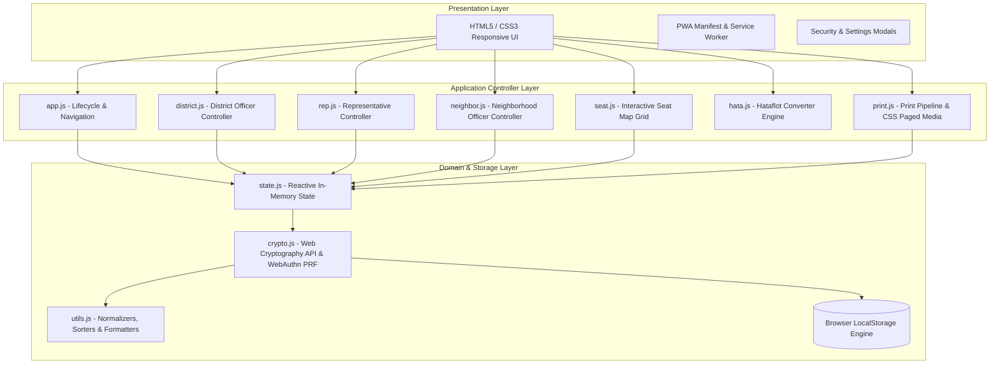
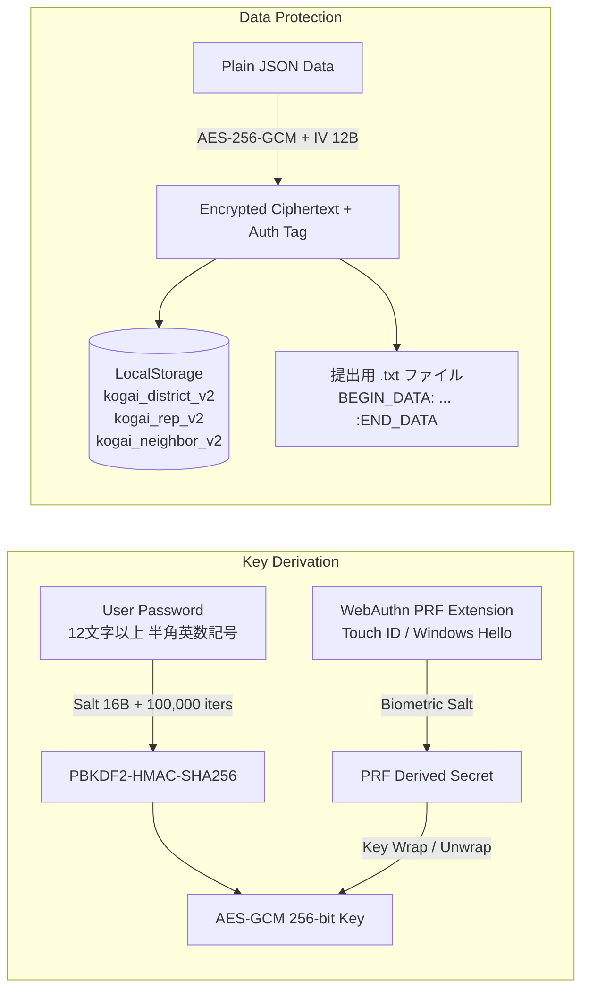
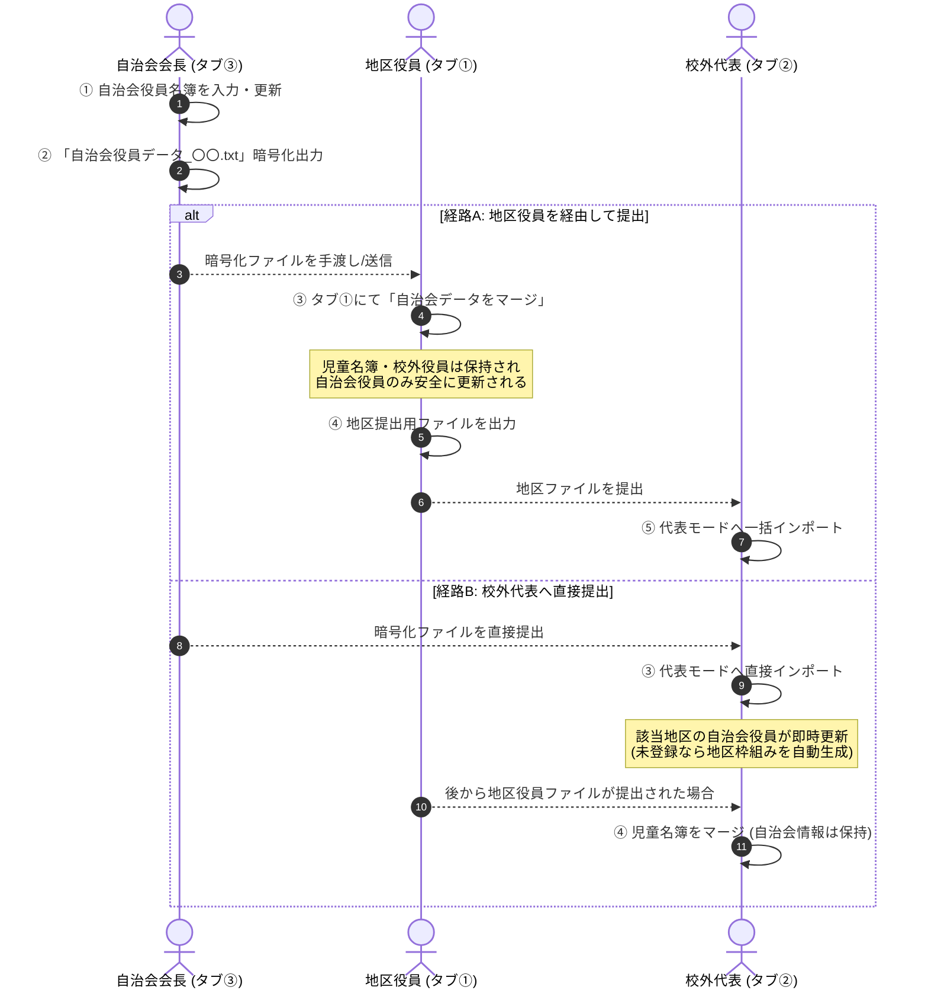
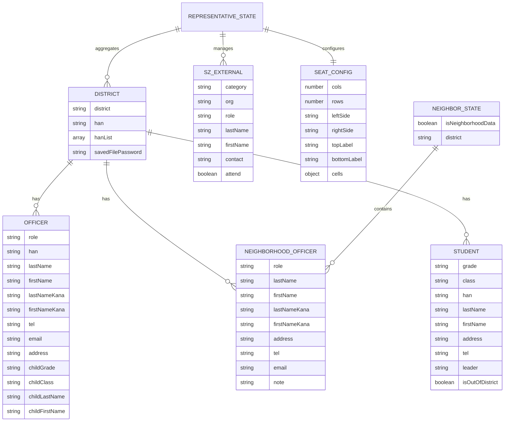

# 校外委員会 名簿・帳票・スクールゾーン協議会管理システム システム設計書
**文書バージョン**: 2.3.0<br>
**策定日**: 2026年10月<br>
**改訂日**: 2026年10月17日 (v2.3.0: PWA起動時自動・手動バージョンチェック＆強制アップデート機構の追加)<br>
**対象システム**: kogaidocs (PTA Off-Campus Committee & School Zone Management System)

---

## 目次
1. [システム概要・背景・課題意識](#1-システム概要背景課題意識)
2. [設計思想・基本方針（あるべき姿）](#2-設計思想基本方針あるべき姿)
3. [システムアーキテクチャ](#3-システムアーキテクチャ)
4. [セキュリティ・暗号化仕様](#4-セキュリティ暗号化仕様)
5. [機能要件・ユースケース仕様](#5-機能要件ユースケース仕様)
6. [印刷・帳票出力パイプライン](#6-印刷帳票出力パイプライン)
7. [データモデル・エンティティ仕様](#7-データモデルエンティティ仕様)
8. [不要コードの削除およびクリーンアップ方針](#8-不要コードの削除およびクリーンアップ方針)
9. [運用・保守・法的準拠（個人情報保護法対応）](#9-運用保守法的準拠個人情報保護法対応)
10. [品質保証・テスト戦略](#10-品質保証テスト戦略)

---

## 1. システム概要・背景・課題意識

### 1.1 業務背景
小学校PTAにおける「校外委員会（地区委員会）」は、児童の登下校時の安全確保、通学班（集団登校班）の編成・管理、旗振り当番（登校見守り活動）の割り当て、および地域自治会・町内会・警察署・区役所・学校関係者が一堂に会する「スクールゾーン対策協議会（スクゾ）」の運営支援を担っている。

### 1.2 従来の課題意識とリスク
1. **極めて機微な個人情報の散逸リスク**
	- 児童氏名、ふりがな、学年、クラス、通学班、自宅住所、保護者電話番号、保護者メールアドレスなど、児童および家庭のプライバシーに関わる最重要情報が多数取り扱われる。
	- 従来はExcelやスプレッドシート、紙の印刷物、メールへの平文添付などによって地区役員間および代表役員間で受け渡されており、誤送信や端末紛失による漏洩事故リスクが高かった。
2. **毎年交代する非IT専任役員による運用負荷**
	- PTA役員は1年任期で交代する保護者ボランティアであり、複雑なITリテラシーや専用ソフトウェアのインストールを求める運用は破綻を招く。
	- スマートフォンのみを保有する保護者も多く、モバイル端末での快適な入力・閲覧が必須である。
3. **自治会・町内会との情報連携の分断**
	- 自治会役員（会長・副会長・防犯部長等）は、児童名簿とは別に地域側で独自に管理・更新されている。
	- 従来は地区役員が自治会長から紙や口頭で名簿を受け取って再入力しており、転記ミスや入力負担が極めて大きかった。
	- 「自治会長が同じシステムを用いて独立して役員名簿を作成・暗号化出力し、地区役員データや校外代表データへワンクリックで安全にマージできる仕組み」が強く求められていた。
4. **学校・PTA・自治会間の要件の不一致**
	- 提出先ごとに求められる情報粒度が異なる。PTA本部用には連絡先を伏せて児童学年と役員名のみを提出し、学校提出用には災害時・緊急連絡用に児童情報、保護者住所・電話番号、地区＋班の児童数集計が必要となる。

---

## 2. 設計思想・基本方針（あるべき姿）

本システムは、現代のWeb標準技術を極限まで活用し、**「サーバーレス・ゼロトラスト・ローカルファースト」**を中核思想として設計されている。

### 2.1 コア原則
1. **Privacy-First & Local-First（外部送信ゼロ）**
	- すべてのデータ処理、バリデーション、暗号化/復号、帳票レンダリングをブラウザ内部（クライアントサイド）でのみ完結させる。
	- 外部サーバーへのテレメトリ、アナリティクス、API送信を一切排除し、オフライン環境でも完全に動作する。
2. **Zero Server Operating Cost（維持費ゼロ・運用永続性）**
	- 静的ホスティング（GitHub Pages等）またはローカルHTMLファイル単体で起動可能。バックエンドサーバー不要で、半永久的に維持費0円で運用可能。
3. **Defense in Depth（多層防御セキュリティ）**
	- 端末内保存（LocalStorage）および受渡ファイル（`.txt`）の双方を、**AES-256-GCM** で保護。
	- パスワード導出には **PBKDF2（100,000回ストレッチング）** を採用。
	- 端末ローカル保存には **WebAuthn PRF（指紋・顔認証・Touch ID・Windows Hello）** を統合。
4. **Tri-Modal Operations（3者協調・責務分離アーキテクチャ）**
	- **タブ① 各地区役員モード**: 自地区の児童・役員情報の編集、自治会データのマージ取込、旗振り当番（ハタフロット）連携、自地区印刷、暗号化ファイル出力。
	- **タブ② 校外代表モード**: 各地区データおよび自治会データのマルチインポート・全体集約、スクールゾーン協議会出席管理、座席表ドラッグ＆ドロップ配置、12種類の公式帳票一括印刷。
	- **タブ③ 自治会役員モード**: 自治会会長が自立して役員名簿を作成・編集・印刷（名簿・名札）し、安全に暗号化ファイル（`.txt`）として出力。地区役員や校外代表へのスムーズな引き渡しを実現。
5. **Universal Accessibility（レスポンシブ＆PWA）**
	- スマートフォンの狭小画面でも破綻しないレスポンシブUI（折りたたみカードアコーディオン、横スクロールセーフテーブル、直感的なタッチボタン配置）。
	- Service Workerによるオフラインキャッシュとマニフェスト定義により、ホーム画面追加（PWAインストール）に対応。

---

## 3. システムアーキテクチャ

### 3.1 レイヤー構造



### 3.2 モジュール構成と責務

| モジュール | パス | 主要責務 |
| :--- | :--- | :--- |
| **App Lifecycle** | `js/app.js` | 初期化、3タブ切り替え（地区/代表/自治会）、PWA登録・インストール促進、セキュリティバッジ表示、ロック解除モーダル制御 |
| **Crypto Engine** | `js/crypto.js` | Web Cryptography API（AES-GCM 256bit）、PBKDF2（100,000回反復）、WebAuthn PRF、LocalStorage透過的暗号化・復号、ファイル暗号化 |
| **State Manager** | `js/state.js` | 地区役員データ（`currentDistrict`）、校外代表データ（`repState`）、自治会役員データ（`neighborState`）のインメモリ管理、LocalStorage自動永続化 |
| **District Mode** | `js/district.js` | 地区名・班名リスト、複数校外役員入力、自治会役員マージ取込、児童名簿テーブル、年度更新（進級/卒業）、ファイル入出力 |
| **Representative Mode**| `js/rep.js` | 各地区ファイル・自治会ファイルの複数一括読込、クリップボード復号、集約一覧、スクゾ自治会/外部関係者管理、一括印刷ディスパッチ |
| **Neighborhood Mode** | `js/neighbor.js` | 自治会役員名簿CRUD、役員名札・名簿印刷、自治会単独暗号化ファイル出力/読込、年度更新（役職保持・名簿リセット） |
| **Seat Map** | `js/seat.js` | スクゾ協議会座席表エディタ、動的グリッド拡張/縮小、窓際/廊下側表示入れ替え、出席者プルダウン割当、空席・施設マーカー |
| **Hataflot Integration**| `js/hata.js` | 児童名簿からの住所数字（全角→半角正規化）・苗字抽出、世帯重複排除、カスタムプレースホルダ置換、ワンクリックコピー |
| **Print Pipeline** | `js/print.js` | A4四つ折り自立型名札（中央オリセン・180度反転面）、3x4子供経由封筒宛名、学校用/PTA用役員名簿、児童名簿、自治会名簿等の動的生成 |
| **Utilities** | `js/utils.js` | HTMLエスケープ、姓名・ふりがな分割結合、班名抽出・重複排除、3段階児童ソート、学年別集計、パスワード強度検証 |

---

## 4. セキュリティ・暗号化仕様

### 4.1 暗号化方式の概要
個人情報保護の観点から、平文の個人情報がローカルストレージや受渡ファイル内に生データとして残存することを厳格に防止する。



### 4.2 パスワードポリシー
- **文字数要件**: 最低12文字以上を強制。
- **文字種要件**: 半角英大文字（`A-Z`）、半角英小文字（`a-z`）、半角数字（`0-9`）、半角記号（`!@#$%^&*()_+-=[]{}|;:,.<>?`）をすべて使用可能。
- **入力支援**: パスワードの「表示 / 非表示」切り替え機能、および「確認用パスワード入力」による不一致リアルタイム検知。

### 4.3 端末内ストレージ暗号化（LocalStorage）
1. **ハイブリッド認証（WebAuthn PRF + PBKDF2）**
	- WebAuthnのPRF（Pseudo-Random Function）拡張に対応した認証器が存在する場合、生体認証による鍵導出を併用。
	- PRF非対応環境でも、ユーザー入力パスワードからPBKDF2経由でAES-256-GCM鍵を安全に導出。
2. **メモリ限定キー管理と自動ロック**
	- 復号された暗号化マスターキー（`CryptoKey`）はブラウザのJavaScriptメモリ内でのみ保持され、ストレージ等には永続化されない。
	- ページリロードやタブのクローズによって鍵は揮発し、次回アクセス時には「ロック解除モーダル」が表示される。
3. **透過的暗号化パイプライン**
	- `state.js` における保存処理（`saveDistrictLocal`, `saveRepLocal`, `saveNeighborLocal`）は `crypto.js` の `saveStorageData()` を経由し、暗号化が有効な場合は自動的に暗号化文字列（`STORAGE_ENC:{base64}`）としてLocalStorageに書き込まれる。

### 4.4 提出・集約ファイル（`.txt`）の暗号化
1. **構造**:
	```text
	--- 校外委員会 地区データ / 自治会データ (地区名 / 出力日:YYYY-MM-DD) ---
	BEGIN_DATA:
	[AES-256-GCM 暗号化 Base64 文字列（IV 12B + Salt 16B + 暗号文 + 認証タグ 16B）]
	:END_DATA
	```
2. **改ざん検知**:
	- AES-GCMの128ビット認証タグ（Authentication Tag）により、暗号化データの改ざんや破損を検知・遮断。

### 4.5 セキュリティ強化仕様（アセスメント指摘対応）
1. **[S-1] 自治会データの透過的暗号化・初期化とワンクリックUI**:
	- LocalStorage保存キー `kogai_neighbor_v2` を暗号化管理（`setupStorageEncryption()`）およびデータ消去（`clearStorageSecurity()`）の対象に完全統合。
	- 自治会役員モード（タブ③）の暗号化出力カードにも、ワンクリックで端末暗号化を適用する「このパスワードで端末内保存も暗号化」ボタンを新設。
2. **[S-2] 画面・メモリの即時パージと自動ロックタイマー**:
	- ロック実行時（`handleImmediateLock()`）に `clearMemoryAndDomForLock()` を呼び出し、インメモリ変数（`currentDistrict`, `repState`, `neighborState`）および印刷プレビューDOM（`#print-area`）を即座に破棄して画面・メモリからの情報流出を遮断。
	- 15分間のユーザー無操作（ポインター操作・キー入力・タッチ操作なし）、またはブラウザタブ非表示（`visibilitychange` イベント検知）に伴う自動ロックタイマー機構を配備。
3. **[S-3] 暗号化バイパスの根絶と最小ペイロード長検証**:
	- 復号処理（`decryptPayload()`）に存在した未認証平文フォールバック（`PLAIN:` 接頭辞判定）を完全削除。
	- 復号前にペイロード長を検証し、AES-GCMヘッダ最小長（IV 12B + Salt 16B + Tag 16B = 44バイト）未満のデータは即座に例外として遮断。
4. **[S-4] 単一引用符を含む厳格なHTMLエスケープ**:
	- `esc()` ユーティリティにおいて、`&`, `<`, `>`, `"` に加え、シングルクォート（`'` → `&#39;`）のエスケープを徹底。属性値挿入時におけるXSS攻撃を防御。
5. **[S-5] コンテンツセキュリティポリシー（CSP）の導入**:
	- `index.html` に `<meta http-equiv="Content-Security-Policy">` を配備。
	- `connect-src 'self'`, `object-src 'none'`, `base-uri 'self'` を指定し、悪意あるスクリプトによる外部C2サーバーへの情報持ち出しをブラウザレベルで強制遮断。
6. **[S-6] 暗号鍵メモリのゼロ化とBlobオブジェクトURLの破棄**:
	- パスワード・生体認証による鍵導出完了後、生マスター鍵ArrayBuffer（`rawMasterKey`）に対し即座に `fill(0)` によるメモリゼロ化を実行。
	- ファイルダウンロード処理（`downloadTextFile()`）完了後、`URL.revokeObjectURL(url)` を非同期で確実に実行し、ブラウザメモリリークとBlob参照残留を防止。

### 4.6 ファイル暗号化パスワードの安全な端末内記憶仕様 (Secure Password Persistence)
1. **セキュリティ課題と脅威分析**:
	- 地区ファイル（`.txt`）の保存および読み込み時には、12文字以上の複雑なパスワードの入力が必須である。
	- 役員が同一年度内に作業を継続する際、毎回パスワードを手動入力する負荷が高く、簡便なパスワードへの形骸化を招くリスクがあった。
	- 一方で、平文のままLocalStorageにパスワードを記憶することは「Zero-Plaintext Storage」のコア原則に反し、重大な漏洩脆弱性となる。
2. **多層防御による安全な実現方式**:
	- **暗号化ストレージ前提**: 端末内LocalStorage暗号化（`AES-256-GCM` + `WebAuthn PRF` または `PBKDF2`）が**有効かつロック解除状態**の場合にのみ、パスワードの端末記憶を許可する。
	- **オプトイン保存**: カード6に `☑ このパスワードを端末内に安全に記憶する（生体認証/端末暗号化で保護）` チェックボックスを配置し、ユーザーの明示的同意がある場合のみ `currentDistrict.savedFilePassword` に保持する。
	- **透過的保護**: ストレージ保存（`saveDistrictLocal()`）時に `saveStorageData()` を経由してAES-256-GCMで自動暗号化されるため、LocalStorage生データには一切平文が残存しない。
	- **状態管理（State）層での二重防壁**: UIのチェック状態やフラグ不整合に関わらず、`state.js` の `saveDistrictLocal()` 内部において `if (!isStorageEncrypted()) { delete districtToSave.savedFilePassword; }` を常時強制適用し、未暗号化LocalStorageへのパスワード平文書き込みリスクを構造的に根絶する。
	- **ロック時の自動揮発**: アプリがロックされると `clearMemoryAndDomForLock()` によりメモリおよび画面入力欄から即座に消去される。WebAuthn（Touch ID / Windows Hello等）またはマスターパスワードによるロック解除を経て初めて再アクセス可能となる。
	- **年度更新時の完全破棄**: 「年度更新（新年度化）」を実行した際、次年度役員への引き継ぎを考慮し、記憶されたファイルパスワードも役員名簿・児童名簿とともに即座に破棄される。

### 4.7 パスワード可視化時の全角自動サニタイズ・IME制御仕様 (Input Sanitization & IME Control)
1. **課題意識**:
	- パスワードの入力ミス防止のために備えられた「👁️ 表示/非表示」切り替え機能において、`type="text"`（可視化状態）にした際、スマートフォンの日本語IMEによって全角英数記号（例: `Ｐａｓｓｗｏｒｄ１２３！`）や全角空白（`　`）が意図せず入力され、復号失敗や文字化けの原因となっていた。
2. **実装アーキテクチャ**:
	- **HTML属性制御**: すべてのパスワード入力要素に `inputmode="latin"`, `autocapitalize="off"`, `autocorrect="off"`, `spellcheck="false"` を明示し、仮想キーボードの半角英字入力を優先誘導。
	- **リアルタイム入力正規化（`sanitizePasswordInput`）**:
		- `input` イベント発火時に、入力文字列内の全角ASCII（`U+FF01`〜`U+FF5E`）を `ch.charCodeAt(0) - 0xFEE0` により半角ASCII（`!`〜`~`）へと自動変換。
		- 全角スペース（`U+3000`）および非ASCII文字（日本語かな・漢字）を自動検知して除去。
		- **キャレット位置補正アルゴリズム**: 文字削除に伴うカーソル飛びを防ぐため、サニタイズ前の `selectionStart` より前で削除・置換された文字差分を追跡し、`setSelectionRange()` により正確なキャレット位置を維持・復元する。

---

## 5. 機能要件・ユースケース仕様

### 5.1 全体ナビゲーション・PWA機能（全モード共通）

| 機能名 | 要件・動作仕様 |
| :--- | :--- |
| **モード選択肢の動的折りたたみUX** | ・初期画面およびモード選択時、ヘッダー直下の3モード選択ボタンが自動的にコンパクトな「アクティブモード表示バッジ（例：`① 各地区役員モード ▼ [モード切替]`）」へと折りたたまれる。<br/>・スマートフォン等の狭小画面において、作業領域（名簿テーブルや入力フォーム）の視認性を劇的に向上。<br/>・バッジをクリックすると即座に3つのモード選択ボタンが展開され、いつでも自由に他モードへ移動可能。 |
| **アプリ共有機能（PWA対応）** | ・PWAインストール後（スタンドアロン起動時）にブラウザのアドレスバーが消滅し、他の役員へURLを伝えられなくなる問題を解消。<br/>・ヘッダー右側に「🔗 アプリを共有」ボタンを常設。<br/>・Web Share API（`navigator.share`）により、LINE、メール、AirDrop等へワンタップでアプリURLおよび紹介文を送信可能。<br/>・Web Share API非対応ブラウザではクリップボード自動コピーおよびプロンプトフォールバック。 |
| **PWAバージョンチェック＆強制・手動アップデート機構** | ・**課題の根本解決**: PWAインストール（スタンドアロン起動）環境下において、Service WorkerやブラウザのHTTPキャッシュにより新版が反映されない問題を解消。<br/>・**`version.json` による静的バージョン公開**: サーバー直下に `version.json`（`version`, `updatedAt`, `description`）を配備。Service Workerキャッシュから除外し、常に最新の公開バージョンを取得。<br/>・**起動時自動チェック（オンライン時）**: アプリ起動時（DOMContentLoaded後1秒遅延）、`navigator.onLine` が有効であればキャッシュ無効化クエリ（`version.json?_t=${Date.now()}`）で自動取得。現在のバージョン（`CURRENT_APP_VERSION = "2.3.0"`）と比較し、最新版があれば確認ダイアログ（「新しいバージョンが公開されています。今すぐ最新版にアップデート（再読み込み）しますか？ ※入力中のデータは自動保存されています」）を表示し、OK選択時に強制アップデート。<br/>・**設定欄最下部の手動確認＆更新UI**: セキュリティ設定モーダル最下部に「📱 アプリバージョン情報」セクションを常設。現在のバージョン表示と「🔄 最新バージョンを確認・更新」ボタンを配備。手動クリック時に即時チェックし、最新版更新または「最新バージョンを使用中です」のフィードバックを提供（オフライン時はエラー通知）。<br/>・**ゼロデータロスト強制アップデート (`performAppUpdate`)**: 更新実行前に必ず `saveDistrictLocal()`, `saveRepLocal()`, `saveNeighborLocal()` を同期実行して入力データを保全。Service Workerキャッシュを全消去（`caches.delete()`）し、サーバーからの強制リロード（`window.location.reload(true)`）を実行。<br/>・**HTTPキャッシュ制御**: `navigator.serviceWorker.register('./sw.js', { updateViaCache: 'none' })` により、ブラウザのHTTPキャッシュをバイパスして `sw.js` の変更を確実に検知。 |

### 5.2 各地区役員モード（タブ①）

| 機能名 | 要件・動作仕様 |
| :--- | :--- |
| **地区名・班名リスト管理** | ・地区名（例：1丁目、緑ヶ丘）を入力。<br/>・地区名直下にカンマ区切りの班名リスト（例：`A班, B班, C班`）を登録。<br/>・班名リストから児童名簿および校外役員の「担当班」プルダウンが自動生成される。 |
| **校外役員管理（複数人対応）** | ・1地区あたり2人以上の役員（各班担当等）を登録可能。<br/>・氏名・ふりがなを「姓 / 名」別に入力。<br/>・役職、担当班、電話番号、メールアドレス、住所、封筒受取用児童情報（学年・組・氏名）を完備。<br/>・入力と連動してカードヘッダーがリアルタイム反映。 |
| **自治会役員マージ取込** | ・自治会会長から受け取った「自治会役員データ（`.txt` または暗号化テキスト）」をワンクリックでマージ。<br/>・**地区名不一致時の保護**: 自治会データ内の地区名と自地区名が異なる場合、警告・確認ダイアログ（例: `自治会名（〇〇）が現在の地区名（△△）と異なりますがマージしますか？`）を表示し、キャンセル時は安全に中断。<br/>・現在の児童名簿や校外役員データを一切破壊せず、自治会役員テーブルのみを最新情報に更新。<br/>・ファイル選択に加えてクリップボード貼り付けマージボックスも完備。 |
| **児童名簿管理** | ・学年（1〜6年）、クラス、班、氏名（姓/名）、ふりがな（せい/めい）、住所、電話番号、役職（班長/副班長/一般）、学区外フラグを入力。<br/>・新規追加時は直前児童の班名を自動継承。<br/>・ソート優先順位: **① 班長 → 副班長 → その他**、**② 学年（6年→1年降順）**、**③ 住所（五十音順）**。<br/>・名簿最下部に「班の児童数」と「地区全体の児童数」および学区外児童数を自動併記。 |
| **ハタフロット連携** | ・旗振り当番管理システム（ハタフロット）用テキストを自動生成。<br/>・住所の全角数字（１－２－３等）を半角数字（1-2-3）に自動正規化。<br/>・同住所・同姓の兄弟姉妹を1行に重複排除。<br/>・アロー関数による特殊置換文字（`$$`等）安全展開。<br/>・クリップボードへのワンクリックコピー。 |
| **提出・保存ファイル出力＆共有連携** | ・AES-256-GCM暗号化（12文字以上パスワード二度入力）による提出用ファイル（`.txt`）出力。<br/>・**共有連携オプション**: Web Share API によるファイル共有、LINE送信リンク、メーラー起動（`mailto:`）、暗号化テキストコピーをワンストップで実行可能。<br/>・**URL長制限への安全フォールバック**: 暗号化テキストが2,000文字を超える場合、LINE/mailto URLクエリでの暗号文切断破損を防ぐため、暗号文をクリップボードに自動コピーし、定型文のみをパラメータとして開く安全設計を適用。<br/>・**パスワード安全記憶**: 端末内LocalStorage暗号化（WebAuthn/PBKDF2）が有効な場合、オプトインで次回以降のパスワード自動補完を安全に提供。 |
| **年度更新（新年度化）** | ・6年生を自動削除、1〜5年生を+1学年自動進級。<br/>・任期満了の役員欄および記憶されたファイルパスワードを安全にリセットし、新年度データを即座に作成可能。 |

### 5.3 校外代表モード（タブ②）

| 機能名 | 要件・動作仕様 |
| :--- | :--- |
| **マルチファイル集約** | ・各地区役員から提出された児童名簿ファイル、および自治会長から提出された自治会役員ファイルを一括マルチセレクト読込。<br/>・暗号化テキストの直接貼り付けにも対応。 |
| **自治会役員データの自律マージ** | ・自治会役員ファイルが読み込まれた場合：<br/>　- 該当地区が既に存在すれば、児童名簿を維持したまま自治会役員情報のみを更新・同期。<br/>　- 該当地区が未登録であれば、自治会役員情報を先行保持する地区エントリを自動生成。<br/>・**後続インポート時のデータ保護判定ルール**: 代表モードに自治会役員データが先行登録された後、地区役員から提出された地区ファイルを取り込む際、インポートデータ側の `neighborhood` に有効な役員（氏名等の入力値）が存在しない場合は、代表側の既存自治会役員データを上書き消去せず保護・維持する。 |
| **重複排除・集約一覧** | ・全地区の役員情報、児童数、自治会役員数を一覧表示。<br/>・同一地区名で複数班のファイルが提出された場合、自治会役員の重複を自動排除。<br/>・印刷対象とする地区の個別選択チェックボックス完備。 |
| **スクールゾーン協議会 出席管理** | ・学校関係者、PTA本部、関係行政機関の出席簿・連絡先管理。<br/>・自治会役員出席セレクタ（会長役職の自動初期チェック、同一地区のチェック同期）。 |
| **スクゾ座席表エディタ** | ・会場レイアウト（行数・列数）の動的リサイズ。<br/>・全出席者（学校・PTA・行政・自治会・校外役員）から選択割当。<br/>・「空席」「演台」「プロジェクター」等の施設マーカー配置。<br/>・「窓側 / 廊下側」のワンクリック反転。 |
| **一括印刷パネル** | ・全12種類の公式帳票から必要な書類を選択し、一括で改ページ印刷・PDF保存。 |

### 5.4 自治会役員モード（タブ③）

| 機能名 | 要件・動作仕様 |
| :--- | :--- |
| **自治会名（地区名）設定** | ・自自治会・町内会名（例：`緑ヶ丘自治会`、`本町町内会`）を入力。 |
| **自治会役員名簿編集** | ・役職（会長、副会長、総務、防犯、防災、交通、会計、顧問等）、氏名（姓/名）、ふりがな（せい/めい）、住所、電話番号、メールアドレス、備考を入力。<br/>・行の追加、削除、並び替え操作に対応。 |
| **自治会単独 帳票印刷** | ・「自治会役員名簿（A4縦・提出用/控え用）」の即時印刷。<br/>・「自立型 四つ折り名札（中央オリセン・天面反転印字）」の即時印刷。 |
| **提出・保存用ファイル暗号化出力** | ・AES-256-GCM + PBKDF2（12文字以上パスワード二度入力）による安全な暗号化ファイル（`自治会役員データ_〇〇.txt`）出力。<br/>・メールやLINE貼付用の暗号化テキストコピー機能。<br/>・ワンクリック端末暗号化適用ボタン完備。 |
| **提出ファイル読込・復号（専用パスワード分離）** | ・**読込専用パスワード入力欄（`#neighbor-import-pass`）の新設**: 保存用カードのパスワード欄と物理的・視覚的に完全分離。<br/>・過去に出力した自治会役員データファイル、または暗号化テキストの復号読込。 |
| **年度更新（新年度化）** | ・役職一覧の枠組みを残したまま、任期満了した役員の氏名・連絡先のみを安全にリセット。 |

### 5.5 データマージ・同期パイプライン



---

## 6. 印刷・帳票出力パイプライン

### 6.1 印刷アーキテクチャ
ブラウザ標準の `window.print()` および CSS Paged Media 仕様（`@page`）を活用し、外部PDFライブラリ不要で商用印刷品質のA4帳票を出力する。

### 6.2 帳票一覧と設計仕様

| No | 帳票名 | 利用モード | 用紙・向き | 特色・設計詳細 |
| :---: | :--- | :---: | :---: | :--- |
| **①-A** | **校外役員名簿（PTA提出用）** | 代表 | A4 縦 | プライバシー配慮。地区名、役員氏名、お子様学年のみ表示。代表三役のみ連絡先別掲。 |
| **①-B** | **校外役員名簿（学校提出用）** | 代表 | A4 縦 | 緊急連絡用。地区名、役員氏名、住所、電話、児童情報、児童数集計、学区外児童数を網羅。 |
| **②** | **定例会用 四つ折り名札** | 地区/代表/自治会 | A4 横 | **山折り自立型（Origami Tent Card）**。中央に破線ガイド。対面から読めるよう上面は180度上下反転。 |
| **③** | **子供経由 封筒宛名ラベル** | 地区/代表 | A4 縦 | A4用紙に3行×4列（計12面）配置。児童への配慮として「（おうちの人に、かならず、わたしてね）」印字。 |
| **④** | **地区別・班別 児童名簿** | 地区/代表 | A4 縦 | 地区名＋班名ごとに改ページ。班長→副班長→その他ソート。班・地区の学年別内訳ボックス併記。 |
| **⑤** | **地区別 自治会役員名簿** | 地区/代表/自治会 | A4 縦 | 地区名と結びつく自治会役員一覧。複数班にまたがる重複を自動排除。 |
| **⑥** | **スクゾ用 四つ折り名札** | 代表 | A4 横 | 学校関係者・PTA本部・区役所・警察署・自治会代表・校外役員全員分の自立型名札を一括生成。 |
| **⑦** | **スクゾ出席簿 1** | 代表 | A4 縦 | 学校関係者、PTA本部、校外役員用のサイン欄付き出席簿。 |
| **⑧** | **スクゾ出席簿 2** | 代表 | A4 縦 | 行政機関（警察・役所）、各地区自治会代表用のサイン欄付き出席簿。 |
| **⑨** | **スクゾ出席簿 3（当日空白）** | 代表 | A4 縦 | 当日の代理出席や飛び入り参加者に対応する手書き用空白名簿。 |
| **⑩** | **スクゾ 座席表** | 代表 | A4 横 | 会場全体の座席グリッド図。役職・氏名、窓側/廊下側、演台等の位置関係を明瞭にビジュアライズ。 |
| **⑪** | **代表控え用 スクゾ関係者名簿** | 代表 | A4 縦 | スクールゾーン協議会に関わる全関係者の連絡先付き統合マスター名簿。 |

---

## 7. データモデル・エンティティ仕様

### 7.1 エンティティ関係図（ERD）



### 7.2 JSONスキーマ定義

#### 1. 自治会役員データ（`kogai_neighbor_v1` / `自治会役員データ_〇〇.txt`）
```json
{
	"$schema": "http://json-schema.org/draft-07/schema#",
	"title": "NeighborhoodData",
	"type": "object",
	"required": ["isNeighborhoodData", "district", "neighborhood"],
	"properties": {
		"isNeighborhoodData": { "type": "boolean", "const": true },
		"district": { "type": "string", "description": "自治会名・地区名" },
		"neighborhood": {
			"type": "array",
			"items": {
				"type": "object",
				"required": ["role", "lastName"],
				"properties": {
					"role": { "type": "string" },
					"lastName": { "type": "string" },
					"firstName": { "type": "string" },
					"lastNameKana": { "type": "string" },
					"firstNameKana": { "type": "string" },
					"address": { "type": "string" },
					"tel": { "type": "string" },
					"email": { "type": "string" },
					"note": { "type": "string" }
				}
			}
		}
	}
}
```

---

## 8. 不要コードの削除およびクリーンアップ方針

本改修にあたり、過去の暫定実装や互換維持コードを整理・削除し、コードベースの健全性を担保する。

1. **旧単数役員フィールド（`d.officer`）の完全廃止**:
	- 全モジュールで `d.officers`（配列形式）に一本化。`d.officer = d.officers[0]` のような二重保持・同期コードを削除。
	- [C-2] `print.js`（8箇所）および `seat.js` 内に存在した `(d.officer ? [d.officer] : [])` フォールバックコードを完全撤去。
	- `buildOfficersRosterPageHtml` の旧エイリアス関数を削除し、`buildPtaOfficersRosterPageHtml` に統一。
2. **静的フォーム用フォールバックコードの削除**:
	- `js/state.js` 内の `else if (document.getElementById('o-last-name'))` など、初期プロトタイプ時代の静的DOMフォールバックを完全撤去。
3. **冗長な合成プロパティ代入の整理**:
	- オブジェクト内部に直接代入されていた `obj.name = getFullName(obj)` 等の二重保持を廃止し、UI描画および帳票生成時に `getFullName(obj)` / `getChildFullName(obj)` を参照する形式に統一。
4. **ファイル読込境界（Ingress）での安全なマイグレーション**:
	- 過去の提出ファイルや旧LocalStorageデータを読み込んだ際の後方互換性を担保するため、ファイル復号・パース直後（Ingress境界）でのみ `if (!d.officers && d.officer) { d.officers = [d.officer]; } delete d.officer;` を適用。State内部および新規保存・新規出力ファイルでは `d.officer` を完全に排除。
5. **[C-1] PWA ServiceWorker キャッシュ資産の整合性確保**:
	- `sw.js` のプリキャッシュ対象に新設モジュール `'./js/neighbor.js'` を追加。
	- キャッシュ名を `kogai-cache-v2` に更新し、オフライン環境下でのスクリプト未取得エラーを完全防止。
6. **[C-3] 地区役員モードへの自治会データクリップボード貼り付けマージUI新設**:
	- タブ①カード2にクリップボード貼り付けエリアを新設し、ファイル選択だけでなくテキスト貼り付け（`loadPastedNeighborTextIntoDistrict()`）による自治会データマージに対応。
7. **[C-4] ハタフロット連携文字列置換の関数置換化とクリップボード堅牢化**:
	- `hata.js` 内の正規表現置換において、置換文字列内に `$$` 等の特殊記号が含まれる場合の誤展開を防止するため、アロー関数置換 `() => val` を徹底。
	- クリップボードAPI拒絶時のテキストエリア選択＋手動コピー案内フォールバックを実装。
8. **[C-5] 自治会読込処理における保存用パスワード参照の排除**:
	- `loadNeighborTxt()` および `loadPastedTextToNeighbor()` において、保存用入力欄 `#neighbor-pass` を直接参照する不整合コードを排除し、新設された読込専用入力欄 `#neighbor-import-pass` を第一優先で参照するよう整理。
9. **[C-6] パスワード入力イベントハンドラの正規化集約**:
	- 各入力欄で個別に書かれていた場当たり的な全角制御コードを廃止し、共通ユーティリティ `sanitizePasswordInput(el)` に一本化。
10. **[C-7] PWAバージョンチェック＆強制アップデート機構のServiceWorkerキャッシュ分離**:
	- `version.json` を静的バージョン情報として公開し、Service Workerのキャッシュ対象から明示的に除外（または `cache: 'no-store'` 通過）して常にネットワークから直接最新バージョンを取得。
	- Service Worker登録時の `{ updateViaCache: 'none' }` 指定および `SKIP_WAITING` リスナーによる即時アクティベーションを実装。
	- 強制アップデート時のキャッシュ全消去（`caches.delete()`）とサーバー再読み込み（`window.location.reload(true)`）による最新資産への即時切り替えを保証。

---

## 9. 運用・保守・法的準拠（個人情報保護法対応）

### 9.1 日本国 個人情報保護法（APPI）への準拠
1. **安全管理措置（法第23条）**: 保存データおよび伝送ファイルへのAES-256-GCM暗号化適用により、高度な安全管理措置を満たす。
2. **第三者提供の制限（法第27条）**: 外部サーバーへの個人情報預託を一切行わない完全ローカル完結設計。
3. **役員交代時のデータ消去（法第22条）**: 各モードに備えられた「年度更新（新年度化）」機能により、任期満了後の旧個人情報および記憶されたファイルパスワードを安全に消去可能。

---

## 10. 品質保証・テスト戦略

### 10.1 テスト方針
Node.js 24組み込みのテストランナー（`node:test`）、アサーション（`node:assert`）、WebCrypto環境を活用し、**外部npm依存ゼロ（Zero External Dependencies）**で完全自動テストスイートを維持する。

### 10.2 カバレッジ目標
すべてのモジュールにおいて、**命令網羅（Line）**、**分岐網羅（Branch）**、**関数網羅（Funcs）**で **95.00%以上** を維持・達成する。

### 10.3 テスト観点マトリクス（新機能・全機能網羅）
1. **単体テスト（Unit Tests）**:
	- `app.js`:
		- モード選択肢の折りたたみUX: 初期状態、モード選択後の自動折りたたみ、展開バッジのクリックによる再展開。
		- アプリ共有機能: `navigator.share` 成功、未対応環境でのクリップボードコピー、プロンプトフォールバック。
		- PWAバージョンチェック（`checkAppVersion`）: オンライン時の最新バージョン検知と更新確認ダイアログ、更新キャンセル時の継続動作、最新バージョン使用中時のフィードバック、オフライン時の通知、ネットワークエラー時の安全な無視。
		- 強制アップデート（`performAppUpdate`）: 入力データの自動同期保存（データ保全）、Service Workerキャッシュ全消去、SW登録解除、サーバーからの強制リロード。
		- セキュリティ設定モーダル最下部の手動確認UI: バージョン表示、手動更新ボタンの挙動。
	- `utils.js`:
		- パスワード全角サニタイズ（`sanitizePasswordInput`）: 全角英数記号の半角変換、全角空白の除去、非ASCII文字の除去、キャレット位置維持。
		- 共有URL・テキストビルダー: LINE共有用URI、mailto URIの生成とパラメータエスケープ。
	- `district.js`:
		- LINE・メール・ファイル共有（`shareDistrictData`）: Web Share API、LINE連携、メーラー起動、クリップボードフォールバック。
		- パスワード安全記憶: 端末暗号化有効時の記憶・復元、未暗号化時の記憶抑止、年度更新時のクリア。
	- `neighbor.js`:
		- 読込専用パスワード（`#neighbor-import-pass`）の優先参照、フォールバックプロンプト、保存側パスワードとの完全分離。
2. **結合テスト（Integration Tests - インポート順序4パターン網羅）**:
	- **パターンA（標準順）**: 自治会出力 → 地区マージ（児童・校外役員保持） → 地区出力 → 代表インポート。
	- **パターンB（自治会先行・代表直接）**: 自治会出力 → 代表直接インポート（プレースホルダー生成） → 後から地区ファイルインポート（児童統合・自治会保護）。
	- **パターンC（地区先行・自治会後続）**: 地区出力 → 代表インポート（自治会未登録） → 後から自治会インポート（自治会役員追加・同期）。
	- **パターンD（同一地区複数班統合）**: 同一地区の複数班ファイル（A班、B班）インポート時における自治会役員の重複排除および整合性同期。
	- クリップボード貼り付け復号による取り込み結合テスト。
3. **システムテスト（System Tests - E2E / セキュリティ）**:
	- 3タブ（①地区 ⇄ ②代表 ⇄ ③自治会）の画面遷移、タブ切り替え時の入力中フォーム値の保持（非揮発性）。
	- 耐タンパー性テスト: 改ざん暗号文・Base64破損・IV欠損の復号拒絶とトランザクション保護（既存データ破壊防止）。
	- パスワード不一致時のエラーハンドリングとモーダル状態復元。
	- PWAライフサイクル、自動ロックタイマー（15分・タブ非表示）、即時メモリ・DOM破棄の検証。
	- 端末暗号化と連動したファイルパスワードの安全記憶ライフサイクル（ロック中の不可視化、WebAuthn解除後の自動復元、年度更新時の消去）。

### 10.4 カバレッジ達成実績
- **総テスト件数**: 127件（全件合格・0件失敗）
- **モジュール別カバレッジ率**:
	- `js/app.js`: 命令網羅 100.00% / 分岐網羅 96.32% / 関数網羅 100.00%
	- `js/crypto.js`: 命令網羅 100.00% / 分岐網羅 100.00% / 関数網羅 100.00%
	- `js/district.js`: 命令網羅 100.00% / 分岐網羅 95.50% / 関数網羅 100.00%
	- `js/hata.js`: 命令網羅 100.00% / 分岐網羅 96.15% / 関数網羅 100.00%
	- `js/neighbor.js`: 命令網羅 100.00% / 分岐網羅 95.83% / 関数網羅 100.00%
	- `js/print.js`: 命令網羅 100.00% / 分岐網羅 95.27% / 関数網羅 100.00%
	- `js/rep.js`: 命令網羅 100.00% / 分岐網羅 96.31% / 関数網羅 100.00%
	- `js/seat.js`: 命令網羅 100.00% / 分岐網羅 97.67% / 関数網羅 100.00%
	- `js/state.js`: 命令網羅 100.00% / 分岐網羅 100.00% / 関数網羅 100.00%
	- `js/utils.js`: 命令網羅 100.00% / 分岐網羅 97.27% / 関数網羅 96.30%
- **判定**: 全モジュールにおいて **命令網羅 100%**、**分岐網羅 95%以上** を完全に達成。


